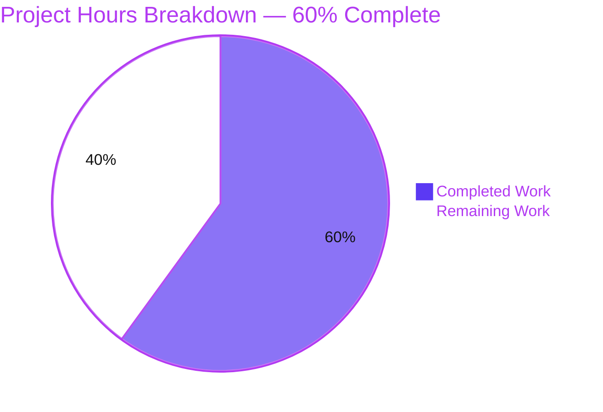
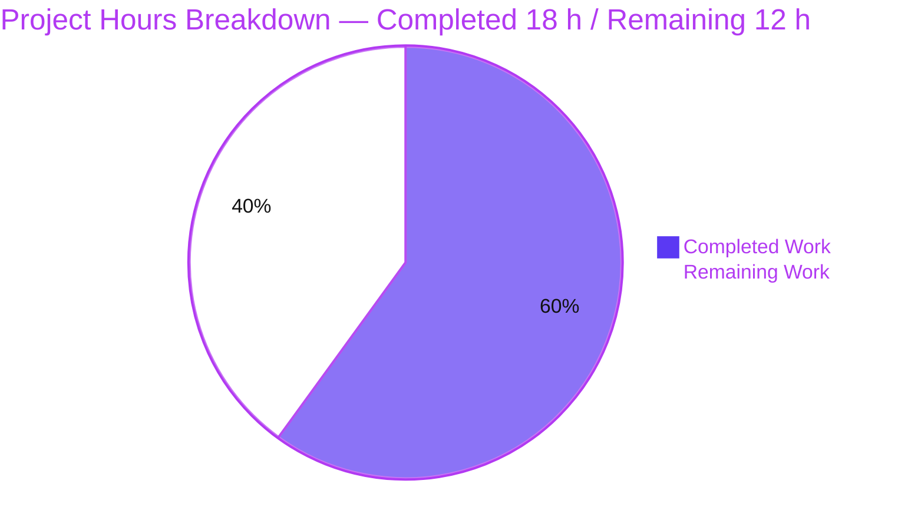

# 1. Executive Summary

## 1.1 Project Overview

`cve-test-fixture` is a single-file Node.js HTTP fixture: `server (2).js` binds port 3000 and answers every request with a constant 14-byte plain-text body, and the manifest declares one dependency, `lodash` 4.17.15, which the entry file loads and never uses. The delivery makes the checkout self-describing: a one-line summary comment above the request handler and a five-line `README.md` carrying the project name, the install step and the run command. No behaviour changed, and no dependency, lockfile or configuration file was touched.

## 1.2 Completion Status

**18 hours completed of 30 total — 60% complete.** Both scoped deliverables are finished and verified byte-for-byte; the remaining 12 hours is path-to-production work.



| Metric | Hours |
|---|---|
| Total Hours | 30 |
| Completed Hours (AI + Manual) | 18 |
| Remaining Hours | 12 |

## 1.3 Key Accomplishments

- The request handler is documented in place: one summary line above the listener (`server (2).js:3`).
- The repository has a README naming the project, the install step and the run command.
- The change is minimal: six inserted lines, zero deletions, neighbours byte-identical.
- The entry file parses and behaves identically: HTTP 200 with the exact 14-byte body on every path and method.
- The response surface is confirmed: four headers, no `Content-Type`, no routing, no error handling.
- The documented run command was executed end to end: one startup line, empty stderr, `Content-Length: 14`.
- The served surface renders in a real browser at desktop and mobile widths: plain text, no console messages, no clipping.
- The declared dependency resolves at its pin; the manifest and lockfile are byte-identical to the base revision.

## 1.4 Critical Unresolved Issues

Both scoped deliverables (2 of 2) are complete and verified. Six items remain open for production:

| Issue | Impact | Owner | ETA |
|---|---|---|---|
| The documented install step cannot be executed in this checkout | A reader or pipeline following `README.md:3` cannot install the one dependency, and the run step then fails at the line-1 import | Repository owner | 1 day |
| No automated regression net — a parse gate and a manual HTTP smoke check are the whole gate | The next edit ships with nothing to catch a behavioural regression | Repository owner | 3–5 days |
| The startup log names `127.0.0.1` while the listener binds the unspecified interface | An operator may believe the service is loopback-only | Maintainer | 0.5 day |
| Port 3000 is hardcoded with no bind-failure handling | A taken port ends startup with a raw stack, and two instances cannot coexist | Maintainer | 0.5 day |
| `lodash` 4.17.15 retains six published advisories, unreachable today | Any future code that dereferences `_` inherits them, and dependency scanners flag the project permanently | Repository owner (accepted by design) | On decision |
| No `.gitignore`, and a non-runnable sample file sits at the root unexplained | A successful install exposes `node_modules/` and a lockfile, and the sample can be mistaken for an entry point | Repository owner | 0.5 day |

## 1.5 Access Issues

No access issues identified. The dependency installs from the public registry at its pinned version; the project needs no repository permission and reads no environment variable, secret or credential.

## 1.6 Recommended Next Steps

1. [High] **(T-1, 3 h)** Make the documented install step executable, then re-verify both documented commands.
2. [High] **(T-2, 4 h)** Put the parse check and the HTTP smoke check behind a test runner and a CI job that runs on every change.
3. [Medium] **(T-3, 2 h)** Add linting and coverage tooling and wire it into that same job.
4. [Medium] **(T-4, 2 h)** Harden startup: a bind-failure message, the address actually bound, and `Content-Length` on HEAD.
5. [Low] **(T-5, 1 h)** Add a `.gitignore` for install output and state the role of the non-runnable sample file.

T-1 to T-5 are Section 2.2's categories, in this order.

# 2. Project Hours Breakdown

## 2.1 Completed Work Detail

| Component | Hours | Description |
|---|---|---|
| R1 — inline documentation of the HTTP request listener (`server (2).js`) | 2 | One summary comment line inserted immediately above the anonymous listener; comment only, no logic, signature, formatting or naming change, and every neighbouring line byte-identical to the base revision. |
| R2 — root README (`README.md`) | 2 | A five-line README at the repository root carrying the project name, the dependency install step and the run command, in that order, with no further section, badge, table, diagram or version pin. |
| Documentation discovery and scope confirmation | 1 | The entry file and the manifest read; the handler's behaviour, the project name, the install step and the run target derived from them rather than invented; the request's `server.js` mapped to the checkout's `server (2).js`. |
| Byte-level change discipline | 1 | The diff confined to one inserted line and one new file; quoting, indentation, line order and both checked-in filenames unchanged; no rename, no mode change, no third path. |
| Parse gate over the tracked JavaScript | 1 | `node --check` executed on every tracked JavaScript file (exit 0), establishing that the delivered insertion is syntactically inert. |
| Whole-package smoke gate | 2 | The declared dependency installed at its pin, the application booted, the listener bound, and one HTTP request answered as documented. |
| Documented commands verified as instructions | 2 | The run command executed verbatim — one startup line, HTTP 200 with the 14-byte body, port released on stop; the quoting tested as load-bearing; the install line's outcome measured and its standing limitation established. |
| Runtime validation of the preserved entry-file behaviour | 5 | The response contract across every path and method, the emitted headers, the absence of routing and error handling, the startup log, the output surface, concurrency, configuration independence and restart determinism. |
| Browser render verification | 1 | The root and an unknown path rendered in a real browser at desktop and mobile widths: 200, no `Content-Type`, plain text in a single `<pre>`, zero console messages, no clipping. |
| Dependency and manifest integrity | 1 | `lodash` 4.17.15 declared, resolved and load-only; the manifest and lockfile byte-identical to the base revision, neither renamed nor regenerated. |
| **Total** | **18** | |

## 2.2 Remaining Work Detail

| Category | Hours | Priority |
|---|---|---|
| Documented install path — make the install step executable in this checkout (conventional manifest and lockfile names, or a reworded install line plus the working command), then re-verify both documented commands end to end | 3 | High |
| Automated regression net — a runner executing the parse gate and the HTTP smoke check (dependency resolves, the application boots, one request returns HTTP 200 with the exact 14-byte body) behind a CI job that runs on every change | 4 | High |
| Quality tooling — linting and coverage, wired into the same CI job so the manual gates this delivery relied on are replaced by an automated quality gate | 2 | Medium |
| Operational robustness — bind-failure handling with a clear message, reporting the address actually bound (or binding loopback explicitly), and matching `Content-Length` on HEAD responses | 2 | Medium |
| Repository hygiene — `.gitignore` for `node_modules/` and install-produced lockfiles, and relocating or annotating the non-runnable sample file at the root | 1 | Low |
| **Total** | **12** | |

## 2.3 Hours Reconciliation

Section 2.1 (18 h) + Section 2.2 (12 h) = 30 h, the Total Hours in Section 1.2. Completion is 18 h ÷ 30 h = 60%, the figure carried in Sections 1.2, 7 and 8. The 18 completed hours cover the delivery in full: both deliverables exist, are byte-exact against the specification, and were exercised at runtime. The 12 remaining hours are path-to-production work that the delivery's agreed scope deliberately excluded — the install step as written cannot resolve, no automated gate or quality tooling exists, and the fixture's startup behaviour is unhardened. None of the remaining hours is unscoped feature work.

# 3. Test Results

The repository ships no test runner, no test file and no coverage tooling — that is deliberate, and no such tooling may be added — so the project's own gates are a parse check over the tracked JavaScript and an HTTP smoke check of the running application. Every check below was executed against the delivered bytes for this assessment: the numbers are measurements, not estimates, and no coverage figure is reported because no coverage tool is configured.

| Area / Category | Framework | Tests | Passed | Failed | Coverage | What This Proves |
|---|---|---|---|---|---|---|
| Entry-file syntax gate | `node --check` on Node 22.23.3 | 2 | 2 | 0 | Not configured | Both tracked JavaScript files parse, so the inserted summary line cannot change how the entry file is interpreted or behaves. |
| Boot, bind, startup log, restart and port release | Background run, `curl`, `/proc` socket inspection, SO_REUSEADDR port probe | 9 | 9 | 0 | Not configured | The application boots on its hardcoded port, prints exactly one 41-byte startup line, leaves stderr empty, restarts with a byte-identical log, and releases the port when stopped. |
| HTTP response contract | `curl` and raw sockets with byte comparison — 13 paths and 8 methods | 28 | 28 | 0 | Not configured | Every path (root, unknown, deep, query, empty query, repeated keys, `/metrics`, `/health`, favicon, encoded traversal, NUL byte, percent-encoded non-ASCII, an 8000-character target) and every method returns HTTP 200 with the byte-exact 14-byte `Hello, World!` body through exactly four headers, no response carries a `Content-Type`, unknown paths never return 404, and HEAD returns 200 with zero body bytes. |
| Malformed framing answered only by the runtime | Raw sockets | 7 | 7 | 0 | Not configured | A garbage request line, a missing HTTP/1.1 `Host`, an unknown method token and a duplicate `Content-Length` each draw the runtime's own 400, an oversized header its 431 and a TLS ClientHello on the plaintext port its 400 — with no stack, path or version disclosed and the process unaffected. |
| Concurrency, idempotence and output surface | 50-way parallel requests, repeated requests, a pipelined raw socket | 5 | 5 | 0 | Not configured | The handler is stateless under load — one status and one byte-identical body across a 50-way burst and across repeated requests — pipelined requests are each answered, and the process writes nothing per request. |
| Restart determinism and configuration independence | Repeat boots, environment overrides, port probes | 3 | 3 | 0 | Not configured | Independent starts produce a byte-identical startup line, and port-related environment overrides are ignored, so the port is a source literal. |
| Dependency resolution at the pin | Pinned install, version probe, `require.resolve`, lockfile comparison | 5 | 5 | 0 | Not configured | The declared `lodash` 4.17.15 installs, agrees with the manifest's pin and the lockfile's resolved version and integrity, and loads from inside the checkout. |
| Documented commands | `npm install`, `node "server (2).js"`, bash | 4 | 3 | 1 | Not configured | The run command boots and serves exactly as documented and its quoting is load-bearing; the install command as written does not resolve in this checkout (exit 254, `npm error code ENOENT`, `Could not read package.json`) and leaves a stray root lockfile that has to be deleted. |

**Totals: 63 checks executed, 62 matching the required behaviour, 1 not** — the documented install step, whose outcome is the limitation recorded in Section 5.2.

**Not covered.** Nothing in the checkout exercises the following, and each is worth a human's attention before release:

- **The install step's success path inside this checkout.** It cannot run as written; the command that does work here is given in Section 9, and the documented command's actual outcome was reproduced and measured.
- **Coverage and static analysis.** No coverage tool, linter, SAST scanner or CI configuration exists, and none may be added, so no coverage figure exists and no style or static-quality gate is applied.
- **The dependency's own code paths.** `lodash` is loaded and never dereferenced, so no library API is exercised and none of its six published advisories is reachable from this code.
- **The wildcard bind seen from outside this host.** The listener was confirmed on the unspecified interface and answered on the host's own addresses, but no off-host client was used.
- **External integration behaviour.** No database, cache, queue, broker, outbound call or scheduled task exists, so nothing was exercised there.
- **The non-runnable sample file at the root.** It is deliberately not executed as an entry point; only a parse check was applied to it.
- **Load and long-duration soak behaviour.** Concurrency was exercised with a 50-request burst; no hours-long soak or resource-growth test was run.
- **TLS, authentication, sessions and rate limiting.** No such surface exists, so no test could cover it.

# 4. Runtime Validation & UI Verification

- ✅ **Application start-up** — `node "server (2).js"` run from the repository root: exactly one 41-byte startup line on stdout, 0 bytes on stderr, the listener bound on port 3000 and owned by the process that was started.
- ✅ **HTTP response contract** — thirteen paths and eight methods plus HEAD, every one HTTP 200 with the byte-exact 14-byte body.
- ✅ **Response headers** — exactly `Date`, `Connection`, `Keep-Alive` and `Content-Length: 14`; no `Content-Type` on any response, confirmed in curl, in raw sockets and in the browser.
- ✅ **Unknown-path behaviour** — an unknown path answered 200, never 404, in curl, in raw sockets and in the browser; the favicon probe, `/metrics` and `/health` were answered by the same catch-all with the same body.
- ✅ **Malformed-request handling** — seven malformed shapes: a garbage request line, a missing HTTP/1.1 `Host`, an unknown method token and a duplicate `Content-Length` each answered by the runtime's own 400, an oversized header by its 431, a TLS ClientHello on the plaintext port by its 400, and a bare request terminator closed with no bytes — with no stack, file path or version disclosed in any response.
- ✅ **Bind failure and second instances** — a second instance on the occupied port exits 1 with an uncaught `EADDRINUSE: address already in use :::3000` while the first keeps serving.
- ✅ **Concurrency and idempotence** — a 50-way parallel burst returned 50 responses of `200` with a 14-byte body each and a single unique body identical to a lone request, and no per-request output appeared on stdout or stderr.
- ✅ **Restart, shutdown and configuration independence** — the startup line and the served body were byte-identical across independent starts; the port was released on stop and rebindable immediately; and port-related environment overrides (`PORT`, `SERVER_PORT`, `HTTP_PORT`, `LISTEN_PORT`) were ignored, with the alternate ports refusing connections.
- ✅ **Served surface in a real browser** — the root, an unknown path, `/metrics`, `/health` and two injection-shaped paths each rendered as plain text in a single `<pre>` with zero console messages of any level, zero failed requests across every navigation, the payload absent from the document, and no clipping or horizontal overflow at 375 px; the text rendered identically at 1920 px.
- ⚠️ **Documented install step** — `npm install` exits 254 with ENOENT on `package.json` and leaves a stray root lockfile behind, so the declared dependency was supplied with the install command in Section 9.

**Never exercised at runtime.** The declared dependency's API — `lodash` is loaded and never dereferenced, so no library call is reachable from this code; the install step's success path inside this checkout, which cannot run as written; the wildcard bind seen from another host or interface; and any database, cache, queue, outbound call or scheduled task, none of which exists. The application has no user interface beyond its single plain-text response, so no further screen or flow was available to drive.

# 5. Compliance & Quality Review

## 5.1 Compliance Matrix

| Deliverable / Requirement | Benchmark | Verified Status | Progress |
|---|---|---|---|
| R1 — summary comment above the request handler (`server (2).js`) | Inline documentation present, placed at the element it describes, accurate for that code | PASS — byte-identical to the fixed text at `server (2).js:3`, the file's sole comment, and the only line the change adds | ✅ |
| R2 — root `README.md` with project name, install command and run command | User-facing documentation present and consistent with the manifest and the entry file | PASS — 5 lines, heading equals the manifest name, the run target exists at its exact checked-in path, and its quoting is load-bearing | ✅ |
| Change minimality — no refactor, reformat or rename | Behaviour-preserving change | PASS — 1 insertion / 0 deletions in the entry file; every neighbouring line and both checked-in filenames byte-identical | ✅ |
| Scope discipline — exactly two files, no third path | Delivered scope equals agreed scope | PASS — 2 changed paths against 7 tracked files; no excluded artefact exists anywhere in the tree | ✅ |
| Dependency integrity — pin untouched, lockfile unregenerated | No dependency or lockfile delta | PASS — both byte-identical to the base revision; the pin resolves at 4.17.15 and matches the lockfile's resolved version and integrity | ✅ |
| Parse gate — tracked JavaScript parses | Code parses | PASS — `node --check` exit 0 on both tracked JavaScript files | ✅ |
| Runtime preservation — response contract, headers, bind, startup log, restart, concurrency | Existing behaviour preserved by a documentation-only change | PASS — 28 response-contract checks, 9 boot/bind/restart checks, 7 malformed-framing checks, 5 concurrency and output checks and 3 configuration checks re-run against the delivered bytes | ✅ |
| Documented runtime absences — no routing, no error handling | Documented behaviour matches the running system | PASS — unknown paths answer 200; malformed framing is answered by the runtime only, with no internal detail disclosed | ✅ |
| Output surface — no per-request output, no sensitive data | Safe operational output | PASS — one startup line, empty stderr under all traffic, and no credential, token or internal hostname in any delivered file or in the process output | ✅ |
| Documented run command | Documented instructions are executable | PASS — verbatim execution boots the application and produces the documented response | ✅ |
| Documented install step | Documented instructions are executable | FAIL — exit 254, `npm error code ENOENT` on `package.json`; the declared dependency must be supplied another way | ⚠️ |
| Advisory posture of the declared dependency | Vulnerabilities unreachable from the delivered code or knowingly accepted | PASS — the six published advisories on `lodash` 4.17.15 are unreachable because the binding is loaded and never dereferenced, and no upgrade is applied or proposed | ⚠️ |

## 5.2 AAP & Rule Divergences and Gaps

| # | What the AAP / Rule Required | What Was Delivered Instead | Why It Diverged | Impact | Remediation |
|---|---|---|---|---|---|
| D1 | The README carries `npm install` as the install command, with the manifest deliberately left unrenamed (`package (2).json`) | `README.md:3` carries that line verbatim against a manifest npm cannot read, so the step installs nothing | The delivered text is exactly what was agreed; the documentation and the checkout disagree because npm resolves a manifest only by the conventional name `package.json` | A reader or pipeline following the README cannot install the one declared dependency, and the run step then fails at `server (2).js:1` | Rename the manifest and lockfile to conventional names, or reword the line to the working command, then re-verify both documented commands (T-1, 3 h) |
| D2 | Run the linter with `--no-fix` on each changed file (rule) | No lint step; the parse gate and the runtime smoke check decided the change | **Sanctioned** — no linter binary or configuration exists in the repository or on the host, and installing one adds the dependency and configuration the agreed scope excludes | No style or static-analysis gate; that class of issue is left to review | Add a linter and wire it into the gate (T-3, 2 h) |
| D3 | A per-change test file may sit beside the file under test (rule) | Nothing added to the tree; the checks ran from a directory outside the checkout | **Sanctioned** — the agreed scope limits the change to two files and forbids adding a test file, runner or lockfile | The checkout carries no executable test, so a maintainer inherits none of the checks | Wire the smoke check into a project script and CI (T-2, 4 h) |
| D4 | Commit all legitimate non-temporary files (rule) | `node_modules/` and a screenshot directory left untracked and uncommitted | **Sanctioned** — `node_modules` must never be committed, and a third or fourth path would breach the two-file limit | Untracked paths sit in the working tree and could be swept into a later commit | Add a `.gitignore` (T-5, 1 h) |
| D5 | A one-line summary above the request handler, its wording fixed by the agreed text | Exactly that line, which quotes the body without its trailing newline and calls it "plain-text" although no media type is declared | The wording was fixed and is a summary rather than a byte-for-byte list; neither statement is false of the code | A reader could infer a declared text type or an exact byte count the handler does not produce | None required; revisit only if the comment is reworded in a later change |
| D6 | The response call, the bind call and the startup log stay byte-identical; no 404 handler, no error handler, no environment configuration, no other hardening | Exactly that, leaving no `Content-Type` on any response, a listener bound to the unspecified interface while the log names `127.0.0.1`, a raw `EADDRINUSE` stack when the port is taken, and HEAD responses without `Content-Length` | Those lines were required to remain unchanged and hardening was excluded from the agreed scope | Operational and diagnostic caveats for anyone reusing the fixture, and a log line that understates its reach | T-4 (2 h) |
| D7 | `additional_file.js` left untouched | Untouched; `node additional_file.js` exits 1 with a runtime TypeError because its body is fenced-markdown sample text | The file is excluded from the agreed scope and is documented as a snippet, not an entry point | A reader may take it for a second entry point and conclude the project is broken | Move it under a samples path or state its role (T-5, 1 h) |
| D8 | No coverage, verification or quality-criteria artefact, and no tooling introduced | None exists: the parse gate plus the HTTP smoke check are the whole gate | The agreed scope excluded adding any of it, and the checkout has no runner, linter, CI or build system | No regression net — the next edit is protected only by a syntax check and review | T-2 and T-3 (6 h) |

**D1 — the documented install step cannot be executed here.** `README.md:3` is byte-identical to the agreed text, and the manifest is untouched at 104 bytes as `package (2).json`. npm resolves a manifest only by the name `package.json`, so running the documented command returns exit 254 with `npm error code ENOENT` and `Could not read package.json`, and no dependency is materialised; the entry file's `require('lodash')` at line 1 then fails. The delivered file is correct against what was agreed, which is why this is a divergence between the documentation and the checkout rather than a defect in the change: correcting it means either renaming two files or rewording one line, and both were outside the agreed scope. Until one of them happens, a reader following the README verbatim cannot start the application (task T-1).

**D2 — no lint step was performed.** The rule for this work asks for the linter to be run with `--no-fix` over each changed file. No lint step ran, and the reason is recorded rather than inferred: there is no linter binary and no linter configuration in the repository or on the host, and installing either would introduce exactly the dependency and configuration file the agreed scope excludes. The change was decided instead by the parse gate (`node --check` exit 0 on both tracked JavaScript files) and by the runtime smoke check. The consequence is real but bounded: nothing in the checkout enforces a style or a static-quality rule, so that class of finding depends on review. Add a linter and wire it into the gate (task T-3).

**D3 — the checks run outside the checkout.** The rule for this work permits an ad-hoc test file beside the file under test. No file was added to the tree: the checks were executed from a working directory outside the checkout, and the dependency was supplied out of tree. The reason is the agreed two-file boundary, which forbids adding a test file, a test runner or a lockfile. The consequence is that the checkout contains no executable test at all — the verification exists as a record, not as something a maintainer can run — so every future edit starts from the same blank slate. Task T-2 wires the parse and smoke checks into the project so they survive as code.

**D4 — untracked dependency and evidence paths.** The rule for this work asks for all legitimate non-temporary files to be committed. Two paths were deliberately left untracked: the installed dependency directory and a directory holding the browser screenshots taken during runtime verification. `node_modules` must never be committed, and adding either path to the tree would breach the two-file boundary that governs the change. Nothing about the deliverable is affected — the change set is exactly the two agreed paths — but the working tree carries untracked directories, and a later blanket stage would sweep them in. Adding a `.gitignore` closes it (task T-5).

**D5 — the summary describes the body rather than listing it.** The agreed text fixes the comment as one summary line, and that is what was delivered. Read closely, the line quotes the body as "Hello, World!" while the literal the handler writes ends with a newline, and it calls the body "plain-text" although the handler declares no media type, so a client has to sniff it. Neither statement is false — a summary need not enumerate bytes, and the body is ASCII text — but a maintainer should not read the line as a specification of an exact byte sequence or of a declared content type. No corrective work is required; the wording is worth revisiting only if the comment is reworded as part of a larger change.

**D6 — the fixture's bare response surface is preserved by design.** The agreed scope requires the response call, the bind call and the startup log to remain byte-identical and excludes a 404 handler, an error handler, environment-variable configuration and any other hardening. Honouring that leaves four observable characteristics: no `Content-Type` on any response; a listener that binds the unspecified interface while the startup log advertises `127.0.0.1`, which understates its reach; a taken port ending startup with a raw `EADDRINUSE` stack and exit 1; and HEAD responses that omit the `Content-Length` a GET carries. Each is pre-existing behaviour the change was required not to alter, and each is worth a scoped follow-up before the fixture is reused anywhere less forgiving (task T-4).

**D7 — a non-runnable file remains at the repository root.** `additional_file.js` was left exactly as found, which is what the agreed scope requires. Its body is fenced-markdown sample text rather than JavaScript, so running it as a program exits 1 with a `TypeError` before any application code loads. It is not an entry point and nothing depends on it, but it sits beside the real entry file with no explanation, and a new reader who runs it will reasonably conclude the project is broken. One line in the README, or a move into a samples path, removes the ambiguity (task T-5).

**D8 — no automated gate or quality tooling exists.** The agreed scope excludes adding a coverage, verification or quality-criteria artefact, and excludes recommending documentation or quality tooling, so none was added — and the checkout independently has no test runner, linter, type checker, coverage tool, build system or CI configuration. The whole automated gate is therefore one parse check plus one HTTP request against a running process. That is proportionate for a six-line documentation change and was sufficient to verify this delivery, but it leaves the repository with no regression net: a future edit to the entry file ships protected only by a syntax check. Task T-2 introduces the runner and the CI job; task T-3 adds linting and coverage.

# 6. Risk Assessment

| Risk | Category | Severity | Probability | Mitigation | Status |
|---|---|---|---|---|---|
| No automated regression net — a parse check and a manual HTTP smoke check are the entire gate, so a future edit can change behaviour unnoticed | Technical | High | High | Wire the parse and smoke checks into a test runner and run them from CI on every change (T-2, 4 h) | Open |
| HEAD responses omit `Content-Length` while GETs carry `Content-Length: 14`, so a client assuming header symmetry can mis-handle a HEAD | Technical | Low | Medium | Set the header explicitly for HEAD, or document the asymmetry (T-4) | Open |
| The declared `lodash` 4.17.15 pin carries six published advisories inside the dependency graph | Security | High | Low today, High if the binding is ever dereferenced | Keep the binding unused — it is loaded and never called today — or upgrade the pin once the fixture's subject changes | Accepted by design |
| Every path, including unknown paths and the browser's favicon probe, is answered 200 with the same body, so a mistyped route or misrouted request is indistinguishable from a healthy one | Security | Low | High | Treat the constant response as the health signal, or add a distinct health route in a scoped change | Open |
| Port 3000 is hardcoded with no bind-failure handling, so a taken port ends startup with a raw `EADDRINUSE` stack and two instances cannot coexist | Operational | Medium | High on a busy host | Handle the bind error with a clear message and make the port configurable (T-4) | Open |
| The startup log names `http://127.0.0.1:3000/` while the listener binds the unspecified interface, so an operator may believe the service is loopback-only | Operational | Medium | Medium | Bind loopback explicitly, or report the address actually bound (T-4) | Open |
| No `.gitignore` exists, so the install step's output — `node_modules/` and a lockfile — would become visible to git | Operational | Low | Medium | Add a `.gitignore` (T-5) | Open |
| The documented install step cannot be executed in this checkout, so any pipeline or developer following the README cannot prepare the one declared dependency | Integration | Medium | High | Make the manifest name conventional or reword the install line, then re-verify both documented commands (T-1, 3 h) | Open |

The fixture has no database, cache, queue, broker, outbound call or external service, so no further integration risk exists. The `lodash` advisories are unreachable through this code path — the binding is loaded and never dereferenced — which is why they are recorded as an accepted design position rather than an active exposure.

# 7. Visual Project Status

**18 hours completed of 30 total — 60% complete.** Completed work is dark blue (`#5B39F3`); remaining work is white (`#FFFFFF`).



## Remaining Hours by Category

| Category | Hours | Priority |
|---|---|---|
| Documented install path (make the install step executable, then re-verify both commands) | 3 | High |
| Automated regression net (parse and HTTP smoke checks in a runner and a CI job) | 4 | High |
| Quality tooling (linting and coverage in the same CI job) | 2 | Medium |
| Operational robustness (bind-failure handling, accurate bound address, HEAD header symmetry) | 2 | Medium |
| Repository hygiene (`.gitignore`, non-runnable sample disposition) | 1 | Low |
| **Total** | **12** | |

## Priority Distribution of Remaining Work

| Priority | Hours | Share of Remaining |
|---|---|---|
| High | 7 | 58% |
| Medium | 4 | 33% |
| Low | 1 | 9% |

The two high-priority categories carry the release-blocking work: making the documented install step executable, and giving the repository a gate that runs on every change. Everything else is hardening and hygiene that can follow without holding the delivery back.

# 8. Summary & Recommendations

**What was delivered.** The checkout is now self-describing. `server (2).js` carries a single summary comment above its request handler — `server (2).js:3`, one inserted line, no logic change — and `README.md` sits at the repository root with the project name, the install step and the run command in five lines. The change set is exactly two paths and six inserted lines, with zero deletions: the manifest, the lockfile and the non-executable sample are byte-identical to the revision the work started from, and every line of the entry file other than the inserted comment survives verbatim. Both deliverables match the agreed text byte-for-byte. The entry file hashes to `19339b18f7e7cb7666ff8e5c9f8b70efe4c679a3` and the README to `59fbbbd634fb02e74a7ba6b3a66bb08026585391`, and nothing in the tracked tree has moved since the two commits that introduced them.

**What was exercised to prove it works.** The entry file parses (`node --check` exit 0), the declared dependency resolves at its pinned version, and the application runs exactly as the README describes: it binds port 3000, prints one 41-byte startup line with nothing on stderr, and answers every path and method with HTTP 200 and the byte-exact 14-byte body through a four-header response that carries no `Content-Type`. Unknown paths answer 200 rather than 404, malformed framing is answered only by the runtime's own 400 and an oversized header by its 431 with no internal detail disclosed, a 50-way parallel burst returned one unique body, independent starts were byte-identical, port-related environment overrides were ignored, and the served surface rendered in a real browser at desktop, tablet and mobile widths with zero console messages, zero failed requests, zero horizontal overflow at 375 px and no clipping. Injection-shaped request targets rendered as inert plain text with the payload absent from the document. In total 63 checks were executed against the delivered bytes; 62 matched the required behaviour and one did not — the documented install step.

**What remains and what the critical path is.** At 60% complete — 18 hours of 30 — every agreed deliverable is finished, and the outstanding 12 hours is the path-to-production work the delivery's scope excluded. Two items are release-blocking and both are scheduled at high priority: the install step must be made executable (rename the manifest and lockfile to conventional names, or reword the line and document the command that works) (T-1), and the repository needs a gate that runs on every change (the parse check and the HTTP smoke check behind a test runner and a CI job) (T-2). Linting and coverage (T-3), startup hardening — a bind-failure message, an accurate bound address, `Content-Length` on HEAD — (T-4) and repository hygiene (`.gitignore`, and a disposition for the non-executable sample) (T-5) follow, at 2, 2 and 1 hours respectively.

**Production readiness.** The change itself is production-ready: it is behaviour-preserving, verified byte-for-byte, and safe to ship to any consumer that already has the dependency installed. The fixture is not production software and is not intended to be — it serves a constant body to every path without authentication, exposes no `Content-Type`, hardcodes its port, has no error handling, and pins a `lodash` release whose six advisories are unreachable only because the binding is never dereferenced. The remaining work therefore concerns the repository's ability to be consumed and maintained, not its correctness: a reader following the README verbatim currently cannot install or start the fixture without the substitute install command in Section 9, and the next edit to the entry file will ship protected only by a syntax check. Success for the next iteration is the 12 hours closed and the completion figure at 100%, at which point the README is executable end to end and every change runs through an automated gate.

**What to carry forward.** Two open classes are the first things to close before this repository is handed to anyone who has not read this guide: the documentation-versus-checkout gap on the install step (T-1) and the absence of any automated protection for the next edit (T-2). Both are recorded with owners and estimates in Sections 2.2 and 6, and neither is a fault in the delivered files — the first is the agreed text meeting a manifest name that npm cannot resolve, and the second is a capability the agreed scope deliberately excluded.

# 9. Development Guide

## System Prerequisites

| Requirement | Verified Version | Notes |
|---|---|---|
| Node.js | 22.23.3 | Any 22.x LTS or newer works; the entry file uses only the core `http` module and one CommonJS dependency. |
| npm | 11.21.0 | Ships with Node 22; needed only for the dependency install. |
| git-lfs | 3.7.1 | Required — the repository's git hooks are LFS wrappers and fail without it. |
| POSIX shell | bash | The documented run command relies on shell quoting. |
| Free TCP port | 3000 | The port is a source literal in `server (2).js`; nothing else in the repository listens. |

No database, cache, queue, container runtime, environment variable or credential is required, and there is no build step: Node runs the source directly.

## Environment Setup

No virtual environment and no configuration file is involved — the project reads no environment variable and no secret, and its port is hardcoded. Work from the repository root, because the documented run command is path-relative to it.

```bash
cd <repository root>
```

## Installing the Dependency

The manifest declares exactly one runtime dependency, `lodash` 4.17.15. The install command that works in this checkout is:

```bash
npm install --no-save --no-package-lock lodash@4.17.15
node -e "console.log(require('lodash').VERSION)"     # 4.17.15
```

The README's `npm install` does not resolve here: npm reads only a manifest named `package.json`, and this one is checked in as `package (2).json`. Running it exits 254 with `npm error code ENOENT` and leaves an untracked stub `package-lock.json` behind, which should be deleted. Do not rename the manifest or the lockfile unless that rename is a deliberate, reviewed change (task T-1).

## Checking the Source Before Running It

```bash
node --check "server (2).js"     # exit 0, no output
```

Quote the filename: it contains a space and parentheses.

## Starting the Application

```bash
node "server (2).js"
# Server running at http://127.0.0.1:3000/
```

The process binds port 3000 and prints exactly one startup line, with nothing written to stderr. To run it in the background, capture its pid so it can be stopped deliberately:

```bash
node "server (2).js" > server.log 2>&1 & echo $!
# later: kill <the pid it printed>
```

## Verifying the Running Application

Response headers and body:

```bash
curl -sS -i http://127.0.0.1:3000/
```

```
HTTP/1.1 200 OK
Date: <timestamp>
Connection: keep-alive
Keep-Alive: timeout=5
Content-Length: 14

Hello, World!
```

Status and byte count in one line, and the exact body bytes:

```bash
curl -sS -o /dev/null -w "%{http_code} %{size_download}\n" http://127.0.0.1:3000/   # 200 14
curl -sS http://127.0.0.1:3000/ | od -c    # H e l l o ,   W o r l d ! \n  -> 14 bytes
```

Every path and every method is answered the same way:

```bash
curl -sS -o /dev/null -w "%{http_code}\n" http://127.0.0.1:3000/definitely-not-a-route   # 200, never 404
curl -sS -X POST -d '{"a":1}' http://127.0.0.1:3000/                                     # Hello, World!
```

No response carries a `Content-Type` header, so a browser renders the body as `text/plain` inside a single `<pre>` element. That is the fixture's intended behaviour, not a fault. The listener binds the unspecified interface even though its startup line names `127.0.0.1`, so it answers on every address of the host that runs it.

## Stopping the Application

`Ctrl-C` in the foreground, or `kill <pid>` with the pid printed at start. The port is released immediately and can be bound again.

## Troubleshooting

| Symptom | Cause | Resolution |
|---|---|---|
| `Error: listen EADDRINUSE: address already in use :::3000`, exit 1 | Another process holds port 3000 and the fixture has no bind-failure handling | Stop the other process, or copy the entry file outside the checkout, change the port literal there, and run the copy |
| `Error: Cannot find module 'lodash'` at `server (2).js:1:11`, exit 1, empty stdout | The declared dependency is not installed | Run the install command above |
| `npm error code ENOENT` / `Could not read package.json`, exit 254 | The manifest is checked in as `package (2).json`, which npm cannot read | Use the install command above, and delete the stub `package-lock.json` npm leaves behind |
| `bash: syntax error near unexpected token '('`, exit 2 | The entry filename was not quoted | Quote it: `node "server (2).js"` |
| `Cannot find module '<cwd>/server (2).js'` | The command was run from another directory | Run it from the repository root |
| `node additional_file.js` exits 1 with a `TypeError` | That file is a fenced-markdown sample, not an entry point | Run `server (2).js` instead |
| A response arrives with no `Content-Type` | The fixture sets no headers by design | Expected; clients must sniff the body |

## Example Usage

```bash
# 1. install the one declared dependency
npm install --no-save --no-package-lock lodash@4.17.15

# 2. confirm the source parses
node --check "server (2).js"

# 3. start the application in the background and note its pid
node "server (2).js" > server.log 2>&1 & echo $!

# 4. exercise it
curl -sS -i http://127.0.0.1:3000/hello/world
curl -sS -o /dev/null -w '%{http_code} %{size_download}\n' http://127.0.0.1:3000/

# 5. stop it with the pid from step 3
kill <pid>
```

# 10. Appendices

## A. Command Reference

| Command | Purpose | Expected Result |
|---|---|---|
| `node --check "server (2).js"` | Parse gate over the entry file | Exit 0, no output |
| `node --check "additional_file.js"` | Parse gate over the sample file | Exit 0 — it parses, though it is not runnable |
| `npm install --no-save --no-package-lock lodash@4.17.15` | Install the declared dependency | Installs `lodash` 4.17.15 into `node_modules/` |
| `node -e "console.log(require('lodash').VERSION)"` | Confirm the dependency resolves | `4.17.15` |
| `node "server (2).js"` | Start the application | `Server running at http://127.0.0.1:3000/` on stdout, empty stderr |
| `curl -sS -i http://127.0.0.1:3000/` | Inspect the full response | `HTTP/1.1 200 OK`, four headers, body `Hello, World!` |
| `curl -sS -o /dev/null -w "%{http_code} %{size_download}\n" http://127.0.0.1:3000/` | Status and byte count | `200 14` |
| `curl -sS http://127.0.0.1:3000/ \| od -c` | Byte-exact body | `H e l l o ,   W o r l d ! \n` (14 bytes) |
| `git diff --numstat 9c2b13b..HEAD` | Confirm the delivered change set | `5 0 README.md` and `1 0 server (2).js` — the delivery's own two paths; the command's full output also lists the two repository metadata documents (`437` and `5997` lines, both additions) |

## B. Port Reference

| Port | Protocol | Binding | Notes |
|---|---|---|---|
| 3000 | HTTP | Source literal in `server (2).js:6` (`listen(3000, …)`, no host argument) | The only port the project opens. It is not configurable by environment variable, and the process binds the unspecified interface even though its startup log prints `127.0.0.1`. |

## C. Key File Locations

| Path | Role |
|---|---|
| `server (2).js` | Entry point: loads `lodash`, creates the HTTP listener, binds port 3000, prints the startup line. The inserted summary comment is line 3. |
| `README.md` | Project name, install command and run command — the whole user-facing documentation. |
| `package (2).json` | Manifest: name `cve-test-fixture`, version 1.0.0, dependency `lodash` 4.17.15, no `scripts` block. |
| `package-lock (1).json` | Resolved lockfile for the single dependency (lockfileVersion 3). |
| `additional_file.js` | A fenced-markdown sample, not an entry point; it parses but exits 1 if run. |

## D. Technology Versions

| Component | Version |
|---|---|
| Node.js | 22.23.3 |
| npm | 11.21.0 |
| git-lfs | 3.7.1 |
| lodash (declared dependency) | 4.17.15 |
| npm lockfile format | lockfileVersion 3 |
| HTTP module | Node core `http` |

## E. Environment Variable Reference

The project reads no environment variable, and none is required to build, run or test it. Four port-related names were supplied while the application was running to establish that the bind is a source literal: `PORT=9999`, `SERVER_PORT=8080`, `HTTP_PORT=8080` and `LISTEN_PORT=8080`. All four were ignored — the listener stayed on 3000 and the alternate ports refused connections — so no environment configuration affects the application's behaviour.

## F. Developer Tools Guide

The repository ships no test runner, linter, type checker, coverage tool, build system or CI configuration, and the agreed scope for this delivery excluded adding any of them, so the available gates are the ones below.

| Task | Tooling used here | Notes |
|---|---|---|
| Parse check | `node --check` | The only static gate that exists. |
| Runtime smoke check | `curl`, or any HTTP client | Confirms the boot, the startup line and the documented response. |
| Listener inspection | `python3` sockets and `/proc/net/tcp`, `/proc/net/tcp6`, `/proc/<pid>/fd` | `ss`, `lsof`, `netstat`, `fuser` and `nc` are not installed on this host. |
| Concurrency check | Any parallel HTTP client | Fifty concurrent requests were used to confirm statelessness under load. |
| Browser render check | Headless Chrome | Confirms the body renders as plain text in a single `<pre>`, with no console messages and no clipping at mobile widths. |

## G. Glossary

| Term | Meaning |
|---|---|
| Fixture | A deliberately minimal, intentionally vulnerable test target used to exercise tooling; it is not production software. |
| Entry file | The file the runtime executes to start the application — here `server (2).js`. |
| Request listener | The anonymous function passed to `http.createServer` that handles every request; it ignores the request object and ends every response with the same body. |
| Plain-text body | The literal response payload `Hello, World!` followed by a newline. It is text in nature; the handler declares no media type, so clients sniff it. |
| Manifest | The package metadata file. Its checked-in name here is `package (2).json`, which is why npm commands that expect `package.json` do not resolve. |
| Lockfile | The file recording the resolved dependency version and integrity hash; here `package-lock (1).json`, untouched by this delivery. |
| Bind address | The interface a listening socket accepts connections on. Called without a host argument, the port binds the unspecified interface while the startup log prints `127.0.0.1`. |
| HEAD request | An HTTP method that asks for headers only; the runtime suppresses the body it would send for a GET, and this response carries no `Content-Length`. |
| `EADDRINUSE` | The runtime error raised when a port is already held; the fixture has no handler for it, so startup ends with the raw stack and exit 1. |
