# Technical Specification

# 1. Introduction

## 1.1 Executive Summary

**Project overview.** The repository publishes a single npm package: `cve-test-fixture`, version `1.0.0`, declared in `package (2).json`. Its working tree is four files and nothing else — that manifest, a `lockfileVersion: 3` lockfile (`package-lock (1).json`), a five-line CommonJS HTTP server (`server (2).js`), and `additional_file.js` (1737 bytes, 72 lines). Git history is four commits on two lines that branch from `701ca5b` ("Add files via upload"): the checked-out branch `1210_01` (and `origin/1210_01`) is HEAD at `9c2b13b`, which adds the fourth file, while `main` (and `origin/main`, `origin/HEAD`) is `94494b6`, where that file is deleted again. There is no README, no documentation folder, no test suite, no CI workflow, no container or deployment artifact, no tag and no stash. The system is therefore best understood as a purpose-built security test fixture rather than an application: a minimal, deterministic Node.js workload whose only substantive content is an exact pin on `lodash` `4.17.15`, a release carrying a known set of published vulnerabilities.

**Core business problem being solved.** Dependency-vulnerability programs need a target small enough that nothing can interfere with the result. This fixture supplies exactly that: one direct dependency, zero transitive dependencies (the lockfile's `packages` map holds precisely two entries, the root `""` and `node_modules/lodash`), a five-line entry point that cannot conceal behavior, and an artifact resolved by absolute URL and fixed by a sha512 Subresource Integrity hash, so the analysed input is byte-identifiable. A scanner that reports nothing, or reports the wrong thing, against this fixture has no ambiguity to hide behind: the expected finding is externally documented and immovable while the pin stands. The repository name `CVE_Repo_1210_01` sequences it within a corpus, indicating its role as the deliberately vulnerable member of a comparison set — the negative case that tooling is supposed to flag.

**Fourth artefact.** `additional_file.js` is committed but inert. Its entire content is a Markdown code fence tagged `javascript` around a snippet of in-memory user-collection helpers — a literal `users` array of five records and five functions that filter, average, look up, create and deactivate them — followed by nine `console.log` calls. Nothing in the tree requires it, no manifest or lockfile entry names it, and it exports nothing. It does not even load: `node additional_file.js` aborts at line 1, column 3 with `TypeError: "" is not a function` and emits nothing. It contributes no capability, no state and no executable surface to the fixture.

**Reachability caveat (important for correct interpretation).** `server (2).js` imports lodash with `const _ = require('lodash')` but never dereferences the binding, so no vulnerable code path is ever executed by the running process. The exposure lives entirely in the declared dependency graph. `additional_file.js` is weaker still: it contains no `require` at all, is reached by no runtime path, and terminates on its first line before any of its helpers is defined, so it adds no reachability of any kind. The fixture therefore tests declarative detection — manifest parsing, lockfile resolution, advisory matching — and does not support any claim about runtime exploitability, in either file.

**Key stakeholders and users.**

| Stakeholder | Interest in the fixture | Interaction with it |
|---|---|---|
| Security and application-security engineers | Confirm a scan pipeline detects a known-vulnerable dependency and reports it accurately | Point an SCA/CVE scanner at a checkout and compare findings to the expected advisory set |
| Vulnerability triage and pipeline owners | Exercise triage, severity routing, suppression and ticket creation on a case with unambiguous ground truth | Automate the scan → triage → remediation loop against the fixture |
| Scanner and SBOM tooling maintainers | Regression-test manifest and `lockfileVersion: 3` parsing, including resolution, integrity and license fields | Feed the two JSON files to parsers and assert on the parsed graph |
| Dependency-remediation workflow owners | Prove that a version bump clears the finding with no other code change | Raise the `lodash` pin, re-resolve the lockfile, re-scan |
| Developers and test engineers | A dependency-light "Hello, World!" HTTP target for port, connectivity and smoke checks | Start the process and issue any request; every request returns the same 14-byte body |

**Expected business impact and value proposition.**

- *Deterministic ground truth.* An exact pin, not a semver range, plus a sha512-verified artifact means repeated scans on the same checkout produce the same finding, which makes the fixture usable as an assertion target in automated checks.
- *Negligible operating cost.* Installation materialised one package in 476 ms in the environment verified for this specification (`npm ci` with Node.js v22.23.3 and npm 11.18.0); there is no build step, no transpiler, no bundler and no configuration.
- *No blast radius.* The fixture holds no data, no credentials, no persistence, no authentication and no outbound network calls, so it can be analysed and executed in disposable environments.
- *Fast remediation feedback.* Because both the vulnerable declaration and the remedy are one line, a full remediation cycle can be demonstrated end to end in seconds.
- *Value is inseparable from the vulnerable pin.* Raising `lodash` to a patched release (4.17.21 or later; 4.18.1 is the current published version) satisfies a remediation workflow but removes the fixture's reason to exist, reducing it to a plain smoke-test server. The pin is the asset, and any shared environment should treat it that way.
- *Not production software.* The process listens on port 3000 with no authentication, no request handling and a known-vulnerable dependency in its graph, so deployment beyond test and analysis environments is out of the question. The Scope sub-sections below state this boundary explicitly.

## 1.2 System Overview

### 1.2.1 Project Context

**Business context and market positioning.** The repository is published at `https://github.com/lakshya-blitzy/CVE_Repo_1210_01.git`, with the work carried on branch `1210_01` at commit `9c2b13b` (HEAD) and `main` at commit `94494b6`. Its packaging identity is the npm package `cve-test-fixture` at version `1.0.0` (`package (2).json`). Both names are descriptive of role rather than product: `CVE_Repo_1210_01` places the repository at a specific position in a numbered corpus of vulnerability-reproduction repositories, and `cve-test-fixture` states that the deliverable is a test fixture. The business context is therefore application-security engineering rather than a commercial market. The fixture occupies the narrow niche of *minimal reproducible subject*: a target whose entire content is one vulnerable dependency pin, small enough that a scanner's output can be attributed to that pin alone and nothing else. Its value is measured in the reliability of the findings produced against it, not in features delivered to end users.

**Current system limitations.** This repository does not replace or upgrade a predecessor system — there is no migration history and no legacy code. `git rev-list --objects --all` shows four commits (`701ca5b` "Add files via upload", `84202e4` and `9c2b13b` "Create additional_file.js", and `94494b6` "Delete additional_file.js") on two lines that branch from `701ca5b`: `main` follows `84202e4` to `94494b6`, which deletes the added file, while `1210_01` commits the same file directly on top of `701ca5b` at `9c2b13b`. The branches have therefore diverged, and `additional_file.js` exists only on the checked-out branch. There are no tags and no stashes. The limitations are the constraints inherent in this construction, each verified directly.

| Limitation | Evidence in the repository | Consequence |
|---|---|---|
| Intentionally vulnerable direct dependency | `package (2).json` lines 4–6 pin `lodash` `4.17.15` | Any environment that scans or runs the fixture inherits a known finding and must treat it as isolated |
| No declared runnable entry point | The manifest has no `main` and no `scripts` (both `undefined` when the file is required from Node) | `npm start` and `npm test` have no defined behaviour; the server must be invoked by file path |
| Cannot start before dependency materialisation | `node "server (2).js"` with no `node_modules` aborts at load time with `Error: Cannot find module 'lodash'`, exit code 1 | An `npm install` or `npm ci` must precede any smoke test; there is no vendored or offline fallback |
| Filenames carry upload artifacts | The names literally end in ` (2)` and ` (1)`, as produced by GitHub's "Add files via upload" | Every path must be quoted in shell commands and is awkward in tooling that derives names from paths |
| Bind address understated by its own log | `listen(3000)` is called with no host argument, binding the unspecified address (all interfaces), while stdout announces `http://127.0.0.1:3000/` | The startup notice describes less exposure than the process actually has |
| One dependency shape only | The lockfile's `packages` map holds exactly two entries, `""` and `node_modules/lodash` | The fixture cannot exercise transitive graphs, multiple ecosystems, semver-range resolution or lockfile conflict handling |
| No verification harness | No test file, no CI workflow, and `.git/hooks` contains only the 14 default `*.sample` stubs | Nothing in the repository fails if the pin or the lockfile changes; verification depends on the consuming pipeline |
| Intent documented nowhere in the tree | No README, no docs folder, no CHANGELOG | The expected finding must be inferred from the package name and the pin |

**Integration with the existing enterprise landscape.** The fixture integrates along three narrow seams and no others.

- *Static analysis seam.* The manifest and lockfile are sufficient for dependency analysis on their own; a scanner needs no install step and no network access to compare the declared and resolved graph against advisory data. This is the primary and intended integration.
- *Install-time seam.* The single external system the repository references is npm's public registry — the lockfile's `node_modules/lodash` entry resolves the artifact at `https://registry.npmjs.org/lodash/-/lodash-4.17.15.tgz` and fixes it with a sha512 Subresource Integrity value. A drifted or tampered registry response fails the install rather than silently altering the analysed input.
- *Runtime seam.* None. A whole-tree scan finds no database, message queue, identity provider, cloud SDK, outbound HTTP client or third-party API reference; the only network behaviour is inbound TCP on port 3000. There is likewise no container definition, orchestrator manifest, or infrastructure-as-code file, so packaging for any deployment platform must be supplied by the consumer.
- *Pipeline seam.* Because the repository defines no automation of its own, wiring a scan job, an assertion on the expected findings and a remediation gate is the consuming organisation's responsibility; the repository contributes only the subject under test.

### 1.2.2 High-Level Description

**Primary system capabilities.**

| Capability | Implementation | Observable result |
|---|---|---|
| Declare one vulnerable dependency at an exact version | `dependencies.lodash = "4.17.15"` in `package (2).json` — an exact pin, not a semver range | A scanner reading only the manifest reports `lodash` `4.17.15`, install state notwithstanding |
| Resolve that dependency reproducibly and verifiably | `package-lock (1).json` (`lockfileVersion: 3`) entry for `node_modules/lodash`, carrying version, resolved URL, sha512 integrity and MIT license | `npm ci` adds exactly one package and verifies the artifact hash |
| Serve a constant HTTP response on port 3000 | Node core `http.createServer(...).listen(3000)` in `server (2).js` | A startup line on stdout, then HTTP `200 OK` with a 14-byte body for every request |
| Present an inert dependency edge for graph-based tooling | `const _ = require('lodash')`, a module-scoped binding that is never dereferenced | Graph builders see the lodash edge; no runtime behaviour is attributable to lodash |

**Major system components.**

| Component | Path | Role | Key properties |
|---|---|---|---|
| Dependency manifest | `package (2).json` | Declares package identity and the single exact dependency pin | 7 lines; no `main`, `scripts`, `license`, `engines` or `devDependencies` |
| Lockfile | `package-lock (1).json` | Freezes resolution: version, tarball URL, integrity hash, license | `lockfileVersion: 3`; 2 package entries; 0 transitive dependencies |
| Runtime entry point | `server (2).js` | Builds and binds the HTTP listener | 5 lines; no exports; effect is entirely a load-time side effect |
| Inert committed snippet | `additional_file.js` | None — it is referenced by nothing and is not executable as committed | 72 lines, 1737 bytes; a Markdown code fence tagged `javascript` around in-memory user-collection helpers; no `require`, no exports; `node additional_file.js` aborts at 1:3 with `TypeError: "" is not a function` and writes nothing |

Components that a reader might expect and that the tree does not contain: no `node_modules` directory in the checkout, no source sub-folders of any kind, no test suite, no configuration files, no dotfiles other than `.git`, and no dependency beyond lodash. The fourth committed file, `additional_file.js`, adds no component in this sense: it is a source artefact with no role in the running system.

**Core technical approach.**

- *Runtime and module system.* Node.js with CommonJS. Two `require` calls exist in the entire repository: `require('lodash')` and `require('http')` from the core library; `additional_file.js` contains none. Verified on Node.js v22.23.3 with npm 11.18.0; the manifest declares no `engines` constraint, so no runtime version is enforced by the repository.
- *No build toolchain.* There is no bundler, transpiler, linter, test runner, or install script, and consequently no build artefact to reproduce — the source files are the deployed artefacts.
- *Declaration-as-subject.* The analysis subject is deliberately decoupled from execution: the pin and its integrity hash define what is assessed, and the unused lodash binding keeps the dependency in the module graph while ensuring no vulnerable code path runs. Detection is therefore declarative by design.
- *Determinism by construction.* The response body is a compile-time literal (`'Hello, World!\n'`), the port is a literal `3000`, and no request data, environment variable or file input reaches the output, so every request yields the identical 14 bytes.
- *Fail-fast startup.* The lodash require is the first statement in the entry point, so a missing dependency aborts the process before any socket is bound rather than degrading at request time.
- *Single-process, stateless operation.* The process holds no state across requests, writes nothing to disk, and remains alive on the event loop after binding.

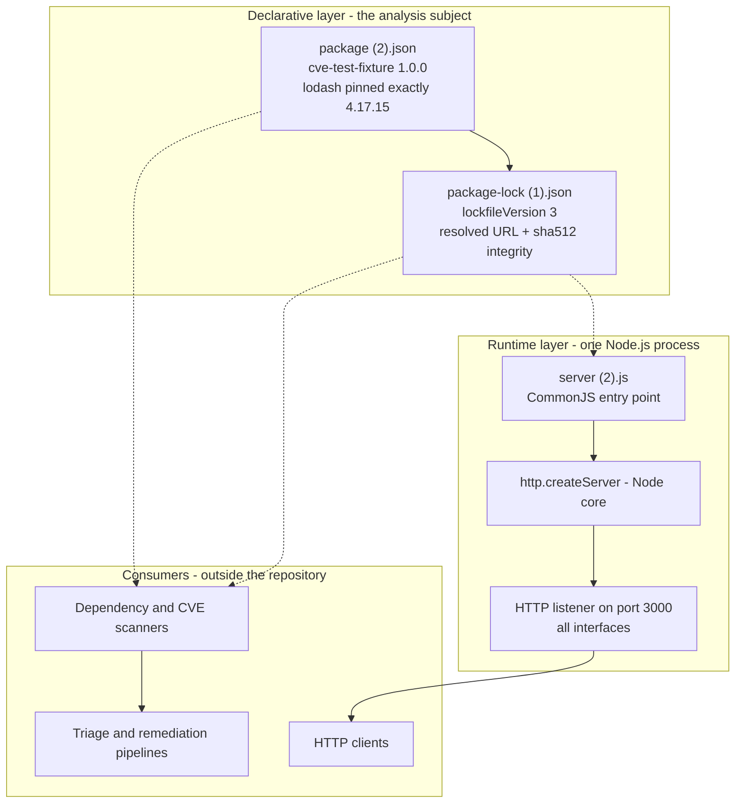

**Component interaction at start-up.** Module evaluation performs the two requires, constructs the server through `http.createServer`, binds port 3000 with a `listening` callback, and leaves the event loop active. The callback fires once and writes the fixed diagnostic line to stdout; thereafter the request listener terminates every response with the same literal body. The lockfile's role in this sequence is indirect: it determines which lodash artifact an install places on disk, which is what the first require resolves against. `additional_file.js` has no place in this sequence — nothing loads it, and an attempt to run it aborts on its first line.

### 1.2.3 Success Criteria

The repository carries no metrics instrumentation, no acceptance tests and no stated thresholds anywhere in its four files. The criteria below are the properties its construction implies, each verified during the analysis behind this specification, and they are what a consumer should measure the fixture against.

**Measurable objectives.**

| Objective | Measure | Observed or target value |
|---|---|---|
| The vulnerable dependency is detectable from declaration alone | Declared version in `package (2).json`, requiring no install | `lodash` exactly `4.17.15` |
| Resolution is reproducible and tamper-evident | Lockfile entries and integrity metadata | 2 package entries (1 direct, 0 transitive); sha512 `8xOcRHvCjnocdS5cpwXQXVzmmh5e5+saE2QGoeQmbKmRS6J3VQppPOIt0MnmE+4xlZoumy0GPG0D0MVIQbNA1A==` |
| The fixture installs cheaply and completely | `npm ci` in a clean environment | 476 ms; 1 package added (Node.js v22.23.3, npm 11.18.0) |
| The process reaches a ready state | stdout line emitted on the `listening` event | `Server running at http://127.0.0.1:3000/` |
| Every request is answered identically | HTTP status, `Content-Length`, body | `200 OK`, 14 bytes, `Hello, World!\n`, for any path, query string and method |
| Detection tooling reports the expected advisory set | Advisories raised for `lodash` `4.17.15` | See the expected-findings table below |

**Expected findings a scanner should surface for the pinned release.** These identifiers come from published advisory data for `lodash` `4.17.15`, not from the repository; they are the assertion target the fixture exists to support.

| CVE | Class and vulnerable API | Fixed in |
|---|---|---|
| CVE-2020-8203 | Prototype pollution via `_.zipObjectDeep`, also reachable through `_.pick`, `_.set`, `_.setWith`, `_.update`, `_.updateWith` | 4.17.19 per the vendor advisory; NVD and Snyk place the boundary at 4.17.20 |
| CVE-2021-23337 | Command injection through `_.template`'s `variable` option | 4.17.21 |
| CVE-2020-28500 | Regular-expression denial of service in `toNumber`, `trim`, `trimEnd` | 4.17.21 |
| CVE-2025-13465 | Prototype pollution via `_.unset` and `_.omit` | 4.17.23 |
| CVE-2026-2950 | Prototype pollution via array-wrapped path segments in `_.unset` and `_.omit` | 4.18.0 per the vendor advisory; Snyk marks everything below 4.18.1 as affected |
| CVE-2026-4800 | Code injection through `_.template` `options.imports` key names | 4.18.0 |

Two further High-severity prototype-pollution advisories reach this version without a CVE identifier in the sources consulted: `SNYK-JS-LODASH-608086` and `SNYK-JS-LODASH-6139239`. Useful negative controls, since they do not affect 4.17.15: `CVE-2019-10744` (fixed 4.17.12), `CVE-2019-1010266` (fixed 4.17.11), `CVE-2018-16487` and `CVE-2018-3721` — all remediated before this release shipped. A scanner that reports any of those four against the fixture is producing a false positive.

**Critical success factors.**

1. *The pin remains exact.* Rewriting `"4.17.15"` as a range such as `^4.17.15` would let resolution drift with registry state and destroy the reproducibility that makes the fixture an assertion target.
2. *Manifest and lockfile remain consistent.* The lockfile's root `""` entry repeats the same name, version and pin; any divergence between the two files invalidates the resolution evidence the fixture is meant to provide.
3. *The dependency edge survives.* Removing either the declaration or the unused `require('lodash')` erases the subject under test. The unused binding is precisely what keeps the dependency in the module graph while leaving the vulnerability unreachable at runtime.
4. *The analysed input stays byte-identifiable.* The sha512 integrity value must be retained; without it nothing proves which artefact was assessed.
5. *The fixture stays isolated.* An unauthenticated listener on all interfaces combined with a known-vulnerable dependency graph means the fixture must not be attached to shared networks, data stores or credentials.
6. *Remediation is demonstrated on a copy, not in place.* Because a version bump converts the fixture into an ordinary smoke-test server, the corrected state should be produced in a branch or a copy so the vulnerable baseline survives for the next comparison.

**Key performance indicators.**

| KPI | Definition | Target |
|---|---|---|
| Advisory coverage | Share of published advisories affecting `lodash` `4.17.15` that the scanner reports | 100% of the expected set above |
| False positives at fixture scope | Findings raised against the four-file tree that do not concern `lodash` `4.17.15` | 0 |
| Transitive dependency count | Lockfile entries beyond the root and the single direct dependency | 0 |
| Install-to-ready cost | Wall time from clean checkout to a listening socket | Install measured at 476 ms; the listener accepted requests within the 2-second settle window used during verification, and start-up was not separately instrumented |
| Response determinism | Share of requests returning the identical 14-byte body | 100% across all paths, query strings and methods |

## 1.3 Scope

### 1.3.1 In-Scope

**Core features and functionalities.**

| Must-have capability | Where it lives | Acceptance condition |
|---|---|---|
| Vulnerable dependency declaration | `dependencies` block of `package (2).json` | The file parses as JSON and declares `lodash` at exactly `4.17.15` |
| Reproducible resolution record | `package-lock (1).json` | `lockfileVersion: 3` with a root `""` entry and a `node_modules/lodash` entry carrying version, resolved URL and sha512 integrity; `npm ci` succeeds against it |
| Constant-response HTTP listener | `server (2).js` | The process boots after installation, emits the startup line, and answers every request with `200 OK` and the body `Hello, World!\n` |
| Inert dependency edge | Line 1 of `server (2).js`, `require('lodash')` | The module graph contains lodash while no lodash function is ever invoked |

**Committed but not in scope as a capability.** `additional_file.js` (72 lines, 1737 bytes) is in scope only as an inventory item of the analysed tree. It is committed on the checked-out branch `1210_01`, contributes no capability, is reached by no request path, and neither widens nor narrows the fixture's purpose — which remains the exact `lodash` pin and its reproducible resolution. The four must-have capabilities above are unchanged by its presence, and no acceptance condition can be written against it.

**Primary user workflows.**

| Workflow | Steps | Expected outcome |
|---|---|---|
| Detect | Check out the branch, run a dependency scanner against the tree without installing | The advisory set for `lodash` `4.17.15` is reported |
| Verify resolution evidence | Parse the lockfile, compare version, resolved URL, integrity hash and license | The assessed artefact is identified as the registry tarball for 4.17.15, MIT-licensed |
| Triage | Map findings to the single dependency, assign severity, check for findings on other packages | Every finding concerns `lodash` `4.17.15`; no false positives elsewhere |
| Remediate | On a copy or branch, raise the pin to a fixed release (4.17.21 or later; 4.18.1 is current), re-resolve the lockfile, re-scan | The advisory set clears with no other code change |
| Smoke test | Install, start the process, request any path, stop it | HTTP `200`, 14-byte body, startup line on stdout |

**Essential integrations.** Three, and only these.

- *npm public registry, install time.* The lockfile resolves the artefact at `https://registry.npmjs.org/lodash/-/lodash-4.17.15.tgz` and fixes it with a sha512 Subresource Integrity value, so the install fails rather than drifting if the artifact differs.
- *Node.js core `http` module, runtime.* The listener is built on the core module; there is no web framework, router or server dependency.
- *Consumer-supplied scanning or CI, analysis time.* The repository itself wires nothing, but its two JSON files are the input such tooling consumes.

**Key technical requirements.**

| Requirement | Detail | Verification |
|---|---|---|
| Node.js with CommonJS module resolution | Two `require` calls; no `engines` constraint is declared, so no version is enforced by the repository | Verified on Node.js v22.23.3 |
| npm able to read `lockfileVersion: 3` | The lockfile targets npm 7 or later | Verified with npm 11.18.0; `npm ci` added 1 package in 476 ms |
| Exactly one third-party dependency, pinned exactly | `lodash` `4.17.15`, with zero transitive dependencies | Lockfile `packages` map holds the root and `node_modules/lodash` only |
| A local TCP port 3000 available | Bound by the literal `listen(3000)`; no host argument, so the unspecified address is used | Bind succeeds on start-up; the process logs its notice |
| No configuration surface | No environment variables or config files are read; the port is a source literal | Whole-tree scan finds no `process.env`, dotenv or config pattern |
| Installation precedes execution | The manifest declares no `main` and no `scripts`; the file is invoked by path | `node "server (2).js"` exits 1 with `Cannot find module 'lodash'` when dependencies are absent |

### 1.3.2 Implementation Boundaries

**System boundaries.** The scope of the system is narrow enough to state exhaustively.

- *Artefact boundary.* Four files at the repository root, with no sub-folders: 105 lines and 2563 bytes in total. `git ls-files` and `git rev-list --objects --all` confirm four blobs on a history of four commits across two divergent lines, and `package (2).json`, `package-lock (1).json` and `server (2).js` remain byte-identical to their blobs at `701ca5b`, so no capability exists outside those three. Only `additional_file.js` is new.
- *Process boundary.* A single Node.js process that binds one TCP port and answers requests in-process. No worker, sidecar, scheduled task or second executable exists; `additional_file.js` is not an executable and is started by nothing.
- *Data boundary.* Nothing is persisted: no file writes, no database, no cache, and no state retained between requests.
- *Network boundary.* Inbound only. No outbound call is made at runtime; the sole external coordinate in the tree is the registry URL that npm consumes at install time.
- *Dependency boundary.* Exactly one third-party package. The manifest declares no `devDependencies`, `peerDependencies` or `optionalDependencies`, and the lockfile records no transitive entry.

**User groups covered.**

| Group | Why it is covered | What remains their responsibility |
|---|---|---|
| Security and application-security engineers | The declared pin and the lockfile are directly scannable | Reporting, ticketing and remediation tracking |
| Scanner and SBOM tooling maintainers | The pair exercises manifest parsing and `lockfileVersion: 3` resolution | Supplying assertions and regression corpora beyond this single pin |
| CI and pipeline operators | The package installs and the process runs from a clean checkout | Providing the pipeline definition, gate and scheduling |
| Developers and test engineers | The listener answers any path and any method identically | Any application behaviour beyond the constant body |

**Geographic and market coverage.** None. Whole-tree scans find no locale, language, currency, region, country, timezone or charset construct; the only content produced is an ASCII English literal, `Hello, World!\n`. The fixture is also not distributed as a consumable library: the manifest declares no `files`, `publishConfig` or `license` field, and there is no tag marking a release. Notably it also declares no `private: true`, so nothing in the manifest blocks an accidental `npm publish`; the only present safeguard is convention. Its market reach is limited to the repositories and pipelines that reference it directly.

**Data domains included.**

| Domain | Content | Location |
|---|---|---|
| Package identity metadata | `cve-test-fixture`, version `1.0.0` | Manifest top level; lockfile header and root `""` entry |
| Dependency declaration data | The single exact pin on `lodash` `4.17.15` | Manifest `dependencies` block |
| Dependency resolution data | Version, resolved tarball URL, sha512 integrity, MIT license | Lockfile `node_modules/lodash` entry |
| Constant response payload | `Hello, World!\n` | Literal in the entry point's request listener |

Domains deliberately absent from the fixture: personal or customer data, credentials and secrets, business records, telemetry, and any log stream beyond the single fixed start-up line. The one data artefact the fixture does not carry is the third-party package's own source, which is fetched at install time and is not present in the checkout.

### 1.3.3 Out-of-Scope

**Explicitly excluded features and capabilities.**

| Excluded capability | Evidence of absence | Implication for readers |
|---|---|---|
| HTTP routing, method handling, path or query parsing | The single listener ignores its `req` argument; no router or framework dependency exists | Every request is answered identically, whatever its path or method |
| Behaviour attributable to `additional_file.js` | Its content is a Markdown code fence around a JavaScript snippet; no manifest, lockfile entry or module references it, and it aborts at load (`TypeError: "" is not a function` at 1:3) | The fourth committed file cannot be exercised as code and yields no acceptance evidence |
| Request validation, body parsing, file upload | No validation, sanitisation or upload construct appears in the tree | The listener cannot be fed malformed input in a meaningful way |
| Authentication, authorisation, sessions, TLS | No auth, session or JWT construct; the core `http` module is used, not `https`, and no certificate is present | The listener is unauthenticated and unencrypted |
| Persistence and caching | No database driver, no file write, no cache | All state is lost on exit; nothing is recorded about requests |
| Configuration management | No environment variable or config file is read; port 3000 is a source literal | Changing behaviour requires editing code |
| Logging and observability | One fixed `console.log`; no logger, metrics or tracing library | There is no per-request visibility and no instrumentation to scrape |
| Test suite | No test file and no test framework is declared | Correctness is asserted only by the consumer |
| CI and CD | No workflow definition exists and `.git/hooks` holds only the 14 default `*.sample` stubs | No automated check runs on change |
| Packaging and release management | No `main`, `scripts`, `license`, `files` or `publishConfig`; no tags | The package is not prepared for publication or versioned release |
| Containerisation and infrastructure as code | No Dockerfile, compose file, Kubernetes manifest or IaC file | Deployment packaging must be supplied externally |
| Internationalisation and localisation | No locale or language construct; only an ASCII English literal | Single-language, single-locale output by construction |
| Performance, scale and abuse controls | No concurrency control, no rate limiting, no limits or timeouts beyond runtime defaults | No throughput or latency guarantee is offered or measured |

**Future phase considerations.** The repository states no roadmap: no TODO, FIXME, stub, placeholder or feature-flag marker exists anywhere in the tree, the four commits carry no planning text, and there are no tags or stashes. The candidates below are inferred from the gaps observed, and readers should treat them as such.

| Candidate phase | Gap it would address | Basis in the repository |
|---|---|---|
| Remediation demonstration | No branch, tag or commit shows the pin corrected | Four commits; the pin is still vulnerable |
| Executable scripts | `npm start` and `npm test` have no defined behaviour | `main` and `scripts` are both absent |
| Automated assertions | Nothing fails if the pin or the lockfile changes | No tests, no CI, no active hooks |
| Packaging for automation | The fixture cannot be run as a job without external packaging | No container or deployment definition |
| Broader detection coverage | One dependency in one ecosystem cannot exercise transitive graphs or range resolution | Lockfile holds 2 entries, all npm |

**Integration points not covered.** No database or cache, no message broker, no identity provider, no cloud SDK, no third-party API, no mail transport, no object storage, no telemetry backend, no webhook, and no inbound integration other than the port-3000 listener. No CI runner, container registry, orchestration platform or secrets manager is referenced. The only external system the repository touches at all is npm's public registry, and only at install time.

**Unsupported use cases.**

- *Production or internet-facing deployment.* The process binds the unspecified address on port 3000 with no authentication, no request handling and a dependency carrying published vulnerabilities; the start-up notice naming `127.0.0.1` understates the actual exposure.
- *Handling any user data.* There is no input path, no storage and no output that reflects input, so no data-processing use case is supportable.
- *Concurrency, throughput or latency guarantees.* No limits, pools or benchmarks exist in the tree, and only single-request behaviour was verified for this specification.
- *Multi-ecosystem or transitive dependency analysis.* The subject is npm-only and single-dependency, so analysis paths that depend on transitive graphs or non-npm ecosystems cannot be exercised here.
- *Runtime exploitability or penetration testing.* The lodash binding is never dereferenced, so no vulnerable code path can be reached; the fixture cannot validate exploit claims, only declarative detection.
- *Licensing attestation for the fixture itself.* The manifest declares no `license` field — the MIT metadata in the lockfile describes lodash, not this package — so the fixture's own licensing status is undeclared.
- *Reuse as a library.* The entry point assigns nothing to `module.exports`, so there is no public interface to import; `additional_file.js` exports nothing either and cannot be loaded in any case.

## 1.4 References

**Repository evidence.**

- `package (2).json` — npm manifest: establishes the package identity `cve-test-fixture` version `1.0.0`, the single exact dependency pin `lodash` `4.17.15`, and the absence of `main`, `scripts`, `license`, `engines`, `private` and any dev, peer or optional dependency.
- `package-lock (1).json` — `lockfileVersion: 3` lockfile: establishes the resolved artifact URL `https://registry.npmjs.org/lodash/-/lodash-4.17.15.tgz`, the sha512 integrity value `8xOcRHvCjnocdS5cpwXQXVzmmh5e5+saE2QGoeQmbKmRS6J3VQppPOIt0MnmE+4xlZoumy0GPG0D0MVIQbNA1A==`, the MIT license of that dependency, and a resolution graph of exactly two entries with zero transitive dependencies.
- `server (2).js` — five-line CommonJS entry point: establishes the inert `require('lodash')` edge, the Node core `http.createServer` usage, the literal port `3000`, the constant `Hello, World!\n` response of 14 bytes, and the fixed stdout notice `Server running at http://127.0.0.1:3000/`.
- `additional_file.js` — 72 lines, 1737 bytes, blob `4f1bd913e0e62a59b86d0482957b372232fd8d7c`: establishes the fourth committed artefact and its inactivity — its whole content is a Markdown code fence tagged `javascript` around in-memory user-collection helpers, it contains no `require` and exports nothing, nothing in the tree references it, and `node additional_file.js` aborts at 1:3 with `TypeError: "" is not a function` while emitting nothing.
- repository root (empty path `""`) — contains only the four files above; establishes the absence of any folder, README, documentation, test suite, CI workflow, container or infrastructure-as-code artifact, and the absence of any `.blitzyignore` file.
- `.git` metadata — commit `701ca5b` ("Add files via upload") plus `84202e4`, `9c2b13b` and `94494b6`; branches `1210_01` at `9c2b13b` (HEAD, with `additional_file.js`) and `main` at `94494b6` (without it); remote `https://github.com/lakshya-blitzy/CVE_Repo_1210_01.git`: establishes a history of four commits on two divergent lines, four blobs in the object store, and the absence of any tag, stash or active hook.

**External sources.**

- [web] GitHub Advisory Database, `GHSA-p6mc-m468-83gw` (CVE-2020-8203) — prototype pollution via `_.zipObjectDeep`, reachable also through `_.pick`, `_.set`, `_.setWith`, `_.update` and `_.updateWith`; fixed in 4.17.19: https://github.com/advisories/GHSA-p6mc-m468-83gw
- [web] NIST National Vulnerability Database, CVE-2020-8203 — the conflicting boundary placing affected versions below 4.17.20: https://nvd.nist.gov/vuln/detail/CVE-2020-8203
- [web] GitHub Advisory Database, `GHSA-35jh-r3h4-6jhm` (CVE-2021-23337) — command injection through `_.template`'s `variable` option; fixed in 4.17.21: https://github.com/advisories/GHSA-35jh-r3h4-6jhm
- [web] GitHub Advisory Database, `GHSA-29mw-wpgm-hmr9` (CVE-2020-28500) — regular-expression denial of service in `toNumber`, `trim` and `trimEnd`; fixed in 4.17.21: https://github.com/advisories/GHSA-29mw-wpgm-hmr9
- [web] GitHub Advisory Database, `GHSA-xxjr-mmjv-4gpg` (CVE-2025-13465) — prototype pollution deleting methods from global prototypes via `_.unset` and `_.omit`; fixed in 4.17.23: https://github.com/advisories/GHSA-xxjr-mmjv-4gpg
- [web] GitHub Advisory Database, `GHSA-f23m-r3pf-42rh` (CVE-2026-2950) — prototype pollution via array-wrapped path segments in `_.unset` and `_.omit`; vendor fix 4.18.0: https://github.com/advisories/GHSA-f23m-r3pf-42rh
- [web] GitHub Advisory Database, `GHSA-r5fr-rjxr-66jc` (CVE-2026-4800) — code injection through `_.template` `options.imports` key names, an incomplete fix of CVE-2021-23337; vendor fix 4.18.0: https://github.com/advisories/GHSA-r5fr-rjxr-66jc
- [web] Snyk, `lodash@4.17.15` vulnerability page — the two High prototype-pollution advisories carrying no CVE identifier (`SNYK-JS-LODASH-608086`, `SNYK-JS-LODASH-6139239`) and the fix ranges applied by advisory consumers: https://security.snyk.io/package/npm/lodash/4.17.15
- [web] lodash changelog (GitHub wiki) — release attribution including the 4.17.15 publication date, 19 July 2019, and the corrupted 4.17.16–4.17.18 builds: https://github.com/lodash/lodash/wiki/Changelog
- [web] npm public registry packument for `lodash` — current published release 4.18.1 (1 April 2026) and the deprecation notice on 4.18.0: https://registry.npmjs.org/lodash
- [web] OpenJS Foundation, "Lodash Rolls Out Major Security Overhaul" — the 4.17.23 security release fixing CVE-2025-13465: https://openjsf.org/blog/lodash-security-overhaul
- [web] Canonical Ubuntu CVE search results for `node-lodash` — fix levels for the advisories that do not affect 4.17.15 (CVE-2019-10744, CVE-2019-1010266, CVE-2018-16487, CVE-2018-3721): https://ubuntu.com/security/cves?package=node-lodash

# 2. Product Requirements

## 2.1 Feature Catalog

This system is a deliberately constructed vulnerability fixture, not an application, so its product surface is exactly what its four files can be shown to do. The catalog below enumerates the five discrete, independently testable features that the repository implements, and nothing beyond them. Four map directly onto the must-have capabilities recorded in [§1.3.1 In-Scope](#131-in-scope); the fifth captures the detection outcome that gives the fixture its purpose. No feature here is aspirational — every one is present in the three analysis-relevant files as committed at `701ca5b` and unchanged at HEAD, and was exercised directly during the analysis behind this specification.

`additional_file.js` contributes no feature to this catalog. It is referenced by no manifest, no lockfile entry and no module, it exports nothing, and it aborts at load as committed, so no capability can be attributed to it and no acceptance evidence can be drawn from it. Its entry appears in the artefact inventory below only to account for the whole tracked tree.

| Feature ID | Feature Name | Category | Priority |
|---|---|---|---|
| F-001 | Exact Vulnerable Dependency Declaration | Dependency Management | Critical |
| F-002 | Reproducible Dependency Resolution | Reproducible Build | High |
| F-003 | Constant-Response HTTP Listener | Runtime Interface | Medium |
| F-004 | Inert Dependency Edge | Dependency Management | High |
| F-005 | Known-Vulnerability Detection Surface | Security Assurance | High |

Status is identical across all five features, and the basis is uniform: each is fully implemented in the committed tree and was reproduced by direct execution on Node.js v22.23.3 with npm 11.18.0.

| Feature ID | Status | Primary Artifact | Requirement Count |
|---|---|---|---|
| F-001 | Completed | `package (2).json` (7 lines) | 4 |
| F-002 | Completed | `package-lock (1).json` (21 lines) | 4 |
| F-003 | Completed | `server (2).js` lines 3–5 | 4 |
| F-004 | Completed | `server (2).js` line 1 | 4 |
| F-005 | Completed | Emergent from F-001 + F-002 | 4 |
| — (not a feature) | Not executable as committed | `additional_file.js` (72 lines, 1737 bytes) | 0 |

### 2.1.1 F-001 — Exact Vulnerable Dependency Declaration

| Attribute | Value |
|---|---|
| Feature ID | F-001 |
| Feature Name | Exact Vulnerable Dependency Declaration |
| Category | Dependency Management |
| Priority | Critical |
| Status | Completed |
| Primary artifact | `package (2).json`, lines 4–6 |

**Overview.** The manifest declares the package identity `cve-test-fixture` at version `1.0.0` together with a single runtime dependency, `lodash`, pinned at the literal string `4.17.15`. The version is an exact pin, not a semver range, so the declared dependency identifies one specific published release rather than a set of acceptable releases.

```json
"dependencies": {
  "lodash": "4.17.15"
}
```

**Business Value.** The pin is the fixture's entire asset. A release carrying six published advisories, declared at an immutable version in a manifest small enough to read at a glance, gives dependency-vulnerability programmes a target whose expected finding is externally documented and cannot drift between runs. Because the declared version is fixed, two scans of the same commit compare equal by construction, which is the property that lets the fixture serve as an assertion rather than a sample. Raise the pin and the fixture stops testing anything worth testing; that trade-off is recorded in [§1.1 Executive Summary](#11-executive-summary) as "the pin is the asset".

**User Benefits.** Security engineers get deterministic ground truth with a single package to attribute findings to; triage owners get a case with no ambiguity to resolve before routing; remediation owners get a remedy that is one line wide. Section 1.1 enumerates the same stakeholder set.

**Technical Context.** The file is seven lines of declarative JSON. It declares no `description`, `main`, `scripts`, `license`, `engines`, `private`, `type`, `devDependencies`, `peerDependencies`, `optionalDependencies`, `resolutions` or `overrides` — a direct check of those properties on the parsed manifest returns an empty object, confirming each is absent rather than empty. The manifest is therefore sufficient on its own for a static scanner: no install step and no network access are needed to observe the vulnerable declaration.

| Dependency Aspect | Detail |
|---|---|
| Prerequisite features | None — F-001 is the root prerequisite of F-002, F-004 and F-005 |
| System dependencies | An npm or compatible toolchain able to parse the manifest; a text-level scanner suffices for declaration-only analysis |
| External dependencies | The npm public registry, referenced indirectly as the resolution target for the pin |
| Integration requirements | npm must be invoked from a directory in which this file is named `package.json`; see [§2.6 Assumptions and Constraints](#26-assumptions-and-constraints) |

### 2.1.2 F-002 — Reproducible Dependency Resolution

| Attribute | Value |
|---|---|
| Feature ID | F-002 |
| Feature Name | Reproducible Dependency Resolution |
| Category | Reproducible Build |
| Priority | High |
| Status | Completed |
| Primary artifact | `package-lock (1).json`, lines 6–20 |

**Overview.** The lockfile freezes what the manifest merely names. A `lockfileVersion: 3` document carries a two-entry `packages` map: the empty-string key `""` describing the root package, and `node_modules/lodash` describing the concrete artifact — version `4.17.15`, the absolute tarball URL `https://registry.npmjs.org/lodash/-/lodash-4.17.15.tgz`, the sha512 Subresource Integrity value, and the `MIT` license.

```json
"resolved": "https://registry.npmjs.org/lodash/-/lodash-4.17.15.tgz",
"integrity": "sha512-8xOcRHvCjnocdS5cpwXQXVzmmh5e5+saE2QGoeQmbKmRS6J3VQppPOIt0MnmE+4xlZoumy0GPG0D0MVIQbNA1A=="
```

**Business Value.** Reproducibility is what makes an assessment defensible. The resolved URL and the integrity hash together identify the exact bytes that an install places on disk, so a result can be attributed to a specific artifact instead of to a mutable version label. This is the "byte-identifiable" property claimed in [§1.2.3 Success Criteria](#123-success-criteria), and it is the reason a drifted or tampered registry response fails the install loudly rather than silently altering the analysed input.

**User Benefits.** Scanner and SBOM maintainers get resolution, integrity and license metadata in a single machine-readable document; auditors get a tamper-evident record; pipeline owners get an install that either produces the reviewed artifact or fails.

**Technical Context.** Twenty-one lines of machine-generated JSON with no executable content. The graph is exactly two entries wide, so there is no transitive resolution to reason about and no lockfile conflict handling to exercise. Verified behavior: `npm ci` against the correctly named lockfile installs exactly one package in 0.414 s, producing a `node_modules` tree of 4.9 MB across 1050 files, and confirms the installed version as `4.17.15`.

| Dependency Aspect | Detail |
|---|---|
| Prerequisite features | F-001 — the root entry mirrors the manifest's name, version and dependency, so a change to the pin invalidates the record |
| System dependencies | npm 7 or later, the first release line to read `lockfileVersion: 3`; verified on npm 11.18.0 |
| External dependencies | The npm public registry, contacted at install time to fetch the URL this file records |
| Integration requirements | The file must be named `package-lock.json` for `npm ci` to accept it, and must sit beside the similarly named manifest |

### 2.1.3 F-003 — Constant-Response HTTP Listener

| Attribute | Value |
|---|---|
| Feature ID | F-003 |
| Feature Name | Constant-Response HTTP Listener |
| Category | Runtime Interface |
| Priority | Medium |
| Status | Completed |
| Primary artifact | `server (2).js`, lines 3–5 |

**Overview.** The entry point builds a Node core HTTP server and binds TCP port 3000. The request listener ignores its `req` argument entirely and terminates every response with a compile-time literal body.

```js
require('http').createServer((req, res) => {
  res.end('Hello, World!\n');
}).listen(3000, () => console.log('Server running at http://127.0.0.1:3000/'));
```

**Business Value.** The fixture must be runnable, not merely readable, if a pipeline is to exercise install, start and readiness checks as well as declaration analysis. A listener that cannot vary its output is the cheapest possible runnable surface: it needs no framework, no routing and no data, so a failure observed against it belongs to the pipeline rather than to the application. This is the "smoke test" capability catalogued in [§1.3.1 In-Scope](#131-in-scope).

**User Benefits.** Developers and test engineers get a dependency-light target for port, connectivity and readiness checks; pipeline operators get a process that reaches a ready state in about 100 ms and answers any request identically, so assertions need no expectations about path or method.

**Technical Context.** Five lines total, no exports, no configuration surface. A whole-file search for `process.env`, `fs.`, `readFile`, `argv` and `config` returns nothing, so no environment value, file or argument can influence output. Verified behavior: `GET /`, `GET /a/b/c`, `GET /x?q=1`, `POST`, `PUT`, `DELETE` and `OPTIONS` all return `200 OK` with `Content-Length: 14` and the body `Hello, World!\n`; `HEAD` returns `200` with no body bytes, which is Node's correct handling of a bodiless method; a `POST` carrying a 100 KB body is accepted and the body discarded. Headers are limited to `Date`, `Connection: keep-alive`, `Keep-Alive: timeout=5` and `Content-Length` — no `Server` header and no rate-limit headers.

| Dependency Aspect | Detail |
|---|---|
| Prerequisite features | F-004 — the listener cannot bind until the module has loaded, and module load fails without the dependency |
| System dependencies | Node.js with CommonJS module resolution; no `engines` constraint is declared, so the repository enforces no version |
| External dependencies | None at runtime — the core `http` module only; no framework, no outbound call |
| Integration requirements | A free local TCP port 3000; a consumer willing to invoke the file by path, since no `scripts` or `main` is declared |

### 2.1.4 F-004 — Inert Dependency Edge

| Attribute | Value |
|---|---|
| Feature ID | F-004 |
| Feature Name | Inert Dependency Edge |
| Category | Dependency Management |
| Priority | High |
| Status | Completed |
| Primary artifact | `server (2).js`, line 1 |

**Overview.** The entry point imports lodash into a module-scoped binding and never uses it: `const _ = require('lodash');` is the first statement of the file, and a whole-file search finds no `_.` dereference anywhere. The dependency is therefore present in the module graph and absent from execution.

**Business Value.** This is the technical decision that keeps the fixture honest about what it demonstrates. A graph-based scanner sees the lodash edge and reports the advisories; a runtime observer sees no vulnerable code path execute. The fixture can therefore validate declarative detection without supporting any claim about exploitability — the caveat stated in [§1.1 Executive Summary](#11-executive-summary). Removing either the import or the never-dereferenced binding collapses the distinction the fixture exists to test.

**User Benefits.** Security engineers can scan the fixture without a containment burden proportionate to a runtime exposure; triage owners can attribute every finding to the declaration rather than to behavior; tooling maintainers can rely on the edge surviving refactors of the trivial server code.

**Technical Context.** Verified behavior: with no `node_modules` present, `node "server (2).js"` aborts before binding any socket with `Error: Cannot find module 'lodash'` and exit code 1, so load-time resolution is a hard prerequisite for the listener. The binding is module-scoped, so nothing exportable depends on it either — the module assigns nothing to `module.exports`, and a search for `module.exports`, `exports.` and `export ` finds no match, leaving the entry point with no public interface. The only other JavaScript file in the tree, `additional_file.js`, contains no `require` at all, so it adds no dependency edge of any kind.

| Dependency Aspect | Detail |
|---|---|
| Prerequisite features | F-001 for the declaration, F-002 for the artifact that the import resolves to |
| System dependencies | CommonJS resolution semantics — Node.js resolves the bare specifier from `node_modules` at load time |
| External dependencies | None at runtime — the imported module is instantiated but never invoked |
| Integration requirements | The dependency must be materialised on disk before start-up; there is no vendored or offline fallback |

### 2.1.5 F-005 — Known-Vulnerability Detection Surface

| Attribute | Value |
|---|---|
| Feature ID | F-005 |
| Feature Name | Known-Vulnerability Detection Surface |
| Category | Security Assurance |
| Priority | High |
| Status | Completed |
| Primary artifact | Emergent from F-001 and F-002 |

**Overview.** The feature is the observable detection outcome produced when standard dependency tooling is pointed at the fixture. It is not implemented in a file; it is the reproducible finding that F-001's pin and F-002's resolution record combine to generate. Verified by running `npm audit` against a resolved install: npm reports one `lodash` entry at severity `high`, covering six advisories, with metadata counts `{high: 1, total: 1}`.

| Advisory | Class | Affected Range | Fixed In |
|---|---|---|---|
| CVE-2021-23337 | Command injection via `_.template` `variable` | < 4.17.21 | 4.17.21 |
| CVE-2020-8203 | Prototype pollution (`_.zipObjectDeep`, `_.set`, `_.pick`) | ≥ 3.7.0 / < 4.17.19 | 4.17.19 |
| CVE-2020-28500 | ReDoS in `toNumber`, `trim`, `trimEnd` | ≥ 4.0.0 / < 4.17.21 | 4.17.21 |
| CVE-2026-4800 | Code injection via `_.template` `options.imports` | ≥ 4.0.0 / ≤ 4.17.23 | 4.18.0 |
| CVE-2026-2950 | Prototype pollution in `_.unset`, `_.omit` | ≤ 4.17.23 | 4.18.0 |
| CVE-2025-13465 | Prototype pollution in `_.unset`, `_.omit` | ≥ 4.0.0 / ≤ 4.17.22 | 4.17.23 |

**Business Value.** A fixture earns its place by producing a finding that can be asserted on. Because the advisory set is externally documented and the declared version cannot drift, the expected output is fixed: a pipeline can compare scan results against the table above and fail loudly on any difference. The consequence for the consumer is that a suppression, a severity misroute or a silently dropped advisory becomes visible rather than absorbed.

**User Benefits.** Vulnerability-triage owners get a case with a known answer for exercising routing and ticketing; scanner maintainers get a regression target for manifest parsing, `lockfileVersion: 3` resolution and advisory matching; remediation owners get guidance that names the exact remedy — npm prints `Will install lodash@4.18.1, which is outside the stated dependency range`, which is itself proof the exact pin is being honoured.

**Technical Context.** Severity is aggregated rather than per-advisory: the six advisories are three High (CVSS 7.2, 7.4 and 8.1) and three Moderate, with none Critical, so npm collapses them into a single `high` entry — which is why the report shows one vulnerability and not six. On the remediation ladder, `4.17.21` clears three, `4.17.23` clears five, and `4.18.1` clears all six. There is no `4.17.22`, so the next patch step from `4.17.21` is `4.17.23`; `4.18.0` must be avoided because the registry marks it deprecated as a bad release. `4.17.15` itself carries no deprecation notice.

| Dependency Aspect | Detail |
|---|---|
| Prerequisite features | F-001 supplies the declaration that is matched; F-002 supplies the resolved version that confirms it |
| System dependencies | An advisory-aware tool with access to a vulnerability database; `npm audit` was used to verify, requiring npm 7 or later |
| External dependencies | GitHub Advisory Database entries and the npm bulk-advisory endpoint, reached over the network at analysis time |
| Integration requirements | None inside the repository — no scan job, gate or assertion is wired here; the consumer supplies them, as [§1.2.1 Project Context](#121-project-context) records |

## 2.2 Functional Requirements

Each feature below is decomposed into numbered requirements in the form `F-XXX-RQ-YYY`. Four properties are recorded per requirement across four tables, kept to four columns or fewer: the requirement statement with its acceptance criteria, priority and complexity; its technical specification; its performance and data criteria; and its validation, security and compliance rules. Priority uses the MoSCoW scale (Must-Have / Should-Have / Could-Have) and is independent of the feature-level priority in [§2.1 Feature Catalog](#21-feature-catalog), which ranks features against each other.

Complexity is uniformly **Low**. That is a finding, not a shortcut: the tracked tree is 105 lines across four files, of which 77 are JavaScript — the five-line entry point and the 72-line `additional_file.js` — and only the five-line entry point executes, because `additional_file.js` cannot load. With one dependency, zero transitive dependencies and no branching logic of any kind, no requirement here carries meaningful implementation risk.

No requirement in this section is attached to `additional_file.js`. It implements no behaviour, is reached by no request path, and yields no acceptance evidence, so it carries no requirement ID, no acceptance criterion and no priority. Every requirement statement below therefore holds exactly as written, unchanged by the file's presence in the tree.

Acceptance evidence for every requirement comes from direct execution rather than from documentation, because the repository contains none — a `search_files` pass for requirements, README or acceptance-criteria documents returns nothing. The declarative-layer and runtime-layer flow described in [§1.2.2 High-Level Description](#122-high-level-description) is the process flow these requirements govern.

### 2.2.1 F-001 — Exact Vulnerable Dependency Declaration

| Requirement ID | Description | Acceptance Criteria | Priority |
|---|---|---|---|
| F-001-RQ-001 | The manifest declares the package identity as `cve-test-fixture` version `1.0.0` | `package (2).json` parses as valid JSON; `name` is a non-empty string equal to `cve-test-fixture`; `version` is a valid semver equal to `1.0.0`; the lockfile root entry repeats both values | Should-Have |
| F-001-RQ-002 | The manifest declares `lodash` at exactly `4.17.15`, with no range syntax | `dependencies.lodash` is the string `4.17.15`; the value contains none of `^`, `~`, `>`, `<`, `*` or `x`; a scanner reading only the manifest reports `4.17.15` regardless of install state | Must-Have |
| F-001-RQ-003 | The production dependency surface is exactly one package | `dependencies` has exactly one key; `devDependencies`, `peerDependencies` and `optionalDependencies` are all absent; the lockfile resolves exactly one package | Should-Have |
| F-001-RQ-004 | The manifest declares no runnable entry point | `main` and `scripts` are both absent from the parsed manifest; `npm start` and `npm test` have no defined behaviour; the entry point is invoked by file path | Could-Have |

| Requirement ID | Input Parameters | Output / Response | Complexity |
|---|---|---|---|
| F-001-RQ-001 | None — the file is read, not called | A parsed object exposing `name` and `version` to npm and to any JSON parser | Low |
| F-001-RQ-002 | None | The literal declaration `"lodash": "4.17.15"` at lines 4–6, visible without an install | Low |
| F-001-RQ-003 | None | An empty result when `devDependencies`, `peerDependencies` and `optionalDependencies` are queried on the parsed manifest | Low |
| F-001-RQ-004 | A file path, supplied by the operator at invocation | No declared command — the consumer must run `node "server (2).js"` directly | Low |

| Requirement ID | Performance Criteria | Data Requirements |
|---|---|---|
| F-001-RQ-001 | Manifest parse completes in well under a millisecond; no measurable cost at any scale | Two scalar string fields: `name`, `version` |
| F-001-RQ-002 | The vulnerable declaration is observable with no install step and no network round trip | The exact version string `4.17.15`, which must correspond to a published release |
| F-001-RQ-003 | A resolved install materialises exactly 1 package in 0.414 s, measuring 4.9 MB across 1050 files | One dependency key name, `lodash`, and its version value |
| F-001-RQ-004 | Not applicable — the absence of automation means there is no command whose runtime could be measured | None |

| Requirement ID | Business Rules and Data Validation | Security Requirements | Compliance Requirements |
|---|---|---|---|
| F-001-RQ-001 | Identity in the manifest must agree with the lockfile header and root entry; any divergence invalidates the resolution evidence | None specific — package identity is not sensitive data | No `license` field is declared, so the fixture's own licensing status is undeclared and cannot be attested |
| F-001-RQ-002 | The version must be an exact published release; substituting a range such as `^4.17.15` destroys the determinism that makes the fixture an assertion target | The known-vulnerable dependency must be retained deliberately and the fixture isolated; no `private: true` is declared, so nothing in the manifest blocks an accidental `npm publish` | Retaining a known-vulnerable dependency is defensible only in an isolated test or analysis context, and must be recorded as an explicit policy exception |
| F-001-RQ-003 | Only production dependencies are in scope; test and build dependency declarations are deliberately absent | No install-script surface is declared, so no `postinstall` hook can execute at dependency-materialisation time | A single-entry inventory makes licence and SBOM attestation trivial; the lockfile records `MIT` for that one entry |
| F-001-RQ-004 | No `scripts` may exist, so no install-time or start-time hook can run from this manifest | The absence of declared scripts removes an install-time code-execution vector | No build, provenance or SBOM tooling is declared by the package itself |

### 2.2.2 F-002 — Reproducible Dependency Resolution

| Requirement ID | Description | Acceptance Criteria | Priority |
|---|---|---|---|
| F-002-RQ-001 | The lockfile records resolution at `lockfileVersion: 3` | `package-lock (1).json` parses as JSON; `lockfileVersion` is `3`; `requires` is `true`; an npm 7 or later client accepts it | Must-Have |
| F-002-RQ-002 | The resolved artifact version and absolute tarball URL are recorded | The `node_modules/lodash` entry holds `version` `4.17.15` and `resolved` equal to `https://registry.npmjs.org/lodash/-/lodash-4.17.15.tgz` | Must-Have |
| F-002-RQ-003 | A sha512 Subresource Integrity digest is recorded for the artifact | The entry holds an `integrity` value beginning `sha512-` whose digest matches the registry artifact; an install of differing bytes fails rather than succeeding | Must-Have |
| F-002-RQ-004 | The root entry mirrors the manifest and the graph resolves zero transitive dependencies | `packages[""]` repeats `cve-test-fixture`, `1.0.0` and the `lodash` pin; the `packages` map holds exactly two keys, `""` and `node_modules/lodash` | Should-Have |

| Requirement ID | Input Parameters | Output / Response | Complexity |
|---|---|---|---|
| F-002-RQ-001 | The manifest, on lockfile generation | A machine-generated lockfile with `lockfileVersion: 3` and `requires: true` | Low |
| F-002-RQ-002 | The declared dependency and registry state at generation time | A frozen pointer to one version string and one absolute URL | Low |
| F-002-RQ-003 | The registry artifact, hashed at generation time | The digest `sha512-8xOcRHvCjnocdS5cpwXQXVzmmh5e5+saE2QGoeQmbKmRS6J3VQppPOIt0MnmE+4xlZoumy0GPG0D0MVIQbNA1A==` | Low |
| F-002-RQ-004 | The manifest's identity and dependency declarations | A root entry echoing all three values, in a `packages` map of exactly two entries | Low |

| Requirement ID | Performance Criteria | Data Requirements |
|---|---|---|
| F-002-RQ-001 | `npm ci` completes in 0.414 s and reports 1 package added | A `lockfileVersion` integer and a `requires` boolean |
| F-002-RQ-002 | The install fetches a single tarball with no transitive walk | Version string, absolute HTTPS URL, and the `MIT` license recorded alongside |
| F-002-RQ-003 | Integrity verification adds no measurable time — it is inside the 0.414 s install | One base64 sha512 digest |
| F-002-RQ-004 | Materialises 4.9 MB across 1050 files in `node_modules` | Two package entries; zero transitive dependency records |

| Requirement ID | Business Rules and Data Validation | Security Requirements | Compliance Requirements |
|---|---|---|---|
| F-002-RQ-001 | `lockfileVersion` must be at least 1 for `npm ci` to run; value 3 requires npm 7 or later | Pinning the lockfile version stops npm re-resolving the graph at install time, so resolution cannot be redirected mid-install | The format is the one npm advisory tooling and SBOM generators consume |
| F-002-RQ-002 | The URL must be absolute and must address the registry artifact for the declared version; a mismatched version or URL is a validation failure | The combination of exact version and absolute URL prevents artifact substitution through range drift | Enables artifact-level identification for licence and provenance reporting |
| F-002-RQ-003 | The digest must be a valid SRI value; a mismatch must fail the install rather than accept the artifact | The integrity hash is the fixture's primary supply-chain control and its only tamper-evidence mechanism | Integrity hashes of this kind are the evidence supply-chain verification controls require |
| F-002-RQ-004 | The root entry must reproduce the manifest's name, version and dependency exactly, or the resolution record is invalid | Zero transitive dependencies means zero transitive supply-chain risk — the whole third-party surface is one auditable artifact | Single-artifact inventory makes licence attestation straightforward; `MIT` is recorded for that artifact |

### 2.2.3 F-003 — Constant-Response HTTP Listener

| Requirement ID | Description | Acceptance Criteria | Priority |
|---|---|---|---|
| F-003-RQ-001 | The process binds TCP port 3000 | `listen(3000)` is called with a literal port and no host argument; a client reaches the socket on the loopback address and on a non-loopback address of the same host | Must-Have |
| F-003-RQ-002 | Every request is answered `200 OK` with the identical 14-byte body | Any path, query string, method and body size returns status `200`, `Content-Length: 14` and the bytes `Hello, World!\n`; `HEAD` returns `200` with no body | Must-Have |
| F-003-RQ-003 | A single startup notice is written to stdout | Exactly one line, `Server running at http://127.0.0.1:3000/`, emitted once on the `listening` event | Should-Have |
| F-003-RQ-004 | Service is sustained across repeated and concurrent requests without throttling | 20 concurrent requests each receive an identical response; 200 sequential requests complete in 0.970 s with no throttling and the process still running | Should-Have |

| Requirement ID | Input Parameters | Output / Response | Complexity |
|---|---|---|---|
| F-003-RQ-001 | The literal port `3000`; no host argument is supplied | A listening socket on the unspecified address, accepting on every interface | Low |
| F-003-RQ-002 | Any HTTP request — path, query, method and body all ignored, bodies of at least 100 KB accepted | `HTTP/1.1 200 OK` with headers `Date`, `Connection: keep-alive`, `Keep-Alive: timeout=5`, `Content-Length: 14`, and the body `Hello, World!\n` | Low |
| F-003-RQ-003 | None | One stdout line naming `http://127.0.0.1:3000/` | Low |
| F-003-RQ-004 | Concurrent or sequential HTTP requests | Identical responses at the same latency, with no limit reached | Low |

| Requirement ID | Performance Criteria | Data Requirements |
|---|---|---|
| F-003-RQ-001 | The listener answered within 2 polls of 50 ms — approximately 100 ms — of process launch | The literal port number `3000` |
| F-003-RQ-002 | 200 sequential requests completed in 0.970 s, about 4.9 ms each including client process start; 20 concurrent requests returned 20 identical bodies with no interleaving artefacts | A compile-time literal body of exactly 14 bytes; no request data is retained or reflected |
| F-003-RQ-003 | One log line per process lifetime; there is no per-request logging | The fixed notice string |
| F-003-RQ-004 | No rate limiting, no concurrency cap and no request timeout beyond Node defaults; the process remained alive after load | No state is retained between requests |

| Requirement ID | Business Rules and Data Validation | Security Requirements | Compliance Requirements |
|---|---|---|---|
| F-003-RQ-001 | The port must be free at start-up; because no host argument is passed the unspecified address is used, which is wider exposure than the notice names | The listener is unauthenticated, unencrypted and bound to all interfaces, so it must never be exposed beyond an isolated environment | The endpoint fails any control requiring authenticated or encrypted transport |
| F-003-RQ-002 | Status must be `200` for every request; the body must be byte-identical every time; `HEAD` must carry no body | No request input is validated, reflected or persisted, so no input-validation, injection or data-exposure surface exists | No personal or customer data is processed, so data-protection obligations are not engaged |
| F-003-RQ-003 | The notice must fire exactly once, from the `listening` event, and must not repeat per request | Log content is a fixed literal, leaving no path for log injection or data leakage through logging | No per-request audit trail exists, so the service cannot satisfy access-logging requirements |
| F-003-RQ-004 | No request may alter the treatment of any later request; the process persists on the event loop | The absence of rate limiting and resource limits means denial-of-service is not mitigated; acceptable only under isolation | No availability commitment is made and none can be asserted, so no SLA is supportable |

### 2.2.4 F-004 — Inert Dependency Edge

| Requirement ID | Description | Acceptance Criteria | Priority |
|---|---|---|---|
| F-004-RQ-001 | The entry point imports `lodash` as its first statement | Line 1 of `server (2).js` is `const _ = require('lodash');`; graph-based tooling that parses the module discovers a lodash edge | Must-Have |
| F-004-RQ-002 | The lodash binding is never dereferenced | A whole-file search for `_.` finds no usage; the binding `_` appears only in the import statement; no lodash function is invoked at any point | Must-Have |
| F-004-RQ-003 | Module load fails fast when the dependency is absent | With no `node_modules`, `node "server (2).js"` exits with code 1 and `Error: Cannot find module 'lodash'`, before any socket is bound | Should-Have |
| F-004-RQ-004 | The entry point exports no public interface | Searching the file for `module.exports`, `exports.` and `export ` finds no match; requiring the module yields no application interface | Could-Have |

| Requirement ID | Input Parameters | Output / Response | Complexity |
|---|---|---|---|
| F-004-RQ-001 | The bare module specifier `lodash` | A resolved dependency edge in the module graph, discoverable without executing the module | Low |
| F-004-RQ-002 | None — the binding is module-scoped and unused | No lodash code path executes, so the vulnerable API surface is unreachable at runtime | Low |
| F-004-RQ-003 | The presence or absence of `node_modules/lodash` on disk | Exit code 1 with `Cannot find module 'lodash'` when absent; normal start-up when present | Low |
| F-004-RQ-004 | None | An empty export object; no callable API surface | Low |

| Requirement ID | Performance Criteria | Data Requirements |
|---|---|---|
| F-004-RQ-001 | Module instantiation cost is negligible and produces no measurable change to the ~100 ms startup | The bare specifier string `lodash` |
| F-004-RQ-002 | Zero runtime cost — the binding is loaded and never used | No data flows from lodash into or out of the process |
| F-004-RQ-003 | Failure occurs before any socket bind, so no partially initialized listener can exist | Depends solely on the presence of the resolved module on disk |
| F-004-RQ-004 | Not applicable — there is no exported surface whose latency could be measured | No exported members |

| Requirement ID | Business Rules and Data Validation | Security Requirements | Compliance Requirements |
|---|---|---|---|
| F-004-RQ-001 | The import must remain present even though unused — it is the graph edge the fixture exists to expose | Keeps the vulnerable dependency visible to dependency-graph tooling, which is the precondition for detection | Supports SBOM completeness: the runtime dependency appears in the inventory rather than being omitted |
| F-004-RQ-002 | A static check must confirm no `_.` usage; adding one would make the vulnerability reachable and change the fixture's semantics | This is the control that removes runtime exploitability from the picture and makes the fixture safe to run under isolation despite a vulnerable graph | Supports the defensible position that a known-vulnerable dependency may be present but unreachable, a distinction any waiver must state |
| F-004-RQ-003 | Declaration order matters — the require precedes server construction, so absence is fatal rather than degraded | Failing fast prevents an unverified partial listener from accepting traffic | Deterministic startup supports reproducibility evidence |
| F-004-RQ-004 | The entry point must remain non-importable as a library, since nothing is assigned to `module.exports` | No exported API means nothing can be invoked with externally controlled arguments | An absent interface carries no API security review obligation |

### 2.2.5 F-005 — Known-Vulnerability Detection Surface

| Requirement ID | Description | Acceptance Criteria | Priority |
|---|---|---|---|
| F-005-RQ-001 | Standard advisory tooling reports the six-advisory set for the pinned version | `npm audit` lists all six advisories listed in [§2.1.5](#215-f-005--known-vulnerability-detection-surface), identified by CVE and covering the pinned `4.17.15` | Must-Have |
| F-005-RQ-002 | Findings aggregate into a single high-severity entry for the package | The report holds one `lodash` entry with severity `high` and metadata counts `{high: 1, total: 1}` | Should-Have |
| F-005-RQ-003 | Remediation guidance names a version outside the declared range | The report states `Will install lodash@4.18.1, which is outside the stated dependency range` | Should-Have |
| F-005-RQ-004 | No finding is attributed to any package other than lodash | Every reported finding concerns `lodash`; none of the four historically-fixed lodash CVEs is reported against `4.17.15` | Must-Have |

| Requirement ID | Input Parameters | Output / Response | Complexity |
|---|---|---|---|
| F-005-RQ-001 | The manifest and lockfile, plus access to advisory data | Six advisory records: CVE-2021-23337, CVE-2020-8203, CVE-2020-28500, CVE-2026-4800, CVE-2026-2950, CVE-2025-13465 | Low |
| F-005-RQ-002 | The same tree | One aggregated entry with severity `high`, the range `<=4.17.23`, and the six advisories listed beneath it | Low |
| F-005-RQ-003 | The same tree | A fix recommendation of `lodash@4.18.1`, flagged as outside the declared range | Low |
| F-005-RQ-004 | The same tree | A finding set containing no entry for `node_modules/lodash`'s dependants and no package besides lodash | Low |

| Requirement ID | Performance Criteria | Data Requirements |
|---|---|---|
| F-005-RQ-001 | A declaration-level scan needs no install and no install-time network access; advisory lookup requires network access to the advisory source | Six advisory records, each with an identifier, an affected range and a fixed version |
| F-005-RQ-002 | Aggregation keeps the report a fixed size regardless of how many advisories match | Severity metadata counts — verified as `{high: 1, total: 1}` — plus `prod: 2`, `total: 1` for dependencies |
| F-005-RQ-003 | The remedy is one line wide, so a full remediation cycle is demonstrable in seconds | The recommended target version, `4.18.1` |
| F-005-RQ-004 | No triage cost is incurred for false positives at fixture scope | No data exists for any package other than lodash |

| Requirement ID | Business Rules and Data Validation | Security Requirements | Compliance Requirements |
|---|---|---|---|
| F-005-RQ-001 | All six advisories must be reported; a scanner surfacing fewer is under-reporting against its own advisory source | Detection here is declarative only — the fixture validates declaration-level SCA and cannot support any claim about runtime exploitability | Satisfies the evidentiary need for reproducible, documented vulnerability findings |
| F-005-RQ-002 | Aggregate severity is the maximum across matched advisories: three High and three Moderate, with none Critical, yields `high` | Severity routing must tolerate aggregation; a pipeline expecting six separate findings will mis-count | Supports severity-based policy routing, for instance a rule that High blocks a merge |
| F-005-RQ-003 | Because the pin is exact, the recommended fix necessarily falls outside the declared range, so the forced-upgrade path is expected rather than anomalous; `4.18.0` must be avoided as a deprecated bad release | Remediation must be demonstrated on a copy or branch, leaving the vulnerable baseline intact for the next comparison | Supports policy enforcement proving a vulnerability clears after an upgrade |
| F-005-RQ-004 | CVE-2019-10744, CVE-2019-1010266, CVE-2018-16487 and CVE-2018-3721 were all remediated before this release shipped and must not appear; the two unbranded High prototype-pollution findings sit outside npm's six | False positives erode triage trust, so the fixture deliberately supplies negative controls | Supports false-positive measurement as a control metric; [§1.2.3](#123-success-criteria) sets the target at zero |

## 2.3 Feature Relationships

Only relationships that the four files or the verified runtime behavior demonstrate are recorded here. The dependency chain is short and fully traceable: F-001 is the root, and every other feature either consumes the declaration or depends on an artifact that the declaration caused to be resolved. `additional_file.js` participates in no feature relationship of any kind.

### 2.3.1 Feature Dependency Map

The arrows below are all confirmed by direct observation. The mirroring of the pin into the lockfile root entry is visible at `package (2).json` lines 4–6 against `package-lock (1).json` lines 10–12. The requirement that an artifact exist on disk before the module can load was reproduced as `Error: Cannot find module 'lodash'` with exit code 1 when `node_modules` is absent. The ordering of load before bind follows from the entry point, where the `require` on line 1 precedes the `createServer(...).listen(...)` chain on lines 3–5.

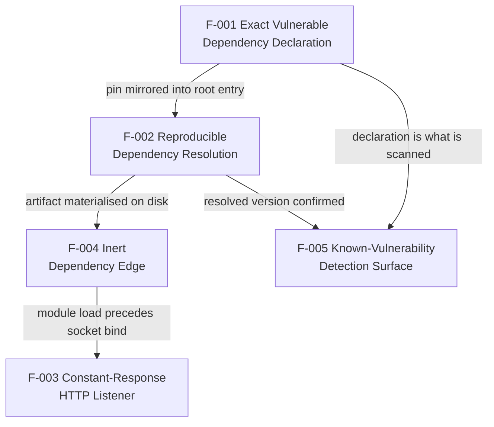

| Dependency | Type | Basis in the system |
|---|---|---|
| F-002 → F-001 | Hard prerequisite | The lockfile's root `""` entry repeats the manifest's name, version and dependency; a change to the pin invalidates the resolution record |
| F-004 → F-002 | Hard prerequisite | `require('lodash')` resolves against `node_modules`, which only exists after the lockfile's recorded artifact is installed; absent it, the process exits 1 |
| F-003 → F-004 | Hard prerequisite | The import is the first statement, so the module cannot reach `createServer` without it |
| F-005 → F-001 | Hard prerequisite | Declaration-level tooling detects the vulnerable version by reading the manifest, needing no install |
| F-005 → F-002 | Soft prerequisite | The resolved version and integrity record are what let a finding be attributed to a specific byte-identical artifact |
| F-001 ↔ F-004 | Mutual reinforcement | The declaration puts lodash in the dependency graph; the never-dereferenced import keeps it in the module graph while leaving it out of execution. Removing either collapses the feature set |

The start-up order these dependencies imply — resolve, import, construct, bind, announce — is the process flow already diagrammed in [§1.2.2 High-Level Description](#122-high-level-description); it is not duplicated here.

### 2.3.2 Integration Points

Four external seams and one internal one. Three of the four are the whole integration surface of the system; the fourth is absent by construction.

| Integration Point | Boundary | Timing and Direction |
|---|---|---|
| npm public registry | `https://registry.npmjs.org/lodash/-/lodash-4.17.15.tgz` | Install time, outbound, one tarball fetch; the only external coordinate in the tree |
| Advisory data source | GitHub Advisory Database / npm bulk-advisory endpoint | Analysis time, outbound; nothing inside the repository wires this |
| Node core `http` module | `require('http')` | Runtime, in-process; no framework, router or server dependency sits between them |
| HTTP clients | TCP port 3000, unspecified bind address | Runtime, inbound; every request answered identically |
| Module resolution | The `node_modules` tree on the local filesystem | Load time; a filesystem read, not a network call |

Notably absent as integration points, consistent with [§1.3.3 Out-of-Scope](#133-out-of-scope): no database or cache, no message broker, no identity provider, no cloud SDK, no third-party API, no telemetry backend and no container registry reference anywhere in the tree. `additional_file.js` is not an integration point either — it opens no socket, issues no call and requires no module.

### 2.3.3 Shared Components

The five features are served by a small set of elements that more than one of them touches. These are the coupling points that matter for maintenance.

| Shared Element | Features That Use It | Why It Is Shared |
|---|---|---|
| The lodash dependency edge | F-001, F-002, F-004, F-005 | It is the single entity all four features address — declared by F-001, resolved by F-002, imported by F-004 and matched by F-005 |
| `package (2).json` | F-001, F-002, F-005 | F-001's artifact, the source the lockfile root entry mirrors, and the sole input a declaration-level scanner reads |
| The version string `4.17.15` | F-001, F-002, F-004, F-005 | Appears in the manifest pin, the lockfile's version field and resolved URL, the artifact the integrity digest covers, and the key the advisory ranges match against |
| The single Node.js process | F-003, F-004 | One process hosts both the resolved module and the listening socket; the import completes before the bind |
| The `listening` event callback | F-003 | The readiness signal a consumer waits on, emitted once at bind time |
| The sha512 integrity digest | F-002, F-005 | Resolution evidence for F-002 and the artifact-identity evidence underpinning F-005's findings |

The consequence of this overlap is that four of the five features share a single point of failure: the three-line dependency block. [§1.2.3](#123-success-criteria) frames the same overlap as a critical success factor — both the declaration and the unused import must survive for the subject under test to remain intact.

### 2.3.4 Common Services

None exist, and the absence is verifiable rather than assumed. The tree contains no service layer, no shared library, no middleware, no configuration service, no logging service, no caching tier and no data-access layer. Every feature is implemented directly in one of the three analysis-relevant files, and no file is imported by another: `server (2).js` requires only `lodash` and the Node core `http` module, while `additional_file.js` imports nothing at all and is imported by nothing. There is therefore still no internal module graph — the fourth file strengthens the finding rather than qualifying it. This is consistent with the single-process, stateless, no-persistence boundary described in [§1.3.2 Implementation Boundaries](#132-implementation-boundaries).

## 2.4 Implementation Considerations

Each feature is assessed against the five implementation dimensions below. Where a consideration is a genuine risk it is stated as one; where a dimension is simply not engaged by a feature of this size, that is stated rather than padded.

### 2.4.1 F-001 — Exact Vulnerable Dependency Declaration

| Dimension | Consideration |
|---|---|
| Technical constraints | The manifest is JSON with no `engines` field, so no Node.js version is enforced and the declared runtime is whatever the operator supplies; verified on Node.js v22.23.3. The pin must remain an exact string — a `^` or `~` prefix would let resolution drift with registry state and destroy the fixture's determinism. The file is 7 lines with no `main`, `scripts`, `license`, `private` or `type`, so the package declares no automation and no licence |
| Performance requirements | None. Parsing a 104-byte JSON file is immeasurable; the declarative path requires no install and no network access |
| Scalability considerations | Not engaged. The manifest is a static declaration with no runtime role; there is nothing to scale beyond the scanner reading it |
| Security implications | The feature deliberately places a known-vulnerable dependency in the graph, so any environment that installs or scans the fixture inherits the finding and must treat the fixture as isolated. No `private: true` is declared, so nothing in the manifest prevents an accidental `npm publish`; convention is the only safeguard. Positive controls do exist: declaring no `scripts` removes the install-hook execution vector entirely |
| Maintenance requirements | The declaration is the fixture's asset, so changes must be deliberate. Bumping the pin to clear a finding converts the fixture into an ordinary smoke-test server; that correction belongs on a branch or a copy, leaving the vulnerable baseline intact. Any dependency addition widens the subject under test beyond a single attributable package and should be resisted |

### 2.4.2 F-002 — Reproducible Dependency Resolution

| Dimension | Consideration |
|---|---|
| Technical constraints | `lockfileVersion: 3` requires npm 7 or later — verified on npm 11.18.0. The lockfile must stay textually consistent with the manifest: any edit to the pin that is not accompanied by re-resolution leaves the root `""` entry describing a different dependency than the manifest declares, invalidating the evidence |
| Performance requirements | An install of the recorded artifact completed in 0.414 s, producing a `node_modules` tree of 4.9 MB across 1050 files. Because the graph is exactly two entries wide, the install performs no transitive walk and its cost is bounded by one tarball |
| Scalability considerations | Not engaged. The dependency graph cannot grow without a deliberate manifest change, and it is flat by construction |
| Security implications | This feature carries the fixture's only supply-chain control. The absolute `resolved` URL plus the exact version prevent substitution through range drift, and the sha512 integrity digest makes the analyzed input tamper-evident — a differing artifact fails the install rather than passing silently. Zero transitive dependencies mean the entire third-party surface is one auditable artifact. Conversely, a drifted or unavailable registry makes the fixture uninstallable: there is no vendored fallback and no offline path |
| Maintenance requirements | The lockfile is machine-generated and should be regenerated rather than hand-edited. If the pin ever moves, both files must move together and the integrity digest must be refreshed from the registry; a digest carried over from a previous version would fail the install. The lockfile should be reviewed as evidence alongside the source it describes |

### 2.4.3 F-003 — Constant-Response HTTP Listener

| Dimension | Consideration |
|---|---|
| Technical constraints | Port 3000 is a source literal, so changing it requires editing `server (2).js`; there is no environment variable or configuration file. `listen(3000)` passes no host argument, so the process binds the unspecified address — every interface — which is wider exposure than the stdout notice naming `127.0.0.1` implies. Start-up fails outright if port 3000 is already in use |
| Performance requirements | The listener answered within approximately 100 ms of process launch. 200 sequential requests completed in 0.970 s — about 4.9 ms each including client process start — and 20 concurrent requests were served without interleaving artefacts. No latency target is declared by the repository; these figures are observations, not commitments |
| Scalability considerations | Untested and unmeasured beyond the figures above, and no limits, pools, worker processes or timeouts are configured. The service is stateless and holds nothing between requests, so it imposes no per-connection cost beyond Node's own HTTP handling, but no throughput or latency guarantee can be asserted and none is offered |
| Security implications | The listener is unauthenticated, unencrypted and reachable on all interfaces. There is no rate limiting, no concurrency cap, no request-size limit and no timeout beyond Node defaults, so denial-of-service is unmitigated; a 100 KB body was accepted and discarded without complaint. Against that, the response is a compile-time literal: no request data is reflected, stored or logged, so there is no input-validation, injection, path-traversal or data-exposure surface, and no credential or secret is present to leak. The practical conclusion is that isolation, not hardening, is the control |
| Maintenance requirements | The code is five lines and complete as written; it has no parameters to tune and no dependencies to update. The one maintenance trap is the notice string: it names `127.0.0.1` while the bind covers all interfaces, so anyone reusing this listener elsewhere should treat the log line as descriptive prose rather than as a statement of the bind scope. Any added routing or logging would expand the fixture beyond its remit |

### 2.4.4 F-004 — Inert Dependency Edge

| Dimension | Consideration |
|---|---|
| Technical constraints | CommonJS resolution semantics apply: the bare specifier `lodash` is resolved from `node_modules` at load time, so the dependency must be materialised on disk before start-up. The import must remain the first statement, because it is what produces the fail-fast behavior and what keeps the dependency in the module graph |
| Performance requirements | None measurable. Module instantiation is part of the ~100 ms start-up, and the binding is never dereferenced, so the feature contributes no runtime cost |
| Scalability considerations | Not engaged. The edge is a static property of the module graph |
| Security implications | This is the feature that delimits runtime exposure. Because the binding is never used, no vulnerable code path executes and the process is safe to run under isolation despite a graph carrying six advisories. The corresponding maintenance hazard is asymmetric: a future contributor adding a single `_.` call would make the vulnerable APIs genuinely reachable while changing nothing visible about the file's length or structure. That property deserves an explicit comment or a guard if the fixture is to survive editing |
| Maintenance requirements | Two invariants must be enforced by review because nothing in the repository tests them: the import stays present, and no lodash function is ever called. Both are verifiable by a whole-file search, which is worth wiring into any pipeline that consumes the fixture. The fail-fast behavior is intentional and should not be softened into a fallback, since a degraded start would produce a listener in an unverified state |

### 2.4.5 F-005 — Known-Vulnerability Detection Surface

| Dimension | Consideration |
|---|---|
| Technical constraints | Detection depends on external advisory data, so a scanner needs network access to an advisory source even though the declaration itself is readable offline. `npm audit` requires npm 7 or later. The expected finding is fixed only while the pin holds |
| Performance requirements | One aggregated entry keeps the report a constant size regardless of how many advisories match; the remedy is one line wide, so a full remediation cycle is demonstrable in seconds |
| Scalability considerations | The subject is npm-only and single-dependency, so this feature cannot exercise transitive graphs, multi-ecosystem inventories or lockfile conflict handling. Its coverage is one package and one ecosystem |
| Security implications | The finding set is externally published and immovable, which is exactly what makes the fixture useful as an assertion target — but it also means the fixture cannot validate exploitability claims, since the vulnerable code paths are unreachable. The remediation target must be chosen carefully: `4.17.21` clears three advisories, `4.17.23` clears five, and `4.18.1` clears all six and is the registry's `latest`. There is no `4.17.22`, so a naive "next patch" step is impossible, and `4.18.0` is deprecated as a bad release and must be avoided. `4.17.15` itself carries no deprecation notice |
| Maintenance requirements | The expected-findings table in [§2.1.5](#215-f-005--known-vulnerability-detection-surface) is dated by the advisory database and will grow as new advisories are published against the pinned range; it is the one artifact in this specification that is expected to change without any change to the repository. Consumers should therefore assert on the specific advisories they depend on rather than on a total count, because npm aggregates the set into a single entry. Severity routing must also tolerate aggregation: a pipeline expecting six findings will mis-count, and a pipeline matching on the aggregate `high` will not distinguish CVE-2026-4800 (CVSS 8.1) from CVE-2020-28500 (CVSS 5.3) |

### 2.4.6 Cross-Cutting Constraints

**Three committed filenames break npm invocation, and this conflicts with Sections 1.1–1.3.** Three of the four files in the checkout are named `package (2).json`, `package-lock (1).json` and `server (2).js` — artifacts of GitHub's "Add files via upload" flow, as [§1.2.1](#121-project-context) notes. npm recognises none of these names. Run in the checkout as committed, both standard commands fail:

```text
$ npm ci
npm error code EUSAGE
npm error The `npm ci` command can only install with an existing package-lock.json ...

$ npm install
npm error code ENOENT
npm error Could not read package.json: no such file or directory, open '.../package.json'
```

Renaming the files to `package.json`, `package-lock.json` and `server.js` in a working copy removes the obstacle entirely: `npm ci` then succeeds in 0.414 s, adds exactly 1 package, and reports the expected finding.

This is a conflict worth stating plainly rather than smoothing over. [§1.2.3](#123-success-criteria) records an `npm ci` run that added 1 package in 476 ms, and [§1.3.1](#131-in-scope) states that `npm ci` succeeds against the lockfile; both figures and both claims are reproducible, but only after the files have been renamed. Read together, the two observations describe the same system from opposite sides: the content is installable, the committed filenames are not usable. Any automation consuming this fixture must rename into a scratch directory or invoke the entry point by path — the latter works as committed, since `node "server (2).js"` reaches its lodash resolution failure rather than a filename error. There is no `.gitignore` or `.blitzyignore` in the repository, so nothing else filters the tree.

**The rename conflict does not extend to `additional_file.js`.** Those three upload-suffixed files remain the only ones this constraint touches. `additional_file.js` carries no suffix, needs no rename to be addressed by path, and no npm command or start command invokes it — so it adds no implementation consideration to F-001 through F-005.

**Isolation is the controlling constraint.** Three properties compound: a dependency graph carrying six published advisories, an unauthenticated listener bound to every interface on port 3000, and a startup notice that understates that exposure by naming `127.0.0.1`. No individual control in the repository mitigates this, and none is intended to; [§1.3.2](#132-implementation-boundaries) sets the same boundary. The fixture belongs in disposable, network-isolated environments with no credentials, no data stores and no shared services attached.

**Runtime version is unconstrained.** No `engines` field is declared, so the repository enforces no Node.js version. Behavior was verified on Node.js v22.23.3 with npm 11.18.0; other versions are untested, and the only implicit requirement is support for CommonJS resolution and for `lockfileVersion: 3` at install time.

**There is no verification harness, so these constraints are unenforced by the repository itself.** With no test file, no CI workflow, no active git hook (`.git/hooks` holds only the 14 default `*.sample` stubs) and no tags, nothing in the repository fails if the pin changes, the import is removed, the integrity digest is altered or the listener's response string drifts. Every invariant recorded in this section is enforceable only by the consuming pipeline, which is the integration responsibility [§1.2.1](#121-project-context) assigns to the consumer.

## 2.5 Traceability Matrix

Every requirement traces to a line range in a tracked file and to acceptance evidence obtained by execution. All 20 requirements carry **version 1.0** against the baseline of the working tree at HEAD `9c2b13b` on branch `1210_01` — the revision that carries `additional_file.js`, whose three analysis-relevant files remain byte-identical to their blobs at `701ca5b`. Every requirement is **Verified**. Priority distribution is 10 Must-Have, 8 Should-Have and 2 Could-Have.

The fourth committed file, `additional_file.js`, traces to no requirement, no requirement ID and no acceptance evidence: it implements no behaviour, is referenced by nothing and cannot load. It is therefore absent from the matrix below by design rather than by omission.

Two verification notes apply across the matrix. Requirements under F-002 were verified after renaming the files to npm-recognised names, for the reason given in [§2.4.6](#246-cross-cutting-constraints). Requirements under F-005 were verified with `npm audit` against a resolved install, which reports one aggregated entry rather than six separate findings.

| Requirement ID | Source Artifact | Acceptance Evidence | Status |
|---|---|---|---|
| F-001-RQ-001 | `package (2).json`:2–3 | Parsed manifest yields `name` `cve-test-fixture`, `version` `1.0.0`; lockfile root entry repeats both | Verified |
| F-001-RQ-002 | `package (2).json`:4–6 | `dependencies.lodash` is the exact string `4.17.15`; no range operator present; visible without an install | Verified |
| F-001-RQ-003 | `package (2).json` (whole file) | Exactly one key in `dependencies`; querying `devDependencies`, `peerDependencies`, `optionalDependencies`, `resolutions` and `overrides` on the parsed manifest returns an empty object | Verified |
| F-001-RQ-004 | `package (2).json` (whole file) | `main` and `scripts` are both absent from the parsed manifest; the entry point is invoked by path | Verified |

| Requirement ID | Source Artifact | Acceptance Evidence | Status |
|---|---|---|---|
| F-002-RQ-001 | `package-lock (1).json`:4–5 | `lockfileVersion` is `3` and `requires` is `true`; accepted by npm 11.18.0 | Verified |
| F-002-RQ-002 | `package-lock (1).json`:14–16 | `version` is `4.17.15`; `resolved` is the registry tarball URL; the install adds that one package | Verified |
| F-002-RQ-003 | `package-lock (1).json`:17 | `integrity` is the sha512 value recorded in [§2.1.2](#212-f-002--reproducible-dependency-resolution); the install completes with it enforced | Verified |
| F-002-RQ-004 | `package-lock (1).json`:7–20 | Root `""` entry mirrors `cve-test-fixture` / `1.0.0` / the lodash pin; `packages` holds exactly the two keys `""` and `node_modules/lodash` | Verified |

| Requirement ID | Source Artifact | Acceptance Evidence | Status |
|---|---|---|---|
| F-003-RQ-001 | `server (2).js`:5 | `listen(3000)` with no host argument; a request succeeds on the loopback address and on a non-loopback address of the same host | Verified |
| F-003-RQ-002 | `server (2).js`:3–4 | `GET /`, `GET /a/b/c`, `GET /x?q=1`, `POST`, `PUT`, `DELETE` and `OPTIONS` each return `200` with `Content-Length: 14` and the body `Hello, World!\n`; `HEAD` returns `200` with no body; a 100 KB body is accepted and discarded | Verified |
| F-003-RQ-003 | `server (2).js`:5 | Exactly one stdout line: `Server running at http://127.0.0.1:3000/` | Verified |
| F-003-RQ-004 | `server (2).js`:3–5 | 20 concurrent requests each returned an identical body; 200 sequential requests completed in 0.970 s with the process still alive | Verified |

| Requirement ID | Source Artifact | Acceptance Evidence | Status |
|---|---|---|---|
| F-004-RQ-001 | `server (2).js`:1 | The import is the file's first statement; graph-based tooling discovers the lodash edge without executing the module | Verified |
| F-004-RQ-002 | `server (2).js`:1 (absence across file) | A whole-file search for `_.` finds no usage; the binding appears only in the import | Verified |
| F-004-RQ-003 | `server (2).js`:1 | With no `node_modules`, execution exits code 1 with `Error: Cannot find module 'lodash'`, before any socket is bound | Verified |
| F-004-RQ-004 | `server (2).js` (whole file) | No match for `module.exports`, `exports.` or `export `; the module has no public interface | Verified |

| Requirement ID | Source Artifact | Acceptance Evidence | Status |
|---|---|---|---|
| F-005-RQ-001 | `package (2).json`:5 + `package-lock (1).json`:15 | `npm audit` lists all six advisories against the pinned version, by CVE identifier | Verified |
| F-005-RQ-002 | same pair | One `lodash` entry at severity `high`, range `<=4.17.23`, with metadata counts `{high: 1, total: 1}` | Verified |
| F-005-RQ-003 | `package (2).json`:5 | The report states `Will install lodash@4.18.1, which is outside the stated dependency range` | Verified |
| F-005-RQ-004 | `package-lock (1).json`:6–20 | Every reported finding concerns lodash; none of CVE-2019-10744, CVE-2019-1010266, CVE-2018-16487 or CVE-2018-3721 is reported | Verified |

**Traceability gaps.** No requirement traces to a test, an assertion or a CI job, because none exists in the repository: there is no test file, no workflow definition and no active git hook. Verification status therefore reflects execution performed during the analysis behind this specification, not an automated check the repository runs. That gap is itself the constraint recorded in [§2.4.6](#246-cross-cutting-constraints) and the candidate phase recorded in [§1.3.3](#133-out-of-scope). The one artefact with no traceability at all is `additional_file.js`, for the reason stated above.

### 2.5.1 Requirement-to-Feature Coverage

| Feature ID | Requirements | Must-Have | Source Files Touched |
|---|---|---|---|
| F-001 | 4 (F-001-RQ-001 … 004) | 1 | `package (2).json` |
| F-002 | 4 (F-002-RQ-001 … 004) | 3 | `package-lock (1).json` |
| F-003 | 4 (F-003-RQ-001 … 004) | 2 | `server (2).js` |
| F-004 | 4 (F-004-RQ-001 … 004) | 2 | `server (2).js` |
| F-005 | 4 (F-005-RQ-001 … 004) | 2 | `package (2).json`, `package-lock (1).json` |

## 2.6 Assumptions and Constraints

The repository states no assumptions and documents no constraints anywhere in its tree — no README, no comments beyond the code itself, no commit message beyond "Add files via upload" and "Create additional_file.js". Everything below is inferred from the artifacts and from observed behavior, and each entry names the evidence it rests on. None of these should be treated as an agreement the maintainers have endorsed.

### 2.6.1 Assumptions

| ID | Assumption | Basis in Evidence | Impact If Wrong |
|---|---|---|---|
| A-01 | The two JSON files are intended as the npm manifest and lockfile despite their names | Their content is unambiguously npm's schema: `name`, `version`, `dependencies`, and a `lockfileVersion: 3` lockfile with `packages`, `resolved` and `integrity` | Filename-keyed automation fails outright; any consumer must rename or parse the files positionally, as [§2.4.6](#246-cross-cutting-constraints) sets out |
| A-02 | The fixture exists to be scanned and analysed, not deployed | The repository name `CVE_Repo_1210_01`, the package name `cve-test-fixture`, an exact vulnerable pin, and the total absence of authentication, TLS, persistence and performance controls | Treating it as a deployable service exposes an unauthenticated all-interface listener with six advisories in its graph |
| A-03 | The `lodash` `4.17.15` pin is deliberate rather than an oversight | The version is an exact pin rather than a range, in a repository whose entire purpose is a known finding, on a four-commit history with no upgrade attempt | A genuine oversight interpretation makes the pin a defect rather than the asset, and a routine dependency bump would silently destroy the fixture's purpose |
| A-04 | The entry point is expected to be invoked by file path | `main` and `scripts` are both absent from the manifest, so no standard npm command is defined | A consumer expecting `npm start` to work finds no defined behaviour and must supply the invocation |
| A-05 | A consumer supplies advisory data at analysis time | The declarations are self-describing, but no advisory list, scanner or assertion exists inside the repository | Detection cannot happen; the fixture would be readable but not actionable |
| A-06 | Consumers accept a declarative-only detection claim | The lodash binding is never dereferenced, so no vulnerable code path executes | Any expectation of demonstrating runtime exploitability is unmet; the fixture tests declaration-level SCA only |
| A-07 | The fixture is a member of a numbered comparison corpus | Both the directory name `CVE_Repo_1210_01` and its position in a sequence suggest a set, with this member as the deliberately vulnerable case | Treated in isolation, the expected-findings table loses its comparative value but remains valid as an assertion target |
| A-08 | A free local TCP port 3000 exists for start-up | The port is a source literal with no configuration path | Binding fails; the fixture cannot reach a ready state without a code edit |

### 2.6.2 Constraints

| ID | Constraint | Type | Consequence |
|---|---|---|---|
| C-01 | The committed filenames `package (2).json` and `package-lock (1).json` are not names npm recognises | Functional | `npm ci` fails with `EUSAGE` and `npm install` fails with `ENOENT` in the checkout as committed; both succeed after renaming in a working copy, and `node "server (2).js"` works as committed |
| C-02 | The dependency is pinned exactly, with no range syntax | Design | Remediation necessarily lands outside the declared range, so npm recommends `lodash@4.18.1` and the forced-upgrade path is required by design rather than anomalous |
| C-03 | `lockfileVersion: 3` requires npm 7 or later | Platform | Older npm clients cannot perform a clean install; `lockfileVersion` must also be at least 1 for `npm ci` to run at all |
| C-04 | No `engines` field is declared | Platform | The repository enforces no runtime version; behavior was verified only on Node.js v22.23.3 with npm 11.18.0 |
| C-05 | Port 3000 is a source literal and no configuration surface exists | Operational | A port conflict requires a code edit; no environment variable or config file is read for any purpose |
| C-06 | There is no test, no CI workflow and no active git hook | Process | Nothing in the repository fails when the pin changes, the import is removed, the digest is altered or the response string drifts; every invariant here is enforceable only by the consumer |
| C-07 | The dependency must be materialised on disk before start-up | Operational | `node "server (2).js"` exits 1 with `Cannot find module 'lodash'` when `node_modules` is absent; there is no vendored or offline fallback |
| C-08 | The manifest declares no `license` field | Legal | The fixture's own licensing status is undeclared; the `MIT` metadata in the lockfile describes lodash, not this package. No `private: true` is declared either, so nothing blocks an accidental publish |
| C-09 | A known-vulnerable dependency sits in the graph while an unauthenticated listener binds every interface | Security | Isolation in a disposable environment is mandatory; the stdout notice naming `127.0.0.1` understates the actual bind scope |
| C-10 | No rate limiting, concurrency cap, request-size limit or timeout is configured | Security | Denial-of-service is unmitigated; a 100 KB request body was accepted and discarded without complaint |
| C-11 | The repository holds four commits across two divergent lines, no tags and no stashes | Configuration Management | `1.0.0` in the manifest is the only version identifier; the vulnerable baseline cannot be diffed against a predecessor, and the branches differ: `main` at `94494b6` does not contain `additional_file.js`, while the checked-out `1210_01` at `9c2b13b` does, so a re-clone yields a different tree depending on the branch taken |
| C-12 | The local `.git/config` remote URL carries an embedded access token | Environment | This is a checkout artifact rather than a tracked file — no committed blob contains it — but it means the working copy's git metadata holds a credential and should not be copied into shared environments. The value is deliberately not reproduced in this specification |
| C-13 | `additional_file.js` is inert by every measure: nothing loads, requires, executes or renames it, and it is not runnable as committed | Operational | No invariant can be asserted over it and no acceptance evidence can be drawn from it; its presence or removal changes neither behaviour nor the expected findings, and any tooling that attempts to execute it fails with `TypeError: "" is not a function` at 1:3 |

### 2.6.3 Assumptions a Consumer Should Not Make

Several plausible expectations are contradicted by the artifacts. Recording them prevents the most common misreadings.

- **That `npm start` or `npm test` will do anything.** No `scripts` block exists, so neither command has defined behaviour.
- **That the vulnerability can be triggered.** The lodash binding is never dereferenced, so no vulnerable API is reachable at runtime; neither does `additional_file.js` offer a path, since it cannot load.
- **That the fixture will clear after a minor upgrade.** `4.17.21` clears three of the six advisories, not all; and there is no `4.17.22`, so the next patch step is `4.17.23`. Only `4.18.1` clears all six, and `4.18.0` is deprecated as a bad release.
- **That the finding count will be six.** npm aggregates the package into a single `high` entry, with the six advisories listed beneath it. The expected set is also dated: it will grow as new advisories are published against the pinned range, so assertions should name the advisories they depend on rather than counting findings.
- **That the fixture is portable to other dependency shapes.** Its graph is npm-only and exactly two entries wide, with zero transitive dependencies, so it cannot exercise transitive resolution, range semantics, multi-ecosystem inventories or lockfile conflict handling.
- **That the fourth file adds capability, data or a new subject to analyse.** `additional_file.js` defines an in-memory users array and five helpers inside a Markdown code fence, exports nothing, is referenced by nothing, and aborts before any of it is defined.
- **That installing it will leave the checkout clean.** Running `npm ci` in the checkout as committed creates a 93-byte `package-lock.json` in the working directory as a side effect; it is untracked and was removed after verification for this specification.

## 2.7 References

**Repository evidence.**

- `package (2).json` — npm manifest: establishes the package identity `cve-test-fixture` version `1.0.0` at lines 2–3, the exact dependency pin `lodash` `4.17.15` at lines 4–6, and the absence of `main`, `scripts`, `license`, `engines`, `private`, `type`, `devDependencies`, `peerDependencies`, `optionalDependencies`, `resolutions` and `overrides`.
- `package-lock (1).json` — `lockfileVersion: 3` lockfile: establishes `lockfileVersion` and `requires` at lines 4–5, the root `""` entry mirroring the manifest at lines 7–13, the resolved artifact version and tarball URL at lines 14–16, the sha512 Subresource Integrity value at line 17, the `MIT` license at line 18, and a resolution graph of exactly two entries with zero transitive dependencies.
- `server (2).js` — five-line CommonJS entry point: establishes the inert `require('lodash')` edge at line 1, the Node core `http.createServer` usage and the constant `Hello, World!\n` body at lines 3–4, and the literal port `3000` plus the fixed stdout notice at line 5.
- `additional_file.js` — 72 lines, 1737 bytes, blob `4f1bd913e0e62a59b86d0482957b372232fd8d7c`: establishes the fourth artefact, a Markdown code fence tagged `javascript` around an in-memory `users` array and five helpers, with no `require`, no exports and no reference to it anywhere in the tree.
- repository root (empty path `""`) — contains only the four files above: establishes the absence of any folder, README, requirements document, acceptance criteria, test suite, CI workflow, container or infrastructure-as-code artifact, and the absence of any `.blitzyignore` or `.gitignore`.
- `.git` metadata — commits `701ca5b` ("Add files via upload"), `84202e4` and `9c2b13b` ("Create additional_file.js") and `94494b6` ("Delete additional_file.js"); branches `main` at `94494b6` and `1210_01` at `9c2b13b` (HEAD); blobs `dfbc80f2`, `3eb58855`, `8869fb6d` and `4f1bd913`; remote `https://github.com/lakshya-blitzy/CVE_Repo_1210_01.git`: establishes a history of four commits on two divergent lines holding four blobs, a clean working tree, hooks limited to the 14 default `*.sample` stubs, and no tag or stash.

**Runtime verification (direct execution, Node.js v22.23.3 with npm 11.18.0).**

- `node "server (2).js"` with no `node_modules` — reproduced `Error: Cannot find module 'lodash'` at exit code 1, establishing F-004-RQ-003.
- `node additional_file.js` — reproduced `TypeError: "" is not a function` at `additional_file.js:1:3` with exit code 1 and no stdout output, establishing that the fourth artefact cannot load as committed.
- `npm ci` and `npm install` in the checkout as committed — reproduced `EUSAGE` and `ENOENT` respectively, establishing constraint C-01; the same commands against a renamed copy reproduced a successful install of 1 package in 0.414 s, establishing F-002-RQ-001 … 004.
- `curl` against the running process — established `200 OK` with `Content-Length: 14` and the body `Hello, World!\n` for every path and method tested, the header set, the absence of rate-limit headers, and the all-interface bind scope (F-003-RQ-001 … 004).
- `npm audit` against a resolved install — established the aggregated single `high`-severity lodash entry, its six-advisory set, and the remediation guidance naming `lodash@4.18.1` (F-005-RQ-001 … 004).
- `npm view lodash` — established `latest` as `4.18.1`, the absence of a deprecation notice on `4.17.15`, the deprecation of `4.18.0` as a bad release, and the absence of a `4.17.22` release.

**External sources.**

- [web] GitHub Advisory Database, `GHSA-35jh-r3h4-6jhm` (CVE-2021-23337) — command injection through `_.template`'s `variable` option, affected `<4.17.21`, fixed 4.17.21, High CVSS 7.2: https://github.com/advisories/GHSA-35jh-r3h4-6jhm
- [web] GitHub Advisory Database, `GHSA-p6mc-m468-83gw` (CVE-2020-8203) — prototype pollution via `_.zipObjectDeep` and reachable peers, affected `>=3.7.0 <4.17.19`, vendor fix 4.17.19, High CVSS 7.4: https://github.com/advisories/GHSA-p6mc-m468-83gw
- [web] GitHub Advisory Database, `GHSA-29mw-wpgm-hmr9` (CVE-2020-28500) — ReDoS in `toNumber`, `trim` and `trimEnd`, affected `>=4.0.0 <4.17.21`, fixed 4.17.21, Moderate CVSS 5.3: https://github.com/advisories/GHSA-29mw-wpgm-hmr9
- [web] GitHub Advisory Database, `GHSA-r5fr-rjxr-66jc` (CVE-2026-4800) — code injection through `_.template` `options.imports` key names, an incomplete fix of CVE-2021-23337, affected `>=4.0.0 <=4.17.23`, vendor fix 4.18.0, High CVSS 8.1: https://github.com/advisories/GHSA-r5fr-rjxr-66jc
- [web] GitHub Advisory Database, `GHSA-f23m-r3pf-42rh` (CVE-2026-2950) — prototype pollution via array-wrapped path segments in `_.unset` and `_.omit`, affected `<=4.17.23`, vendor fix 4.18.0, Moderate CVSS 6.5: https://github.com/advisories/GHSA-f23m-r3pf-42rh
- [web] GitHub Advisory Database, `GHSA-xxjr-mmjv-4gpg` (CVE-2025-13465) — prototype pollution in `_.unset` and `_.omit`, affected `>=4.0.0 <=4.17.22`, fixed 4.17.23, Moderate: https://github.com/advisories/GHSA-xxjr-mmjv-4gpg
- [web] NIST National Vulnerability Database, CVE-2020-8203 — the conflicting fix boundary placing affected versions below 4.17.20 rather than below 4.17.19: https://nvd.nist.gov/vuln/detail/CVE-2020-8203
- [web] OSV (Google), `GHSA-r5fr-rjxr-66jc` and `GHSA-f23m-r3pf-42rh` — corroborating fixed versions and CVSS scores for the two 2026 advisories: https://osv.dev/vulnerability/GHSA-r5fr-rjxr-66jc and https://osv.dev/vulnerability/GHSA-f23m-r3pf-42rh
- [web] Snyk, `lodash@4.17.15` vulnerability page — the same six advisories plus two High prototype-pollution findings carrying no CVE identifier, and the fix ranges advisory consumers apply: https://security.snyk.io/package/npm/lodash/4.17.15
- [web] npm public registry packument for `lodash` — current published release `4.18.1` and the version list confirming no `4.17.22`: https://registry.npmjs.org/lodash
- [web] lodash changelog (GitHub wiki) — release attribution and the fix levels cited by the advisories: https://github.com/lodash/lodash/wiki/Changelog
- [web] npm Docs, "About audit reports" — the severity levels npm applies, which govern how the six advisories aggregate into one `high` entry: https://docs.npmjs.com/about-audit-reports

**Related sections of this specification.**

- [§1.1 Executive Summary](#11-executive-summary) — the fixture's purpose, stakeholders and the expected-advisory set.
- [§1.2 System Overview](#12-system-overview) — components, the declarative/runtime layer split and the start-up process flowchart referenced in §2.3.1.
- [§1.3 Scope](#13-scope) — the four must-have capabilities that map onto F-001 … F-004, and the exclusions that bound this feature set.
- [§1.4 References](#14-references) — the broader evidence base for the system overview.

# 3. Technology Stack

## 3.1 Programming Languages

The repository is exhaustively inventoried by `git ls-files`: four files totaling 105 lines, so the language list below is complete rather than a sample. One language executes; a second file carries JavaScript that never runs; a third format declares.

| Language | Platform / component | Where it appears | Version evidence |
|---|---|---|---|
| JavaScript (CommonJS) | Server-side runtime — the only executable component — plus one non-executable source file | `server (2).js`: 5 lines, two `require` calls, one arrow-function request listener. `additional_file.js`: 72 lines, JavaScript enclosed in a Markdown code fence, no `require`, no exports, and a load abort at 1:3 | Not pinned by the repository; executed and verified on Node.js v22.23.3 |
| JSON | Declarative artefacts — package identity, dependency pin, resolution record | `package (2).json` (7 non-blank lines), `package-lock (1).json` (21 non-blank lines) | JSON syntax; the lockfile's own field version is `lockfileVersion: 3` |

JavaScript therefore accounts for 77 of the 105 tracked lines, but only 5 of them execute. The remaining 72 belong to `additional_file.js`, whose content is source text rather than runnable language surface: it is wrapped in a Markdown code fence, and Node aborts on the fence's first line with `TypeError: "" is not a function`. Any statement in this section about JavaScript behaviour refers to `server (2).js` alone.

The wire format the process speaks is HTTP/1.1 over plain TCP with a `text/plain` body — supplied entirely by the Node core `http` module and the response literal `'Hello, World!\n'` in `server (2).js`, not by any protocol library in the tree.

**Selection criteria and justification.**

- *The dependency subject dictates the host language.* The fixture's purpose is a scannable, attributable third-party pin (see [§2.1.5](#215-f-005--known-vulnerability-detection-surface)). Only a JavaScript runtime with npm's manifest and resolution formats can declare `lodash` `4.17.15` in a way that dependency scanners and `npm audit` consume directly, and only CommonJS `require` can hold that package in the module graph while leaving it unused at runtime.
- *Minimality is a functional requirement, not a preference.* Findings must be attributable to a single pin, so the stack carries no element that could itself raise an advisory. Node's core `http` module supplies the listener without adding a single package, whereas any other runtime would need a web framework plus its transitive graph (see [§2.4.5](#245-f-005--known-vulnerability-detection-surface) on false positives at fixture scope).
- *Declarative detection does not require execution.* Choosing plain JSON for the manifest and lockfile means a scanner reads the subject with no install, no build and no network access to the fixture itself.
- *Verification cost.* A five-line entry point is reviewable in full; the language was chosen for the smallest possible surface that still exhibits real npm resolution and a real listening socket.

**Constraints and dependencies.**

| Constraint | Detail | Evidence |
|---|---|---|
| Module system is CommonJS, not ESM | The manifest sets no `type` field, so Node's default `"commonjs"` applies; both imports are `require` calls and no `import`/`export` statement exists anywhere in the tree | `package (2).json` (keys: `name`, `version`, `dependencies` only); `server (2).js` line 1 and line 3 |
| Runtime version is unenforced | No `engines` field, no `.nvmrc`, no toolchain version manager configuration; verification ran on Node.js v22.23.3 with npm 11.18.0, and other versions are untested | `package (2).json`; constraint C-04 in [§2.6.2](#262-constraints) |
| Implicit runtime floor | The runtime must support CommonJS resolution, and the npm client consuming the lockfile must support `lockfileVersion: 3` (npm 7 or later) | `package-lock (1).json` line 4; verified with npm 11.18.0 |
| No language-level toolchain | No transpiler, bundler, linter, formatter, type checker, `.editorconfig`, `.npmrc` or `.eslintrc` exists, so nothing enforces style, a target ECMAScript level, or the import invariants the fixture depends on | Whole-tree scan; 0 matches for `typescript`, `eslint`, `babel`, `webpack` |
| Dependency materialisation precedes execution | `require('lodash')` is the first statement, so `node "server (2).js"` aborts with exit code 1 (`Cannot find module 'lodash'`) before any socket is bound when dependencies are absent | `server (2).js` line 1; verified in a clean copy |
| The second JavaScript file is not executable | Its content is fenced Markdown text, so Node cannot parse it as a module; it is committed source that no command runs | `additional_file.js` lines 1 and 72 (the fences); verified by `node additional_file.js` |
| Paths are not language-friendly | Filenames end in ` (2)`/` (1)` as uploaded, so every invocation must quote the path — a language-independent packaging constraint, not a syntax one | `server (2).js` as tracked |

**Default-stack languages not applicable.** The supplied default technology stack names Python (with Flask), TypeScript (with React, React-Native and TailwindCSS) and native languages (Swift, Kotlin, Objective-C). None is present, and the absence is exhaustive rather than incidental because the tracked tree is only four files. A case-insensitive scan of those four files for `flask`, `typescript`, `react`, `swift`, `kotlin` and `electron` returns no matches, and no `*.py`, `*.ts`, `*.tsx`, `*.swift` or `*.kt` source exists to compile. The one additional `.js` file that the four-file inventory contains, `additional_file.js`, is JavaScript source that cannot load, so it extends the JavaScript line count without adding a runnable language surface. Introducing any other language would require adding a second ecosystem and its own manifest, which would break the single-attributable-subject property the fixture exists to provide.

## 3.2 Frameworks & Libraries

There is no application framework in this system. The listener is built directly on a Node.js core module, and the only third-party library present is inert.

| Layer | Technology | Version | Role in the system | Evidence |
|---|---|---|---|---|
| Application server | Node.js core `http` module — bundled with the runtime, never a package | The version shipped with Node.js v22.23.3 | `http.createServer(listener).listen(3000)` builds and binds the only interface the process exposes | `server (2).js` line 3 |
| Third-party library | `lodash` | `4.17.15`, exact pin | Declared dependency and module-graph edge; the binding is never dereferenced, so the library contributes no runtime behaviour | `package (2).json` lines 4–6; `server (2).js` line 1 |
| Web framework / router | none | — | No routing, middleware, body parsing or templating layer exists; the single listener ignores its `req` argument | No `express`, `fastify`, `koa` or `nest` reference or dependency anywhere in the tree |
| Build, transpile or bundle framework | none | — | Source files are the deployed artefacts; nothing is generated | No `devDependencies`, no build configuration file, no `scripts` entry |
| Test framework | none | — | No runner, assertion library or test file exists | Tracked tree is 4 files |
| Client / UI frameworks | none | — | No browser or mobile client is part of this system | No `react`, `react-native`, `tailwind` or `electron` reference or dependency |

**Compatibility requirements.**

| Requirement | Detail | Basis |
|---|---|---|
| npm 7 or later | `lockfileVersion: 3` is not readable by earlier clients | `package-lock (1).json` line 4; constraint C-03 in [§2.6.2](#262-constraints) |
| `lockfileVersion >= 1` for a clean install | `npm ci` refuses without a recognised lockfile, which it discovers by filename | Verified: `npm ci` fails `EUSAGE` against the committed filenames |
| Node.js with CommonJS resolution | Bare-specifier resolution from `node_modules` is what the entry point depends on | `server (2).js` line 1; verified on Node.js v22.23.3 |
| No library-imposed constraint from the dependency | `lodash` `4.17.15` declares no `engines` field and no dependencies of its own, so it contributes no compatibility matrix and no transitive graph | Registry metadata for `lodash@4.17.15`; lockfile `packages` map holds only `""` and `node_modules/lodash` |

**Justification for each choice.**

- *Core `http` rather than a framework.* The system answers every request with one compile-time literal, so routing, middleware, content negotiation and templating would all be unused weight. More decisively, any framework would add packages to a graph whose entire analytical value is that findings attribute to one pin — an added dependency would introduce advisories of its own and destroy the false-positive-free property measured in [§1.2.3](#123-success-criteria).
- *`lodash` as the only library.* It is present because the fixture must exhibit a real, resolvable, vulnerable npm dependency, not because the code needs it. The exact pin at `4.17.15` and the unused binding together produce a graph that carries six advisories while no vulnerable API is reachable at runtime.
- *No test, build or lint framework.* The repository defines no automation at all; correctness is asserted by the consuming pipeline, and adding tooling would add `devDependencies` and widen the subject under test beyond one attributable package.

**Stack composition and resolution path.**

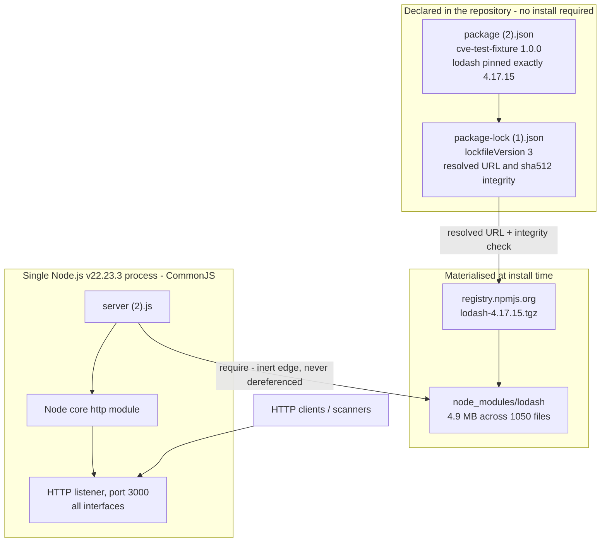

**Default-stack frameworks not applicable.** The default technology stack names Flask, Langchain, React with TypeScript, TailwindCSS, React-Native with TypeScript and ElectronJS. Every one is absent, with the same exhaustive evidence: the manifest declares no dependency beyond `lodash`, no application framework, build, transpile or bundle layer and no test framework is declared or present anywhere in the tracked tree, and a case-insensitive scan for `flask`, `langchain`, `react`, `tailwind` and `electron` returns no match. The fourth committed file does not qualify any of those determinations: `additional_file.js` contains no `require` at all and therefore consumes no library, framework or toolchain — it is plain JavaScript text inside a Markdown code fence that cannot load. There is likewise no browser, mobile or desktop presentation layer for a UI framework to serve, and no AI or model interaction for Langchain to mediate.

## 3.3 Open Source Dependencies

The complete third-party inventory is one package. The manifest declares one direct dependency, the lockfile records that same package and no transitive entry, and no `devDependencies`, `peerDependencies` or `optionalDependencies` block exists.

| Attribute | Value | Evidence |
|---|---|---|
| Package | `lodash` | `package (2).json` lines 4–6 |
| Declared version | `4.17.15` — an exact pin, not a semver range | Same |
| Dependency type | Production / runtime, but unused in code | `server (2).js` line 1 binds `_` and never dereferences it |
| Registry | npm public registry | `package-lock (1).json` line 16 |
| Resolved artefact | `https://registry.npmjs.org/lodash/-/lodash-4.17.15.tgz` | `package-lock (1).json` line 16 |
| Integrity | `sha512-8xOcRHvCjnocdS5cpwXQXVzmmh5e5+saE2QGoeQmbKmRS6J3VQppPOIt0MnmE+4xlZoumy0GPG0D0MVIQbNA1A==` | `package-lock (1).json` line 17 |
| Licence | MIT | `package-lock (1).json` line 18 |
| Transitive dependencies | 0 | `packages` map holds exactly `""` and `node_modules/lodash` |
| Self-declared constraints | No `engines`, no dependencies, no install script | Registry metadata for `lodash@4.17.15` |
| Consumed by | `server (2).js` line 1, as an inert module-graph edge | Same |
| Purpose in the system | The deliberate detection subject, not functional support | [§2.1.5](#215-f-005--known-vulnerability-detection-surface) |

| Ecosystem totals | Count |
|---|---|
| Direct dependencies | 1 |
| Transitive dependencies | 0 |
| Development dependencies | 0 |
| Peer / optional dependencies | 0 |
| Package ecosystems used | 1 (npm) |

**Realised install footprint.** A clean `npm ci` against the renamed files added exactly 1 package in 341 ms during verification (`476 ms` in [§1.2.3](#123-success-criteria)), producing a `node_modules` tree of 4.9 MB across 1050 files. Because the graph is two entries wide there is no transitive walk, no dependency-tree conflict resolution and no install-script execution: neither the manifest nor the lockfile declares a script, so the npm install-hook execution vector does not exist here.

**The fixture's own package identity.** `cve-test-fixture` at `1.0.0` is published nowhere; the repository holds no tag and the manifest declares no `license`, `files`, `main` or `publishConfig`. It also declares no `private: true`, so nothing in the metadata itself prevents an accidental `npm publish` — convention is the only safeguard (constraint C-08 in [§2.6.2](#262-constraints)). The `MIT` recorded in the lockfile describes lodash, not this package.

**Supply-chain controls, and their limits.** Three properties in the lockfile are the fixture's whole supply-chain posture: the exact version, the absolute `resolved` URL, and the sha512 Subresource Integrity digest. Together they make the analysed artefact byte-identifiable and tamper-evident — a differing or substituted tarball fails the install rather than passing silently — and with zero transitive dependencies the entire third-party surface is one auditable artefact. The corresponding weakness is that the control is entirely install-time and entirely external: no vendored copy, no offline mirror and no cache exists in the tree, so a drifted or unreachable registry makes the fixture uninstallable, and nothing in the repository verifies the digest because there is no test, no CI workflow and no active git hook.

**Advisory exposure of the pinned release.** `npm audit` against the installed lockfile reports one aggregated `high` entry — `{"high":1,"total":1}` — carrying six advisory URLs beneath the single package. The identifiers below pair the audit output with published advisory data.

| GHSA (reported by `npm audit`) | CVE | Class and vulnerable API | First release that clears it |
|---|---|---|---|
| `GHSA-p6mc-m468-83gw` | CVE-2020-8203 | Prototype pollution via `_.zipObjectDeep`, also reachable through `_.pick`, `_.set`, `_.setWith`, `_.update`, `_.updateWith` | 4.17.19 |
| `GHSA-35jh-r3h4-6jhm` | CVE-2021-23337 | Command injection through `_.template`'s `variable` option | 4.17.21 |
| `GHSA-29mw-wpgm-hmr9` | CVE-2020-28500 | Regular-expression denial of service in `toNumber`, `trim`, `trimEnd` | 4.17.21 |
| `GHSA-xxjr-mmjv-4gpg` | CVE-2025-13465 | Prototype pollution via `_.unset` and `_.omit` | 4.17.23 |
| `GHSA-f23m-r3pf-42rh` | CVE-2026-2950 | Prototype pollution via array-wrapped path segments in `_.unset` and `_.omit` | 4.18.0 |
| `GHSA-r5fr-rjxr-66jc` | CVE-2026-4800 | Code injection through `_.template` `options.imports` key names | 4.18.0 |

None of the affected APIs is referenced by the entry point, so the exposure is declarative: the graph carries the advisories, and the process cannot reach the vulnerable code paths.

**Remediation ladder for the pin.** `npm audit` returns `fixAvailable: {"name":"lodash","version":"4.18.1","isSemVerMajor":false}`; because the dependency is an exact pin rather than a range, no `npm audit fix` can satisfy it in place — the pin itself must move. The registry's release ladder is discontinuous, which matters for choosing the target.

| Target version | Advisories cleared | Note |
|---|---|---|
| 4.17.21 | 3 of 6 | Long-serving release; still exposed to CVE-2025-13465, CVE-2026-2950, CVE-2026-4800 |
| 4.17.23 | 5 of 6 | Clears CVE-2025-13465; does not exist as `4.17.22`, so a naive next-patch step is impossible |
| 4.18.0 | 6 of 6 per advisory metadata | Deprecated in the registry: "Bad release. Please use lodash@4.17.21 instead." — avoid |
| 4.18.1 | 6 of 6 | Current registry `latest` (dist-tag verified) and the value `npm audit` recommends |

**Ecosystem constraints.** The dependency subject is npm-only: one package, one registry, one lockfile format version, zero transitive edges. It therefore cannot exercise transitive resolution, range semantics, multi-ecosystem inventories or lockfile conflict handling — the same boundary [§1.3.2](#132-implementation-boundaries) draws. Maintenance discipline follows from the format: the lockfile is machine-generated and must be regenerated rather than hand-edited, and any move of the pin must move both files together and refresh the integrity digest from the registry, since a digest carried over from the previous version fails the install.

## 3.4 Third-Party Services

This system integrates with no third-party service at runtime. Two external services matter to it, and both operate outside the process: the npm registry at install time, and advisory data at analysis time.

| Category | Used? | Evidence |
|---|---|---|
| External APIs / outbound HTTP clients | No | The only network construct in the tree is the inbound listener; no HTTP client module is required, and no `fetch`, `axios` or `https` reference exists |
| Authentication or identity provider | No | No auth construct, token, client ID, callback route or session store; the listener is unauthenticated and has no login surface |
| Monitoring, APM or telemetry | No | One fixed `console.log` on the `listening` event is the entire observability surface of the running system; no agent, exporter, DSN or metrics endpoint exists. The tree does hold nine further `console.log` statements in `additional_file.js`, but that file cannot load, so they never execute and no agent, exporter or endpoint is implied by them |
| Cloud services / managed platform | No | No cloud SDK, no service endpoint, no credential or region configuration, and no infrastructure-as-code file |
| Message broker, queue or webhook | No | No producer, consumer or subscriber construct; no outbound request is made at runtime |
| Email, SMS or notification transport | No | No transport library or template |
| Secrets manager / configuration service | No | No configuration surface at all: no environment variable, config file, `.env` or `.npmrc` is read or present |

**Install-time service: the npm public registry.** The single external system the repository references is `registry.npmjs.org` — the lockfile resolves `lodash` `4.17.15` to `https://registry.npmjs.org/lodash/-/lodash-4.17.15.tgz` and fixes it with a sha512 integrity value. The interface is HTTPS with a tarball download and no credential. Its failure modes are the fixture's only operational dependencies:

- *Registry unreachable or the artefact withdrawn* — the install fails outright. There is no vendored copy, no private mirror configuration and no offline path anywhere in the tree.
- *Artefact substituted or drifted* — the sha512 digest mismatch fails the install rather than silently changing the analysed input, which is the one control protecting the integrity of the subject under test.
- *Registry advisory metadata* — `npm audit` retrieves advisory data for the pinned version from npm's configured advisory source; that lookup, not the manifest, is what turns the declaration into findings.

**Analysis-time service: advisory data (consumer-supplied).** The fixture itself carries no scanner, no advisory snapshot and no assertion, so the detection claim in [§1.2.3](#123-success-criteria) depends on an external advisory service reached by the consuming pipeline — npm's audit endpoint, the GitHub Advisory Database or an equivalent SCA feed. This is a genuine integration requirement of the system as used: the declarations are readable offline, but they cannot be interpreted as vulnerable without that data, and the expected finding set is dated by it.

**Integration requirements.**

| External system | Interface | Direction | When | Credential | Failure mode |
|---|---|---|---|---|---|
| npm public registry (`registry.npmjs.org`) | HTTPS tarball fetch, integrity-verified | Outbound, from the npm client (not from the application) | Install time only (`npm ci` / `npm install`) | None | Install aborts; the fixture cannot start, since the dependency must be on disk before `require` runs |
| Advisory data source (npm audit endpoint / GitHub Advisory Database / SCA feed) | HTTPS advisory lookup keyed by package and version | Outbound, from the consumer's tooling | Analysis time | Depends on the consumer's tooling | Detection cannot happen; the fixture stays readable but not actionable |

**Credentials and secrets.** None is tracked: no committed blob contains a key, token or password, and the application reads no configuration. One environment caveat applies rather than a tracked one — the working copy's `.git/config` remote URL carries an embedded access token (constraint C-12 in [§2.6.2](#262-constraints)). The value is deliberately not reproduced in this specification, and the practical consequence is that the checkout's git metadata should not be copied into shared or archived environments.

**Default-stack third-party services not applicable.** AWS, Auth0 and the monitoring tools named in the default stack are all absent with the same evidence: no SDK dependency beyond `lodash`, no endpoint, credential or configuration of any kind, and no observability construct beyond a single start-up `console.log` — the nine `console.log` calls in `additional_file.js` are unreachable text, not a service integration. Nothing in the system authenticates users, so an identity provider has no role; nothing leaves the process except HTTP responses, so no telemetry backend is reachable; and nothing is provisioned on a cloud platform, so no managed service is referenced.

## 3.5 Databases & Storage

No database, cache or storage service is part of this system, and no persistence code exists to reach one. The fourth committed file does not alter that finding: `additional_file.js` declares only a compile-time in-memory array literal and five pure helpers, aborts before any of them is defined, opens no driver or connection, and writes nothing to disk or anywhere else.

| Category | Present? | Evidence |
|---|---|---|
| Primary database (relational or document) | No | No driver, ORM, connection string, schema or migration file; no `mongo`, `postgres`, `mysql` or `sqlite` reference anywhere in the tree |
| Secondary / analytical database | No | Same |
| Cache or key-value store | No | No `redis`, `memcached` or in-process cache construct; the process holds no state between requests |
| Object or block storage | No | No bucket, key-prefix, signed-URL or storage SDK reference |
| Message broker or queue used as durable storage | No | No producer or consumer construct exists |
| Filesystem writes | No | The entry point's only outputs are the HTTP response literal and one start-up `console.log`; nothing is written to disk by the running process |
| In-memory session or request state | No | The request listener ignores its `req` argument and holds nothing; every request yields the same 14-byte body |
| In-memory data structure in the added file | Literal only, never instantiated | `additional_file.js` defines a `users` array of five object literals and five helpers over it; the file does not load, so no array is ever created in any running process |
| Configuration store | No | No environment variable, config file or `.env` is read; port 3000 is a source literal |

**Persistence strategy: version-controlled declarations only.** What persists across executions is exactly two JSON documents held in git, and each has a distinct authority:

| Persisted artefact | Data it stores | Authority it carries |
|---|---|---|
| `package (2).json` | Package identity (`cve-test-fixture`, `1.0.0`) and the exact dependency pin `lodash@4.17.15` | The declaration of what must be analysed — readable with no install and no network |
| `package-lock (1).json` | Resolution record: version, absolute `resolved` URL, sha512 integrity digest, MIT licence, `lockfileVersion: 3` | The identity of the artefact actually assessed — the tamper-evident evidence layer |

There are no tables, collections, indexes, retention rules, migrations or backups, because there is no store to maintain. Nothing in the system is user-supplied: the only payload produced is the compile-time literal `'Hello, World!\n'`, and no request data is reflected, recorded or logged, so no data domain exists that would need a persistence tier. The record shape defined in `additional_file.js` (`id`, `name`, `age`, `active`) is likewise not a data model: nothing reads it, nothing writes it, and the file it lives in never executes.

**The installed dependency tree is the only artefact materialised at runtime.** A clean `npm ci` creates `node_modules` (4.9 MB, 1050 files, verified) on the local filesystem, and it is that directory `require('lodash')` resolves against. Two consequences follow:

- *It is not tracked.* `git ls-files` lists exactly the four source files, so the installed tree is excluded by omission from the index rather than by policy — the repository contains no `.gitignore`, so a blanket `git add -A` would stage `node_modules`.
- *It is not durable.* There is no vendored copy or offline cache, so the tree must be re-materialised from the registry for every clean execution (constraint C-07 in [§2.6.2](#262-constraints)).

**Consequences for consumers.** The system is stateless and disposable: there is nothing to back up, migrate, seed, restore or secure at the data layer, and no store to isolate when the process is run. The isolation requirement that [§2.4.6](#246-cross-cutting-constraints) sets is driven entirely by the exposed listener and the vulnerable dependency graph, not by any data asset. The default-stack database choice (MongoDB) is therefore not merely unimplemented but inapplicable: no code path in the tree could read from or write to it, and the one file that names data shapes cannot run.

## 3.6 Development & Deployment

The toolchain is two tools: a Node.js runtime and npm. Nothing else in the repository builds, tests, packages, provisions or deploys the system.

| Concern | Technology / status | Version and evidence |
|---|---|---|
| Runtime | Node.js — the only runtime required | v22.23.3, the version used for every verification in this section; no `engines` field constrains it |
| Package manager / build client | npm CLI | 11.18.0; consumes `lockfileVersion: 3` and performs the only "build" step, dependency materialisation |
| Version control | git | History of four commits on two lines from `701ca5b` ("Add files via upload"): `main` at `94494b6` (via `84202e4`) and `1210_01` at `9c2b13b` (HEAD), the branches having diverged; working branch `1210_01`; no tags, no stashes |
| Build system | None | No `scripts` block, no `main`, no bundler, transpiler, minifier or asset pipeline; the source files are the deployed artefacts |
| Test tooling | None | No test runner, assertion library or test file; no active git hook either (`.git/hooks` holds 14 default `*.sample` stubs, 0 non-sample) |
| Quality tooling | None | No linter, formatter, type checker, `.editorconfig`, `.npmrc` or `.nvmrc` |
| Containerisation | None | No `Dockerfile`, compose file, Kubernetes manifest or container build configuration |
| Infrastructure as code | None | No Terraform, CloudFormation or equivalent file; no cloud resource is referenced anywhere in the tree |
| CI/CD | None | No workflow directory, Jenkinsfile, CircleCI, Travis or GitLab configuration; GitHub hosts the remote (`origin` → `github.com/lakshya-blitzy/CVE_Repo_1210_01.git`) but no pipeline is defined against it |
| Release management | None | No tag, no changelog, no `publishConfig`, no `files` field; `1.0.0` exists only as a manifest and lockfile value, and no `private: true` blocks an accidental publish |
| Logging / process supervision | None | One fixed `console.log` to stdout at start-up; no log destination, rotation, collector, process manager or graceful-shutdown handler |

**Deployment procedure and its observed constraints.** The steps below were executed during verification; each constraint is a first-hand observation, not a warning inherited from another section.

| Step | Action | Observed behaviour |
|---|---|---|
| 1 | Check out the branch as committed | Three of the four files carry GitHub upload suffixes: `package (2).json`, `package-lock (1).json`, `server (2).js`. The fourth, `additional_file.js`, carries no suffix |
| 2 | Rename the two metadata files in the working copy | Required: against the committed names `npm ci` fails `EUSAGE` ("can only install with an existing package-lock.json or npm-shrinkwrap.json with lockfileVersion >= 1") and `npm install` fails `ENOENT` opening `package.json` (constraint C-01) |
| 3 | Install dependencies | `npm ci` against the renamed files added 1 package in 341 ms with zero transitive dependency; requires network access to `registry.npmjs.org` |
| 4 | Ensure a free local TCP port 3000 | The port is a source literal; a conflict requires a code edit, since no environment variable or configuration file is read |
| 5 | Start the process | `node server.js`, or `node "server (2).js"` by path; without `node_modules` the process aborts at load time with exit code 1 (`Cannot find module 'lodash'`) rather than degrading at request time |
| 6 | Confirm readiness | Startup line `Server running at http://127.0.0.1:3000/` on stdout, then `200 OK` with a 14-byte `text/plain` body for every path, query string and method |

Those three upload-suffixed files are the only ones the rename step touches, and they are the only ones any install or start command addresses. `additional_file.js` carries no upload suffix, needs no rename, and appears in no install or start command — it is present in the checkout and in the deployed working copy, and nothing consumes it.

Two operational properties belong alongside those steps. The listener is bound with `listen(3000)` and no host argument, so it answers on the unspecified address — every interface — while the notice it prints names `127.0.0.1`; the log line is descriptive prose, not a statement of bind scope. And no health endpoint, readiness probe, signal handler or graceful-shutdown path exists, so lifecycle management is entirely the operator's: the process simply dies on a signal.

**Operational preconditions and deployment posture.**

| Precondition | Reason |
|---|---|
| Network access to the npm public registry at install time | No vendored or cached dependency exists, and the artefact is integrity-checked against the lockfile digest |
| A free TCP port 3000 on the host | The port is compiled into the source with no configuration surface |
| A disposable, network-isolated environment | A dependency graph carrying six published advisories combined with an unauthenticated listener bound to every interface makes isolation, not hardening, the controlling control — the boundary [§1.3.2](#132-implementation-boundaries) and [§2.4.6](#246-cross-cutting-constraints) both set |
| Packaging supplied by the consumer | Nothing in the repository can be run as a job, service or container without an external definition |

Containerising or pipelining the fixture is therefore possible but entirely consumer-authored: a base image would need npm 7 or later to install from `lockfileVersion: 3`, a job would need to perform the rename step before invoking npm, and the port would need to be free inside the container. Because the repository defines no automation, no automated check fails when the pin moves, the `require('lodash')` import is removed, the integrity digest is altered or the response literal drifts — every invariant recorded across this specification is enforceable only by the consuming pipeline.

**Default-stack deployment technologies not applicable.** The default stack's Docker, Terraform and GitHub Actions entries have no counterpart in the tree: there is no container definition, no infrastructure-as-code file and no workflow directory, and `git status --porcelain --ignored` is empty while `.git/hooks` contains no active hook. Their absence is not an unmet requirement of this system — the fixture is a scan subject, not a deployable service ([§2.6.1](#261-assumptions) A-02) — but any consumer wanting containerised or automated execution must supply all three.

## 3.7 References

**Repository artefacts cited as evidence.**

- `package (2).json` — npm manifest: package identity `cve-test-fixture` `1.0.0`, the exact `lodash` `4.17.15` pin, and the absence of `main`, `scripts`, `engines`, `license`, `private`, `type` and `devDependencies`
- `package-lock (1).json` — `lockfileVersion: 3` resolution record: two-entry `packages` map, `resolved` tarball URL, sha512 integrity digest, MIT licence
- `server (2).js` — the only executable file: CommonJS `require` of lodash and core `http`, the port-3000 listener, the constant 14-byte response and the start-up log line
- `additional_file.js` — the only other JavaScript file: 72 lines, 1737 bytes, a Markdown code fence tagged `javascript` around an in-memory `users` array and five helpers, with no `require`, no exports, no reference to it in the tree, and a load abort at 1:3
- Repository root — the complete tree: four files, 105 lines, 2563 bytes, no sub-folders, no `.gitignore`, `.npmrc`, `.nvmrc` or `.editorconfig`, and no `node_modules` in the tracked set
- `.git/hooks/` — 14 default `*.sample` stubs and no active hook, evidencing the absence of repository-side automation

**Runtime, registry and advisory sources.**

- [web] npm registry packument and version history for `lodash` (`https://registry.npmjs.org/lodash`) — `latest` dist-tag is `4.18.1`; the release ladder jumps 4.17.21 → 4.17.23 → 4.18.0 → 4.18.1 with no 4.17.22
- [web] npm registry version metadata for `lodash@4.18.0` — the deprecation notice "Bad release. Please use lodash@4.17.21 instead."
- [web] GitHub Advisory Database entries `GHSA-p6mc-m468-83gw`, `GHSA-35jh-r3h4-6jhm`, `GHSA-29mw-wpgm-hmr9`, `GHSA-xxjr-mmjv-4gpg`, `GHSA-f23m-r3pf-42rh` and `GHSA-r5fr-rjxr-66jc` — CVE mapping, affected ranges and first-fixed versions for the six advisories `npm audit` reports against the pin
- [web] OSV vulnerability records for the same six identifiers — affected-version ranges and cross-listing of the aliased advisory pairs
- [web] lodash changelog (`https://github.com/lodash/lodash/wiki/Changelog`) — release contents for 4.17.19, 4.17.21, 4.17.23, 4.18.0 and 4.18.1
- [web] Snyk package page for `lodash@4.17.15` — fix guidance requiring 4.18.1 or higher, noting 4.18.0 was deprecated for a breaking regression

**Verification environment.** All version, install, audit and runtime observations above were produced locally on Node.js v22.23.3 with npm 11.18.0, using a scratch copy holding the three upload-suffixed files renamed to their npm-recognised names together with `additional_file.js`, which was copied for completeness and never executed. No dependency, lockfile or other artefact was added to the checkout itself.

# 4. Process Flowchart

## 4.1 System Workflows

The repository holds four files and one executable process, so its workflow surface is small enough to enumerate completely. Five workflows exist, and every one of them was observed by executing the fixture on Node.js v22.23.3 with npm 11.18.0 in a throwaway copy of the checkout; the repository itself was not modified by any verification behind this section.

| Workflow | Purpose | Trigger | Terminal outcome |
|---|---|---|---|
| **W-1** Dependency materialisation | Turn the declared pin into an artifact on disk | `npm ci` (or `npm install`) in a working copy | `node_modules` with 1 package, or a non-zero npm exit |
| **W-2** Process start-up | Bind the listener and announce readiness | `node "server (2).js"` | Listening socket plus one stdout line, or exit code 1 |
| **W-3** Request handling | Answer every request identically | Any TCP connection to port 3000 | `200 OK` with a 14-byte body |
| **W-4** Declaration-level vulnerability detection | Surface the pinned release's advisories | A consumer's scan job | Six advisories aggregated to one `high` entry |
| **W-5** Remediation and re-verification | Clear the findings without destroying the baseline | A triage decision on a copy or branch | An install whose audit is clean |

W-1, W-2 and W-3 are the execution substrate; W-4 and W-5 are the fixture's actual purpose and the only workflows with a business outcome, which is why [§1.2.1](#121-project-context) places the deliverable in application-security engineering rather than in product delivery.

The fourth committed file introduces no workflow of its own. No workflow step invokes `additional_file.js`, no command reaches it, it cannot run, and it consumes or produces nothing — so the five workflows above, together with their actors, inputs, outputs and measured timings, are unchanged by its presence in the tree.

**Where the decisions live.** `server (2).js` contains no branching statement of any kind — no `if`, `else`, `switch`, ternary, `try` or `catch` — so every decision point in this section is executed by Node's runtime, by npm's installer, or by a consumer's pipeline, never by application code. [§4.2.1](#421-workflow-element-inventory) inventories each one and [§4.4](#44-required-diagrams) draws them.

### 4.1.1 Core Business Processes

#### W-1 Dependency materialisation

| Step | Action | Source anchor | Observed timing |
|---|---|---|---|
| 1 | Operator or job renames `package (2).json` → `package.json` and `package-lock (1).json` → `package-lock.json` in the working copy | Manifest and lockfile names as committed (constraint C-01) | — |
| 2 | npm parses the manifest (`name`, `version`, one dependency) and opens the lockfile at `lockfileVersion: 3`, `requires: true` | `package (2).json` L4–6; `package-lock (1).json` L4–5 | — |
| 3 | npm resolves the single install path `node_modules/lodash` to version 4.17.15, the absolute URL `https://registry.npmjs.org/lodash/-/lodash-4.17.15.tgz`, its sha512 digest and the `MIT` license | `package-lock (1).json` L14–18 | — |
| 4 | npm fetches the tarball from the public registry over HTTPS and verifies the digest before writing | Integrity value at `package-lock (1).json` L17 | "added 1 package in 294ms", real 0.352 s |
| 5 | The artifact lands on disk and the install ends | `npm ls --all` → `cve-test-fixture@1.0.0 └── lodash@4.17.15` | 4.9 MB across 1050 files |

The end-to-end journey has exactly one decision diamond: **D-02, does the fetched artifact match the recorded digest?** A mismatch aborts the install rather than writing an unverified artifact — the SRI value is the fixture's only supply-chain control ([§2.2.2](#222-f002--reproducible-dependency-resolution) F-002-RQ-003). Step 1 is a decision in its own right (**D-01**) because npm does not recognise the committed filenames: `npm ci` against them fails `EUSAGE` ("can only install with an existing package-lock.json or npm-shrinkwrap.json with lockfileVersion >= 1") and `npm install` fails `ENOENT` opening `package.json`. The install is also the only step in the whole system that requires a network round trip.

Error paths: a missing or misnamed lockfile (D-01, no branch taken), an unreachable registry, or an integrity mismatch all terminate the install with a non-zero exit and leave no usable dependency tree. There is no vendored copy, no offline mode and no `.npmrc` in the tree to tune any of it, so recovery is entirely the consumer's re-run.

#### W-2 Process start-up

Evaluation of `server (2).js` is a single pass with two decision diamonds and a hard ordering dependency between them.

| Step | Action | Source anchor | Observed result |
|---|---|---|---|
| 1 | Node evaluates the module top level; the first statement resolves the bare specifier `lodash` | `server (2).js` L1 | With no `node_modules`: `Error: Cannot find module 'lodash'`, exit code 1, before any socket exists |
| 2 | `http.createServer` registers the request listener; construction alone has no external effect | `server (2).js` L3–4 | — |
| 3 | `listen(3000)` binds a TCP socket; no host argument is passed | `server (2).js` L5 | Listener on the IPv6 unspecified address — every interface (`/proc/net/tcp6` listener `00000000000000000000000000000000:0BB8`) |
| 4 | A second instance on the same port fails | Same literal, no error handler | Unhandled `'error'` event: `EADDRINUSE: address already in use :::3000`, exit code 1 |
| 5 | The `listening` event fires and the callback writes one stdout line | `server (2).js` L5 callback | `Server running at http://127.0.0.1:3000/`, 41 ms after process spawn |
| 6 | The event loop stays active with nothing else scheduled | Whole file | Process idle until a connection arrives |

Decision diamond **D-03 — is the dependency resolvable on disk?** — is the fail-fast boundary: when it fails, the process dies before binding, so a partially initialised listener can never accept traffic ([§2.2.4](#224-f004--inert-dependency-edge) F-004-RQ-003). Decision diamond **D-04 — is port 3000 free?** — has no fallback branch: the port is a source literal with no configuration surface (constraint C-05), so a conflict is resolved by editing code, freeing the port, or killing the incumbent process.

Two properties of this workflow matter operationally. Start-up is always by file path, because the manifest declares neither `main` nor `scripts`, so `npm start` has no defined behaviour (assumption A-04). And the notice names `127.0.0.1` while the socket is bound to all interfaces — the log line is descriptive prose, not a report of bind scope.

#### W-3 Request handling

| Step | Action | Ownership | Observed result |
|---|---|---|---|
| 1 | TCP connection accepted | Node core | Connection open; no application code runs yet |
| 2 | Request line, HTTP version, method token and header block parsed | Node core HTTP parser | Malformed line, `HTTP/9.9`, or an unknown method token → `400 Bad Request` with `Connection: close` and an empty body |
| 3 | Header block size checked | Node core (16 KB maximum) | A 40 KB header line → `431 Request Header Fields Too Large`, listener never invoked |
| 4 | `'request'` event fires; the listener discards `req` and terminates the response | `server (2).js` L3–4 | `200 OK`, `Content-Length: 14`, body `Hello, World!\n` for every path, query string, method and body |
| 5 | Connection reuse decided by the client's `Connection` header | Node core | `keep-alive` → socket persists, `Keep-Alive: timeout=5` advertised, server closes the idle socket at 6007 ms; `close` or HTTP/1.0 → socket closed after the response |

Decision diamond **D-05 — is the request syntactically well formed?** — is the only one the listener can be bypassed by, and it is answered by the runtime, not the application: every response the fixture itself produces is a `200`. Decision diamond **D-06 — will the connection be reused?** — governs socket lifetime. There is no decision about request content, because the listener never reads the body: a `POST` declaring `Content-Length: 100` with no bytes sent received an immediate `200 OK`, and a `Transfer-Encoding: chunked` body with an invalid chunk still produced the constant response. Request bodies, including a 100 KB payload, are accepted and discarded unread.

Response contract, identical in every observation: status `HTTP/1.1 200 OK`; headers `Date`, `Connection`, `Keep-Alive: timeout=5` (keep-alive only) and `Content-Length: 14`; body the 14 bytes `Hello, World!\n`. `HEAD` returns `200` with no body and no `Content-Length`. The response carries no `Content-Type` and no `Server` header — a point on which this section conflicts with [§3.6](#36-development--deployment), whose deployment step 6 describes the body as `text/plain`; the observed header set contains no content-type header at all.

Throughput, measured over raw sockets: 200 sequential requests in 44 ms total (≈0.22 ms each), 20 concurrent requests in 2 ms with byte-identical bodies — the earlier 0.970 s figure for 200 requests in [§2.2.3](#223-f003--constant-response-http-listener) included curl process spawn. No throttling, no concurrency cap and no response-time degradation was observed, and the process remained alive after the load.

#### W-4 Declaration-level vulnerability detection

This is the fixture's primary end-to-end journey, and it needs no install.

| Step | Action | Evidence |
|---|---|---|
| 1 | A scanner reads the declared dependency straight from the manifest; declaration alone is sufficient | `package (2).json` L4–6 pins `4.17.15` exactly ([§2.2.5](#225-f005--known-vulnerability-detection-surface) F-005-RQ-001) |
| 2 | The declared and resolved versions are matched against advisory data supplied by the consumer | Assumption A-05: the repository ships no advisory list, scanner or assertion |
| 3 | Decision **D-07 — does the version fall inside any affected range?** For `4.17.15` six advisories match | `npm audit --json`: one `lodash` entry, `severity: high`, range `<=4.17.23` |
| 4 | Findings aggregate; severity is the maximum across matches (three High, three Moderate, none Critical) | `metadata.vulnerabilities` → `{info: 0, low: 0, moderate: 0, high: 1, critical: 0, total: 1}` |
| 5 | Decision **D-08 — does a fix exist inside the declared range?** No, because the pin is exact | npm reports `Will install lodash@4.18.1, which is outside the stated dependency range` |
| 6 | The consumer routes the finding to policy and triage | Nothing in the repository performs this step |

The six matched advisories are command injection in `lodash` (CWE-77, CWE-94, `<4.17.21`), prototype pollution (CWE-770, CWE-1321, `>=3.7.0 <4.17.19`), regular-expression denial of service (CWE-400, CWE-1333, `>=4.0.0 <4.17.21`), code injection via `_.template` imports key names (CWE-94, `>=4.0.0 <=4.17.23`), prototype pollution via array path bypass in `_.unset` and `_.omit` (CWE-1321, `<=4.17.23`), and prototype pollution in the same two functions (CWE-1321, `>=4.0.0 <=4.17.22`). The aggregation behaviour matters to any pipeline keyed on finding counts: six advisories produce one package entry, so a rule expecting six rows will mis-count. Four historically-fixed CVEs (CVE-2019-10744, CVE-2019-1010266, CVE-2018-16487, CVE-2018-3721) are negative controls — a scanner reporting them against this version is producing a false positive, and [§1.2.3](#123-success-criteria) sets the tolerance for that at zero.

Error paths: with no advisory source reachable, detection cannot happen at all (assumption A-05); a scanner parsing the files positionally rather than by name must still reach the same declarations (assumption A-01).

#### W-5 Remediation and re-verification

| Step | Action | Decision / consequence |
|---|---|---|
| 1 | Fork a copy or a branch of the fixture | Keeps the vulnerable baseline intact for the next comparison ([§1.2.3](#123-success-criteria), critical success factor 6) |
| 2 | Move the pin to a chosen version and re-resolve the lockfile | Version choice is decision **D-09** |
| 3 | Reinstall from the lockfile and re-run the audit | Confirms which advisories cleared |
| 4 | Record the before-and-after evidence; leave the baseline untouched | The upgrade converts the fixture into an ordinary smoke-test server if applied in place |

Decision **D-09 — which version clears the findings?** has three defensible answers and one trap: `4.17.21` clears three of the six, `4.17.23` (the last `4.17.x` release) clears five, `4.18.1` clears all six and is what npm's own fix advice names; `4.18.0` is deprecated as a bad release and must be avoided, and no `4.17.22` exists, so the next patch step from `4.17.21` is `4.17.23` (constraint C-02, [§2.6.3](#263-assumptions-a-consumer-should-not-make)).

#### Actors, journeys and touchpoints

| Actor | Journey | Touchpoints | Reachable surface |
|---|---|---|---|
| Operator / CI job | Clean checkout → rename → install → start → observe → assert | Four files on disk, npm CLI, process stdout and stderr, exit code | No CLI arguments, no configuration file, no environment variable |
| Analysis consumer | Read declarations → match advisories → triage → remediate on a copy | The two JSON files, the advisory source, the audit report | No in-repo scanner, no CI workflow, no hook |
| HTTP client | Connect → receive | TCP port 3000 on every interface | One unauthenticated endpoint; no routing, no TLS, no session |
| Triage pipeline | Receive findings → route by severity → gate | Advisory output only | Nothing the repository can enforce (constraint C-06) |

There is no interactive user surface: no web UI, no admin console, no command-line tool, and no exported programmatic API, since nothing is assigned to `module.exports`.

### 4.1.2 Integration Workflows

The fixture integrates with exactly one external system, and it does so at install time rather than at run time.

| Integration | Direction | Protocol / mechanism | Lifecycle stage | Evidence |
|---|---|---|---|---|
| npm public registry | Inbound artifact | HTTPS fetch of one tarball, verified against the recorded sha512 digest | Install (W-1) | `package-lock (1).json` L16–17 |
| Consumer advisory source | Inbound data | Consumer-supplied; the fixture carries no client for it | Analysis (W-4) | No advisory, scanner or assertion anywhere in the tree |
| HTTP client | Inbound request | Plain HTTP over TCP port 3000, unauthenticated, unencrypted | Runtime (W-3) | Listener on the unspecified address; no TLS configuration exists |
| Git remote | Development only | `origin` → `github.com/lakshya-blitzy/CVE_Repo_1210_01.git` | Authoring | Four commits on two divergent lines from `701ca5b`, ending at `9c2b13b` (`1210_01`) and `94494b6` (`main`); no pipeline is defined against it |

Absent integrations, each confirmed by a whole-tree search: no database driver or connection string, no message queue or broker, no identity provider or authentication SDK, no outbound HTTP client (`fetch`, `axios` or `http.request` appear nowhere), no cloud SDK, no container or orchestrator manifest, and no infrastructure-as-code file.

**Data flow between systems.**

| Flow | Payload | Path | Verified property |
|---|---|---|---|
| Dependency artifact | `lodash-4.17.15.tgz` | Registry → npm → `node_modules/` | Digest verified against `sha512-8xOcRHvCjnocdS5cpwXQXVzmmh5e5+saE2QGoeQmbKmRS6J3VQppPOIt0MnmE+4xlZoumy0GPG0D0MVIQbNA1A==` before the artifact is accepted |
| Dependency declaration | Package identity and one exact version | `package (2).json` → lockfile root entry `""` → consumer | Root entry repeats `cve-test-fixture`, `1.0.0` and the pin |
| Request data | Path, query string, method, headers, body | Client → port 3000 | Reaches the socket and is discarded; nothing is parsed, logged or reflected |
| Response data | 14 bytes, compile-time literal | Process → client | Byte-identical for every request, path, method and body size |
| Outbound application data | None | — | The process sends nothing beyond its HTTP replies, and writes nothing to disk |

**API interactions.** The fixture exposes one implicit endpoint with no routing: the listener never inspects the request, so no path is special, no method is reserved, and the application itself never emits `404`, `405`, `401` or a redirect. The only non-`200` responses observed come from Node's parser before the listener runs.

| Client request | Server response | Evidence |
|---|---|---|
| `GET /`, any path, any query string | `200`, `Content-Length: 14`, `Hello, World!\n` | Paths `/a/b/c` and `/x?q=1` verified |
| `POST`, `PUT`, `DELETE`, `OPTIONS` with or without body | Identical `200` and identical 14 bytes | A 100 KB body and an invalid chunked body both produced the same response |
| `HEAD` | `200` with no body and no `Content-Length` | Verified over a raw socket |
| Pipelined `GET` twice on one connection | Two ordered `200` responses; the second honours `Connection: close` | Verified over a raw socket |
| Malformed request line, `HTTP/9.9`, or an unknown method token | `400 Bad Request`, `Connection: close`, empty body | Node's parser, before the listener |
| Single header line above 16 KB | `431 Request Header Fields Too Large` | Node's parser, before the listener |

**Event processing.** Two application callbacks exist in the entire repository — the request listener and the `listening` callback — and both are anonymous arrow functions registered inline at `server (2).js` L3 and L5. The repository defines no event emitter, no subscriber, no queue consumer and no scheduled task.

| Event | Emitted by | Handler | Observed behaviour |
|---|---|---|---|
| `listening` | HTTP server, once per process | Inline callback, `server (2).js` L5 | One stdout line; never repeated per request |
| `request` | HTTP server, once per parsed request | Inline listener, `server (2).js` L3–4 | One constant response; no per-request logging |
| server `'error'` | HTTP server on bind failure | None — unhandled | Crash with a stack trace on stderr, exit code 1 |
| socket timeout / close | TCP layer | None | Idle keep-alive connection closed by the server at 6007 ms (Node's 5 s `keepAliveTimeout` plus grace); a partial request left idle for 6 s stayed open |
| client abort | TCP layer | None | Connection torn down; the process is unaffected and keeps serving |

Ordering is per-connection and sequential: pipelined requests are answered in order, while separate connections are fully independent, which is why 20 concurrent requests returned 20 byte-identical bodies with no interleaving artefacts.

**Batch processing sequences.** None exist. There is no batch job, no scheduler, no queue drain and no bulk endpoint; the only batch-shaped workflow in this system is the consumer's scan job over the two JSON files, and it is entirely consumer-authored because the repository defines no CI, no test and no hook (constraint C-06). The nearest in-fixture analogue to a batch run is repeated traffic: 200 sequential requests completed in 44 ms with no throttling and the process alive afterwards, and 20 concurrent requests completed in 2 ms.

## 4.2 Flowchart Requirements

Every element a flowchart needs is inventoried here for all five workflows of [§4.1](#41-system-workflows), so that the diagrams in [§4.4](#44-required-diagrams) can be read against a fixed set of names: start and end points, process steps, decision diamonds, system boundaries, user touchpoints, error states with recovery paths, and timing. The final element — service level agreements — has no repository-side answer, and that absence is itself recorded. No new flowchart element is required by the fourth committed file.

### 4.2.1 Workflow Element Inventory

**Start and end points.**

| Workflow | Start point | End points | Terminal condition |
|---|---|---|---|
| W-1 Dependency materialisation | Invocation of `npm ci` or `npm install` in a working copy | `node_modules` populated, or install aborted | One package on disk, or non-zero npm exit with no usable tree |
| W-2 Process start-up | `node "server (2).js"` | Listening socket plus one stdout line, or exit 1 | Ready state, or fail-fast termination |
| W-3 Request handling | TCP connection to port 3000 | `200` response then keep-alive or closed socket; or a parser-generated `400`/`431` | Connection closed by client, server idle timeout, or parser rejection |
| W-4 Detection | A scan reading the declarations | One aggregated `high` severity entry and a remediation recommendation | Findings routed to consumer policy |
| W-5 Remediation and re-verification | A triage decision applied to a copy or branch | Clean audit on the copy; baseline unchanged | Evidence recorded, vulnerable baseline retained |

**Process steps.** Step-by-step catalogues with source anchors are given in [§4.1.1](#411-core-business-processes); the inventory below states where each workflow is anchored in the repository and how much of it the repository actually owns.

| Workflow | Distinct steps | Repository-owned steps | Anchors |
|---|---|---|---|
| W-1 | 5 | 3 — the declaration, the frozen resolution and the integrity value | `package (2).json` L1–7; `package-lock (1).json` L1–21 |
| W-2 | 6 | 3 — the require, the server construction and the bind with its callback | `server (2).js` L1, L3–4, L5 |
| W-3 | 5 | 2 — the listener body and the response termination | `server (2).js` L3–4 |
| W-4 | 6 | 2 — the declarations that make detection possible | `package (2).json` L4–6; `package-lock (1).json` L14–18 |
| W-5 | 4 | 0 | Nothing in the tree records, enforces or automates remediation |

**Decision diamonds.**

| ID | Decision and condition | Branch outcomes | Decided by |
|---|---|---|---|
| D-01 | Are the committed metadata filenames recognisable to npm? Condition: file is named `package.json` / `package-lock.json` | No → `EUSAGE` or `ENOENT`, install ends; Yes → W-1 continues | npm CLI (constraint C-01) |
| D-02 | Does the fetched artifact match the recorded sha512 digest? | No → install aborts, no artifact written; Yes → artifact accepted | npm CLI |
| D-03 | Is `lodash` resolvable on disk at module load? | No → `Cannot find module 'lodash'`, exit 1 before any bind; Yes → start-up continues | Node CommonJS loader, `server (2).js` L1 |
| D-04 | Is TCP port 3000 free? | No → unhandled `EADDRINUSE`, exit 1, no fallback port; Yes → socket bound on all interfaces | Node net layer, `server (2).js` L5 |
| D-05 | Is the request syntactically well formed? | No → parser `400` or `431`, listener bypassed; Yes → listener invoked | Node HTTP parser |
| D-06 | Will the connection be reused? | Keep-alive → socket persists, closed by server at 6007 ms idle; otherwise → socket closed after the response | Node HTTP layer, driven by the client's `Connection` header |
| D-07 | Does the resolved version fall inside an affected advisory range? | Yes, six advisories for `4.17.15` → findings; No → clean result | Consumer's scanner |
| D-08 | Does a fix exist inside the declared range? | No, by construction — the pin is exact, so npm proposes `4.18.1` outside the range | npm audit (constraint C-02) |
| D-09 | Which version does remediation target? | `4.17.21` clears three, `4.17.23` clears five, `4.18.1` clears all six; `4.18.0` is deprecated and no `4.17.22` exists | Consumer decision ([§2.6.3](#263-assumptions-a-consumer-should-not-make)) |

No decision diamond is drawn by application code: `server (2).js` has no `if`, `switch`, ternary or `catch`, so D-03 and D-04 are the *absence* of a resolution and the *absence* of a free port surfacing as runtime errors, while D-01, D-02, D-07, D-08 and D-09 sit entirely outside the repository. `additional_file.js` answers no decision diamond either: it executes nothing and is reached by no branch of any workflow.

**System boundaries.**

| Boundary | Contents | Crossing mechanism |
|---|---|---|
| Repository (static) | Four files, 105 lines and 2563 bytes total, no folders, no configuration, no secrets in tracked content; the fourth file, `additional_file.js` (72 lines, 1737 bytes), is committed but referenced by nothing and not executable as committed | Human or scanner reading the declarations; git |
| Process (runtime) | One Node.js process holding the HTTP server handle, an unused `lodash` binding and a literal response string | Process start and termination; stdout for the single notice |
| Host (install) | `node_modules` — 4.9 MB across 1050 files for exactly one package | npm CLI writing to disk after digest verification |
| External (network) | The npm public registry at install time; an advisory source at analysis time; HTTP clients at run time | Inbound HTTPS for the artifact, inbound plain HTTP on port 3000 |

The runtime boundary is deliberately asymmetric: the process accepts inbound TCP on every interface, yet initiates no outbound connection of any kind, holds no credentials and reads no configuration surface.

**User touchpoints.**

| Touchpoint | Actor | Interaction | Observable result |
|---|---|---|---|
| `package (2).json` and `package-lock (1).json` | Operator, scanner | Read or install from | Declared and resolved vulnerability at a fixed version |
| npm CLI | Operator, CI job | `npm ci` / `npm install` / `npm audit` | Install and audit output, exit codes |
| Process stdout | Operator | Read at start-up | One line, `Server running at http://127.0.0.1:3000/`, never repeated |
| Process stderr and exit code | Operator, CI job | Read on failure | Stack trace with exit code 1 for `MODULE_NOT_FOUND` and `EADDRINUSE` |
| TCP port 3000 | HTTP client | Any request | Constant `200` with 14 bytes |
| Git history | Maintainer | Commit, branch, diff | Four commits on two divergent lines from `701ca5b`: `1210_01` at `9c2b13b` with `additional_file.js`, `main` at `94494b6` without it |

There is no interactive touchpoint: no web UI, no admin surface, no command-line interface, no exported library API, and no health or readiness endpoint an operator could probe.

**Error states and recovery paths.**

| Error state | Detection point | Recovery path | Evidence |
|---|---|---|---|
| Dependency absent at load | Process start, `server (2).js` L1 | Materialise the dependency, then restart; no offline fallback exists | `Cannot find module 'lodash'`, exit 1 before bind |
| Port occupied | Bind, `server (2).js` L5 | Free the port, terminate the incumbent process, or edit the literal; no fallback port and no retry | Unhandled `EADDRINUSE: address already in use :::3000`, exit 1 |
| Metadata filenames unrecognised | npm start, before resolution | Rename to `package.json` / `package-lock.json` in a working copy and re-run | `EUSAGE` for `npm ci`, `ENOENT` for `npm install` |
| Registry unreachable or digest mismatch | Install, step 4 of W-1 | Re-run the install in a network-enabled environment; nothing is vendored | No `.npmrc`, no cached artifact inside the tree |
| Malformed or oversized request | Node parser, before the listener | Client-side correction; the fixture cannot be configured to relax the limits | `400 Bad Request`, `431 Request Header Fields Too Large` |
| Idle keep-alive connection | Server, 6007 ms after the response | Expected behaviour, not a fault: the client reconnects | Idle socket closed by the server; `Keep-Alive: timeout=5` advertised |
| Slow or partial request | None — no application timeout | Client-side timeout only; the connection stays open server-side | Partial request line plus partial header left idle for 6 s stayed open |
| Client abort | None — no socket error handler | Nothing to recover; the process is unaffected | Socket destroyed on connect and after write; process kept serving |
| Attempt to execute `additional_file.js` | Load time, line 1 of the file | No recovery path exists: the content is fenced Markdown, so no runtime or flag can execute it; the file is not part of any workflow | `TypeError: "" is not a function` at `additional_file.js:1:3`, exit 1, no stdout output |
| Findings reported by a scanner | Consumer's audit step | Remediate on a copy or branch, then re-verify ([§4.1.1](#411-core-business-processes) W-5) | Six advisories aggregated to one `high` entry |
| Process signal | Any `SIGTERM` or `SIGINT` | Restart manually; no supervision or auto-restart is defined | Process terminated by signal, exit code `null`, no shutdown log |

**Timing and SLA considerations.**

| Timing point | Measured value | Basis | Constraint status |
|---|---|---|---|
| Process spawn → listening callback | 41 ms | Node v22.23.3, lodash load included | Not enforced; no startup deadline exists |
| Single request, server-side round trip | ≈0.22 ms | 200 sequential raw-socket requests in 44 ms | No latency target declared |
| 200 sequential requests | 44 ms total, no throttling, process alive after | Raw sockets | No rate limit or concurrency cap configured |
| 20 concurrent requests | 2 ms, byte-identical bodies | Raw sockets | No concurrency control |
| Idle keep-alive close | 6007 ms | Node `keepAliveTimeout` 5 s plus grace | Default only; not tuned by the repository |
| `npm ci` install | 294 ms reported, 0.352 s wall (4.9 MB, 1050 files) | After renaming the metadata files | No timeout declared; comparable runs measured 341–476 ms elsewhere |
| Dependency fetch | One tarball, no transitive walk | Registry round trip | Requires network access; no mirror is configured |

The repository declares no SLA, no availability target, no latency budget and no error budget, and no instrumentation exists from which any could be measured — there is no metrics endpoint, no per-request log and no timing code. Because the listener is `200`-only and unthrottled, no availability commitment is supportable from the artifacts ([§2.2.3](#223-f003--constant-response-http-listener) F-003-RQ-004); any service level must be asserted by the consuming pipeline, whose success targets are set in [§1.2.3](#123-success-criteria).

### 4.2.2 Validation Rules and Checkpoints

**Business rules at each step.** Every rule below is an invariant the artifacts imply; none is written down in the repository, so each must be enforced by review, by the consuming pipeline, or not at all.

| ID | Rule | Applies at | Enforcement and consequence of violation |
|---|---|---|---|
| BR-01 | The dependency version stays an exact pin, with no range syntax | W-1 step 2; W-4 step 1 | Review only. A range such as `^4.17.15` lets resolution drift and destroys the determinism that makes the fixture an assertion target |
| BR-02 | Manifest and lockfile agree on name, version and dependency | W-1 steps 2–3 | Review, or an npm install that silently re-resolves. Divergence invalidates the resolution record |
| BR-03 | `devDependencies`, `peerDependencies` and `optionalDependencies` stay absent | W-1 step 2 | Review. An added block changes the analysed inventory and the expected finding set |
| BR-04 | The `require('lodash')` import stays, and the `_` binding is never dereferenced | W-2 step 1; W-3 | A whole-file search for `_.` must return nothing. Dereferencing would make the vulnerable API reachable and change the fixture's semantics |
| BR-05 | Every response is `200` with the byte-identical 14-byte body | W-3 step 4 | Verified behaviourally. Divergence breaks the determinism property on which smoke assertions rest |
| BR-06 | The start-up notice is emitted exactly once, from the `listening` event | W-2 step 5 | Review. Per-request logging would introduce a log-volume and log-content surface that does not exist today |
| BR-07 | Remediation is demonstrated on a copy or a branch, never in place | W-5 step 1 | Process discipline. Editing the pin in place converts the fixture into an ordinary server and destroys the baseline |
| BR-08 | Assertions name the advisories they expect rather than counting them | W-4 steps 3–4 | Consumer-side. The set is dated and grows as new advisories publish, and npm aggregates six advisories into one entry |
| BR-09 | Port 3000 must be free before start-up | W-2 step 3 | Operational. A conflict is resolved by freeing the port or editing the literal; no configuration surface exists |
| BR-10 | The dependency is materialised before start-up | W-2 step 1 | Operational, fail-fast. There is no vendored or offline path |
| BR-11 | The fixture runs only in an isolated, disposable environment | W-3 | Security policy. An unauthenticated listener on every interface with six advisories in its graph makes isolation the controlling control (constraint C-09) |
| BR-12 | The lockfile's integrity digest is retained unchanged | W-1 step 4 | Review. Without it nothing proves which artifact was assessed |

**Data validation requirements.** The application validates nothing: no input reaches a decision, so no branch depends on request content.

| Validator | Input | Rule applied | Failure behaviour |
|---|---|---|---|
| Node HTTP parser | Request line, HTTP version, method token | llhttp grammar | `400 Bad Request`, empty body, `Connection: close`, listener never invoked |
| Node HTTP parser | Header block | 16 KB total header size limit | `431 Request Header Fields Too Large`, `Connection: close` |
| Node HTTP layer | `Transfer-Encoding` and `Content-Length` framing | Frames are parsed, but the listener never reads the body | Invalid chunk sequences are never surfaced: an invalid chunk still produced the `200` response |
| npm | Lockfile presence, name and `lockfileVersion` | `lockfileVersion` of at least 1, recognisable filenames | `EUSAGE` when the lockfile is unrecognisable; `ENOENT` when the manifest name is wrong |
| npm | Fetched artifact bytes | sha512 digest comparison against `integrity` | Install aborts before writing; not exercised during this verification, since it requires tampering with either the artifact or the lockfile |
| Application listener | Path, query string, headers, body | None | Data is discarded unread: a 100 KB body and an invalid chunked body both received the constant response |

**Authorization checkpoints.** There are none anywhere in the system, and this is a property of the artifact rather than an omission to be fixed: the fixture has no identity, no credentials and no protected resource.

| Control | Status in the fixture | Evidence | Consequence |
|---|---|---|---|
| Authentication | Absent | No auth code, session, token, cookie or identity-provider reference exists in the tree | Anyone with network reach to port 3000 gets the response |
| Authorization / entitlement checks | Absent | No roles, scopes or policy checks; the listener has no branch to gate | No request can be rejected on policy grounds |
| Transport encryption | Absent | Plain HTTP on port 3000; no certificate, key or TLS option anywhere | Traffic is readable in transit |
| Bind-scope restriction | Not applied | `listen(3000)` with no host argument binds the unspecified address | Reachable on every interface, while stdout names `127.0.0.1` |
| Secret handling | Not applicable | No environment variable, file input or credential is read | The only credential in the checkout lives in untracked `.git/config` metadata, not in any tracked file (constraint C-12) |

**Regulatory compliance checks.** No compliance control is implemented in code, and the fixture processes no regulated data class; the compliance-relevant records are entirely supply-chain artifacts.

| Obligation area | Fixture behaviour | Evidence | Consumer action |
|---|---|---|---|
| Personal or customer data | None processed, logged or stored; the response is a fixed ASCII literal and no request field is retained | `server (2).js` L3–4; no `fs`, database or logging dependency exists | No data-protection obligation is engaged by the fixture |
| Supply-chain integrity | One dependency, resolved to an absolute URL with a sha512 digest verified before the artifact is written | `package-lock (1).json` L16–17 | Treat the digest as the artifact-identification evidence for provenance and SBOM reporting |
| Licence attestation | The lockfile records `MIT` for `lodash`; the fixture's own manifest declares no `license` field | `package-lock (1).json` L18; absent field in `package (2).json` (constraint C-08) | The fixture's own licensing status cannot be attested from the artifacts |
| Vulnerability-retention policy | A known-vulnerable pin is retained deliberately and made unreachable at run time | `package (2).json` L5; no `_.` dereference in `server (2).js` | Record the retention as an explicit, documented policy exception with an isolation requirement |
| Access and audit logging | No per-request logging exists; one start-up line only | `server (2).js` L5 callback; no logger dependency | The service cannot satisfy access-logging expectations; any audit trail must be supplied externally |
| Change control | No test, CI workflow or active git hook; four commits on two divergent lines and no tags | Constraint C-06, C-11 | Every invariant above is enforceable only in the consuming pipeline, which must also perform the rename step of BR-09's runbook |

## 4.3 Technical Implementation

### 4.3.1 State Management

The system is stateless in the sense that matters most: no request influences any other, no state is persisted by the running process, and the process holds nothing that a restart would need to recover. What state exists is concentrated in three places — the declaration files on disk, the module-load sequence of a single process, and the per-connection socket lifecycle of Node's HTTP layer. The fourth committed file contributes none of it: `additional_file.js` holds only a compile-time users array and five helpers, is never loaded, and therefore has no state that could be persisted, cached, invalidated or recovered.

**State inventory.**

| State | Owner | Persistence | Entered / left by |
|---|---|---|---|
| `DECLARED` — identity and one exact pin | `package (2).json` | Repository file, version-controlled | Authoring; changed only by a commit |
| `RESOLVED` — version, URL, digest, licence | `package-lock (1).json` | Repository file, version-controlled | Lockfile generation; changed only by a commit or a relock |
| `MATERIALISED` — the artifact on disk | `node_modules/` | Host filesystem, untracked | Successful install (W-1); removed by deleting the directory |
| `NO_DEPENDENCY` — nothing on disk | Host filesystem | None | Checkout state; verified absent in the repository as committed |
| `LOADING` — module evaluation in progress | Node process | Process memory | Evaluated from `server (2).js` L1 through L5 |
| `LOAD_FAILED` — terminal | Node process | None | D-03 false branch: exit code 1, stack trace on stderr |
| `BOUND` — socket bound, callback pending | Node process | None | `listen(3000)` returned successfully |
| `SERVING` — ready and answering | Node process | None | `listening` event fired; stdout notice written once |
| `TERMINATED` — process gone | Host | None | Signal, or a fatal startup error |
| `INERT` — a `users` array of five literals and five helpers, never instantiated | `additional_file.js` | None | Nothing: the file cannot load, no process state is ever created from it, and neither persistence nor recovery applies |
| Connection states: `CONNECTED`, `REQUEST_PARSED`, `RESPONSE_SENT`, `KEEP_ALIVE_IDLE`, `CLOSED_BY_SERVER`, `CLOSED_BY_CLIENT`, `REJECTED_BY_PARSER` | Node HTTP layer, per socket | None | Driven by the client's bytes and by Node's parser and keep-alive timers |

**State transitions.**

| From | To | Trigger | Observable evidence |
|---|---|---|---|
| `NO_DEPENDENCY` | `LOAD_FAILED` | `node "server (2).js"` with no resolvable `lodash` | `Error: Cannot find module 'lodash'`, exit code 1, no socket created |
| `MATERIALISED` | `LOADING` | Process start with `node_modules` present | Module evaluation begins at L1 |
| `LOADING` | `LOAD_FAILED` | A required module cannot be resolved | Same fail-fast exit as above |
| `LOADING` | `BOUND` | `http.createServer` and a successful `listen(3000)` | Socket visible in `/proc/net/tcp6` on the unspecified address |
| `LOADING` | `TERMINATED` | Port 3000 already bound | Unhandled `'error'` event, `EADDRINUSE: address already in use :::3000`, exit code 1 |
| `BOUND` | `SERVING` | `listening` event | Exactly one stdout line: `Server running at http://127.0.0.1:3000/` |
| `SERVING` | `SERVING` | Each parsed request | `200` response; the state does not otherwise change |
| `SERVING` | `TERMINATED` | `SIGTERM` or `SIGINT` | Process exits by signal, exit code `null`, no shutdown output |
| Connection: `CONNECTED` | `REJECTED_BY_PARSER` | Malformed request line, unsupported version, unknown method token, headers above 16 KB | `400` or `431`, empty body, `Connection: close` |
| Connection: `CONNECTED` | `RESPONSE_SENT` | Well-formed request reaching the listener | `200` with the 14-byte body |
| Connection: `RESPONSE_SENT` | `KEEP_ALIVE_IDLE` | Client did not request closure | `Keep-Alive: timeout=5` advertised |
| Connection: `KEEP_ALIVE_IDLE` | `CLOSED_BY_SERVER` | 6007 ms of idle time | Socket closed by the server, verified over a raw socket |
| Connection: `RESPONSE_SENT` | `CLOSED_BY_CLIENT` | Client sent `Connection: close`, pipelined and closed, or aborted | Socket gone; the process is unaffected |

No state transition depends on request content, on time of day, on configuration or on stored data. The only transitions that can end the process are the two failure branches (D-03, D-04) and a signal.

**Data persistence points.**

| Artifact | Location | Written by | Lifetime |
|---|---|---|---|
| Manifest and lockfile | Repository working tree | Author, by commit | Lifetime of the revision; both blobs are identical at `701ca5b` and at HEAD `9c2b13b` |
| `additional_file.js` source | Repository working tree | Author, by commit on branch `1210_01` | Lifetime of the revision; it is present on `1210_01` and absent on `main` |
| Installed package | `node_modules/lodash`, 4.9 MB across 1050 files | npm CLI, after digest verification | Until deleted; untracked, and **no `.gitignore` exists**, so an install leaves 1050 untracked paths in `git status` |
| Response body | Process memory | Compiled into the source as a literal | Process lifetime; released at exit |
| Start-up notice | Process stdout | `console.log` in the `listening` callback | Wherever the operator redirects it; no log file is opened |
| Anything else | — | — | Nothing: the running process performs no file write, opens no database and sends no outbound request |

That last row is the important one for recovery planning: because the process persists nothing, a restart loses nothing but the socket, and no reconciliation step exists or is needed.

**Caching requirements.** No cache is configured anywhere in the repository; the three cache layers that can still influence behaviour are all outside it.

| Layer | Repository configuration | Observed behaviour |
|---|---|---|
| Node module cache | Implicit to CommonJS | `lodash` is evaluated once per process at `server (2).js` L1; there is no second `require` of it anywhere, and `additional_file.js` contains no `require` at all |
| HTTP response caching | None — no `Cache-Control`, `Expires`, `ETag` or `Last-Modified` is ever sent | Clients may apply heuristic caching to the unauthenticated `200` response; no cache directive is offered by the server, and no `Content-Type` is sent either |
| npm client cache | None — no `.npmrc` exists, so npm defaults apply unmodified | The registry fetch in W-1 may be served from npm's own cache; nothing in the repository depends on that |
| Application cache | None | No in-memory cache, no session store, no memoisation, no shared state between requests |

**Transaction boundaries.** The system has no database, so there is no transaction in the classical sense. Three weaker atomic boundaries are observable and worth naming because they are the ones a flowchart should treat as indivisible.

| Boundary | What is atomic | Evidence |
|---|---|---|
| Package acceptance in W-1 | The artifact is written only after its sha512 digest is verified against the lockfile, so a verification failure leaves no partially accepted package | Integrity value at `package-lock (1).json` L17; failure path not exercised during this verification |
| Response emission in W-3 | One `res.end` call writes the complete body, and `Content-Length: 14` declares it, so a client receives one complete message or none | Header set observed on every raw-socket probe |
| Request independence in W-3 | Each request is handled with no shared mutable state, so no ordering, locking or idempotency concern arises | 20 concurrent requests returned byte-identical bodies; pipelined requests were answered in order |

There is no rollback, no compensating action, no idempotency key and no two-phase commit anywhere in the system, and none is needed: nothing the running process touches can be left half-changed.

### 4.3.2 Error Handling

Error handling in this system is a posture rather than a mechanism. `server (2).js` contains no `try`, no `catch`, no `.on('error')` handler, no timeout and no retry, so every failure is handled by Node's defaults or by npm's, and the fixture's deliberate choice is to fail fast and loudly at start-up rather than degrade while serving. These findings hold for the executable content of the tree; the one other JavaScript file executes nothing and therefore has no error path to handle.

**Failure modes and current handling.**

| Failure mode | Detection point | Current handling | Recovery |
|---|---|---|---|
| `lodash` unresolvable at load | W-2 step 1, `server (2).js` L1 | None in application code: the CommonJS loader throws and the process exits 1 before any socket exists | Materialise the dependency, then restart ([§4.1.1](#411-core-business-processes) W-2 step 1) |
| Port 3000 already bound | W-2 step 3, `server (2).js` L5 | None: the server `'error'` event is unhandled, so Node throws and the process exits 1 with `EADDRINUSE: address already in use :::3000` | Free the port, stop the incumbent process, or edit the literal; no fallback port is attempted |
| Malformed request line, unsupported HTTP version, unknown method token | Node HTTP parser, before the listener | Node replies `400 Bad Request` with `Connection: close` and an empty body; no application code runs | Client-side correction; the fixture exposes no setting to relax the parser |
| Header block above 16 KB | Node HTTP parser | Node replies `431 Request Header Fields Too Large` and closes the connection | Client-side correction |
| Invalid or incomplete request body | None — the body is never read | Never surfaces: an invalid chunked body still produced the constant `200` response, and a `Content-Length: 100` body that never arrived still got an immediate `200` | Nothing to recover; the request is answered regardless of its body |
| Client aborts the connection | None — no socket error handler | Connection torn down; the process keeps serving, verified for aborts on connect and after write | Nothing to recover |
| Slow or partial request | None — no request timeout configured | The connection stays open: a partial request line plus partial header left idle for 6 s produced neither a response nor an error | External timeouts only; an operator cannot configure one here |
| Idle keep-alive connection | Node's keep-alive timer | Server closes the socket at 6007 ms while advertising `Keep-Alive: timeout=5` | Expected behaviour; the client reconnects |
| Install cannot find its metadata files | npm start, before resolution | `npm ci` fails `EUSAGE`; `npm install` fails `ENOENT` opening `package.json` | Rename the two files in a working copy and re-run (D-01, constraint C-01) |
| Registry unreachable, or artifact digest mismatch | npm install, W-1 step 4 | npm aborts with a non-zero exit; no artifacts are written | Re-run in a networked environment; nothing is vendored and no offline fallback exists |
| Attempt to load `additional_file.js` | Load time, line 1 of the file | None available: the content is fenced Markdown and Node throws immediately | No recovery path, and none is needed — the file is invoked by nothing in any workflow |
| Findings reported against the pinned version | Consumer's audit step | No in-repository handling exists — no test, hook or workflow would fail | Remediate on a copy or branch, then re-verify (W-5) |
| Signal (`SIGTERM`, `SIGINT`) | OS | No handler: the process terminates immediately, exit code `null`, no shutdown log and no drain of in-flight requests | Manual restart; no supervision is defined |

**Retry mechanisms.** There are none in the repository: no retry loop, no backoff, no reconnect, no re-bind attempt and no `.npmrc` to tune npm's own retry behaviour, which therefore applies unmodified at install time. Because the two fatal start-up failures both end the process, retry is a property of whatever supervises it — and nothing in the tree supervises it, so retry is a consumer-supplied wrapper job at best.

**Fallback processes.** None. There is no secondary port, no vendored dependency, no cached artifact guarantee, no alternate response, no degraded mode and no read-only fallback. The one deliberate fallback-shaped behaviour is its inverse: on a missing dependency the process aborts before binding rather than starting in a state where request handling could fail unpredictably (F-004-RQ-003) — fail-fast, so that a listener that exists is a listener that was verified.

**Error notification flows.**

| Error class | Channel | Content | Destination |
|---|---|---|---|
| Start-up success | stdout, once per process | `Server running at http://127.0.0.1:3000/` | Operator or job log |
| Dependency unresolvable | stderr | CommonJS loader stack trace ending `Cannot find module 'lodash'`, plus exit code 1 | Operator or job log; the failure is machine-detectable through the exit code |
| Port occupied | stderr | Unhandled `'error'` stack trace ending `EADDRINUSE: address already in use :::3000`, plus exit code 1 | Same |
| Request rejected by the parser | HTTP response only | `400` or `431` with an empty body | The client; nothing is logged, so the server side retains no record |
| Findings from analysis | None produced by the fixture | Advisory records come from the consumer's tooling | The consumer's triage process |

There is no alerting, no webhook, no metrics exporter, no per-request access log and no audit trail. The tree holds ten `console.log` statements in total, but only one of them is executable — the start-up line, which fires once per process lifetime; the other nine sit in `additional_file.js` and never emit, because that file cannot load. An operator therefore learns about traffic only by watching the socket, not from the process.

**Recovery procedures.** The runbook below covers every reachable failure; each step is verified by an observation recorded during this analysis.

| Symptom | Cause | Action | Verification |
|---|---|---|---|
| `Cannot find module 'lodash'`, exit 1 | No `node_modules` on disk (constraint C-07) | Install from the lockfile in a renamed working copy, then start again | `npm ls --all` shows `cve-test-fixture@1.0.0 └── lodash@4.17.15`; start prints the notice once |
| `EADDRINUSE: address already in use :::3000`, exit 1 | Port 3000 still bound, typically by an earlier instance (D-04) | Free the port or stop the incumbent process, then start again; changing the literal requires editing the source | Startup notice appears; a request returns `200` with 14 bytes |
| `npm ci` fails `EUSAGE`, `npm install` fails `ENOENT` | Committed filenames carry upload artifacts (D-01, C-01) | Rename to `package.json` and `package-lock.json` in the working copy, then re-run | `added 1 package` in ≈0.3 s, 4.9 MB across 1050 files |
| Install aborts without writing the package | Registry unreachable, or the digest does not match the lockfile | Restore network access and re-run; if the mismatch persists, treat the artifact as suspect rather than disabling verification | Install completes; `npm ls --all` lists the single dependency |
| Client request returns `400` or `431` | Request malformed, or headers oversized | Correct the request; the limits are Node's defaults and are not configurable here | A well-formed request returns `200` with the constant body |
| Response never arrives on a slow request | No request timeout is configured; the connection simply stays open | Apply a client-side timeout; treat the open connection as expected, not as a fault | A subsequent well-formed request on a new connection returns `200` |
| Connection closes by itself after a period of inactivity | Keep-alive idle expiry at 6007 ms | Reconnect; no server-side state is lost, because none is kept | A new connection returns `200` |
| Client disconnects early | Client abort, unhandled by application code | No action required | The process continues serving; verified for aborts before and after the request write |
| `TypeError: "" is not a function` when running `additional_file.js` | The file's content is a fenced Markdown snippet, not a loadable module | No action required: nothing in the repository or in any workflow invokes it | Removing or ignoring the file changes neither the process nor the expected findings |
| Six-advisory `high` finding in an audit report | Deliberate vulnerable pin (assumption A-03) | Remediate on a copy or branch to the chosen version (D-09), keeping the baseline intact | A re-run audit on the copy reports a clean result for the chosen target |
| Process gone after a signal | No shutdown handler and no supervisor | Restart manually; if continuity matters, the supervisor must be supplied by the consumer | Startup notice reappears; `200` responses resume |

**Design posture.** Read end to end, error handling here has one rule: **fail fast at start-up, never fail while serving.** Start-up failures are fatal and loud through a stack trace plus a non-zero exit code; serving-time conditions — malformed requests, oversized headers, aborted clients, absent bodies, slow clients — are absorbed silently by Node's defaults or, in the case of the body, never observed at all, and the constant response is returned regardless. Nothing in the system retries, degrades, notifies or recovers on its own, which is consistent with its role as a scan subject rather than a service (assumption A-02) and with the requirement that every invariant be enforceable only in the consuming pipeline (constraint C-06).

## 4.4 Required Diagrams

Five diagram classes are required for this system, and each appears once below. All diagrams use Mermaid.js; subgraphs carry swim lanes, `{...}` nodes are decision diamonds, and `([...])` nodes are start or end points. Where a diagram shows a timing value it is a measurement recorded during verification on Node.js v22.23.3 with npm 11.18.0, not a target — the repository declares none ([§4.2.1](#421-workflow-element-inventory)).

| Required diagram | Location | Swim lanes / participants | Decision points shown | Related requirements |
|---|---|---|---|---|
| High-level system workflow | [§4.4.1](#441-high-level-system-workflow) | Operator or CI job, npm CLI, npm registry, Node process, HTTP client and scanner | D-01 … D-04 | F-001-RQ-002, F-002-RQ-003, F-003-RQ-001, F-004-RQ-003 |
| Detailed process flow per core feature | [§4.4.2](#442-detailed-process-flows-for-each-core-feature) | One swim lane in `LR` or `TD` per feature | D-01, D-02, D-03, D-05, D-06, D-07, D-08, D-09 | F-001 … F-005 |
| Error handling flowchart | [§4.4.3](#443-error-handling-flowchart) | Install-time, serve-time and signal-time branches | D-01 … D-05 | F-001-RQ-004, F-002-RQ-003, F-003-RQ-002, F-004-RQ-003 |
| Integration sequence diagram | [§4.4.4](#444-integration-sequence-diagram) | CI job, npm CLI, registry, Node process, lodash module, HTTP client | D-01, D-02, D-03, D-04, D-05, D-06, D-07 | F-002-RQ-001 … F-002-RQ-003, F-003-RQ-002, F-005-RQ-001 |
| State transition diagram | [§4.4.5](#445-state-transition-diagram) | Process lifecycle and per-connection lifecycle | D-03, D-04, D-05, D-06 | F-003-RQ-001, F-003-RQ-004, F-004-RQ-003 |

### 4.4.1 High-Level System Workflow

The end-to-end view: an operator or job materialises the dependency, starts the process, and either serves traffic or scans the declarations. Dashed edges are data paths that cross the repository boundary without executing repository code.

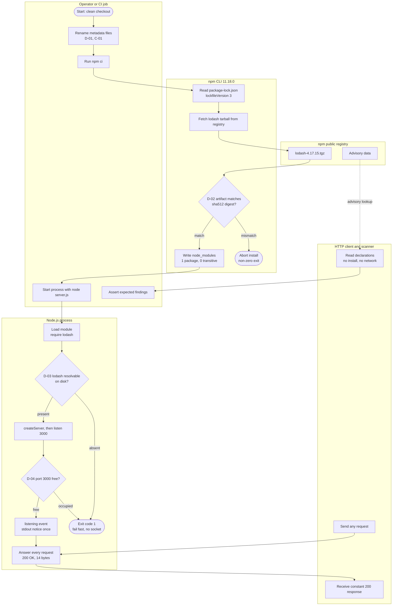

### 4.4.2 Detailed Process Flows for Each Core Feature

**F-001 — Exact vulnerable dependency declaration.** The declaration is the analysis subject, so the flow is a review gate rather than a runtime path: a single `BR-01` check decides whether the fixture still asserts a fixed version.

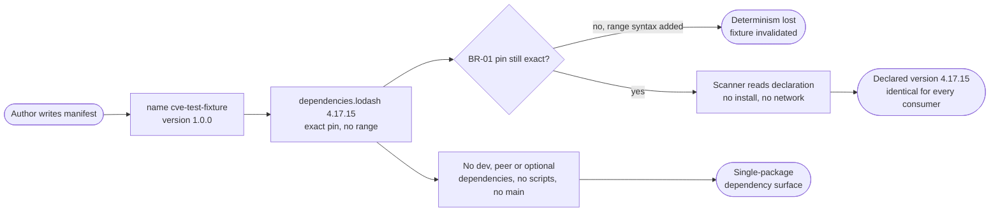

**F-002 — Reproducible dependency resolution.** Two decisions gate the artifact: whether npm recognises the metadata filenames (`D-01`) and whether the fetched bytes match the recorded digest (`D-02`).

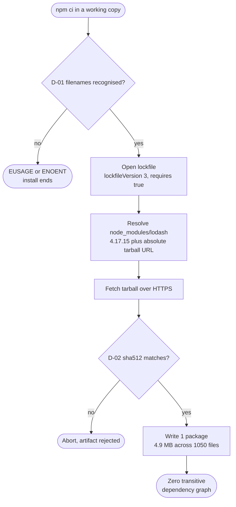

**F-003 — Constant-response HTTP listener.** The only runtime flow. The listener's inputs never influence the output, so the flow has no content-dependent branch; `D-05` and `D-06` belong to Node's HTTP layer.

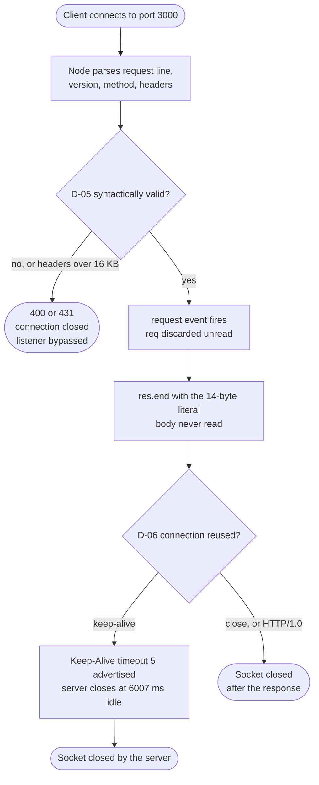

**F-004 — Inert dependency edge.** Start-up order is the whole flow: the require runs first, and the check that the binding stays dereferenced is what keeps the vulnerable API unreachable.

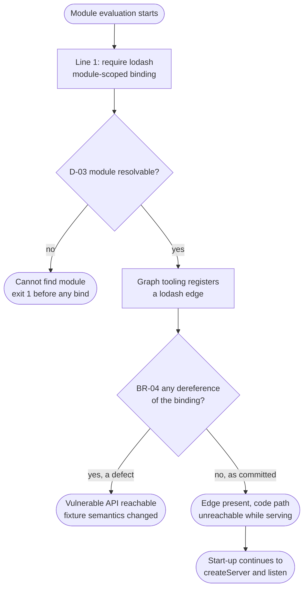

**F-005 — Known-vulnerability detection surface.** The detection and remediation journey, which needs no install and ends in a version choice: three defensible outcomes and one version to avoid.

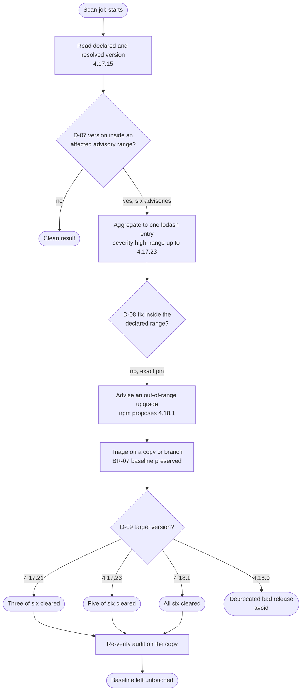

### 4.4.3 Error Handling Flowchart

Every reachable failure in one decision tree, ordered by when it occurs: install-time, start-up, serve-time, then termination. Branch labels name the decision ID and the observed symptom, so the diagram doubles as an index into the runbook in [§4.3.2](#432-error-handling).

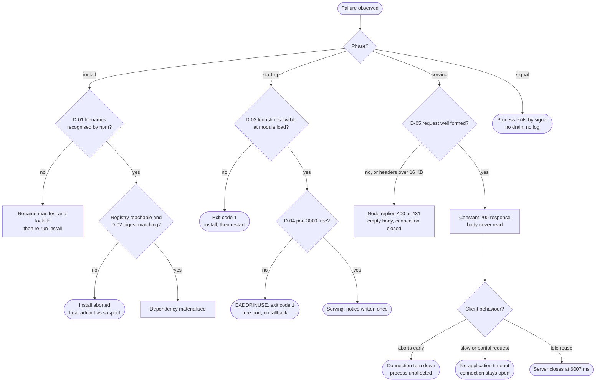

### 4.4.4 Integration Sequence Diagram

The only external integration is the install-time registry fetch; everything else on the wire is inbound. Timings in the notes are measured values, and the `alt` block records the parser-level rejection path that never reaches the listener.

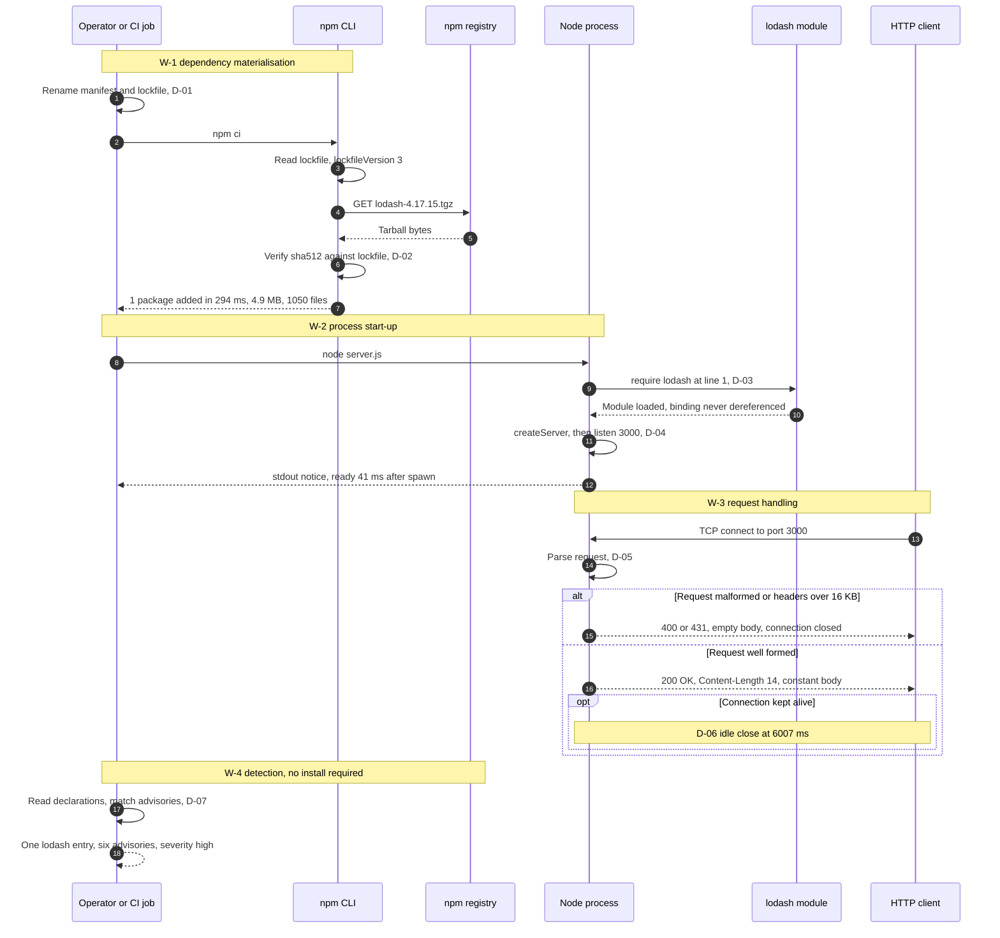

### 4.4.5 State Transition Diagram

Two machines, both stateless on the outside: the process lifecycle for one invocation, and the connection lifecycle Node maintains per socket. Neither has a persistence step, so no transition writes anything to disk.

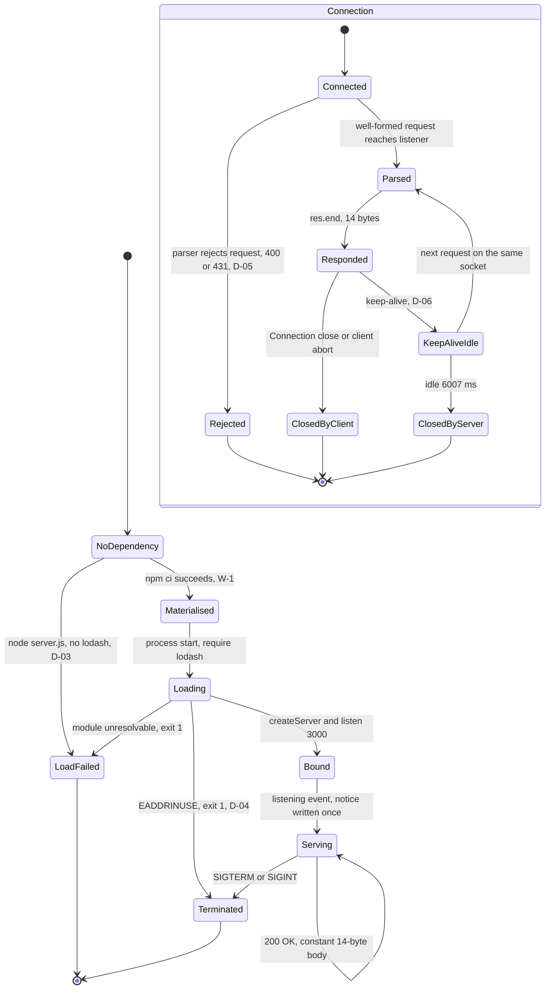

## 4.5 References

- `server (2).js` — the sole executable entry point; established the module-load order at L1, the request listener at L3–4 whose only action is `res.end('Hello, World!\n')`, and the bind plus `listening` callback and notice at L5, including the absence of any branch, export, timeout or error handler
- `package (2).json` — the dependency manifest; established the package identity (`cve-test-fixture` `1.0.0`), the exact `lodash` `4.17.15` pin at L4–6, and the absence of `scripts`, `main`, `devDependencies` and `license`, which is why start-up is always by file path
- `package-lock (1).json` — the resolution record; established `lockfileVersion: 3` and `requires: true` at L4–5, the root mirror entry at L7–13, the single install path `node_modules/lodash` with its absolute tarball URL at L14–16, the sha512 digest at L17 and the `MIT` license at L18
- `additional_file.js` — 72 lines, 1737 bytes, blob `4f1bd913…`; established that the fourth committed file is a Markdown code fence tagged `javascript` around an in-memory `users` array and five helpers, with no `require`, no exports, no invocation from any workflow, and a load abort at `1:3` (`TypeError: "" is not a function`) that writes nothing to stdout
- repository root (path `""`) — contained exactly four files and no folders, 105 lines and 2563 bytes in total; established that there are no tests, no CI configuration, no `.gitignore`, no `.npmrc` and no `.blitzyignore` anywhere in the tree
- git metadata of the checkout (branch `1210_01` at HEAD `9c2b13b`, branch `main` at `94494b6`, both descended from `701ca5b` on two divergent lines) — established that the workflows documented here have no predecessor to diff against, that `additional_file.js` exists only on the working branch, and that there are no tags
- [web] npm public registry and its advisory service, consulted through the npm CLI during verification (`npm ci`, `npm ls --all`, `npm audit --json`) — confirmed the single dependency resolved to 4.17.15, the six advisories matched against `<=4.17.23`, the aggregate `high` severity with metadata `{info: 0, low: 0, moderate: 0, high: 1, critical: 0, total: 1}`, and `fixAvailable` `lodash` `4.18.1` outside the declared range
- internal cross-references used for terminology, identifiers and figures: [§1.2 System Overview](#12-system-overview) and [§1.2.3 Success Criteria](#123-success-criteria) (declarative versus runtime layers, expected findings, success factors), [§2.2 Functional Requirements](#22-functional-requirements) (features F-001 … F-005 and their requirement IDs), [§2.6 Assumptions and Constraints](#26-assumptions-and-constraints) (IDs A-01 … A-08 and C-01 … C-13), and [§3.6 Development & Deployment](#36-development--deployment) (toolchain versions, deployment steps, and the one claim this section reports as conflicting)

# 5. System Architecture

## 5.1 High-Level Architecture

The repository holds four files and one executable process, so its architecture is small enough to describe completely and to bound precisely. This sub-section establishes the architectural style, the components, the flows between them and the boundary the system presents to everything outside it. The fourth committed file, `additional_file.js`, lies outside every runtime path, so the style described here and every data flow below are unchanged by its presence.

### 5.1.1 System Overview

**Architectural style.** The system is a single-process, single-file, unlayered monolith built entirely from Node.js core modules. Its whole executable surface is `server (2).js` — five lines, two `require` calls and no exported symbol — in which one `http.Server` instance handles its `'request'` event with one anonymous listener that terminates every response with a compile-time literal. There is no framework, no middleware chain, no routing table, no dependency-injection container, no build step, no configuration layer and no tier separation (no controller/service/repository split), because there is nothing to separate: the composition root and the entire application are the same five lines. The dominant runtime characteristic is event-driven, non-blocking I/O — one server object, one listener, sockets and timers owned by the host runtime rather than by application code.

The style is *declarative-first*: the architecture's subject of interest is the pair of JSON artifacts, and the process exists to make the declared dependency edge concrete. `package (2).json` L4–6 declares `lodash` at the exact version `4.17.15`; `package-lock (1).json` L14–18 resolves that pin to one artifact with a sha512 digest; `server (2).js` L1 keeps the dependency in the module graph through `const _ = require('lodash')` while never dereferencing the binding. §1.2.2 names this same intent *declaration-as-subject*, and §1.2.3 makes "the dependency edge survives" a critical success factor.

**Rationale.** Every structural facility a product service would adopt for availability or feature velocity — a framework, layering, configuration, persistence, an observability stack, retries, authentication — would add nodes or edges to a dependency graph whose entire purpose is to contain exactly one. The architecture therefore omits them deliberately rather than provisionally. The same reasoning explains why the runtime is inert: because no lodash function is ever called, the vulnerability that the fixture exists to surface is visible to analysis yet unreachable in execution, so the fixture can be scanned, installed and exercised without that vulnerability changing the observed behaviour.

**Architectural principles.**

| Principle | Enforcement in the repository | Architectural effect |
|---|---|---|
| Declaration over execution | The manifest and lockfile carry the complete analysis subject (`package (2).json` L4–6; `package-lock (1).json` L14–18); the listener never inspects `req` | Detection requires no install and no request traffic |
| Determinism by construction | Response body literal `'Hello, World!\n'` (L4), port literal `3000` (L5), exact dependency pin, one direct and zero transitive dependencies | Every request produces the identical 14 bytes; one assessment target exists |
| Fail-fast at load time | `require('lodash')` is statement 1, ahead of server construction and binding | A missing dependency aborts before any socket exists; no partially initialised listener |
| Zero configuration surface | No `main`, no `scripts`, no `process.env` read, no `argv` parsing, no config file anywhere in the four files | Behaviour is fixed at author time; the port and bind scope can only be changed by editing source |
| Dependency inertness | One unused module-scoped binding; the dependency's code loads but no API call site exists | The edge is present for graph builders and absent from behaviour |
| Statelessness | Nothing written to disk at runtime, no in-memory store, no session data, no per-request retention | Any request can be served by any instance of the process; restart is the only recovery |

**System boundaries and major interfaces.** The boundary is the process plus the four committed files. The host runtime, the npm registry, consumer scanners and HTTP clients all sit outside it.

| Interface | Direction | Contract | Evidence |
|---|---|---|---|
| Module resolution (filesystem) | Inbound lookup | Bare specifier `lodash` resolved against `node_modules` at module load; unresolvable → `MODULE_NOT_FOUND`, exit 1 | `server (2).js` L1; observed abort with no `node_modules` |
| Declarative artifacts (read by tooling) | Outbound hand-off | JSON manifest and lockfile read by npm for install and by scanners without install | `package (2).json`; `package-lock (1).json` |
| Install-time artifact fetch | Inbound | HTTPS GET of one tarball, accepted only if its digest matches the recorded sha512 value | `package-lock (1).json` L16–17 |
| Runtime request handling | Inbound | HTTP/1.1 over TCP port 3000 on all interfaces, plaintext, unauthenticated, no routing or method discrimination; request content discarded unread | `server (2).js` L3–5; observed `200 OK` for `GET /` and `POST /deep/path?q=1` alike |
| Process observability | Outbound | One stdout line on the `listening` event; failure reported as a stderr stack trace with exit code 1; nothing emitted per request | `server (2).js` L5; observed startup line and `EADDRINUSE` crash |
| Authoring | Development only | `origin` → `github.com/lakshya-blitzy/CVE_Repo_1210_01.git`; four commits on two divergent lines from `701ca5b`, ending at `9c2b13b` (`1210_01`, HEAD) and `94494b6` (`main`); no automation wired to it | `git remote -v`; `git log`; `.git/hooks` holds only `*.sample` stubs |

Confirmed absent from the boundary by a whole-tree search, consistent with §1.2.1: no database or connection string, no message queue or broker, no identity provider or authentication SDK, no outbound HTTP client, no cloud SDK, no container, orchestrator or infrastructure-as-code manifest.

**Architectural assumptions.** Each assumption is a property the repository relies on but does not itself enforce:

- The host supplies a Node.js runtime; no `engines` field exists, so no version is required or verified. The behaviour described here was observed on Node.js v22.23.3 with npm 11.18.0.
- npm is new enough to read `lockfileVersion: 3`, and the lockfile is the resolution authority.
- The operator renames `package (2).json` and `package-lock (1).json` in a working copy before npm is invoked, since npm does not recognise the committed names (constraint C-01; `npm ci` fails `EUSAGE`, `npm install` fails `ENOENT` — see [§4.1.1](#411-core-business-processes) W-1).
- Port 3000 is free on every interface the process binds, because there is no configuration surface to change it (constraint C-05).
- The consumer supplies the advisory data and the scanning job; the repository ships neither ([§1.2.1](#121-project-context), assumption A-05).
- The fixture is kept on an isolated network, since it exposes an unauthenticated listener together with a dependency graph carrying known advisories (§1.2.3, critical success factor 5).

### 5.1.2 Core Components Table

Six components make up the system: four committed files, the host runtime that executes one of them, and the dependency artifact that install materialises. Dependencies and integration points are combined below because, for every component in this system, each dependency *is* an integration point.

| Component | Primary Responsibility | Dependencies and Integration Points | Critical Considerations |
|---|---|---|---|
| Dependency manifest — `package (2).json` | Declares package identity (`cve-test-fixture` 1.0.0) and the single exact dependency pin `lodash` `4.17.15`; the primary analysis subject | Read by npm at install and by dependency/CVE scanners without install; mirrored by the lockfile root entry `""` | No `main` and no `scripts`, so start-up is by file path only; replacing the exact pin with a range would destroy the reproducibility the fixture depends on; the committed filename must be renamed for npm to accept it |
| Lockfile — `package-lock (1).json` | Freezes resolution of the one dependency: install path `node_modules/lodash`, version, tarball URL, sha512 integrity, MIT license; no transitive entries | Consumed by `npm ci` / `npm install`; determines which artifact the entry point's `require` resolves against | The digest check is the system's only supply-chain control; divergence between its root `""` entry and the manifest invalidates the resolution evidence |
| Runtime entry point — `server (2).js` | Keeps the dependency edge in the module graph and binds an HTTP listener that returns a constant body for every request; the only executable component | `require('lodash')` (unused binding), `require('http')` (core module), stdout; binds TCP port 3000 on all interfaces | No exports and no declared entry point, so its whole effect is a load-time side effect; no error listener, so a bind failure terminates the process |
| Inert committed source — `additional_file.js` | None in the running system: it keeps a users array and five helpers in the repository without participating in any path | No dependency edge — it contains no `require` — and no integration point; nothing in the tree imports, names or executes it | 72 lines, 1737 bytes, pure ASCII with one trailing LF; its content is a Markdown code fence tagged `javascript`, so Node cannot load it (`TypeError: "" is not a function` at 1:3, exit 1, no output); it holds no state, declares no interface and is reachable from no request path |
| Node.js runtime and core `http` (host-provided) | Executes the module, resolves the bare specifier, parses and serialises HTTP, owns sockets, timers and the module cache | Invoked by the operator as `node "server (2).js"`; no version constraint declared by the repository | Runtime version is unmanaged, so defaults such as the unspecified bind address and keep-alive timeouts are host-determined |
| Materialized dependency artifact — `node_modules/lodash` (lodash 4.17.15, MIT) | Satisfies the load-time require and carries the advisories the fixture exists to surface | Produced by the install workflow; loaded as one self-contained UMD file (`node_modules/lodash/lodash.js`) with no API call site | Not committed, so the runtime cannot start until install runs; 4.17.15 predates the fix releases for its advisories, and the exact pin means npm cannot satisfy the declared range with a fix version ([§4.1.1](#411-core-business-processes) W-4) |

### 5.1.3 Data Flow Description

Four flows span the system: one at install time, two in the process, and one in the consumer's analysis pipeline. Only the first two touch the repository's own artifacts; the third consumes them by reading alone. None of the four involves `additional_file.js`.

**F1 — Install-time dependency materialisation.** `package (2).json` L4–6 supplies the declared pin; npm opens `package-lock (1).json` and resolves the single install path `node_modules/lodash` to version 4.17.15, its registry URL and its sha512 digest (L14–18); npm fetches `lodash-4.17.15.tgz` over HTTPS from `registry.npmjs.org` and verifies the digest before writing. The artifact lands on disk and the install ends. This is the only network round trip the system ever performs, and it happens strictly before the process exists.

**F2 — Process start-up.** Node evaluates `server (2).js` top down. L1 resolves the bare specifier `lodash` against `node_modules` and executes the dependency's UMD bundle, binding its exports to `_`, which is never read afterwards. L3 constructs an `http.Server` around the inline request listener. L5 binds port 3000 with no host argument, so the socket is bound to the unspecified address (observed as `::`, family IPv6, dual-stack — the same `::` that appears in the `EADDRINUSE: address already in use :::3000` message). The `listening` event fires once and its callback writes the single stdout line `Server running at http://127.0.0.1:3000/`. The event loop then idles with nothing scheduled.

**F3 — Request servicing.** A TCP connection is accepted by the runtime; the HTTP parser decodes the request line and headers before any application code runs, so protocol-level rejections never reach the listener. The `'request'` event then invokes the listener, which discards `req` entirely and calls `res.end('Hello, World!\n')`. Node frames the response — observed as `HTTP/1.1 200 OK`, `Date`, `Connection: keep-alive`, `Keep-Alive: timeout=5`, `Content-Length: 14`, with no `Content-Type` and no `Server` header — and writes the 14 bytes to the socket. The connection is reused for further requests and closed by the server once idle. Nothing about the request is retained: method, path, query string and body never influence the response.

**F4 — Declaration-level detection.** A scanner reads the manifest and lockfile without installing anything, matches the declared and resolved versions against advisory data it supplies, and finds six advisories affecting `lodash` 4.17.15, which it aggregates to a single `high` finding. Remediation happens on a copy or branch so the vulnerable baseline survives ([§4.1.1](#411-core-business-processes) W-4 and W-5). The repository's only participation is to be read.

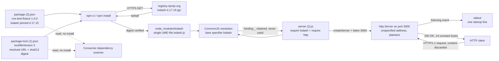

`additional_file.js` appears in no flow and in no edge of this diagram: it is not resolved, not required, not installed, not read by any command, and holds no state that could be handed on.

**Integration patterns and protocols.**

| Pattern | Where it appears | Protocol and format | Notes |
|---|---|---|---|
| One-way artifact fetch | Install (F1) | HTTPS GET of a gzip tarball, pinned by URL and verified by sha512 digest | The only outbound network call in the system; a digest mismatch aborts the install |
| Request/response messaging | Runtime (F3) | HTTP/1.1 over plaintext TCP, keep-alive | No routing, no method discrimination, request content discarded |
| Local module resolution | Runtime (F2) | CommonJS `require` against the filesystem | No dynamic import, no registry lookup, no code generation |
| Declarative hand-off | Analysis (F4) | JSON files read by external tooling | No API, webhook, event or callback into the fixture |
| Process signalling | Start-up and failure | One stdout text line; stderr stack trace with exit code 1 | No health endpoint, no metrics endpoint, no readiness probe |

**Data transformation points.** There are exactly two, and neither is application code. npm converts the lockfile's one `node_modules/lodash` entry into an on-disk artifact, verifying the digest before writing (L14–18). Node's HTTP parser and serialiser convert wire bytes into JavaScript request and response objects and back, adding status line and framing headers. Inside `server (2).js` there is no transformation at all: no request field is read, no environment value is consulted, no file is parsed, and the response body is a literal fixed at author time.

**Key data stores and caches.**

| Store or cache | Nature and lifetime | Contents | Role |
|---|---|---|---|
| `node_modules/lodash` | On-disk, created by install, persists until the directory is removed | One package: lodash 4.17.15, MIT | The only persisted artifact; makes the load-time require satisfiable |
| CommonJS `require` cache | In-memory, per process | One entry, `node_modules/lodash/lodash.js` (a single self-contained UMD file) | Holds the dependency's exports for the process lifetime; the binding that references them is never read |
| Socket and connection state | In-memory, per connection, owned by the runtime | Listening socket on port 3000, per-connection buffers and timers | Enables keep-alive reuse; no application state survives a request |

No database, external cache, session store, queue or runtime filesystem write exists anywhere in the system, and a whole-tree search finds no driver, client library or connection string for one.

### 5.1.4 External Integration Points

| External System | Integration Type | Data Exchange Pattern | Protocol, Format and SLA Position |
|---|---|---|---|
| npm public registry (`registry.npmjs.org`) | Install-time artifact source | One-way pull of a single tarball during install only; nothing is published back | HTTPS GET of `lodash-4.17.15.tgz`, accepted against the recorded sha512 digest; no SLA, retry policy or timeout is declared or configured |
| HTTP clients (any host able to reach port 3000) | Runtime inbound request | Every request answered with the same 14-byte body; request content never read | HTTP/1.1 over plaintext TCP on the unspecified address; no availability target, rate limit or timeout beyond the runtime's keep-alive defaults |
| Node.js runtime (host-supplied) | Runtime platform dependency | Process execution, CommonJS module resolution, HTTP parsing and socket ownership | No `engines` constraint, so no version contract exists; behaviour was observed on v22.23.3 with npm 11.18.0 |
| Consumer dependency/CVE scanning pipeline | Analysis consumer | One-way read of the manifest and lockfile; detection completes without installing or running anything | JSON text read as declarative input, plus advisory data the consumer supplies; the repository defines no integration, no scan job and no assertion |
| Git remote (`github.com/lakshya-blitzy/CVE_Repo_1210_01.git`) | Authoring and distribution | Source retrieval and history only; no build or deploy wired to it | Git over HTTPS, four commits on two divergent lines from `701ca5b` (`1210_01` at `9c2b13b` with `additional_file.js`, `main` at `94494b6` without it); no CI, no pipeline, no deployment target defined |

**SLA requirements.** None exist to document. No availability target, latency budget, error budget, retry policy, timeout, rate limit or recovery objective appears in any of the four files: the manifest declares only `name`, `version` and `dependencies`, and the entry point contains no timer, no retry logic and no configuration read. The only timing values in the running system are the host runtime's own defaults — the advertised `Keep-Alive: timeout=5` and the server's termination of an idle keep-alive socket shortly after — together with the latencies measured during verification (dependency resolution in well under a second, per-request work in the sub-millisecond range, and start-up to stdout in tens of milliseconds). An operator consuming the fixture must therefore set its own expectations; the fixture can neither meet nor breach a declared one.

## 5.2 Component Details

Each component is described against the same five headings — purpose and responsibilities, technologies and frameworks, key interfaces and APIs, data persistence requirements, and scaling considerations — so that the four committed files and the two external components can be compared on equal terms. The final three sub-sections carry the required interaction, state and sequence diagrams.

### 5.2.1 Dependency Manifest — `package (2).json`

**Purpose and responsibilities.** The manifest states the package's identity and, through a one-entry `dependencies` object at L4–L6, declares `lodash` at the exact version `4.17.15`. It is the first artifact a dependency or CVE scanner reads and needs no install to be useful, so it carries the fixture's primary analysis subject: name `cve-test-fixture`, version `1.0.0`. Its responsibilities end there — it declares nothing executable, describes nothing, and configures nothing.

**Technologies and frameworks.** Declarative JSON conforming to the npm package-metadata schema, using only three of its top-level properties. No `description`, `main`, `scripts`, `license`, `author`, `repository`, `keywords`, `engines`, `private`, `type`, `exports`, `devDependencies`, `peerDependencies`, `optionalDependencies`, `resolutions` or `overrides` is present. The absence of `main` and `scripts` is architecturally significant rather than incidental: it removes any declared entry point, which is why the process must be started by file path (§1.2.1, assumption A-04).

**Key interfaces and APIs.** The manifest has no callable API. Its interface is a schema contract consumed twice:

- *npm at install.* The `dependencies` entry drives resolution; npm matches the declared name and version against the lockfile entry for `node_modules/lodash` and installs from there. Because the value is the exact string `"4.17.15"` rather than a range, resolution cannot drift with registry state.
- *Scanners without install.* Declaration alone is sufficient for version matching, which is what makes the detection flow (F4) independent of the install flow (F1).

One operational constraint belongs to this component: npm does not recognise the committed filename, so the interface only opens after the file is renamed to `package.json` in a working copy (constraint C-01; see [§4.1.1](#411-core-business-processes) W-1).

**Data persistence requirements.** The file is itself the persisted state — a static artifact committed once in `701ca5b` with no migration mechanism, no schema version, and no runtime read. Nothing in the running system ever opens it, so there is no persistence, locking or consistency requirement to satisfy.

**Scaling considerations.** None apply in the runtime sense. The artifact's size is constant and its one dependency entry keeps both install and scan cost independent of graph size; the architecture's scalability property here is the inverse of a service's — the manifest is designed to stay at exactly one direct dependency, because every added entry would widen what a scan result must be attributed to.

### 5.2.2 Lockfile — `package-lock (1).json`

**Purpose and responsibilities.** The lockfile freezes resolution of the single declared dependency. Its `packages` map holds exactly two entries: the empty-string key `""`, which describes the root package and repeats `cve-test-fixture`, `1.0.0` and the pin, and `node_modules/lodash`, which carries the resolved version `4.17.15`, the absolute tarball URL `https://registry.npmjs.org/lodash/-/lodash-4.17.15.tgz`, the sha512 Subresource Integrity value, and the `MIT` license (L14–18). With `lockfileVersion: 3` and `requires: true`, it also makes `npm ci` a deterministic operation. This component is the system's only supply-chain control: the digest comparison it supplies is what decides whether an artifact downloaded from the public registry is accepted.

**Technologies and frameworks.** The npm v3 lockfile format, machine-generated and committed verbatim. It declares no transitive dependencies, so its dependency graph is a single edge — a shape that cannot exercise range resolution, peer resolution or conflict handling, which is a limitation of the fixture rather than of the format.

**Key interfaces and APIs.** The lockfile is consumed by npm's installer and by nothing else:

- *Resolution interface.* The `node_modules/lodash` key fixes the install path, version and artifact URL.
- *Verification interface.* The `integrity` field is compared against the fetched tarball's digest before any file is written, so a tampered or drifted registry response fails the install instead of silently altering the assessed input.
- *Consistency interface.* The root `""` entry must stay identical to the manifest's identity and pin; any divergence invalidates the resolution evidence the fixture exists to provide (§1.2.3, critical success factor 2).

**Data persistence requirements.** Persisted on disk and expected to remain committed, since a regenerated lockfile that resolved a different artifact would change the subject under test. There is no runtime persistence: the process never reads it. Its content is write-once in practice — npm rewrites it only when install runs against a changed manifest.

**Scaling considerations.** The two-entry map makes install cost constant and network traffic a single tarball fetch. The scaling property that matters is stability, not throughput: keeping exactly two entries preserves the `0` transitive dependency KPI in §1.2.3, whereas any added dependency would multiply the entries and the findings they attract.

### 5.2.3 Runtime Entry Point — `server (2).js`

**Purpose and responsibilities.** The entry point carries two responsibilities in five lines. The first is to keep the dependency edge in the module graph: `const _ = require('lodash')` at L1 executes the dependency's bundle and binds its exports to a module-scoped variable that is never dereferenced, so a graph-based tool sees the lodash edge while no lodash behaviour is attributable at run time. The second is to bind an HTTP listener whose response is fixed: `http.createServer((req, res) => { res.end('Hello, World!\n'); }).listen(3000, …)`. The file exports nothing — no assignment to `module.exports` or `exports` exists — so its entire effect is a load-time side effect, and `req` is accepted and ignored.

**Technologies and frameworks.** Node.js with the CommonJS module system, using the core `http` module as the only server technology. There is no framework, no router, no middleware, no templating, no bundler, no transpiler and no runtime dependency other than the unused lodash binding; the only two `require` calls in the whole repository are L1 and L3. The two behaviours in the file are both inline anonymous arrow functions: the request listener (L3–4) and the `listening` callback that logs the startup line (L5).

**Key interfaces and APIs.**

| Interface | Contract | Observed behaviour |
|---|---|---|
| HTTP request/response | Node's `http.Server` `'request'` event; the listener may write headers and a body through `res` | Every method, path, query string and body receives `HTTP/1.1 200 OK` with `Content-Length: 14` and the body `Hello, World!\n`; no `Content-Type` or `Server` header is emitted; the request is never read |
| HTTP server lifecycle | `http.createServer(listener)` then `Server.listen(3000, callback)` with no host argument | Binds TCP port 3000 on the unspecified address (observed `::`, dual-stack); the callback runs once on the `listening` event |
| Process observability | stdout for the readiness line; stderr and exit code for failures | One line, `Server running at http://127.0.0.1:3000/`; the line names loopback while the socket is bound to all interfaces, so it understates the reachable surface |
| Failure signalling | No `'error'` listener registered | A bind conflict produced an unhandled `'error'` event — `EADDRINUSE: address already in use :::3000` — and the process terminated with a stack trace and exit code 1 |
| Module exports | None | No programmatic API exists; the module cannot be imported for use |
| Configuration | No `process.env` read, no `argv` parsing, no config file | Port and bind scope are source literals; behaviour cannot be changed without editing the file |

Protocol-level handling occurs before this component runs: request parsing, malformed-input rejection and header-size limits are performed by the runtime, so the listener is only reached for well-formed requests ([§4.1.1](#411-core-business-processes) W-3).

**Data persistence requirements.** None. The process writes nothing to disk, holds no state across requests, and creates no session, cache file or log file. Its only retained memory is the runtime's own require cache and socket state, so a restart is indistinguishable from continued operation apart from the startup line.

**Scaling considerations.** The listener is a single-process, single-threaded event-loop server: JavaScript execution for every connection is serialised on one thread, while socket I/O is handled asynchronously by the runtime. Because the handler performs constant work with no blocking call, throughput is bounded by framing and socket machinery rather than by application logic, and no measured response degradation was observed under sequential or concurrent load. Horizontal scaling is constrained by construction: the port is a source literal, no `cluster` module or socket-sharing configuration is used, and no load balancer or service definition is provided, so running more than one instance requires either a distinct port per instance, an external reverse proxy, or a code change. No autoscaling signal exists either — there is no metrics or health endpoint to scale on. Vertical scaling is likewise open-ended: the process imposes no memory or connection limit, but nothing in the repository documents an intended capacity.

### 5.2.4 Inert Committed Source — `additional_file.js`

**Purpose and responsibilities.** This component has no responsibility in the running system, and that is its defining property. It is committed source that participates in no runtime, deployment or promotion path: nothing requires it, nothing names it in a manifest or lockfile, no command executes it, and it exports nothing. Its content is a Markdown code fence tagged `javascript` around a small in-memory user-collection snippet — a literal `users` array of five records shaped `{ id, name, age, active }`, five helper functions over that array (`getActiveUsers`, `getAverageAge`, `findUserByName`, `createUser`, `deactivateUser`), and nine `console.log` calls. Its only architectural role is documentary: it is part of the repository's inventory, and [§5.1.2](#512-core-components-table) records it as outside every runtime path.

**Technologies and frameworks.** Plain JavaScript source, 72 lines and 1737 bytes, pure ASCII with exactly one trailing LF. It uses no module system construct at all — no `require`, no `import`, no assignment to `module.exports` or `exports` — so it neither depends on nor extends the CommonJS conventions the entry point follows. It is not a loadable module: the repository treats it as committed text, and Node cannot evaluate it as JavaScript.

**Key interfaces and APIs.** None exist. There is no exported function, no callable surface, no route and no integration point, and no consumer anywhere in the tree reads it. The one observable behaviour it has is failure: `node additional_file.js` aborts at `additional_file.js:1:3` with `TypeError: "" is not a function`, exit code 1, and writes nothing to stdout — the first line of the file is a Markdown fence rather than JavaScript, so the loader throws before any of the snippet's declarations is evaluated. Nothing in the repository detects its presence, its absence or its content, which is why the same file can be present on one branch and deleted on another without any observable effect.

**Data persistence requirements.** None. The only data it mentions is the compile-time `users` array, which is a source literal rather than state: it is never instantiated, never read and never written, because the file never executes. The file itself is persisted in version control like any other committed artefact, and it adds nothing to the runtime persistence surface — no file write, no store, no cache ([§3.5](#35-databases--storage)).

**Scaling considerations.** None, and none could arise: an artefact that is never loaded cannot be measured for throughput, memory or startup cost, and it contributes no listener, no worker and no per-request work. Its only cost is 1737 bytes of repository storage, and it is absent from the process entirely.

### 5.2.5 Host Runtime and Materialized Dependency Artifact

**Purpose and responsibilities.** Two components outside the repository complete the architecture. The Node.js runtime executes the entry point, resolves the bare specifier `lodash`, parses and serialises HTTP, owns sockets and timers, and holds the module cache. The materialized artifact — lodash 4.17.15 installed under `node_modules/lodash` — satisfies the load-time require and carries the advisories the fixture exists to surface.

**Technologies and frameworks.** Node.js with the CommonJS loader and the core `http` module; the runtime version is unmanaged by the repository because no `engines` field is declared, and all behaviour reported in this section was observed on Node.js v22.23.3 with npm 11.18.0. The dependency is a single self-contained UMD bundle: `require('lodash')` added exactly one entry to the module cache, `node_modules/lodash/lodash.js`, and the package declares no dependencies, no peer requirements and no engine requirement of its own.

**Key interfaces and APIs.** The runtime presents the process-invocation interface (`node "server (2).js"`), the CommonJS resolution interface for bare specifiers, the HTTP parser and serialiser, and stdout, stderr and the exit code. The dependency presents the `_` export object, which is bound at L1 and never read. That unused binding is deliberate: it keeps the dependency in the module graph while leaving the vulnerable code paths unreachable, and it also makes the dependency a hard load-time prerequisite — with no `node_modules`, module evaluation aborts with `Error: Cannot find module 'lodash'` at `server (2).js:1:11` and exit code 1, before any socket is bound. `additional_file.js` presents no interface to either of them: the loader never reaches it, and it contributes no module-cache entry.

**Data persistence requirements.** The installed tree is the only persisted state either component introduces. It is created by install, is not committed (the checkout contains no `node_modules`), and must exist before the process can start; there is no vendored copy and no offline fallback. Because the require happens once at load, the artifact is read once per process and never again.

**Scaling considerations.** The dependency adds a fixed, one-time load cost — the bundle is parsed and executed during startup even though no function from it is called — and a fixed resident footprint to every process instance. Both are constant and independent of request volume. The dependency also fixes the fixture's risk posture: `4.17.15` predates the releases that fix its published advisories, and because the pin is exact, npm's own remediation advice points outside the declared range ([§4.1.1](#411-core-business-processes) W-4), so remediation is a deliberate, reviewed change rather than an automatic upgrade.

### 5.2.6 Component Interaction Diagram

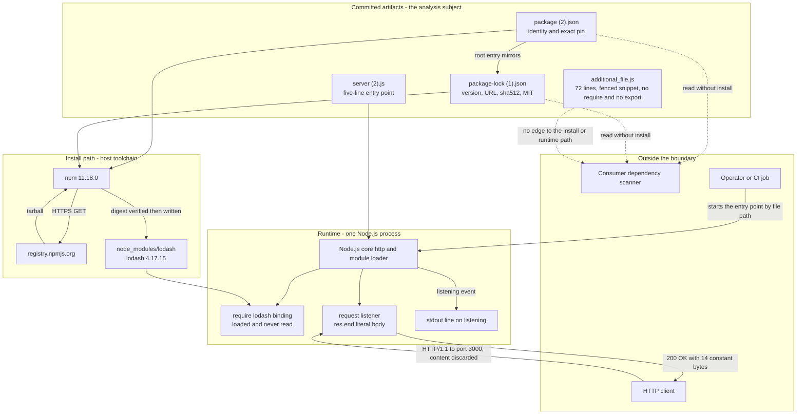

### 5.2.7 State Transition Diagrams

The process lifecycle has exactly two failure transitions, both of which terminate the process rather than degrade it, and one steady state in which it answers every request identically.

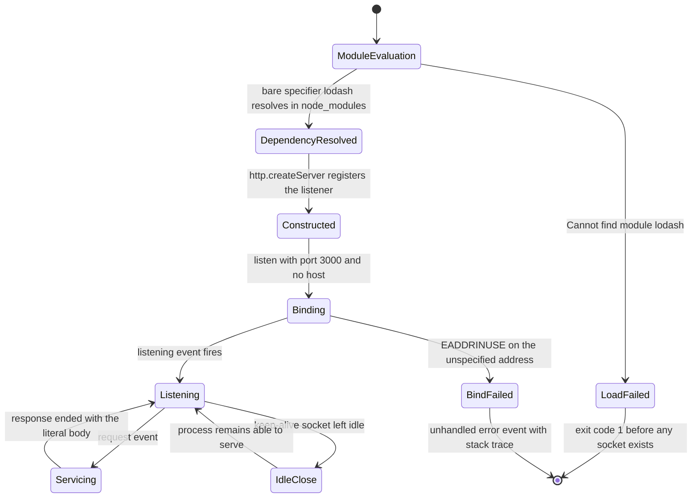

Connection state is per socket and independent of the process state above: requests on one socket are answered in order, and separate sockets do not share state. `additional_file.js` has no place in either diagram: it is never evaluated, so it reaches no state and can transition only from absence to failure if something attempts to load it.

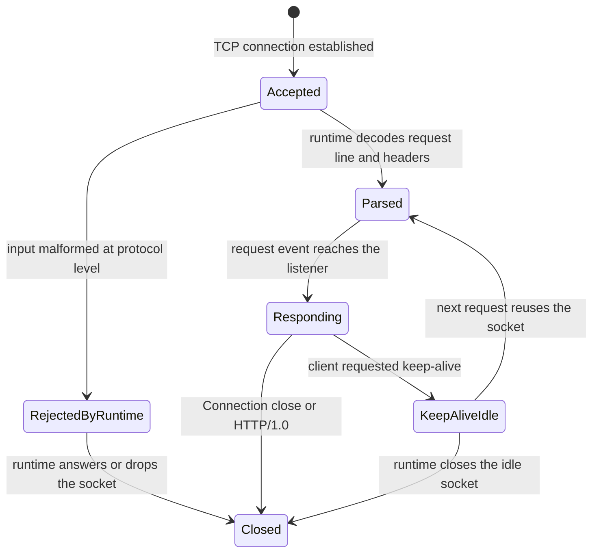

### 5.2.8 Sequence Diagrams for Key Flows

Start-up spans two tools and one process. The install half produces the artifact; the execution half produces the listening socket and a single readiness line.

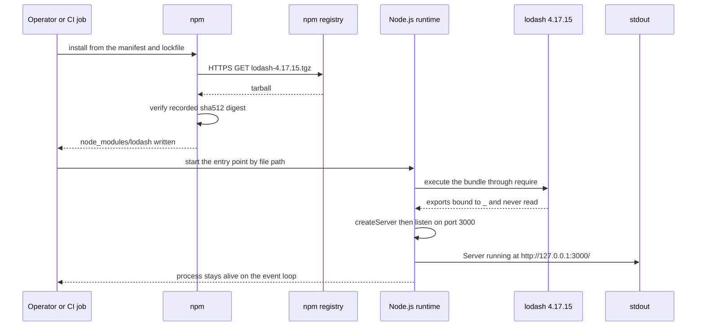

Request servicing shows the single, constant path every request takes, and the parallel path by which the same declarations are assessed without traffic at all.

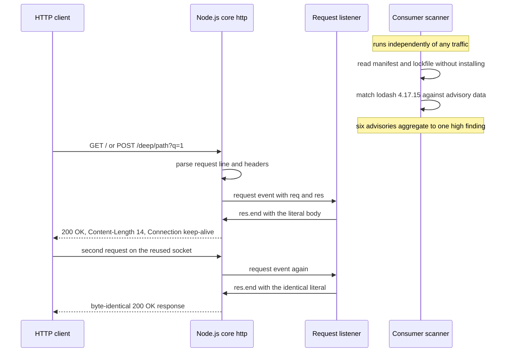

## 5.3 Technical Decisions

The repository contains no design notes, no README and no decision log — a whole-tree search finds four files and nothing else — so the decisions below are reconstructed from what the committed artifacts and the running process actually do. Where a decision names a rejected alternative, that alternative is the one a reader would otherwise expect for this kind of component; the stated cost of rejecting it follows from a property the repository itself measures, chiefly the dependency count and the determinism of the analysed input.

### 5.3.1 Decision Tree of Architectural Choices

```mermaid
flowchart TD
  StartNode{"Primary design goal?"}
  StartNode -->|chosen| DeclaredGoal["Reproducible declarative finding<br/>on exactly one pinned dependency"]
  StartNode -->|rejected| ProductGoal["Feature delivery and availability"]

  DeclaredGoal --> Q1{"Which HTTP layer?"}
  Q1 -->|chosen| CoreHttp["Node core http module<br/>zero added dependency edges"]
  Q1 -->|rejected| Framework["Express or Fastify<br/>adds transitive edges and findings"]

  DeclaredGoal --> Q2{"Keep the dependency edge?"}
  Q2 -->|chosen| KeepEdge["Retain the unused require binding<br/>edge visible, vulnerable code unreachable"]
  Q2 -->|rejected| DropEdge["Remove the require<br/>subject under test disappears"]

  DeclaredGoal --> Q3{"How is the version bound?"}
  Q3 -->|chosen| ExactPin["Exact pin plus lockfile digest<br/>resolution fixed and verifiable"]
  Q3 -->|rejected| RangePin["Caret range<br/>resolution drifts with registry state"]

  DeclaredGoal --> Q4{"Where does configuration live?"}
  Q4 -->|chosen| Literals["Source literals for port and body<br/>behaviour fixed at author time"]
  Q4 -->|rejected| ConfigFile["Environment and config files<br/>behaviour varies per host"]

  DeclaredGoal --> Q5{"Any state or cache?"}
  Q5 -->|chosen| Stateless["No persistence and no cache tier<br/>nothing to invalidate or corrupt"]
  Q5 -->|rejected| Stateful["Database or cache dependency<br/>new edges and new attack surface"]

  DeclaredGoal --> Q6{"How is exposure controlled?"}
  Q6 -->|chosen| Isolated["Unauthenticated plaintext listener<br/>acceptable only on an isolated network"]
  Q6 -->|rejected| ProxyTls["TLS and authentication via a proxy<br/>new dependencies, no protected asset"]

  DeclaredGoal --> Q7{"Who verifies the fixture?"}
  Q7 -->|chosen| Consumer["Consumer asserts the expected findings<br/>no tests, no CI, no build step"]
  Q7 -->|rejected| InRepo["In-repo test suite and pipeline<br/>devDependencies and a build surface"]

  DeclaredGoal --> Q8{"How is it packaged?"}
  Q8 -->|chosen| AsCommitted["Four files as committed<br/>packaging left to the consumer"]
  Q8 -->|rejected| Container["Container or orchestrator manifest<br/>an artefact with no declared target"]
```

Each *chosen* branch is what the committed files implement, and the two criteria that drive every one of them are visible in the artifacts themselves: the dependency count (one direct, zero transitive, per `package (2).json` L4–6 and `package-lock (1).json`) and determinism of the analysed input (exact pin, digest, literal response). Those two criteria explain the otherwise surprising omissions — the absent framework, configuration, storage, cache, authentication, tests and packaging — better than any product requirement would, because each omitted facility is also an omitted dependency edge.

### 5.3.2 Architecture Style Decisions and Tradeoffs

| Style decision | Tradeoff accepted | Evidence |
|---|---|---|
| Single-file, single-process, unlayered monolith | No internal boundary exists to test, replace or scale independently; growth would require restructuring rather than extension | `server (2).js` is five lines with no exports and no modules of its own |
| Node core `http` instead of a web framework | No routing, middleware, error pipeline or lifecycle hooks; anything a framework supplies must be written by hand | The repository contains exactly two `require` calls: lodash (L1) and `http` (L3) |
| No build step, no transpilation, no bundling | Source files are the deployed artifacts; language features are capped by the host runtime, which is unpinned because no `engines` field exists | No `scripts`, no `devDependencies`, no bundler or transpiler configuration anywhere |
| Declarative-first runtime with an inert dependency | The dependency's bundle is parsed and executed at every start-up, and install becomes mandatory, for no behavioural benefit | `require('lodash')` at L1 binds `_`, never dereferenced; without `node_modules` the process aborts with `MODULE_NOT_FOUND` |
| Event-driven, non-blocking, single-threaded execution | All JavaScript for all connections is serialised on one thread; the process cannot use a second core as written | One `http.Server`, one inline listener, no worker or cluster code |
| Stateless request handling | No feature requiring memory across requests is possible, and no request-level forensic record survives a response | Response is a compile-time literal; nothing is written to disk or retained in memory |

The style is coherent for its purpose and costly for any other: as a service, five unlayered lines offer no seams to evolve; as a fixture, layer boundaries would be additional lines whose only effect on the analysis subject would be to obscure it.

### 5.3.3 Communication Pattern Choices

| Pattern | Where it is used | Alternative available | Why this one is in force |
|---|---|---|---|
| Synchronous request/response over HTTP/1.1 with keep-alive | Every client interaction with port 3000 | gRPC, WebSocket, message queue, RPC over a socket | Requires no dependency beyond Node's core `http`; the response is a constant and needs no streaming, no duplex channel and no framing of its own |
| Method- and path-agnostic single endpoint | The request listener | Explicit routes, verb dispatch, 404/405 handling | The listener never reads the request, so the surface stays one implicit endpoint; any routing would be code with no observable distinction |
| Install-time one-way artifact pull | Dependency materialisation | Publish or push; vendoring a copy in the repository | One artifact, one digest, one fetch; vendoring would add files to a tree whose subject is its declaration |
| Zero outbound runtime communication | Whole runtime | Outbound HTTP client, telemetry exporter | No call site exists for one: the process answers and sends nothing else, which keeps the runtime inert and the boundary provable |
| Process-to-operator signalling through stdout, stderr and the exit code | Start-up and failure | Health or readiness endpoint, log framework, metrics exporter | No dependency and no second port; the `listening` event is an unambiguous readiness signal and the exit code distinguishes the failure cases |

No asynchronous messaging, event bus, queue consumer, scheduler or batch channel exists in the system, so there is no delivery-guarantee, ordering or idempotency decision to record. Ordering that does exist is implied by the transport: requests pipelined on one connection are answered in order, and separate connections are independent. The fourth committed file participates in none of these patterns: it opens no channel, issues no call and requires no module.

### 5.3.4 Data Storage Solution Rationale

**Decision.** The system stores nothing at run time and depends on no datastore. The only persisted state in the architecture is the four committed artifacts plus the `node_modules` tree that install creates.

**Rationale.** Three properties of the fixture make a storage tier impossible to justify. The subject under test is a declaration, so no business data needs to exist (§1.2.2). The response is a compile-time literal, so no read path exists for a store to serve. And every datastore requires a client dependency, which would put a second edge — and a second, unrelated finding surface — into a graph whose purpose is to hold exactly one (§1.2.3, dependency count KPI of zero transitive entries).

**Tradeoff accepted.** Findings that only a datastore can exhibit — injection through query construction, credential or connection-string leakage, storage misconfiguration — cannot be demonstrated by this fixture, and neither can the transitive dependency graphs, semver-range resolution or lockfile conflict handling that §1.2.1 lists as absent capability. That is a boundary of the fixture's scope rather than an oversight: the fixture asserts pin-level findings, and adding a datastore to widen the scope would change the assertion target. The in-memory record shape in `additional_file.js` changes nothing here: it is a compile-time literal in a file that never executes, so it adds no storage tier, no read path and no persistence requirement.

**Consistency and migration.** None required. There is no schema, no migration mechanism, no backup and no consistency model to reason about, because the only persisted bytes are source artifacts committed to Git and an installed dependency tree that any install reproduces from the lockfile.

### 5.3.5 Caching Strategy Justification

**Decision.** There is no cache at any tier: no in-memory cache, no HTTP cache headers or validators, no reverse proxy, no CDN, no external cache service.

**Justification.** A cache avoids repeated computation or repeated I/O, and neither exists here. The response is a 14-byte literal fixed at author time, the handler performs one call with no branch, and no request data reaches the response, so a cache would store a single value that is already free to produce. Every caching mechanism available would also introduce state — an entry with an invalidation rule inside the process, or a validator and a lifetime on the wire — into a process whose statelessness is one of the properties that keeps it restartable and deterministic. The only cache in the system belongs to the runtime: the CommonJS require cache, which holds `node_modules/lodash/lodash.js` for the process lifetime so that the bare specifier resolves. That is a module-resolution artifact, not an application cache.

**Accepted consequences.** Responses carry no `Cache-Control`, `ETag` or `Last-Modified` (the observed header set is `Date`, `Connection`, `Keep-Alive`, `Content-Length`), so a client cannot revalidate or be told how long the body is fresh, and an intermediary is free to apply its own heuristics; response latency is bounded only by the runtime's framing and socket work. If a future version needed a cache, the mechanism would have to be added deliberately, together with the state and the dependency edge it implies.

### 5.3.6 Security Mechanism Selection

**Mechanism actually present.** Exactly one security mechanism exists in the system: the sha512 Subresource Integrity value recorded for the single dependency at `package-lock (1).json` L17, which the installer compares against the fetched tarball before writing it. Its role is integrity of the analysed input — without it, nothing proves which artifact a scanner's finding refers to — and together with the exact pin at L4–6 of the manifest it prevents silent substitution through resolution drift.

**Mechanisms deliberately absent.**

| Absent mechanism | Consequence of its absence | Why it is absent |
|---|---|---|
| TLS and any transport encryption | Requests and responses cross the wire in plaintext | There is no protected payload: the body is a public constant and the request content is discarded |
| Authentication and authorization | Any host that can reach port 3000 is served; no identity is ever established | No protected asset, no user, no credential and no secret exists in the tree |
| Input validation and sanitisation | Not applicable — the listener never reads the request | No input reaches application logic to validate |
| Rate limiting and request throttling | No limit on request volume or connection count | Enforcement would require configuration and state; the workload has no cost model to protect |
| Secrets management | No secret is configured, so none can leak from the repository | A grep across the four files finds no environment read, token, key or credential |
| Dependency scanning inside the repository | The vulnerable pin is surfaced only by the consumer's tooling | The advisory source is supplied by the consumer (assumption A-05) |
| Network restriction on the bind | The socket is bound to the unspecified address, so every interface answers | `listen(3000)` passes no host and no configuration surface exists to change it |

The fourth committed file adds no mechanism to this list: it contains no credential, makes no network call, is reachable by no request path, and cannot execute, so it neither introduces a security consideration nor mitigates one.

**Residual risk and accepted exposure.** Three exposures follow from those choices and are accepted rather than mitigated. First, the listener is reachable on all interfaces while the only readiness message names `127.0.0.1`, so the announced address understates the reachable surface — a reader who trusts the log line would misjudge the exposure. Second, the process loads a dependency version carrying published advisories; the vulnerable functions are never called, so the runtime behaviour is unaffected, but the graph is affected, which is the fixture's purpose — and because the pin is exact, remediation is a deliberate version change on a copy rather than an automatic upgrade. Third, the fixture carries no isolation control of its own: keeping it off shared networks, data stores and credentials is the consumer's responsibility (§1.2.3, critical success factor 5).

### 5.3.7 Architecture Decision Records

| ADR | Decision and alternatives considered | Rationale | Consequences accepted |
|---|---|---|---|
| ADR-01 | Single-file, single-process, unlayered monolith; not a layered or modular service | The runtime is a vehicle for a declarative subject; five lines is the minimum that binds a socket and keeps the dependency edge | No seams to test, replace or scale independently; growth means restructuring |
| ADR-02 | Node core `http`; not Express, Fastify or another framework | Any framework adds dependencies, each widening the finding surface and breaking the zero-transitive KPI | Routing, middleware and error pipelines would have to be written by hand if ever needed |
| ADR-03 | Retain the unused `require('lodash')` binding; not exercise lodash, and not remove it | Keeps the dependency in the module graph while leaving the vulnerable code unreachable; removing it deletes the subject under test | Install becomes a hard prerequisite (`MODULE_NOT_FOUND` without it) and the bundle loads at every start-up |
| ADR-04 | Exact pin `4.17.15` plus `lockfileVersion: 3` with a sha512 digest; not a caret range and not manifest-only declaration | The assessed input must be byte-identifiable and tamper-evident | npm cannot satisfy the declared range with a fix version, so remediation must be a deliberate change on a copy |
| ADR-05 | No configuration surface: source literals for port and response, no environment reads, no `argv`, no config file | Determinism and independence from host state | A port conflict can only be resolved by editing code or freeing the port, and bind scope cannot be tuned |
| ADR-06 | Statelessness: no persistence and no filesystem writes at run time | Nothing needs storing, and a store would add a dependency and a secrets concern | No storage-layer findings can be produced by the fixture |
| ADR-07 | No caching tier and no HTTP cache directives | The response is a constant, so a cache would manage state for zero gain | Clients receive no validators and no freshness information |
| ADR-08 | Dependency-inert runtime: no lodash call site anywhere | Detection is declarative; a call path would make vulnerable code reachable and change runtime behaviour | Reachability must be reasoned about from an unused binding, and a scanner may judge the edge unreachable |
| ADR-09 | No authentication, authorization or TLS; not a TLS-terminating proxy with basic auth | No protected asset exists, and a proxy would add dependencies the fixture does not need | The listener must be isolated by the network the consumer attaches it to; traffic is plaintext on every interface |
| ADR-10 | Observability limited to one `console.log` line on the `listening` event; no log framework, metrics or health endpoint | Avoids dependencies and extra ports, and keeps output deterministic | No per-request records, no metrics and no probe target exist for a scheduler or platform |
| ADR-11 | No error handling and no recovery path; not an `'error'` listener with retry or fallback port | Fail-fast is unambiguous, adds no state, and surfaces the fault through stderr and the exit code | A bind failure terminates the process instead of degrading |
| ADR-12 | No tests, no CI and no build step; verification belongs to the consumer | The assertion target is consumer-defined because no advisory data is shipped (assumption A-05) | Nothing in the repository detects drift in the pin or the lockfile (constraint C-06) |
| ADR-13 | Committed filenames keep their upload suffixes (` (2)`, ` (1)`); not renamed to canonical npm names | Provenance: the files were added through a single GitHub "Add files via upload" commit and never renamed | npm commands fail against the committed names (`EUSAGE` for `npm ci`, `ENOENT` for `npm install`), so a rename precedes install; every path must be quoted in shell commands |
| ADR-14 | No container, orchestrator or infrastructure-as-code definition | No deployment target is declared, and packaging is a consumer concern | The fixture cannot be launched by a platform without packaging supplied outside the repository |

**The fourth artefact is not a decision.** `additional_file.js` joins the tree through the same GitHub upload flow that produced the upload-suffixed filenames recorded in ADR-13 — committed as "Create additional_file.js" on one branch and deleted on the other — and it is documented alongside that decision rather than as an architectural choice of its own. It invalidates none of the ADRs above: it adds no dependency edge, no storage tier, no communication pattern, no cache, no security mechanism, no error path and no test surface, and it cannot execute. Its only architectural significance is the negative one recorded in [§5.1.2](#512-core-components-table): it lies outside every runtime path.

## 5.4 Cross-Cutting Concerns

Cross-cutting concerns in this system are defined almost entirely by absence, and the absences are consistent rather than accidental: each would have required code, configuration or a dependency that the architecture deliberately excludes. The table below states the posture for each concern; the sub-sections that follow give the evidence and the consequences.

| Concern | Posture | In-repository mechanism | Consequence |
|---|---|---|---|
| Monitoring and observability | Minimal | One stdout line on the `listening` event | No metrics, no probes, no per-request signal |
| Logging and tracing | Startup only | A single unstructured `console.log` at L5 | No access records, no correlation, no request forensics |
| Error handling | Fail-fast at start-up, no-op per request | No `try`/`catch`, no `'error'` listener, no exception handlers | Startup faults terminate the process; no request can produce an application error response |
| Authentication and authorization | None | No mechanism exists | Every request is served; isolation depends on network placement |
| Performance and SLAs | Undeclared | Constant per-request work over non-blocking sockets | The fixture can neither meet nor breach a target it does not state |
| Disaster recovery | No state to recover | The four committed files plus a reproducible install | Recovery is a restart; no backup, failover or runbook exists |

### 5.4.1 Monitoring and Observability

**What the system emits.** Two signals exist, both at process level. On the `listening` event the callback at `server (2).js` L5 writes one line to stdout: `Server running at http://127.0.0.1:3000/`. On a load-time or bind-time fault the runtime writes a stack trace to stderr and the process exits with code 1. Nothing else is emitted — not a per-request record, not a counter, not a timer, not a gauge.

| Signal | Emitted by | Content | What it establishes |
|---|---|---|---|
| Startup line | `listening` callback, L5 | A fixed, unstructured sentence naming `http://127.0.0.1:3000/` | That the socket was bound successfully; it does not report the actual bind scope |
| Failure trace | Node runtime on an unhandled exception or `'error'` event | Stack trace naming the failing statement (`server (2).js:1:11` for a missing dependency, `server (2).js:5:4` for a bind conflict) | Which phase failed, and that the process is gone |
| Exit code | Process termination | `1` on both observed failure paths | Machine-readable failure without parsing the trace |

**What is absent.** There is no health, readiness or liveness endpoint; no `/metrics` route or metrics client; no APM agent, tracing exporter or `diagnostics_channel` instrumentation; no heartbeat or watchdog; no alerting hook; and no configuration file through which any of these could be enabled without editing source. Readiness can only be inferred externally, by process liveness or by the fact that port 3000 accepts a connection — and because every path returns `200 OK`, an HTTP probe cannot distinguish the intended fixture from an unrelated service answering on that port.

**Practical consequence.** An operator can observe that the process is up, that it holds a socket, and what it printed at start-up. Nothing can be observed about volume, latency, error rate or client identity, because none of it is measured. Any monitoring of the fixture must therefore be built outside it — process supervision, a TCP or HTTP probe, and stdout collection — which is consistent with the observability decision recorded as ADR-10.

### 5.4.2 Logging and Tracing Strategy

**Logging.** Exactly one application log statement executes in the running system: `console.log` inside the `listening` callback at L5. A case-insensitive sweep for `log`, along with `process.env`, `config`, `auth`, `token`, `secret`, `tls`, `cache` and `argv` across the four committed files matches that line and, in addition, nine `console.log` statements inside `additional_file.js` — statements that never emit, because that file cannot load as committed. Its output is unstructured plain text with no timestamp, no severity level, no key–value fields and no request identifier, and it is emitted once per process, not once per request. No log framework, transport, rotation policy, file target or agent configuration is present, so the destination is whatever the operator's shell or supervisor provides.

**Request logging.** None. There is no access log, no status-code counter and no error log per request, and the listener never inspects `req`, so a method, path, query string, client address or response code is not available to log even in principle without a code change. The only per-request facts that exist anywhere are those the client itself can observe.

**Tracing.** None. No trace or span identifiers are created, no correlation headers are read or propagated, and no context object is passed between components — there is no second component to pass it to, since the request listener is the only application handler in the system. The three flows that cross a boundary (install, request servicing, scanning) are each recorded by the tool that performs them — npm, the client, the scanner — never by the fixture, so correlating a failure seen by a client with a record held by the fixture is impossible from the fixture's side.

**Accepted consequences.** Start-up and failure are diagnosable from stdout, stderr and the exit code; everything that happens after the socket is listening is invisible to the system that serves it. The startup line is also descriptive prose rather than a measurement: it names `http://127.0.0.1:3000/` while the socket is bound to the unspecified address, so it is the one log statement the process ever emits and it understates the exposure it reports.

### 5.4.3 Error Handling Patterns

**Pattern in force.** Fail-fast at start-up, no-op at request time. Application code contains no `try`, no `catch`, no `'error'` listener on the server, no `process.on('uncaughtException')` or `'unhandledRejection'` handler, no status-code assignment, no retry, no circuit breaker and no fallback. A fault that prevents the process from reaching a listening state terminates it; a fault in a request never reaches application code, because the handler either ignores the input or is bypassed by the runtime's parser.

| Failure | Detected by | Observed behaviour | Required recovery |
|---|---|---|---|
| Dependency not installed | Module loader at L1 | `Error: Cannot find module 'lodash'` at `server (2).js:1:11`, stack trace on stderr, exit code 1, no socket bound | Install dependencies, then start the process again |
| Port already in use, or any bind failure | `listen` at L5 | Unhandled `'error'` event — `EADDRINUSE: address already in use :::3000` — stack trace, exit code 1 | Free port 3000 or edit the literal and restart |
| Malformed request line, unsupported HTTP version or method token | HTTP parser in the runtime, before the listener | The runtime answers or closes the connection; the listener is never invoked ([§4.1.1](#411-core-business-processes) W-3) | Client corrects and retries |
| Oversized header block | HTTP parser in the runtime | Rejected before the listener runs ([§4.1.1](#411-core-business-processes) W-3) | Client reduces the request |
| Request body that is missing, malformed or large | Nowhere — the body is never read | The constant `200 OK` is returned regardless | None needed; no input path exists |
| Client disconnect or half-open socket | Socket layer | Connection torn down; the process remains listening and unaffected | None needed |
| Idle keep-alive connection | Runtime timer | The runtime closes the socket after the advertised timeout | None needed |

**Rationale.** With no request-dependent behaviour anywhere in the system, an error handler could only introduce variation into responses that are meant to be byte-identical, and it would add branches whose correctness would itself need verification. Terminating on a start-up fault is equally deliberate: the process can never be half-initialised, because the dependency require precedes both server construction and binding.

**Accepted consequences.** There is no in-process recovery of any kind, so restart after a fault is the responsibility of an external supervisor — and no supervisor definition, restart policy or container manifest exists in the repository (ADR-11, ADR-14). A port conflict cannot be resolved by the process itself, because the port is a source literal (ADR-05).

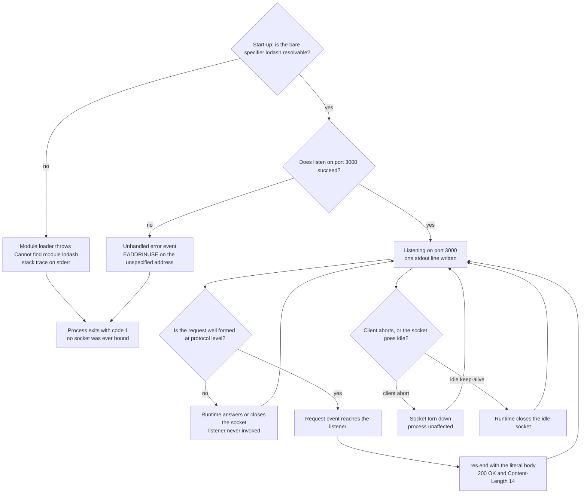

### 5.4.4 Authentication and Authorization Framework

**Framework.** There is none, and no partial mechanism either: no authentication middleware, no session or cookie handling, no token, API key or header check, no mutual TLS, no IP allow-list, no CORS policy, no host-header validation, and no reference to an identity provider. The listener is method- and path-agnostic and never reads the request, so there is no protected resource, no role and no privilege boundary to express — every request that reaches the listener is served, which makes authorization vacuous rather than permissive by policy.

| Control | Present | Effect on the reachable surface |
|---|---|---|
| Authentication of the client | No | Any reachable host is served without identifying itself |
| Authorization or access control | No | No resource exists to protect; all paths behave identically |
| Transport encryption (TLS) | No | Traffic is plaintext; the response carries only `Date`, `Connection`, `Keep-Alive` and `Content-Length` |
| Credential or secret handling | No | No environment read, token, key or credential appears in any of the four files |
| Network-level restriction | No | The socket is bound to the unspecified address, so every interface on the host answers |
| Isolation obligation | External | The fixture must be placed where only intended consumers can reach it (§1.2.3, critical success factor 5) |

**Exposure.** The bind is wildcard — `listen(3000)` supplies no host, and the process was observed listening on `::` in dual-stack mode — while the only message the system prints names `http://127.0.0.1:3000/`. The practical security boundary is therefore set by host firewall rules and network placement, not by the application, and the startup line cannot be used to reason about it.

**Governance consequence.** If this fixture were ever repurposed into a service, authentication would be a new design rather than a configuration change: there is no middleware chain to insert a check into, no framework supplying one, and no configuration surface to hold credentials. The place to add it is the five-line entry point itself, which would make the change visible in review.

### 5.4.5 Performance Requirements and SLAs

**Declared requirements.** None. No availability target, latency budget, error budget, throughput target, concurrency limit, timeout, memory ceiling or recovery objective appears in any of the four files, and the manifest declares neither `engines` nor `scripts` through which a runtime constraint could be expressed. The system therefore has no SLA to meet or breach; performance can only be described by its intrinsic characteristics and by what was measured during verification.

| Dimension | Requirement declared | Capability observed or implied |
|---|---|---|
| Per-request latency | None | Constant work: one `res.end` with a 14-byte literal, no I/O, no per-request state; sub-millisecond sequential responses measured during verification ([§4.1.1](#411-core-business-processes) W-3) |
| Throughput and concurrency | None | Non-blocking socket handling with all JavaScript on one thread; no degradation observed across sequential or concurrent load, with no throttling or connection cap in place |
| Start-up time to readiness | None | Dependency resolution, server construction and bind; the readiness line appeared within the settle window used in verification ([§4.1.1](#411-core-business-processes) W-2) |
| Install-to-ready cost | None | One package added from a single tarball; measured at well under one second in a clean environment (§1.2.3) |
| Connection lifetime | None | Runtime defaults: `Keep-Alive: timeout=5` advertised, and an idle keep-alive socket closed by the server shortly after ([§4.1.1](#411-core-business-processes) W-3) |
| Failure and timeout handling | None | No retry, no backoff, no request timeout, no rate limit, no circuit breaker, no fallback path |

**Implications.** Two properties bound performance in practice. The first is that all JavaScript in the process is serialised on a single thread, so added work in the handler would delay other connections, though the current handler does none. The second is that the literal port prevents more than one instance per host without a reverse proxy or a code change, and the absence of any metrics or health signal prevents an autoscaler from making a scaling decision at all. Conversely, resource consumption is trivially predictable: the process serves a fixed body with no unbounded cache, queue or buffer of its own, so its memory footprint is dominated by the runtime and the single loaded dependency bundle rather than by traffic.

**What a consumer must supply.** Because nothing is declared, every expectation — probe interval, restart policy, acceptable startup delay, and any capacity ceiling — has to be defined by the consuming pipeline or operator, which is the same conclusion reached for external integration points in [§5.1.4](#514-external-integration-points).

### 5.4.6 Disaster Recovery Procedures

**Recovery posture.** There is no state to lose: the process holds no persistent data, writes nothing to disk at run time, and keeps nothing across requests, so the recovery point objective is zero by construction because no data is ever mutated. Recovery is therefore a restart plus, at most, a reinstall from the committed declaration. The unit of recovery is the repository content itself: four files under Git, on a history of four commits across two divergent lines from `701ca5b`, with `1210_01` at `9c2b13b` on `origin` as the checked-out revision.

| Failure scenario | Impact | Recovery step available | External dependency |
|---|---|---|---|
| Process crash (bind conflict, missing dependency, host restart) | Service unavailable until restarted; no data loss | Start the entry point again by file path | A supervisor — the repository defines no restart policy, unit file or container |
| Port 3000 occupied by another process | Start-up fails with `EADDRINUSE` | Free the port, or edit the source literal and redeploy | Operator action; no configuration surface exists |
| `node_modules` absent, incomplete or corrupted | Start-up fails with `MODULE_NOT_FOUND`, or an install fails its digest check | Re-run install in a clean working copy; the lockfile reproduces the exact artifact by digest | The npm registry must be reachable |
| Host loss or corruption of the checkout | Service unavailable | Re-clone from `origin` and reinstall | Network access to the Git remote |
| Accidental dependency upgrade applied in place | The vulnerable baseline is destroyed and the fixture becomes an ordinary smoke-test server | Restore the committed pin and lockfile from Git | Git history; §1.2.3 requires remediation to be demonstrated on a copy for this reason |
| `additional_file.js` missing from the working tree | No functional impact: nothing loads or invokes it | Restore it from `1210_01` if the tree must match that branch; otherwise no action is needed | Git history — the file exists only on `1210_01`, not on `main` |
| Runtime version change on the host | Unmanaged behaviour change; no `engines` constraint pins the runtime | Reinstall a compatible runtime | Nothing in the repository constrains or records the version |

**Procedures that do not exist.** No backup or snapshot job, no replication or failover, no standby instance, no runbook, no health check for a supervisor to consume, no alerting, and no infrastructure definition of any kind. Recovery is consequently an operator procedure rather than a system capability, and the fastest correct sequence is: confirm the working tree at HEAD `9c2b13b` carries the three analysis-relevant files byte-identical to `701ca5b`, run install if `node_modules` is absent, then start the entry point and confirm the single startup line.

**The one recovery rule specific to this system.** The vulnerable baseline must be restored exactly — the manifest and lockfile pair as committed — because the fixture's value lies in being a stable assertion target. A remediation applied in place is indistinguishable from data loss here, which is why W-5 in [§4.1.1](#411-core-business-processes) prescribes working on a copy or branch.

## 5.5 References

**Repository artifacts cited as evidence**

- `server (2).js` — the only executable component: five lines containing `const _ = require('lodash')` (L1, an unused binding), the `http.createServer` request listener that returns the literal `'Hello, World!\n'` (L3–4), and `listen(3000, …)` with the startup `console.log` (L5); source of every statement about the request/response contract, the bind call, the absence of exports and error handling, and the single observability signal.
- `package (2).json` — dependency manifest declaring `name` `cve-test-fixture`, `version` `1.0.0` and the exact pin `lodash` `4.17.15` (L4–6); establishes the absence of `main`, `scripts`, `engines`, `license` and `devDependencies`, and the declarative analysis subject.
- `package-lock (1).json` — npm `lockfileVersion: 3` lockfile with two package entries; the root `""` entry mirroring the manifest and `node_modules/lodash` (L14–18) carrying version `4.17.15`, the registry tarball URL, the sha512 integrity value and the MIT license; source of the install-time resolution and verification claims, including the zero-transitive-dependency count.
- `additional_file.js` — 72 lines, 1737 bytes, blob `4f1bd913…`; establishes the fourth committed file, its Markdown-fenced JavaScript content, the absence of any `require` or export, and the load abort at `1:3` (`TypeError: "" is not a function`) that keeps it outside every runtime path described in this section.
- Repository root folder (empty path) — confirmed to contain exactly the four files above, 105 lines and 2563 bytes in total, with no sub-folders, no configuration, no tests, no CI definition and no `.blitzyignore` file anywhere in the tree.
- Git metadata (`.git/`) — commits `701ca5b` ("Add files via upload"), `84202e4` and `9c2b13b` ("Create additional_file.js") and `94494b6` ("Delete additional_file.js") on two divergent lines; branch `1210_01` at HEAD `9c2b13b` carrying `additional_file.js` and `main` at `94494b6` without it; a clean working tree, `origin` pointing at `github.com/lakshya-blitzy/CVE_Repo_1210_01.git`, and a `.git/hooks` directory containing only `*.sample` stubs; establishes provenance, the shape of the history and the absence of repository-defined automation.

**Runtime evidence gathered by executing a throwaway copy outside the checkout**

- Execution on Node.js v22.23.3 with npm 11.18.0: `Error: Cannot find module 'lodash'` at `server (2).js:1:11` with exit code 1 when `node_modules` is absent; the startup line `Server running at http://127.0.0.1:3000/` when it is present; `HTTP/1.1 200 OK` with `Content-Length: 14`, `Connection: keep-alive` and body `Hello, World!` for `GET /` and `POST /deep/path?q=1` alike, including via `127.0.0.2`; unhandled `'error'` event with `EADDRINUSE: address already in use :::3000` on a second instance; listening address reported as `::` (family IPv6, dual-stack); exactly one entry added to the module cache by `require('lodash')` (`node_modules/lodash/lodash.js`); and `TypeError: "" is not a function` at `additional_file.js:1:3` with exit code 1 and no stdout output when that file is run directly.

**Cross-referenced sections of this specification**

- [§1.2 System Overview](#12-system-overview) — establishes the fixture's purpose as an application-security subject, the declaration-as-subject principle, the component names reused throughout this section, the absent-capability list, constraint C-01, assumption A-05 and the critical success factors including isolation and preservation of the dependency edge.
- [§4.1 System Workflows](#41-system-workflows) — supplies the workflow identifiers W-1 to W-5 used here for install, start-up, request servicing, detection and remediation, together with the measured timings and the observed absence of a content-type header.
- The section-5 sub-sections cross-referenced internally: [§5.1.4](#514-external-integration-points) for external integration and SLA posture, and [§4.1.1](#411-core-business-processes) for workflow-level behaviour including protocol-level request rejections.

**Web sources consulted for external dependency facts**

- [web] npm registry packument for `lodash` (`https://registry.npmjs.org/lodash`) — established the published version history, that `4.17.15` was published in July 2019, and that `4.18.1` is the current `latest` release (April 2026).
- [web] Snyk package pages for `lodash` and for `lodash@4.17.15` (`https://security.snyk.io/package/npm/lodash`, `.../lodash/4.17.15`) — advisory counts per version, the fix guidance pointing above the pinned release, and the presence of two High advisories without CVE identifiers.
- [web] GitHub Advisory Database and OSV entries for `CVE-2020-8203`, `CVE-2021-23337`, `CVE-2020-28500`, `CVE-2025-13465`, `CVE-2026-2950` and `CVE-2026-4800` — the affected functions, severity classes and fix versions cited in [§5.3.6](#536-security-mechanism-selection) and referenced from §1.2.3.
- [web] `lodash@4.17.15` published manifest and README on unpkg (`https://unpkg.com/lodash@4.17.15/package.json`) — confirmed that the dependency declares no `engines`, `dependencies` or `peerDependencies`, so no runtime or peer contract is enforced by it.
- [web] Lodash version-support statement (`https://lodash.com/version-support`) — confirmed that the project supports only the latest version of a given major release line, which qualifies the remediation guidance recorded for the pinned release.

Nothing in this section rests on documentation inside the repository, because none exists: the tree contains no README, no design note, no decision log and no comment beyond the code itself, so every claim above is traced either to one of the four committed files, to the process behaviour observed while executing them, or to a public source about the pinned dependency version.

# 6. SYSTEM COMPONENTS DESIGN

## 6.1 Core Services Architecture

### 6.1.1 Applicability Determination

**Core Services Architecture is not applicable for this system.**

The repository contains no microservices, no distributed architecture and no distinct service components. Its entire committed content is four files at the repository root — `server (2).js` (5 lines of executable Node.js), `package (2).json` (7 lines of manifest), `package-lock (1).json` (21 lines of lockfile) and `additional_file.js` (72 lines, 1737 bytes) — totalling 105 lines and 2563 bytes, with no folder of any kind beneath the root and no deployment, orchestration or infrastructure descriptor anywhere in the tree. Exactly one component executes: the single Node.js process started from `server (2).js`. Everything the system does at runtime happens inside that process — one `http.Server` bound to TCP port 3000 whose listener terminates every request with the compile-time literal `'Hello, World!\n'` (`server (2).js` L3–L5). There is no second component to call, address, discover, balance, retry or fail over to.

The fourth committed file is not a service component. `additional_file.js` is started by nothing, required by nothing, listens on no port, holds no state that any other part of the system reads, and cannot even load as committed (`TypeError: "" is not a function` at 1:3). It therefore takes no part in service boundaries, discovery, scaling, resilience or degradation, and its presence changes none of the determinations below.

| Required area | Posture in this repository | Evidence |
|---|---|---|
| Service boundaries and inter-service communication | One process boundary; no service-to-service call of any kind | `server (2).js` L1–L5 — the only two `require` calls are a never-dereferenced dependency and a Node core module |
| Service discovery, load balancing, circuit breaker, retry | Absent from code and configuration | No `try`/`catch`, no `'error'` listener, no client, no timer, no counter in the entry point; whole-tree search finds no proxy, ingress or registry configuration |
| Auto-scaling, resource allocation, capacity rules | Absent | `package (2).json` L1–7 declares only `name`, `version` and `dependencies` — no `scripts`, `main` or `engines` through which behaviour could be constrained |
| Resilience and disaster-recovery machinery | Restart only; no state to protect | Nothing is written to disk at runtime (`server (2).js` L1–L5); `package-lock (1).json` L14–19 is the only persisted artifact reference |

**Why the absence is deliberate.** The fixture exists to be a stable single-point assertion target for dependency analysis: its manifest declares one exact pin (`lodash@4.17.15`, `package (2).json` L4–6), its lockfile resolves that pin to one digest-verified artifact (`package-lock (1).json` L14–19), and its entry point keeps the dependency edge in the module graph while never calling into it (`server (2).js` L1). Every facility a service architecture would contribute — a framework, layering, configuration, a registry, health endpoints, retries, a supervisor, container or orchestrator definitions — would add nodes, edges or behaviour to a graph whose purpose is to contain exactly one edge, and would make the observed response vary. The architectural consequences are recorded in [§5.1.1](#511-system-overview) and the per-concern posture in [§5.4](#54-cross-cutting-concerns).

**How the remaining sub-sections are to be read.** Because no service architecture exists, the sub-sections below do not describe one. Against each area the section prompt enumerates, they record what the single process actually does, what is demonstrably absent, and which capability a consumer must therefore supply: [§6.1.2](#612-service-components) for components, communication, discovery, balancing, circuit breaking and retry; [§6.1.3](#613-scalability-design) for scaling, auto-scaling, resources, performance and capacity; [§6.1.4](#614-resilience-patterns) for fault tolerance, disaster recovery, redundancy, failover and degradation; and [§6.1.5](#615-required-diagrams) for the required diagrams.

### 6.1.2 Service Components

**Service boundaries.** The system has exactly one deployable unit — the Node.js process started from `server (2).js` — and it qualifies as a service only in the narrow sense of being a long-running listening process. Three boundaries exist, and only the first is a runtime boundary.

| Boundary | What is inside | What crosses it | Evidence |
|---|---|---|---|
| Process (runtime) | One module graph holding a never-dereferenced dependency binding, one `http.Server`, one bound socket | Inbound: HTTP/1.1 connections on port 3000. Outbound: one stdout line per process | `server (2).js` L1–L5 |
| Install (pre-runtime, separate process) | npm reading the manifest and lockfile | Inbound: one HTTPS tarball fetch verified by digest. Outbound: `node_modules/lodash` on the local filesystem | `package (2).json` L4–6; `package-lock (1).json` L14–19 |
| Declarative artifact (file) | The two JSON documents at the repository root | Outbound: read-only hand-off to npm at install and to scanners with no install at all | `package (2).json` L1–7; `package-lock (1).json` L1–21 |

No second runtime boundary exists. Nothing in the process opens an outbound connection, spawns another process, or writes to disk; no service, container, sidecar, ingress or proxy is declared anywhere in the tree ([§5.1.1](#511-system-overview), [§3.6](#36-development--deployment)).

**Responsibilities.** The single runtime component carries four responsibilities and no others. There is no controller/service/repository split, no routing table, no middleware chain and no dependency-injection container that would host a layer boundary.

| Responsibility | Implementation | Evidence |
|---|---|---|
| Retain the dependency edge in the module graph | `const _ = require('lodash')` — a module-scoped binding never dereferenced afterwards | `server (2).js` L1 |
| Construct and bind the listener | `http.createServer(...).listen(3000, ...)` with no host argument, so the unspecified address is bound | `server (2).js` L3–L5 |
| Answer every request identically | A single `res.end('Hello, World!\n')` that discards the `req` argument | `server (2).js` L4 |
| Report readiness once | `console.log` inside the `listening` callback | `server (2).js` L5 |

Not a responsibility anywhere in the repository: request validation, routing, method discrimination, authentication, persistence, per-request logging, health reporting, metrics emission, retry, or any outbound call.

**Inter-service communication patterns.** None, because there is one service. The communication that does occur is between the process and things outside it.

| Communication | Direction | Protocol and format | Evidence |
|---|---|---|---|
| Artifact fetch (install time) | Inbound to npm, one-way | HTTPS GET of a gzip tarball, accepted only if its digest matches the recorded sha512 value | `package-lock (1).json` L16–17 |
| Request/response (runtime) | Inbound to the process | HTTP/1.1 over plaintext TCP on port 3000, keep-alive; request content discarded unread | `server (2).js` L3–L5 |
| Readiness notice (runtime) | Outbound to stdout | Unstructured plain text, emitted once per process, not per request | `server (2).js` L5 |

Absent patterns, each confirmed by a whole-tree search: synchronous or asynchronous RPC, HTTP calls between internal components, message queues or brokers, event buses or streams, publish/subscribe, webhooks or callbacks, shared database or cache as an integration channel, and a service-mesh data plane. With no second component to address, no inter-service contract, payload schema, serialization format or version negotiation exists.

**Service discovery mechanisms.** None. Two lookups occur in the system and neither discovers a service.

| Lookup | Mechanism | Target resolved | Failure mode |
|---|---|---|---|
| Dependency resolution | CommonJS bare-specifier resolution by the module loader against `node_modules` | A module object, not an endpoint | `Cannot find module 'lodash'` at `server (2).js:1:11`, process exits with code 1 |
| Listener location | The client's own knowledge of `host:port` | The one socket, always on the source literal port 3000 | A client-side connection failure; the process never advertises an address |

Absent: a service registry (Consul, etcd, Eureka, ZooKeeper), DNS-based discovery or SRV records, Kubernetes Services or headless services, a service mesh, environment-variable endpoint configuration, a configuration file, and any registration, heartbeat or lease. The one startup message, `Server running at http://127.0.0.1:3000/` (`server (2).js` L5), is descriptive prose rather than a discovery record: the socket is bound to the unspecified address while the line names only loopback ([§5.4.4](#544-authentication-and-authorization-framework)).

**Load balancing strategy.** None is implemented, configured or achievable without a change to the repository or an arrangement outside it.

| Constraint | Observed fact | Consequence for balancing |
|---|---|---|
| Single literal port | `listen(3000)` supplies no host, so the unspecified address is bound — observed dual-stack as `::` | Only one instance can listen on port 3000 per host; a second instance needs another host or network namespace |
| No readiness signal | No health, readiness or liveness endpoint exists, and every path returns `200 OK` | An HTTP probe cannot distinguish this fixture from any other service on the port; only a TCP probe or process liveness is usable |
| No balancing configuration | No upstream, virtual host, `SO_REUSEPORT` use, `cluster` module use, ingress or proxy manifest | Any balancing is consumer-authored and external — a reverse proxy, or one instance per host behind an ingress |

Absent explicitly: round-robin or least-connections configuration, session affinity (unnecessary, as no session state exists), sticky cookies, a health-check path, connection-draining settings, weighted routing, and client-side load balancing.

**Circuit breaker patterns.** None. A circuit breaker protects an outbound call path, and the process has none: the only network activity in the system is npm's install-time tarball fetch, performed by a different process before the entry point ever runs ([§5.1.3](#513-data-flow-description), F1). Inside `server (2).js` there is no client object, no timeout wrapper, no `AbortController`, no failure counter, no open/half-open/closed state, no `'error'` listener on the server, and no dependency health check.

**Retry and fallback mechanisms.** None in application code. The repository holds no timer, no backoff, no attempt counter and no alternative response path — the body is a compile-time literal (`server (2).js` L4), so there is nothing to fall back to and no partial or degraded response can be produced.

| Failure path | Detected by | Observed behaviour | Retry or fallback present |
|---|---|---|---|
| `lodash` missing or unresolvable | Module loader, `server (2).js` L1 | `Cannot find module 'lodash'`, stderr stack trace, exit code 1, no socket bound | None; the process ends and recovery is external |
| Bind failure (port in use, insufficient privilege) | `listen`, `server (2).js` L5 | Unhandled `'error'` event — `EADDRINUSE: address already in use :::3000` — exit code 1 | None; the port is a source literal, so no configuration fallback exists |
| Malformed request line, unsupported HTTP version, oversized header block | Node HTTP parser, before the listener is invoked | The runtime answers or closes the connection; no application code runs | Not applicable; the listener is bypassed |
| Missing, malformed or large request body | Nowhere — the body is never read | The same constant `200 OK` is returned regardless | Not applicable; no input path exists |
| Attempt to load `additional_file.js` | Module loader, `additional_file.js:1` | `TypeError: "" is not a function`, exit code 1, no output | None needed; no component or command invokes it |

The consequence is that every failure mode is either terminal for the process or invisible to it: nothing in the repository retries a failed operation, short-circuits a failing dependency or masks a fault. Recovery is always an operator or supervisor action, as [§6.1.4](#614-resilience-patterns) records; the underlying failure observations are those of [§5.4.3](#543-error-handling-patterns).

### 6.1.3 Scalability Design

**Horizontal scaling approach.** The process is intrinsically safe to replicate, because it is stateless: it writes nothing to disk at runtime, holds no in-memory store, no session and no per-request state, and its listener discards the request object entirely (`server (2).js` L3–L5). Any instance therefore serves any request with the same 14-byte body, and no coordination, session store or shared cache is needed between instances. Replication is nevertheless blocked in practice by the port literal `3000` (L5): only one process per host can bind it, so a second instance requires a second host or network namespace, or an edit to the source. Nothing in the repository defines replicas, a replica set, a process count or an orchestrator ([§5.4.5](#545-performance-requirements-and-slas)).

| Scaling dimension | Intrinsic position | Blocking constraint | Evidence |
|---|---|---|---|
| Horizontal (more instances) | Safe by construction: identical, stateless, request-independent responses | One instance per host on port 3000; no orchestrator, ingress or proxy definition exists | `server (2).js` L3–L5 |
| Vertical (larger instance) | Possible but of little benefit: constant per-request work, no tuning surface | No `engines`, no resource request or limit, no worker or thread configuration | `package (2).json` L1–7 |
| Concurrent connections per instance | Bounded by the host runtime's socket and file-descriptor limits, not by application code | No connection cap, backlog value or timeout setting is declared | `server (2).js` L5 |

**Vertical scaling.** The ceiling is set by the runtime rather than by the code. All JavaScript in the process executes on one thread, and the handler performs a single `res.end` of a compile-time literal without touching any I/O, so per-request CPU work is fixed and negligible; memory is dominated by the Node.js runtime plus the one loaded UMD bundle (`node_modules/lodash/lodash.js`, resolved from `package-lock (1).json` L14–19) rather than by traffic, because the process holds no unbounded cache, queue or buffer of its own. A larger instance therefore buys almost nothing that a second instance would not, while the repository offers no knob — CPU shares, `--max-old-space-size`, `UV_THREADPOOL_SIZE` or `cluster` worker count — through which to use it, since no `scripts` block exists to carry such flags (`package (2).json` L1–7).

**Auto-scaling triggers and rules.** None exist. An autoscaler must act on a signal, and the process emits exactly one: the readiness line on stdout (`server (2).js` L5). There is no `/metrics` route or metrics client, no health, readiness or liveness endpoint, no APM agent, no counter, gauge or histogram, no queue depth, no concurrency report and no per-request record, and no configuration surface through which any of these could be enabled without editing source. The nine `console.log` statements in `additional_file.js` supply no signal either: that file cannot load, so it never emits.

| Signal an autoscaler could use | Present | What remains available instead |
|---|---|---|
| Application metrics (latency, rate, saturation) | No | Nothing — none is measured |
| Health or readiness endpoint | No | An external TCP connect to port 3000, or process liveness as seen by a supervisor |
| Queue depth or backlog | No | Nothing — no queue exists |
| Log-derived signal | Only one start-up line per process, unstructured and emitted once | stdout collection by the operator's supervisor |

Because every path returns `200 OK`, an HTTP probe confirms only that something is answering on port 3000, not that the intended fixture is; a scale-out rule built on such a probe is therefore a liveness rule rather than a health rule.

**Resource allocation strategy.** Undeclared. The repository sets no CPU, memory, file-descriptor, connection or storage limit, and no container, orchestrator or unit file exists in which limits could be expressed ([§3.6](#36-development--deployment)). The only resource figures obtainable are environmental rather than declarative: `npm ci` materialises `node_modules` at roughly 4.9 MB across about 1050 files ([§3.5](#35-databases--storage)), and at runtime the footprint is the Node.js runtime plus that single dependency bundle. Per-request allocation is effectively constant, so capacity is consumed by process count rather than by traffic shape.

**Performance optimization techniques.**

| Technique | Present | Evidence |
|---|---|---|
| Event-driven non-blocking I/O | Yes, by construction | `http.createServer(...).listen(...)` — all sockets, timers and buffering are owned by the runtime (`server (2).js` L3–L5) |
| Constant-work request handling | Yes | One `res.end` of a literal with `req` discarded (L4): no branching, no I/O, no serialization beyond the runtime's own framing |
| Keep-alive connection reuse | Yes, runtime default | The response advertises `Keep-Alive: timeout=5`, so connections are reused until idle ([§5.1.3](#513-data-flow-description), F3) |
| Caching, compression, clustering, worker threads, connection pooling, CDN, static assets | No | No corresponding call, module, header or configuration appears in any of the four files |

Optimization was not merely omitted but made unnecessary: with a fixed 14-byte response and no request-dependent work, the only measurable costs are process start-up and install, neither of which the running process controls.

**Capacity planning guidelines.** No guideline is stated in the repository, so every planning variable must be supplied by the consumer. The repository contributes only these bounding facts: each instance can bind exactly one port on exactly one host; the handler is single-threaded but performs constant work; responses are byte-identical and independent of request content; start-up requires an install of one tarball at first use ([§3.6](#36-development--deployment)); and no instance holds state that another would need.

| Planning variable | Value derivable from the repository | Who must supply it |
|---|---|---|
| Instances per host | At most one, because port 3000 is a source literal | Consumer, by choosing one instance per host or editing the literal |
| Number of hosts | Undetermined — no orchestration, replica or cluster definition exists | Consumer |
| Memory and CPU ceiling per instance | Undetermined — no limit, request or `engines` constraint is declared | Consumer |
| Probe interval, restart policy, drain behaviour | Undetermined — no health endpoint and no lifecycle handling exists | Consumer |

**Scalability architecture.** The arrangement a consumer would have to build — external proxy, one instance per host, no shared state — is shown in Figure 6.1-2 in [§6.1.5](#615-required-diagrams).

### 6.1.4 Resilience Patterns

**Fault tolerance mechanisms.** The posture is fail-fast at start-up and no-op at request time. `require('lodash')` is the first statement of the entry point, ahead of server construction and binding (`server (2).js` L1, L3–L5), so the process can never reach a listening state with an unresolved dependency: either the module graph is complete before a socket exists, or the process exits with code 1. At request time no application error is possible at all, because the listener never reads `req` and the response body is a literal (L4), leaving no input path that could fail.

| Tolerance mechanism | Present | Effect observed | Evidence |
|---|---|---|---|
| Fail-fast on unresolvable dependency | Yes, by ordering | `MODULE_NOT_FOUND` at load, exit code 1, no socket bound | `server (2).js` L1 |
| Graceful error response for a failing request | Not applicable | No request can fail inside application code; every request gets `200 OK` | `server (2).js` L3–L4 |
| Application exception handling | No | No `try`/`catch`, no `uncaughtException` or `unhandledRejection` handler, no `'error'` listener on the server | `server (2).js` L1–L5 |
| Process supervision, restart policy, watchdog | No | No supervisor definition, unit file or container manifest exists | [§3.6](#36-development--deployment) |
| Timeouts, rate limits, load shedding | No | No request timeout, connection cap or throttle is configured | `server (2).js` L3–L5 |

Tolerance is therefore entirely external to the system: the process either runs and answers identically to everything, or it is gone, and bringing it back is an operator or supervisor action ([§5.4.3](#543-error-handling-patterns)).

**Disaster recovery procedures.** The recovery point objective is zero by construction, because no data is ever mutated: the process writes nothing to disk at runtime, keeps nothing across requests and holds no session (`server (2).js` L1–L5; [§3.5](#35-databases--storage)). Recovery is consequently a restart, preceded at most by reinstall, and the unit of recovery is the repository content itself — four files, 105 lines and 2563 bytes, under Git on a history of four commits across two divergent lines from `701ca5b`, with the remote `origin` as the second copy ([§5.4.6](#546-disaster-recovery-procedures)).

| Failure scenario | Impact | Recovery step available | External dependency |
|---|---|---|---|
| Process crash or host restart | Unavailable until restarted; no data loss | Start the entry point again by file path | A supervisor — the repository defines no restart policy |
| Port 3000 occupied | Start-up fails with `EADDRINUSE` | Free the port, or edit the source literal and redeploy | Operator action; no configuration surface exists |
| `node_modules` absent, incomplete or corrupt | Start-up fails with `MODULE_NOT_FOUND`, or install fails its digest check | Re-run install in a clean working copy; the lockfile reproduces the exact artifact by digest | Reachability of `registry.npmjs.org` |
| Checkout lost or corrupted | Unavailable | Re-clone from `origin` and reinstall | Reachability of the Git remote |
| Vulnerable pin upgraded in place | The fixture ceases to be the assessment target | Restore the committed manifest and lockfile pair from Git | Git history; remediation must be demonstrated on a copy |
| `additional_file.js` missing from the tree | No functional impact — nothing loads or invokes it | Restore it from `1210_01` if the tree must match that branch | Git history; the file is absent from `main` |

**Procedure that exists.** Confirm that the three analysis-relevant files are byte-identical to their committed blobs, run install if `node_modules` is absent, start the entry point, confirm the single readiness line on stdout. **Procedures that do not exist:** no backup or snapshot job, no replication, no standby, no runbook, no alerting, no health check for a supervisor to consume, and no infrastructure definition of any kind.

**Data redundancy approach.** None, and none is required at the data layer: the system has no database, cache, queue, session store or filesystem write, so there is no stored dataset to replicate, seed, restore or secure ([§3.5](#35-databases--storage)). What persists is the repository itself, and its redundancy is git's own: the four committed files on a history of four commits from `701ca5b`, with the remote `origin` → `github.com/lakshya-blitzy/CVE_Repo_1210_01.git` as the only second copy.

| Artifact | Redundancy mechanism | Durability |
|---|---|---|
| `package (2).json`, `package-lock (1).json`, `server (2).js`, `additional_file.js` | Git commit history and the remote at `origin` | Durable for as long as the remote exists; the history is four commits on two divergent lines, and `additional_file.js` exists only on `1210_01` |
| `node_modules/lodash` (created by install) | None — not vendored, not tracked, no local cache | Reproducible, not durable; its identity is guaranteed by the sha512 digest recorded in the lockfile (`package-lock (1).json` L17) |
| Runtime state (sockets, timers) | None, and none needed | Per-process and per-connection only; nothing survives a restart |

One rule is specific to this system: the vulnerable baseline must be restored exactly, because a remediation applied in place is indistinguishable from data loss for a fixture whose value is being a stable assertion target ([§5.4.6](#546-disaster-recovery-procedures)). The added file carries none of that weight: restoring it is a fidelity concern for the branch, not a recovery requirement, because no behaviour and no finding depends on it.

**Failover configurations.** None exist. There is no standby instance, no active/passive or active/active pair, no health-checked failover target, no virtual IP or DNS failover record, and no multi-zone or multi-region arrangement; the repository contains no configuration through which any of these could be declared, and the process advertises no address of its own.

| Failover mechanism | Present | Available substitute |
|---|---|---|
| Automatic failover on health failure | No | None in-repository; a supervisor or orchestrator must detect the exit and restart |
| Standby instance or replica | No | Start a second process on another host where port 3000 is free |
| Traffic redirection on failure | No | Consumer-side change of the addressed `host:port`, or proxy configuration outside the repository |
| Graceful shutdown, drain, handover | No | The process terminates on a signal; no signal handler or drain path exists |

Because the process holds no state, a replacement instance is functionally identical the instant it binds its socket: failover in this system is a start-up on another host rather than a synchronisation problem.

**Service degradation policies.** None exist, and none is meaningful here. The system has exactly one response and no runtime dependency whose loss could degrade it, so there is no reduced mode to enter: if the process is listening it answers with the identical 14 bytes, and if it is not listening it answers nothing at all.

| Degradation lever | Present | Why it is absent or irrelevant |
|---|---|---|
| Rate limiting or throttling | No | No client identity, no counters and no configuration surface exist |
| Request timeout or deadline | No | The handler performs no I/O, so no request can be long-running |
| Priority classes or partial responses | No | The response is a single compile-time literal; there is no subset to return |
| Maintenance or read-only mode | No | No configuration read, no flag and no second behaviour exist |
| Fallback data source | No | No data source of any kind exists |
| Brownout or load shedding on saturation | No | No saturation signal is measured and no connection cap is set |

The only runtime behaviour that varies with conditions is the host runtime's own keep-alive handling — the advertised `Keep-Alive: timeout=5` and the server's closure of an idle keep-alive socket shortly after ([§5.1.3](#513-data-flow-description), F3) — and that is a runtime default rather than a policy chosen by this system. The resilience posture in diagram form is Figure 6.1-3 in [§6.1.5](#615-required-diagrams).

### 6.1.5 Required Diagrams

Three diagrams are required for this section: service interaction, scalability architecture and resilience pattern implementation. Each is labelled and each shows the system as it is — one process, with the capabilities a distributed system would supply marked as absent or consumer-supplied rather than implied.

| Figure | Required diagram | What it establishes |
|---|---|---|
| Figure 6.1-1 | Service interaction | The only communication paths in the system: install-time artifact fetch and client-to-listener HTTP; no service-to-service call exists |
| Figure 6.1-2 | Scalability architecture | That replication is safe by construction but gated by the literal port, and that every scaling component is consumer-supplied |
| Figure 6.1-3 | Resilience pattern implementation | The two terminal start-up failure paths, the constant request path, and the absence of any in-process recovery |

**Figure 6.1-1 — Service interaction diagram.**

```mermaid
flowchart LR
  subgraph InstallTime["Install time - separate process, no service call"]
    ManifestNode["package (2).json<br/>cve-test-fixture 1.0.0<br/>lodash pinned 4.17.15"]
    LockfileNode["package-lock (1).json<br/>lockfileVersion 3<br/>sha512 digest"]
    NpmNode["npm ci / npm install"]
    RegistryNode["registry.npmjs.org<br/>lodash-4.17.15.tgz"]
    ModulesNode["node_modules/lodash<br/>single UMD bundle"]
  end
  subgraph RuntimeProcess["Runtime - the only deployable unit"]
    EntryNode["server (2).js<br/>single Node.js process"]
    ListenerNode["http.Server<br/>port 3000, unspecified address"]
    HandlerNode["anonymous request listener<br/>res.end constant body"]
    StdoutNode["stdout<br/>one readiness line"]
  end
  subgraph ConsumerBoundary["Consumer side - outside the system boundary"]
    ClientNode["HTTP client"]
    ScannerNode["dependency scanner<br/>read-only, no install"]
  end
  ManifestNode --> NpmNode
  LockfileNode --> NpmNode
  NpmNode -->|HTTPS GET tarball| RegistryNode
  RegistryNode -->|digest verified| ModulesNode
  ModulesNode -->|require lodash, binding never used| EntryNode
  EntryNode --> ListenerNode
  ListenerNode --> HandlerNode
  ClientNode -->|HTTP/1.1 plaintext request| ListenerNode
  HandlerNode -->|200 OK, 14 constant bytes| ClientNode
  ListenerNode -->|listening event, once| StdoutNode
  ManifestNode -.->|no install, no execution| ScannerNode
  LockfileNode -.-> ScannerNode
```

The three subgraphs are the three boundaries named in [§6.1.2](#612-service-components). No edge runs between two runtime components other than the construction of the listener, because no other runtime component exists; the dashed edges are read-only hand-offs that involve no execution inside the fixture. `additional_file.js` is absent from the diagram entirely, since it takes part in no service path.

**Figure 6.1-2 — Scalability architecture.**

```mermaid
flowchart TD
  ClientNode["Clients"]
  ProxyNode["Reverse proxy or load balancer<br/>consumer-supplied, absent from the repository"]
  SupNode["Process supervisor or orchestrator<br/>consumer-supplied, no policy declared"]
  InstanceA["Instance 1<br/>node server (2).js, port 3000 on host A"]
  InstanceB["Instance N<br/>identical file, second host or namespace"]
  ConflictNode["A second process on the same host cannot bind the literal port<br/>EADDRINUSE :::3000, exit code 1"]
  StateNode["Stateless by construction: no session, cache, database or disk write<br/>every instance returns the same 14 bytes"]
  MetricNode["No metrics, health or readiness endpoint exists<br/>an autoscaler has no in-system signal"]
  VerticalNode["Vertical scaling adds little: single-threaded handler doing constant work<br/>no engine constraint, resource limit or worker setting is declared"]
  ClientNode -->|HTTP/1.1 plaintext| ProxyNode
  ProxyNode -->|port 3000| InstanceA
  ProxyNode -.->|port 3000, another host| InstanceB
  InstanceB -.-> ConflictNode
  InstanceA --- StateNode
  InstanceB --- StateNode
  InstanceA --- VerticalNode
  SupNode -.->|restart on exit| InstanceA
  SupNode -.->|restart on exit| InstanceB
  MetricNode --- SupNode
```

**Figure 6.1-3 — Resilience pattern implementation.**

```mermaid
flowchart TD
  StartNode{"Process start: is the bare specifier lodash resolvable?"}
  StartNode -->|no| MissingDepNode["MODULE_NOT_FOUND at server (2).js:1:11<br/>stack trace on stderr"]
  MissingDepNode --> ExitNode["Exit code 1, no socket was ever bound"]
  StartNode -->|yes| BuildNode["http.Server constructed<br/>request listener registered"]
  BuildNode --> BindNode{"Does listen on port 3000 succeed?"}
  BindNode -->|no| BindErrNode["Unhandled error event<br/>EADDRINUSE :::3000 on the unspecified address"]
  BindErrNode --> ExitNode
  BindNode -->|yes| ListenNode["Listening on port 3000<br/>one readiness line written to stdout"]
  ListenNode --> ReqNode{"Is the request well formed at protocol level?"}
  ReqNode -->|no| ParserNode["Runtime answers or closes the connection<br/>the listener is never invoked"]
  ParserNode --> ListenNode
  ReqNode -->|yes| HandlerNode["Listener runs: req discarded, res.end constant body"]
  HandlerNode --> ReplyNode["200 OK, Content-Length 14<br/>identical for every method, path and body"]
  ReplyNode --> ListenNode
  ListenNode --> SocketNode{"Client aborts, or the connection goes idle?"}
  SocketNode -->|client abort| TeardownNode["Socket torn down<br/>the process is unaffected"]
  SocketNode -->|idle keep-alive| IdleNode["Runtime closes the idle socket after its default timeout"]
  TeardownNode --> ListenNode
  IdleNode --> ListenNode
  ExitNode -.->|only recovery path| ExtNode["Consumer-supplied supervisor or operator<br/>no supervisor, restart policy, backup or runbook exists here"]
  ExtNode -.->|no in-process retry, backoff, circuit breaker or fallback exists| ListenNode
```

Read together, the three figures state the same finding as [§6.1.1](#611-applicability-determination): the system has one runtime component, one communication path, one response, two terminal failure paths, and no in-system mechanism for scaling, supervising, retrying or recovering. Every box marked consumer-supplied is a capability a consumer must build, not a gap the repository intends to close ([§5.4.6](#546-disaster-recovery-procedures), [§3.6](#36-development--deployment)).

### 6.1.6 References

- `server (2).js` — the system's only executable component: `require('lodash')` binding at L1 (never dereferenced), `http.createServer` and `listen(3000)` with no host argument at L3–L5, constant response literal at L4, readiness `console.log` at L5, no exports, no `'error'` listener, no `try`/`catch`. Establishes the single process boundary, the wildcard bind, the constant response and both terminal start-up failure paths.
- `package (2).json` — manifest declaring `cve-test-fixture` 1.0.0 and the exact pin `lodash` `4.17.15` (L4–6); no `scripts`, `main`, `engines`, resource or runtime constraint. Establishes the absence of any executable entry point, autoscaling or resource-allocation configuration.
- `package-lock (1).json` — `lockfileVersion: 3` lockfile resolving the single install path `node_modules/lodash` to version 4.17.15, the registry tarball URL and the sha512 integrity digest, MIT licensed (L14–19). Establishes the only persisted artifact identity and the reproducibility that replaces data redundancy.
- `additional_file.js` — 72 lines, 1737 bytes, blob `4f1bd913…`: establishes the fourth committed artefact and its complete inactivity — no `require`, no export, no port, no state, and a load abort at `1:3`, so it is not a service component and appears in none of the diagrams above.
- Repository root folder (path `""`) — contains exactly four files and no folders: `server (2).js`, `package (2).json`, `package-lock (1).json` and `additional_file.js`, totalling 105 lines and 2563 bytes. Establishes that no second service, module, configuration file, test or deployment descriptor exists in the tree.
- [§5.1.1 High-Level Architecture](#511-system-overview) — single-process architecture, component inventory, the wildcard bind and the absence of declared SLAs; source of the flow identifiers F1–F4 and the keep-alive observation.
- [§5.1.3 Data Flow Description](#513-data-flow-description) — install-time fetch (F1), process start-up (F2) and request servicing (F3) used here for the communication and performance statements.
- [§5.4.3 Error Handling Patterns](#543-error-handling-patterns) — fail-fast posture, the `MODULE_NOT_FOUND` and `EADDRINUSE` observations and the absence of retry, circuit breaker and fallback logic.
- [§5.4.4 Authentication and Authorization Framework](#544-authentication-and-authorization-framework) — absence of authentication, TLS and network restriction; the wildcard-bind exposure.
- [§5.4.5 Performance Requirements and SLAs](#545-performance-requirements-and-slas) — constant per-request work, single-threaded execution and the literal port's one-instance-per-host limit.
- [§5.4.6 Disaster Recovery Procedures](#546-disaster-recovery-procedures) — zero recovery point objective, restart-and-reinstall recovery, the four-commit history on two divergent lines and the remote `origin`.
- [§3.5 Databases & Storage](#35-databases--storage) — absence of any database, cache, queue or runtime filesystem write; the installed tree's size and the two persisted declarative artifacts.
- [§3.6 Development & Deployment](#36-development--deployment) — no containerisation, infrastructure-as-code, CI/CD, supervision or lifecycle handling; Node.js v22.23.3 and npm 11.18.0 as the observed toolchain.

## 6.2 Database Design

### 6.2.1 Applicability Determination

**Database Design is not applicable to this system.**

The repository neither declares nor reaches a database, and no persistent storage interaction exists anywhere in it. The committed tree is four files at the repository root — `server (2).js` (5 lines), `package (2).json` (7 lines), `package-lock (1).json` (21 lines) and `additional_file.js` (72 lines, 1737 bytes), 105 lines and 2563 bytes in total — with no folder beneath the root, no configuration file, no schema file and no data directory. A whole-tree search for database, ORM, driver, pooling and caching keywords (`sql`, `mongo`, `postgres`, `mysql`, `sqlite`, `redis`, `knex`, `sequelize`, `mongoose`, `prisma`, `typeorm`, `pool`, `database`, `persist`, `writeFile`, `fs.`, `localStorage`, `cache`) returns zero matches across all four files.

| Storage concern | Present in this repository | Evidence |
|---|---|---|
| Database driver, ORM, query builder | No | Keyword sweep over the whole tree returns zero matches; the only two module loads in the entry point are a never-dereferenced `lodash` binding and Node core `http` |
| Connection string, host, port or credential | No | The entry point's only literals are the response body and the port number 3000 (`server (2).js` L4–L5); no `.env`, config or environment read exists |
| Schema, table, collection, migration or model file | No | The tree holds exactly four files, none of which is DDL, a migration, or a model definition |
| Runtime write to disk | No | No filesystem-write call exists; a running instance created and modified no file across repeated requests |
| Cache or key-value store | No | No cache client, no in-process store, and no cache header on the response |
| Session, request or in-memory state | No | The listener discards its `req` argument and retains nothing (`server (2).js` L4); repeated requests return identical bytes |

**No data domain exists to model.** The system accepts no user data and produces none. The request listener ignores its `req` argument entirely, so no query string, path, header or body influences behaviour, and the only payload the system ever emits is the compile-time literal `'Hello, World!\n'` (`server (2).js` L4). Nothing is recorded, logged or reflected: the sole stdout write is one readiness line per process start (`server (2).js` L5), which is a notice rather than a record. A running instance was exercised with `GET /`, a repeated `GET /abc?x=1`, and a `POST /api/users` carrying the JSON body `{"user":"alice","email":"a@b.c"}`; all three returned the identical 14-byte body, the two repeated requests were byte-identical, no log line was written per request, and a before/after filesystem snapshot showed no file created, changed or removed by the process. An idle instance held zero outbound connections, so no database session was ever opened. The one record-shaped structure in the tree, the `users` array of `{id, name, age, active}` literals in `additional_file.js`, is a compile-time constant in a file that never loads, so it too is never instantiated, never read and never written.

**What stands in place of a database.** Persistence in this system is version-controlled declaration only, held in exactly two JSON documents, and neither is read by the running process.

| Persisted artefact | Role as a store | Volume | Evidence |
|---|---|---|---|
| `package (2).json` | The declaration layer: package identity and the exact dependency pin | 104 bytes | `package (2).json` L1–L7 |
| `package-lock (1).json` | The resolution record: version, tarball URL, integrity digest, licence | 537 bytes | `package-lock (1).json` L1–L21 |
| `server (2).js` | Not a store; the only executable content in the repository | 185 bytes | `server (2).js` L1–L5 |
| `additional_file.js` | Not a store and not a runtime artefact; committed source that cannot load and holds only a literal array | 1737 bytes | `additional_file.js` L1, L72 |

Durability for these artefacts comes from Git alone — four commits across two divergent lines from `701ca5b`, no tags and no stashes — and the one external store the system touches is the npm registry at install time, in a separate process that precedes any execution of the entry point ([§3.5](#35-databases--storage), [§6.1.2](#612-service-components)).

**Why the absence is deliberate.** The repository is a dependency-analysis fixture, not application software: its purpose is to present one exact vulnerable pin (`lodash@4.17.15`) in a module graph, and its value is behaving as a stable assertion target. A database would introduce mutable state, a configuration surface, credentials and a second failure domain, and would make the observed response vary with stored content — the opposite of what the fixture requires. The architectural consequences are recorded in [§5.1.1](#511-system-overview) and [§6.1.1](#611-applicability-determination), which reaches the same determination for the service architecture: exactly one component executes, and it holds no state.

**How the remaining sub-sections are to be read.** Because no database design exists, the sub-sections below do not describe one. Against each area the section prompt enumerates, they record the observed posture, the nearest analogue that actually exists in the repository, and which capability a consumer must therefore supply: [§6.2.2](#622-schema-design) for entity relationships, data models, indexing, partitioning, replication and backup; [§6.2.3](#623-data-management) for migration, versioning, archival, storage and retrieval, and caching; [§6.2.4](#624-compliance-considerations) for retention, backup and fault tolerance, privacy, audit and access control; [§6.2.5](#625-performance-optimization) for query optimization, caching, pooling, read/write splitting and batch processing; and [§6.2.6](#626-required-diagrams) for the required diagrams and the full index and constraint inventory.

### 6.2.2 Schema Design

No database schema exists in this system. There is no DDL file, no table, collection, view or relation definition, no entity class, no migration and no schema-version record, because there is no database engine to hold one. Against each area the prompt enumerates, the posture and the nearest analogue that does exist are as follows.

| Required area | Posture | Nearest analogue that exists | Evidence |
|---|---|---|---|
| Entity relationships | No entities declared | One declaration-to-resolution edge: the manifest's dependency spec is realised by one lockfile entry | `package (2).json` L4–L6; `package-lock (1).json` L7–L19 |
| Data models and structures | No model, no ORM, no schema | Two JSON document schemas: the npm manifest and the `lockfileVersion: 3` lockfile, plus one non-executable literal array in a file that never loads | `package (2).json` L1–L7; `package-lock (1).json` L1–L21; `additional_file.js` L2–L8 |
| Indexing strategy | No index, no key of any kind | Map keying: the lockfile's `packages` map is keyed by install path | `package-lock (1).json` L6–L20 |
| Partitioning approach | None | None required: the whole persistent surface is 2563 bytes in one directory | `package (2).json` (104 B), `package-lock (1).json` (537 B), `server (2).js` (185 B), `additional_file.js` (1737 B) |
| Replication configuration | None | Git: the remote `origin` is the only second copy of the committed artefacts | Four commits on two divergent lines from `701ca5b`; [§5.4.6](#546-disaster-recovery-procedures) |
| Backup architecture | None | Reproduction rather than backup: re-clone plus a digest-verified reinstall | `package-lock (1).json` L17; [§3.5](#35-databases--storage) |

**Entity relationships.** The system contains one relationship and it is a declaration-to-artefact edge, not a relational one. The manifest declares `lodash` at the exact spec `4.17.15` (`package (2).json` L4–L6); the lockfile records the install path `node_modules/lodash` at version `4.17.15` with the registry URL and integrity digest that resolve that spec (`package-lock (1).json` L14–L19). The `packages` map holds exactly two keys — the empty string, which mirrors the root package, and `node_modules/lodash` — so the graph is two entries wide with zero transitive entries. Cardinality is exactly one-to-one: one declared dependency, one resolved entry, and no second dependency exists that could introduce a many-side.

**Data models and structures.** The two committed JSON documents are the only structures with a defined field layout, and both are read by external tooling rather than by the running process.

| Manifest field | Value | Role in the model |
|---|---|---|
| `name` | `cve-test-fixture` | Package identity, restated as the key of the lockfile's root entry |
| `version` | `1.0.0` | The only version identifier in the repository; no tag or tag-derived version exists |
| `dependencies` | `{ "lodash": "4.17.15" }` | The single declared edge, pinned exactly with no range syntax |
| *Absent:* `scripts`, `main`, `engines`, `license` | not declared | No entry point, no runtime constraint, no licence of this package's own |

| Lockfile property | Value | Role in the model |
|---|---|---|
| `lockfileVersion` | `3` | Lockfile format generation; requires npm 7 or later to install from cleanly |
| `requires` | `true` | Legacy boolean retained by the v3 writer; no modelling effect |
| `packages[""]` | `name`, `version`, `dependencies` | The root record, keyed by the empty install path, mirroring the manifest |
| `packages["node_modules/lodash"]` | `4.17.15`, resolved URL, sha512 digest, `MIT` | The only dependency record, and the identity of the artefact actually assessed |

**The one other record-shaped structure, and why it is not a model.** `additional_file.js` opens a Markdown code fence and then defines `const users`, an array of five object literals shaped `{ id, name, age, active }`, followed by five helper functions over that array. It is a compile-time literal in a source file that never executes: the file cannot be loaded as a module, exports nothing, is referenced by nothing, and aborts at `1:3` with `TypeError: "" is not a function`. No schema, store, migration, retention rule, backup or restore path follows from it, and no table in this section treats it as data.

**Indexing strategy.** None, and none is possible: an index belongs to a store, and no store exists. The three lookups the system performs are key and directory lookups, not index scans.

| Lookup | Key or key space | Mechanism | Evidence |
|---|---|---|---|
| Record access by install path | `packages` map key | The lockfile's map is addressed by its key; npm reads the entry it needs directly | `package-lock (1).json` L6–L20 |
| Module resolution by bare specifier | directory name under `node_modules` | The CommonJS loader maps the specifier `lodash` to the directory at load time | `server (2).js` L1 |
| Analysis-time discovery | package name | A scanner reads the `dependencies` object without installing anything | `package (2).json` L4–L6 |

**Constraints.** No `PRIMARY KEY`, `FOREIGN KEY`, `NOT NULL`, `CHECK` or `UNIQUE` declaration exists anywhere. Four constraints are nevertheless expressed by the declarations, one of which is cryptographically enforced.

| Constraint | Kind | Expression | Enforced by |
|---|---|---|---|
| Exact-version pin | Domain (one permitted value) | `dependencies.lodash` = `"4.17.15"`, no range syntax | npm resolution at install; nothing enforces it at runtime |
| Artefact integrity | Integrity | `sha512-8xOcRHvCjnocdS5cpwXQXVzmmh5e5+saE2QGoeQmbKmRS6J3VQppPOIt0MnmE+4xlZoumy0GPG0D0MVIQbNA1A==` | npm's digest verification, which rejects a substituted tarball |
| Install-path uniqueness | Uniqueness | One entry per `packages` key; the map holds exactly `""` and `node_modules/lodash` | Lockfile map semantics |
| Root identity agreement | Consistency | `name` and `version` repeated identically in the manifest and in `packages[""]` | Convention only — no test, workflow or git hook exists to check it |

The last row is the practical limit of this model: because the repository contains no test, no CI workflow and no active git hook, an edit that breaks the manifest-to-lockfile agreement, changes the pin, or alters the digest produces no failure anywhere in the repository. Every invariant above is enforceable only by the consumer.

**Partitioning approach.** None, and none is warranted. Partitioning addresses a data volume that grows; here the persistent surface is constant at four files and 2563 bytes in a single directory, with no table, no shard key, no time dimension, no tenant dimension and no archive tier. The only volume that varies is the installed dependency tree created by npm outside the repository, and it is reproduced from scratch rather than partitioned or aged.

**Replication configuration.** None. No primary, replica, replica set, standby, log shipping, read replica, synchronous or asynchronous copy, quorum, or multi-zone placement exists, and no descriptor in which such a configuration could be expressed is present in the tree. There is likewise nothing to replicate: the system holds no dataset, no session and no runtime state, and its only durable content is four files under Git, whose sole second copy is the remote `origin` (`github.com/lakshya-blitzy/CVE_Repo_1210_01.git`) reached by a manual push and clone ([§6.1.4](#614-resilience-patterns)).

**Backup architecture.** None. There is no snapshot job, no dump, no backup window, no restore procedure, no retention tier, and no infrastructure definition in which any of these could exist ([§3.6](#36-development--deployment)). The recovery point objective is zero by construction, because no data is ever mutated: the running process writes nothing to disk and retains nothing between requests. Recovery is reproduction rather than restoration — re-clone the committed tree (four files, with `additional_file.js` present only on `1210_01`) and reinstall the one dependency, whose identity is guaranteed by the sha512 digest recorded against it. The installed tree is reproducible but not durable, being neither vendored nor tracked, so it must be re-materialised for every clean execution. One artefact-specific rule follows from the fixture's purpose: the vulnerable baseline pin must be restored from Git exactly, because a remediation applied in place destroys the property the fixture exists to provide.

### 6.2.3 Data Management

No data-management machinery exists in this system. There is no migration framework, no schema-version table, no archive tier, no retention job and no application cache, because there is no store to migrate, version, age or cache. What replaces all of it is declarative replacement: two committed documents are overwritten wholesale by a commit, and one installed directory is reproduced from a digest-verified download.

**Migration procedures.** None exist. There is no migration file, no up/down pair, no migration runner, no advisory lock, and no schema to which a migration could apply — a schema migration is not merely absent here, it is undefined. The five change operations that the repository does admit, and what each actually requires, are recorded below.

| Change | Procedure that exists | Constraint that shapes it |
|---|---|---|
| Rename the JSON files to npm-recognised names | Manual rename in a working copy; `npm ci` then succeeds | The committed names are not recognised by npm: `npm ci` fails with `EUSAGE`, `npm install` with `ENOENT` (C-01) |
| Remediate the dependency | Must be done on a copy, preserving the vulnerable baseline | The pin is exact, so remediation necessarily lands outside the declared range and npm's forced-upgrade path applies (C-02) |
| Regenerate the lockfile | Reinstall, which rewrites the version, resolved URL and integrity digest of the one entry | `lockfileVersion: 3` requires npm 7 or later (C-03) |
| Change the listening port | Edit the source literal in `server (2).js` | No configuration surface exists; no environment variable or config file is read for any purpose (C-05) |
| Roll any of these back | Check out the committed revision | Four commits across two divergent lines from `701ca5b`, no tags and no stashes, so the pre-change state has to be identified by revision rather than by release (C-11) |

**Versioning strategy.** Four version identifiers exist and none of them versions data.

| Identifier | Value | Scope |
|---|---|---|
| Package version | `1.0.0` | The fixture as a whole; declared in the manifest and restated in the lockfile root entry |
| `lockfileVersion` | `3` | Lockfile format generation; constrains which npm clients can install cleanly |
| Dependency version | `4.17.15` | The single dependency, pinned exactly and resolved to one digest-verified artefact |
| Git revision | Four commits on two lines — `701ca5b` (root), `84202e4` and `9c2b13b` (the added file) and `94494b6` (its deletion) — no tags | The only change record covering the four files |

Absent in every form: a schema version, a migration-history table, a data dictionary, a sequence or counter, and any compatibility or deprecation policy. Version compatibility in this system is a property of the lockfile format and the npm client, not of any stored data.

**Archival policies.** Nothing is archived. There is no archive job, cold-storage tier, purge schedule, compaction, vacuum or lifecycle rule, and no dataset that could age: requests leave no trace, and the process holds no accumulated history. The nearest analogue of an archive is Git's history, which for this repository is four commits — "Add files via upload", two "Create additional_file.js" commits and one "Delete additional_file.js" — plus the one readiness line written to stdout at start-up, ephemeral, unstructured, and retained by nothing inside the repository. Because the vulnerable baseline pin is the fixture's whole value, it must be kept active and unchanged rather than allowed to age out; there is no archival trigger in this system's design.

**Data storage and retrieval mechanisms.** Exactly two storage mechanisms exist, both outside the running process, and the retrieval path taken depends on who is reading.

| Mechanism | What it holds | Created by | Durability |
|---|---|---|---|
| Version-controlled documents | Package identity, dependency pin, resolution record, integrity digest, plus the non-executable added snippet | The maintainers, across the four commits of the history | Durable for as long as the git remote exists |
| Materialised `node_modules/lodash` | The resolved dependency's files on the local filesystem | npm, in a separate pre-runtime process | None — not vendored and not tracked; reproducible by digest, not durable |
| Process memory | One listener socket and one never-dereferenced module binding | The process at start-up | Per-process only; nothing survives a restart |

| Reader | Retrieval path | Access | Evidence |
|---|---|---|---|
| The running process | Bare-specifier module resolution at load time; afterwards none — the response is a literal | Read of the installed tree only | `server (2).js` L1, L3–L4 |
| npm at install time | HTTPS fetch of the tarball, accepted only if its digest matches the recorded value | Write of `node_modules` | `package-lock (1).json` L16–L17 |
| A scanner or analyst | Direct read of the two JSON documents, with no install and no execution | Read only | `package (2).json` L1–L7; `package-lock (1).json` L1–L21 |

No component issues a query, and the running process never reads either JSON document; a runtime check over repeated requests confirmed that no file was created or modified and that no outbound connection was opened.

**Caching policies.** No application cache exists: no cache object, no time-to-live, no invalidation rule, no key derivation and no memoisation, and nothing worth caching, since every response is the same compile-time literal.

| Cache layer | Posture | Evidence |
|---|---|---|
| Application cache | None — no cache construct exists in the entry point | `server (2).js` L1–L5 |
| HTTP cache policy | None expressed: the response carries `Date`, `Connection: keep-alive`, `Keep-Alive: timeout=5` and `Content-Length: 14`, and no `Cache-Control`, `ETag`, `Last-Modified`, `Expires` or `Vary` | Observed response headers |
| npm package cache | External to the repository and undeclared by it; it can satisfy a reinstall without network access | `package (2).json` L1–L7 |
| Node require cache | Runtime default: the one dependency bundle is loaded once per process, and never dereferenced, so nothing observable is cached; `additional_file.js` adds no entry, since nothing requires it | `server (2).js` L1 |

Keep-alive at the transport level is connection reuse rather than caching, and it is a runtime default rather than a policy chosen here ([§6.1.3](#613-scalability-design)).

### 6.2.4 Compliance Considerations

**Data retention rules.** Nothing is retained, because nothing is recorded. The system never reads the request object, so no path, query, header or body value can be stored, logged or reflected, and no retention schedule, deletion deadline or erasure path is required of its own processing.

| Category of data | Stored? | Retention posture | Evidence |
|---|---|---|---|
| Request content: path, query, headers, body | No | None — never read; a `POST` carrying a name and an email address produced the same constant body | `server (2).js` L4; runtime check |
| Client identifiers, sessions, tokens | No | None — no authentication and no session exists | `server (2).js` L3–L5; [§5.4.4](#544-authentication-and-authorization-framework) |
| Access, event or error history | No | None — no per-request log or event stream exists | `server (2).js` L5 |
| Committed documents and the dependency pin | Yes, in Git | Indefinite by commit; the vulnerable baseline must be retained unchanged | Four commits on two divergent lines from `701ca5b` |

Obligations therefore attach to the corpus that consumes the fixture rather than to the fixture: it holds no personal data to retain, age out or delete. The one retention rule that does apply is deliberate — the pin at `lodash@4.17.15` must stay in the baseline, because altering or upgrading it in place destroys the assertion the fixture exists to provide ([§2.6.3](#263-assumptions-a-consumer-should-not-make)).

**Backup and fault tolerance policies.** No backup policy exists in any form: no snapshot job, no dump, no backup window, no retention tier, no documented restore procedure and no infrastructure definition in which one could be declared ([§3.6](#36-development--deployment), [§6.1.4](#614-resilience-patterns)).

| Policy dimension | Posture | Recovery available | External dependency |
|---|---|---|---|
| Backup schedule and retention | None — no job, dump or snapshot tier exists | Re-clone the committed tree | Git remote `origin` |
| Restore procedure | None documented in the tree | Reinstall the one dependency, verified against its digest | Reachability of `registry.npmjs.org` |
| Standby, failover, replication | None | Start a process where port 3000 is free | Consumer-supplied host |
| Recovery point objective | Zero by construction — no data is ever mutated | Restart | None |
| Recovery time objective | Unspecified | Dominated by materialising the installed tree, about 4.9 MB across roughly 1050 files | Install-time network access |

The two fault-tolerance properties the system does have are structural rather than configured: it fails fast at load, because `require('lodash')` precedes server construction, so the process can never reach a listening state with an unresolved dependency (`server (2).js` L1); and its request path cannot fail, because the listener reads no input and returns a compile-time literal (L4). Nothing in the repository catches an exception, listens for an `'error'` event, restarts a dead process or masks a fault; every recovery action is external.

**Privacy controls.** No personal data is processed, so no privacy control is implemented and none is needed at the data layer:

- the listener discards `req` and never reads the body, so no name, address, identifier or payload can be collected, stored, logged, reflected or shared; a runtime check that posted `{"user":"alice","email":"a@b.c"}` to `/api/users` returned the identical constant body and produced no log line beyond the single start-up notice;
- nothing is encrypted at rest, because nothing is at rest: the only written artefacts are the two committed JSON documents and one ephemeral stdout line;
- no consent record, data map, masking or pseudonymisation rule, purpose limitation, cross-border transfer control, or subject-access or erasure path exists, and none is required, since no data subject's information ever enters the system.

The real exposure in this repository is not about stored data: the listener binds the unspecified network address with no authentication and no transport encryption, so anything able to reach that interface is served identically, and the stdout notice naming `127.0.0.1` understates the actual bind scope (C-09, [§5.4.4](#544-authentication-and-authorization-framework)). Separately, the working copy's local git metadata carries an embedded access token in its remote URL — an environment secret in a checkout artefact rather than a tracked file or a stored user record, and its value is deliberately not reproduced here (C-12).

**Audit mechanisms.** No runtime auditing exists. There is no access log, request log, structured or JSON log, event emission, metric, trace or security-event stream; the single stdout line per process start is an unstructured readiness notice (`server (2).js` L5) and cannot establish who called, what was requested, when, or from where.

| Audit artefact | Available | What it can establish | Evidence |
|---|---|---|---|
| Runtime access or request log | No | Nothing — no per-request record exists | `server (2).js` L3–L5 |
| Structured or machine-readable log | No | Nothing — one free-text line is emitted once, at start-up | `server (2).js` L5 |
| Change history for code and declarations | Yes | Four commits, their messages, and the exact content of the four files at any revision | `git log`; commits `701ca5b`, `84202e4`, `9c2b13b`, `94494b6` |
| Artefact-identity evidence | Yes | Which dependency version, from which URL, was assessed, and against which digest | `package-lock (1).json` L14–L19 |
| Install-time evidence (registry, proxy or network logs) | External only | That a fetch occurred, and when | Consumer-side instrumentation |

Two audit gaps follow. Nothing inside the repository detects a later edit to the pin, the integrity digest, the import statement or the response literal, because there is no test, workflow or git hook (C-06); and audit-data retention is moot, because no audit data is produced. The added file is likewise unaudited in both directions: it produces no record when present, and its removal from `main` produced no check anywhere in the tree.

**Access controls.** No access control is authored by this repository at any layer. Every request is served identically: verification covered `GET /`, a repeated `GET /abc?x=1` and a `POST /api/users` with a JSON body, each returning `200 OK` with the same 14 bytes.

| Control | Posture | Effect | Evidence |
|---|---|---|---|
| Authentication, authorization, session, API key | None | Any client that can reach the port is served, whatever it sends | `server (2).js` L3–L5; C-09 |
| Transport encryption, rate limit, size cap, timeout | None | Denial of service is unmitigated; a 100 KB body is accepted and discarded | C-10 |
| Store-level access control: roles, grants, credentials, rotation | Not applicable | No store, account or credential exists to grant or revoke access to | Whole tree |
| Integrity and immutability controls that do exist | Digest and exact pin | A substituted tarball is rejected at install; version drift is blocked until the manifest is edited | `package-lock (1).json` L17; `package (2).json` L5 |

One further consequence concerns the installed tree: it is untracked, unverified per run and writable locally, so a consumer cannot rely on the copy present on disk and should reinstall against the recorded digest instead ([§3.5](#35-databases--storage)).

### 6.2.5 Performance Optimization

There is no query to optimize, no result to cache and no connection to pool, because there is no store and no client. Against each technique the prompt enumerates, the posture is the same — absent — and the reason differs enough to record separately.

| Technique | Present | Reason, or the nearest fact that replaces it | Evidence |
|---|---|---|---|
| Query optimization | No | Zero queries are issued: no driver, no client, no statement cache and no prepared statement. Even the one persisted structure is read by external tooling, never by the process | Whole-tree keyword sweep; `server (2).js` L1–L5 |
| Caching strategy | No | The response is a compile-time literal and no cache header is emitted; the only caches in play are npm's package cache and Node's module cache, both external to and undeclared by this code | Observed response headers; `server (2).js` L4 |
| Connection pooling | No | No outbound client exists to pool. Inbound concurrency is the Node runtime's socket handling, bounded by no declared cap, backlog value, timeout or size limit | `server (2).js` L3–L5; C-10 |
| Read/write splitting | No | There are no reads and no writes: the process neither queries nor persists anything, and a runtime check confirmed it created and modified no file | `server (2).js` L1–L5; runtime check |
| Batch processing | No | One request yields one constant response; there is no batch endpoint, queue, worker, scheduled job or bulk operation | `server (2).js` L3–L5 |

**Measured behaviour of the one request path.** The performance of this system is entirely determined by its single handler, and the measurements below are its whole cost profile.

| Observation | Measured value | Source |
|---|---|---|
| Response body | 14 bytes, byte-identical for every method, path and body | Runtime check |
| Response headers | `Date`, `Connection: keep-alive`, `Keep-Alive: timeout=5`, `Content-Length: 14`; no `Content-Type`, `Cache-Control`, `ETag`, `Last-Modified`, `Expires` or `Vary` | Runtime check |
| Per-request work | One `res.end` of a literal on a single thread; no I/O, no branching, no serialization beyond HTTP framing | `server (2).js` L3–L4 |
| Start-up work | One module load of the dependency plus one socket bind; `additional_file.js` is never loaded, so it contributes no start-up cost | `server (2).js` L1, L5 |
| Idle outbound connections | 0 — no database session, no cache connection, no upstream socket | Runtime check |
| Repeatability | Two successive identical requests returned byte-identical responses | Runtime check |

**Where cost actually arises.** The dominant cost is not per-request work, which is negligible and constant, but the install-time I/O that precedes first execution: a digest-verified HTTPS fetch that materialises roughly 4.9 MB across about 1050 files in `node_modules` ([§3.5](#35-databases--storage)). That phase is performed by npm in a separate process, and no part of this repository configures, caches or parallelises it. Two consequences for anyone sizing the system: a warm environment starts in the time it takes to load one module and bind one port, and a cold environment pays a network-bound install before it can start at all. Keep-alive reuse, the one transport-level efficiency the system exhibits, is a runtime default and not a policy chosen here ([§6.1.3](#613-scalability-design)).

**No tuning surface exists.** Because nothing is measured, nothing can be tuned from inside the system: there is no metrics endpoint, no APM hook, no logging level, no environment variable, no configuration file, and no `scripts` block in which to pass a runtime flag such as a heap size or worker count (`package (2).json` L1–L7). The only performance-relevant constraint the repository imposes is structural — the literal port 3000 permits one instance per host, so throughput is scaled by adding hosts rather than by tuning a store, a pool or a cache ([§6.1.3](#613-scalability-design)).

### 6.2.6 Required Diagrams

Three diagrams are required: database schema, data flow and replication architecture. Because no database exists, two of them cannot depict a database; each is presented below as the system actually is, with every absent element labelled absent rather than implied.

| Figure | Required diagram | What it establishes |
|---|---|---|
| Figure 6.2-1 | Data flow diagram | The single request path, the constant literal response, and the four persistence elements the path never touches |
| Figure 6.2-2 | Database schema diagram (ERD) | That the schema has zero entities; the only record structures in the system, and the single edge between them |
| Figure 6.2-3 | Replication architecture | That no replication, standby or backup facility exists, and that the only copy of record is the Git remote |

**Figure 6.2-1 — Data flow diagram.**

```mermaid
flowchart TD
  ClientNode["HTTP client"]
  subgraph RuntimeScope["Runtime scope - one Node.js process started from server (2).js"]
    ParserNode["Node HTTP parser<br/>framing only, request body never read"]
    ListenerNode["Anonymous request listener<br/>req argument discarded"]
    LiteralNode["Compile-time literal response<br/>Hello, World! plus newline, 14 bytes"]
    StdoutNode["stdout<br/>one readiness line per process"]
  end
  subgraph PersistenceTierAbsent["Persistence tier - every element below is absent from the repository"]
    RelDbNode["Relational or document database<br/>no driver, no connection string, no schema, no migration"]
    CacheNode["Cache or key-value store<br/>no client, no in-process store, no cache header"]
    BrokerNode["Message broker or queue<br/>no producer, no consumer, no batch path"]
    DiskNode["Runtime filesystem write<br/>no write call exists and none was observed"]
  end
  subgraph InstallTimeStores["External stores touched at install time only, by npm and not by this code"]
    RegistryNode["registry.npmjs.org<br/>lodash-4.17.15.tgz"]
    ModulesNode["node_modules/lodash<br/>materialised, reproducible by digest"]
    GitNode["git remote origin<br/>four committed files, history of four commits from 701ca5b"]
  end
  ClientNode -->|"HTTP/1.1 plaintext request on the literal port 3000"| ParserNode
  ParserNode --> ListenerNode
  ListenerNode --> LiteralNode
  LiteralNode -->|"200 OK, Content-Length 14, identical for every method and path"| ClientNode
  ListenerNode -.->|"no read, no write"| RelDbNode
  ListenerNode -.->|"no lookup, no store"| CacheNode
  ListenerNode -.->|"no publish, no consume"| BrokerNode
  ListenerNode -.->|"nothing persisted between requests"| DiskNode
  RegistryNode -->|"digest-verified HTTPS fetch"| ModulesNode
  ModulesNode -.->|"require lodash at load, binding never dereferenced"| ListenerNode
  GitNode -.->|"clone and reinstall reproduce the fixture"| ModulesNode
  ListenerNode -.->|"emitted once, on the listening event"| StdoutNode
```

Every edge in the request path is a solid line between two runtime nodes; the dashed edges that reach into the persistence tier are the four data operations the system never performs ([§6.2.1](#621-applicability-determination)).

**Figure 6.2-2 — The required ERD, showing zero database entities.**

No database schema exists, so the ERD has no tables, no columns and no relations: the schema is empty by definition, not merely undocumented. What follows is instead the complete persistent-record model that does exist — the two committed JSON documents and the single dependency edge between them. It is a document model, not a database schema, and it is read only by external tooling; the running process never opens either file.

```mermaid
erDiagram
  ROOT_PACKAGE ||--|| LODASH_ENTRY : "declares and resolves exactly one dependency"
  ROOT_PACKAGE {
    string name PK "cve-test-fixture, identity of the fixture"
    string version "1.0.0, the only version identifier present"
    string dependency_spec "lodash 4.17.15, exact pin with no range syntax"
  }
  LODASH_ENTRY {
    string install_path PK "packages map key, node_modules/lodash"
    string version "4.17.15, must agree with the declared spec"
    string resolved "https registry tarball URL"
    string integrity "sha512 digest, the integrity constraint"
    string license "MIT, describes lodash and not this package"
  }
```

**Figure 6.2-3 — Replication architecture.**

```mermaid
flowchart LR
  subgraph Authoritative["Authoritative copies that exist"]
    WorkingCopyNode["Working copy<br/>4 files, 2563 bytes, HEAD 9c2b13b on 1210_01"]
    RemoteNode["git remote origin<br/>github.com/lakshya-blitzy/CVE_Repo_1210_01.git"]
  end
  subgraph Materialised["Materialised at install time - reproducible, not durable"]
    ModulesNode["node_modules/lodash 4.17.15<br/>about 4.9 MB across roughly 1050 files"]
  end
  subgraph ReplicationAbsent["Replication and durability facilities - none exists"]
    DbReplicaNode["Primary and replica database nodes<br/>no database exists to replicate from"]
    LogShippingNode["Replication log or change stream<br/>no store produces a change to ship"]
    StandbyNode["Standby instance and failover promotion<br/>no instance or policy is declared"]
    BackupJobNode["Scheduled backup or snapshot job<br/>no infrastructure definition exists"]
  end
  NothingToReplicateNode["Nothing to replicate: no dataset, no session, no runtime state<br/>the only redundancy is git and the only durability is the commit"]
  WorkingCopyNode -->|"git push, manual"| RemoteNode
  RemoteNode -->|"git clone, manual"| WorkingCopyNode
  RemoteNode -.->|"reinstall, resolved by the recorded digest"| ModulesNode
  NothingToReplicateNode --- DbReplicaNode
  NothingToReplicateNode --- LogShippingNode
  NothingToReplicateNode --- StandbyNode
  NothingToReplicateNode --- BackupJobNode
```

**Index and constraint inventory.** The prompt requires every index and constraint to be documented. No index exists in any store, because no store exists; the constraints that do exist are expressed by the two declarations, and only one of them is enforced cryptographically.

| Name | Kind | Definition | Enforced by |
|---|---|---|---|
| `packages` map key | Uniqueness | One entry per install path; the map holds exactly `""` and `node_modules/lodash` | Lockfile map semantics, not a database |
| Lodash version pin | Domain, single permitted value | `dependencies.lodash` = `"4.17.15"` with no range syntax | npm resolution at install; nothing at runtime (C-02) |
| Artefact integrity | Integrity | `sha512-8xOcRHvCjnocdS5cpwXQXVzmmh5e5+saE2QGoeQmbKmRS6J3VQppPOIt0MnmE+4xlZoumy0GPG0D0MVIQbNA1A==` | npm digest verification, which rejects a substituted tarball |
| Root identity agreement | Consistency | `name` and `version` identical in the manifest and in `packages[""]` | Convention only: no test, workflow or git hook exists (C-06) |
| Indexes | None | No index of any kind is declared anywhere | No store exists to index |

Absent in every form: a primary key, foreign key, `NOT NULL`, `CHECK`, `UNIQUE` or default-value declaration; a uniqueness or exclusion constraint at the data level; a sequence or identity column; and any DDL file at all. The last constraint above is the practical limit of the model, since an edit that breaks manifest-to-lockfile agreement, changes the pin or alters the digest produces no failure anywhere in the repository — every invariant is enforceable only by the consumer.

### 6.2.7 References

- `server (2).js` — the system's only executable content: `require('lodash')` at L1 (binding never dereferenced), `http.createServer` and `listen(3000)` with no host argument at L3–L5, `res.discard`-equivalent handling of `req` with the constant response literal at L4, and the single readiness `console.log` at L5. Establishes the absence of any query, write, cache lookup or data retrieval in the request path.
- `package (2).json` — the manifest: `cve-test-fixture` 1.0.0 with the exact pin `"lodash": "4.17.15"`, no range syntax, and no `scripts`, `main`, `engines` or `license` field (L1–L7, 104 bytes). Establishes the declaration layer of the only persistent record model and the absence of any tuning or configuration surface.
- `package-lock (1).json` — the `lockfileVersion: 3` lockfile: root entry mirroring the manifest at `packages[""]` (L7–L13) and the single dependency record at `packages["node_modules/lodash"]` with version, `resolved` URL, sha512 `integrity` digest and `MIT` licence (L14–L19), 537 bytes. Establishes the resolution record, the install-path key, and the only cryptographically enforced constraint in the system.
- `additional_file.js` — 72 lines, 1737 bytes, blob `4f1bd913…`: a Markdown-fenced JavaScript snippet defining a `users` array of `{id, name, age, active}` literals and five helpers. Establishes that the fourth committed file holds a record shape but no data: it is a compile-time constant in a file that never loads, read by nothing and written by nothing.
- Repository root folder (path `""`) — contains exactly four files and no folders, no hidden configuration, no `.gitignore`, no data directory and no `node_modules`. Establishes that no schema, migration, DDL, seed or backup artefact exists in the tree, and that the entire persistent surface is 105 lines and 2563 bytes.
- [§3.5 Databases & Storage](#35-databases--storage) — no database, cache, queue, object store or runtime filesystem write; version-controlled declarations as the only persistence; the installed tree's size and its non-durability.
- [§6.1.1 Core Services Architecture](#611-applicability-determination) and [§6.1.2](#612-service-components) — the single-process boundary, the three boundary types (process, install, declarative artefact), the constant-response handler and the absence of any outbound call.
- [§6.1.4 Resilience Patterns](#614-resilience-patterns) — fail-fast at load, restart-and-reinstall recovery, zero recovery point objective, the four-commit history on two divergent lines and the remote `origin`.
- [§2.6.2 Assumptions and Constraints](#262-constraints) — constraints C-01, C-02, C-03, C-05, C-06, C-08, C-09, C-10, C-11, C-12 and C-13 cited for filenames, the exact pin, lockfile generation, the literal port, the absent test and CI, undeclared licensing, network exposure, absent request limits, the four-commit history, the checkout credential not reproduced here, and the added file's inertness; [§2.6.3](#263-assumptions-a-consumer-should-not-make) for the retention rule that the vulnerable baseline must stay unchanged.
- [§5.4.4 Authentication and Authorization Framework](#544-authentication-and-authorization-framework) — no authentication, no TLS and no network restriction; the wildcard bind whose scope the start-up notice understates.

**Verification note.** All runtime observations — identical responses for repeated and differing requests, the response header set, zero idle outbound connections, and the unchanged filesystem across requests — were made by executing a byte-identical copy of `server (2).js` in a temporary working copy, because npm does not recognise the committed filenames (`package (2).json`, `package-lock (1).json`) and `node_modules` is absent from the checkout (C-01, C-07). Node.js v22.23.3 with npm 11.18.0 was used, and `additional_file.js` was present in that working copy but never executed. No web source was consulted for this section; every claim rests on the four committed files and the direct observation above.

## 6.3 Integration Architecture

### 6.3.1 Applicability Determination

**Integration Architecture is not applicable for this system.**

The repository designs no API, implements no message-processing machinery, and performs no outbound integration from its own process. Its entire committed content is four files at the repository root — `server (2).js` (5 lines, 185 bytes), `package (2).json` (7 lines, 104 bytes), `package-lock (1).json` (21 lines, 537 bytes) and `additional_file.js` (72 lines, 1737 bytes), 105 lines and 2563 bytes in total — with no folder beneath the root. Two external systems matter to the fixture, and both act outside the process: the npm public registry at install time, and advisory data supplied by the consuming pipeline at analysis time ([§3.4](#34-third-party-services)). The only cross-boundary surface the fixture owns is inbound: one `http.Server` on port 3000 that answers every request with the compile-time literal `'Hello, World!\n'` (`server (2).js` L3–L5).

`additional_file.js` is not an integration point. It opens no socket, issues no call, requires no module and consumes no service, so the inbound listener and the install-time registry fetch remain the entire integration surface of this system, exactly as described below.

| Area the prompt requires | Posture in this repository | Evidence |
|---|---|---|
| API design: protocol, authentication, authorization, rate limiting, versioning, documentation | One inbound HTTP/1.1 listener with no endpoint surface, no credential check, no request limit and no version negotiation; no documentation artefact of any kind | `server (2).js` L3–L5; manifest keys are exactly `name`, `version` and `dependencies`; the tree holds no README and no API specification |
| Message processing: event processing, queues, streams, batch flows | One `'request'` handler and one `'listening'` callback; no broker, producer, consumer, stream pipeline, scheduler or batch endpoint | `server (2).js` L3–L5; a keyword sweep for broker, queue, stream, batch, worker and cron terms across all four files returns zero matches |
| External systems: third-party patterns, legacy interfaces, gateway configuration, service contracts | One one-way artefact fetch performed by npm before the process starts; one runtime dependency loaded but never dereferenced; no gateway, proxy or ingress descriptor | `package-lock (1).json` L14–L19; `server (2).js` L1; no infrastructure or configuration file exists in the tree |
| Outbound calls at runtime | None — the process opens no socket other than its own listener and writes only one stdout line | `server (2).js` L1–L5; an idle instance was observed holding zero outbound connections |

**Why the absence is deliberate.** The fixture exists to be a stable single-point assertion target for dependency analysis: one exact pin (`lodash` `4.17.15`, `package (2).json` L4–L6), one digest-verified artefact (`package-lock (1).json` L14–L19), and one dependency edge retained in the module graph while never being called (`server (2).js` L1). An integration layer — a routing table, an authentication middleware, a rate limiter, a versioned contract, a message broker, a gateway manifest — would add nodes, edges and configuration to a system whose purpose is to contain exactly one edge, and would make the observed response vary with request content, credential or traffic rate. The dependency itself is kept inert for the same reason: because no lodash function is ever invoked, the vulnerabilities the fixture exists to surface stay visible to an analyser while remaining unreachable in execution ([§5.1.1](#511-system-overview)).

**What stands in place of an integration architecture.** Three hand-offs, all one-way and all outside the process boundary: npm reads the two JSON documents and pulls one tarball whose digest it verifies; a scanner reads the same documents without installing anything; and a client addressing port 3000 receives the same 14 bytes whatever it sends. Nothing in the system calls another system, and nothing outside it is notified by it: there is no webhook, callback, event emission, publish step or outbound request anywhere in the four files.

**How the remaining sub-sections are to be read.** Because no integration architecture exists, the sub-sections below do not describe one. Against each area the section prompt enumerates they record the observed posture, the nearest analogue that does exist, and which capability a consumer must therefore supply: [§6.3.2](#632-api-design) for protocol, authentication, authorization, rate limiting, versioning and documentation standards; [§6.3.3](#633-message-processing) for event processing, queue architecture, stream processing, batch flows and the error-handling strategy; [§6.3.4](#634-external-systems) for third-party patterns, legacy interfaces, gateway configuration and external service contracts, with the full external-dependency inventory; and [§6.3.5](#635-required-diagrams) for the required diagrams.

### 6.3.2 API Design

No API is designed in this system. What exists is a single HTTP listener that terminates every request with one literal response (`server (2).js` L3–L5), and the whole of the following description is derived from that five-line file and from direct verification of the running process. Nothing here is a specification the repository defines; each row records observed behaviour and the absence of a corresponding design decision.

**Protocol specification.**

| Protocol element | Observed value | Evidence |
|---|---|---|
| Transport and encryption | Plaintext TCP on port 3000; no TLS, no ALPN, no certificate or key material anywhere in the four files | `server (2).js` L5; keyword sweep finds no `tls` or `https` reference |
| HTTP version | HTTP/1.1. An HTTP/1.0 request is answered as `HTTP/1.1`; the HTTP/2 connection preface is rejected with `400 Bad Request` | `server (2).js` L3; verified with `curl --http1.0` and a raw preface |
| Bind scope | The unspecified address, dual-stack — `listen(3000)` supplies no host argument | Procfs listener table; the `:::` in `EADDRINUSE: address already in use :::3000` |
| Response status and body | Always `200 OK` with the 14-byte body `Hello, World!\n`, byte-identical for every request observed | `server (2).js` L4; repeated requests compared byte for byte |
| Response headers | `Date`, `Connection: keep-alive`, `Keep-Alive: timeout=5`, `Content-Length: 14` only. No `Content-Type`, `Server`, `Cache-Control`, `ETag`, `Vary` or `Content-Encoding` | Observed header set |
| Request consumption | None. The `req` argument is discarded unread, so method, path, query, headers and body never reach application logic | `server (2).js` L3–L4 |
| Body handling | Never awaited. A `POST` declaring `Content-Length: 2000000` with no body sent was answered in 0.000 s; a 2 MB body was accepted and discarded in 2 ms | Verification over a raw socket and with `curl --data-binary` |
| Content negotiation and compression | None. `Accept-Encoding: gzip, br` produced no `Content-Encoding` and no `Vary`; no request header is consulted | Observed response headers |
| Connection lifetime | Keep-alive reuse by runtime default; the server closed an idle socket 6.0 s after the response, against an advertised `timeout=5` | `server (2).js` L3–L5; idle-socket probe |
| Protocol-level rejections | Malformed request line → `400 Bad Request`; ~100 KB header block → `431 Request Header Fields Too Large`. Both carry `Connection: close`, no body, no `Content-Type`, and neither writes a log line | Raw-socket probes; stdout remained at exactly one line |

The interface has no endpoint inventory. Every request is one target, and the handler discriminates nothing:

| Request observed during verification | Discrimination applied by the listener | Response produced |
|---|---|---|
| `GET /` | None | `200 OK`, 14 bytes, headers as above |
| `POST /api/v2/users?x=1&y=2` with `Content-Type: application/json`, `Authorization: Bearer abc` and a JSON body | None | `200 OK`, 14 bytes, byte-identical to the `GET /` response |
| `PUT /anything`, `OPTIONS /`, `TRACE /` | None | `200 OK` |
| `HEAD /` | None | `200 OK`, headers only |
| HTTP/1.0 request | None | `200 OK`, answered at version 1.1 |
| `POST` with a 2 MB body | None; the body is never read | `200 OK` in 2 ms |

**Authentication methods.** None are implemented, and none is required of a caller.

| Mechanism | Present | Evidence |
|---|---|---|
| Token, API key, basic or bearer credential check | No | `Authorization: Bearer abc` was accepted and ignored; the listener reads no header |
| Session or cookie handling | No | No `Set-Cookie` is emitted and no cookie is read; the handler holds no state |
| Mutual TLS or client certificates | No | There is no TLS listener at all, so no certificate can be presented or verified |
| Identity provider integration | No | No SDK, endpoint, client identifier or callback route appears in any of the four files |
| Network-level restriction | No | The socket is bound to the unspecified address, so every interface on the host answers |

The system has no `401` path: the only non-`200` statuses it can produce are the runtime parser's `400` and `431`, neither of which involves a credential. Because the transport is plaintext and unauthenticated, isolation is a placement decision made entirely outside the repository, as [§5.4.4](#544-authentication-and-authorization-framework) records.

**Authorization framework.** None exists, and none is expressible in the current code. There is no protected resource, no role, no scope, no tenant and no policy document; the single handler discards the request object, so it holds no path, method or identity from which an authorization decision could be derived. Every path and method behaves identically, which was confirmed for `GET /`, `POST /api/v2/users?x=1&y=2`, `PUT /anything`, `OPTIONS /` and `TRACE /`. There is no `403` path. Authorization here is therefore vacuous rather than permissive by policy, consistent with [§5.4.4](#544-authentication-and-authorization-framework).

**Rate limiting strategy.** None is implemented, configured or configurable from the repository.

| Limit type | Present | Evidence |
|---|---|---|
| Request-rate or concurrency limit | No | 300 sequential requests were all answered `200` in 1571 ms total, with no `429` and no throttling header |
| Payload size cap | No | A 2 MB body was accepted and discarded; no `413` path exists |
| Header size cap | Runtime default only | A ~100 KB header block produced `431 Request Header Fields Too Large` from the parser, not from application code |
| Client identity for quota tracking | No | No header, address or credential is read, so no counter could be keyed |
| Configuration surface for limits | No | No environment read, no config file and no `scripts` block exists (constraint C-10) |

Any throttling must therefore be applied outside the repository — by a consumer-side proxy, a host firewall or the runtime's own defaults — and the fixture offers no surface through which a limit could be declared or observed.

**Versioning approach.** No API version exists. Four version identifiers are present in the repository and none of them versions the interface.

| Identifier | Value | Location and scope |
|---|---|---|
| Package version | `1.0.0` | `package (2).json` L3 and the lockfile root entry at L3 and L9 — versions the fixture as a whole |
| Lockfile format generation | `3` | `package-lock (1).json` L4 — constrains which npm clients install cleanly (constraint C-03) |
| Dependency version | `4.17.15` | `package (2).json` L5 and `package-lock (1).json` L15 — versions the single assessed artefact |
| Git revision | Four commits on two divergent lines from `701ca5b`, no tags | The only change record covering the four files |

Absent in every form: a version segment in the request path (`POST /api/v2/users` behaves exactly as `GET /`), media-type versioning (no `Accept` or `Content-Type` value is read), a version header such as `Accept-Version`, and any deprecation, sunset or compatibility policy. Version negotiation is impossible in principle in this system rather than merely unimplemented, because no request header reaches application code.

**Documentation standards.** None are used, and no documentation artefact of any kind is committed.

| Documentation artefact | Present | Evidence |
|---|---|---|
| README, docs directory or usage guide | No | The tree holds exactly four files and no folder |
| OpenAPI, Swagger, Postman or AsyncAPI description | No | A keyword sweep for those terms across all four files returns zero matches |
| Inline comments or JSDoc annotations | No | The five-line source contains no comment; the only `//` in the file sits inside the URL string at L5. `additional_file.js` carries none either — its 72 lines are code and `console.log` calls inside a Markdown fence, with no annotation of the endpoint surface |
| Package metadata for a registry or index page | No | Manifest keys are exactly `name`, `version` and `dependencies` — no `description`, `keywords`, `repository` or `license` |
| Runtime interface documentation | No | The only text the system emits is the readiness notice at L5, which is descriptive prose rather than a contract |

The consequence is that the interface contract exists only as readable code: a consumer that needs a specification, a schema or machine-readable description of the endpoint must author it, and the runtime's own protocol behaviours — the `400` and `431` rejections, the keep-alive lifetime, the header set — are documented nowhere in the repository. Even npm cannot read the committed manifest under its committed name: `npm pkg get` fails with `ENOENT`, and `npm ci` fails with `EUSAGE`, until the file is renamed (constraint C-01).

**Figure 6.3-1 — Key flow: request servicing, the only sequence the system performs.** The diagram shows the full path a request takes, including the protocol-level rejection branch that bypasses application code, and it marks the control layers a designed API would place between caller and handler as absent.

```mermaid
sequenceDiagram
  actor Caller as Any HTTP client
  participant Parser as Node HTTP parser
  participant Listener as Anonymous request listener

  Note over Parser,Listener: No gateway, no authentication, no authorization, no rate limiter and no version negotiation exists between caller and listener
  Caller->>Parser: Any method, any path, any headers and any body
  alt Request is malformed at protocol level
    Parser-->>Caller: 400 Bad Request or 431 Request Header Fields Too Large with Connection close
    Note over Parser,Listener: The listener is bypassed and no log line is written
  else Request is well formed
    Parser->>Listener: request event with req carrying method, path, headers and body
    Note over Listener: req is discarded unread - no field of the request is consulted and no state is retained
    Listener-->>Caller: 200 OK with Content-Length 14 and the constant literal body
  end
  Note over Caller,Listener: Response bytes are identical for every method, path, header and body observed, and the body is never awaited
```

### 6.3.3 Message Processing

No message-processing machinery exists in this system. There is no broker, no queue, no stream pipeline, no scheduler, no worker and no batch path, because there is nothing to decouple and nothing to defer: one request produces one constant response synchronously, and no message is ever produced, consumed, stored or forwarded. What does exist is two runtime event handlers inside the single five-line entry point, and the following records what each of them does and what a messaging system would have contributed.

**Event processing patterns.** The only events in play are the two the Node.js runtime emits to the listener's own handlers; no application-defined event is published or subscribed to anywhere.

| Event | Emitted by | Handler and effect | Evidence |
|---|---|---|---|
| `request` | Node runtime on each parsed inbound request | The anonymous arrow at L3–L4 discards `req` and calls `res.end` with the literal; no error branch, no acknowledgement, no downstream emission | `server (2).js` L3–L4 |
| `listening` | Node runtime once the socket is bound | The anonymous arrow at L5 writes one unstructured stdout line and returns | `server (2).js` L5 |
| `error` | Node runtime on a bind or socket fault | None is registered, so the event is unhandled: the process prints a stack trace and exits with code 1 | `server (2).js` L5; verified `EADDRINUSE: address already in use :::3000` with three stderr lines |
| Protocol-level rejection | Node HTTP parser, before any handler | No handler is invoked at all; the runtime answers `400` or `431` itself | Raw-socket probes; stdout stayed at one line |

Absent in every form: an `EventEmitter` subclass or custom event name, an event bus or dispatcher, publish/subscribe registration, domain or integration events, event schemas, event sourcing or a replay log, delivery guarantees (at-most-once, at-least-once), ordering guarantees, consumer groups, subscription filters, and idempotency or de-duplication keys. The system emits no event to any other system, and nothing outside it can subscribe to the fixture: the `listening` line is a local readiness notice, not a notification. `additional_file.js` would in principle emit nine `console.log` lines if it ran, but it cannot load, so it produces no message, no signal and no log entry anywhere in this system.

**Message queue architecture.** None. No queue client, broker configuration, credential or endpoint appears in any of the four files, and a keyword sweep for broker, queue and messaging terms returns zero matches.

| Queue concept | Present | Nearest thing that exists instead |
|---|---|---|
| Broker or messaging middleware | No | Nothing — no client library, no endpoint, no connection string |
| Producer and consumer | No | One synchronous handler that consumes nothing and produces one literal response |
| Queue or topic with acknowledgements | No | The runtime's socket buffer, which the handler never reads |
| Retry, backoff and dead-letter handling | No | Failure terminates the process or is invisible to it ([§5.4.3](#543-error-handling-patterns)) |
| Durability, persistence and replay | No | Nothing is written to disk at runtime; the only durable content is the four committed files |
| Ordering and delivery guarantees | No | Not applicable — no message crosses a boundary, and responses are order-independent identical bytes |

The one one-way transfer in the system is npm's install-time artefact fetch (`package-lock (1).json` L14–L19), and it is neither queued nor retried: it is a single synchronous HTTPS request performed by a different process before the entry point runs, with a digest check as its only failure control ([§5.1.3](#513-data-flow-description), F1).

**Stream processing design.** None. The entry point requires no stream module, constructs no pipeline and performs no transformation; request data is never read as a stream, and no response is emitted as one.

| Stream concept | Present | Evidence or nearest analogue |
|---|---|---|
| Stream pipeline, operator or transform | No | `server (2).js` L1–L5 requires only `lodash` and `http`; no `stream` or `pipeline` reference exists |
| Backpressure or consumer pacing | No | Nothing is consumed, so no backpressure signal could arise: the response is written without waiting for the body |
| Chunked transfer or streaming response | No | Every response advertises `Content-Length: 14`; no `Transfer-Encoding` appears |
| Server-sent events or WebSocket upgrade | No | No `Upgrade` handling exists, and the HTTP/2 connection preface is rejected with `400 Bad Request` |
| Windowed or stateful stream computation | No | The handler holds no state between messages and no window, watermark or checkpoint |

The single stream that does exist is the runtime's inbound request-body stream, and the fixture never consumes it: a `POST` declaring `Content-Length: 2000000` whose body was never sent was answered in 0.000 s, and a 2 MB body was accepted and discarded in 2 ms. That is the inverse of a stream-processing design — data arrives and is dropped unread rather than transformed — and it means no application-level backpressure, batching or flow control exists to document.

**Batch processing flows.** None exist in the request path: one request yields one constant response, and there is no bulk endpoint, no scheduled job, no cron or timer, no job queue, no worker or parallel fan-out, and no aggregation or de-duplication step.

| Batch concept | Present | Nearest analogue that exists |
|---|---|---|
| Batch or bulk endpoint | No | Every request is handled independently and identically; no multi-item request form exists |
| Scheduled or periodic job | No | No timer, no scheduler, no `cron` or interval appears in the entry point |
| Worker pool or parallel processing | No | All JavaScript runs on one thread with no worker, cluster or job construct |
| Offline aggregation pass | Outside the process | npm materialises the installed tree — 4.9 MB across 1050 files — and the consumer's scanner reads the two declarations in one offline pass |

The install-time materialisation and the consumer's read-only scan are the only operations in this system's lifecycle that touch more than one item at a time, and both are performed by other tools rather than by the fixture ([§6.2.3](#623-data-management)).

**Error handling strategy.** The strategy is fail-fast before the socket exists, constant response afterwards, and no recovery anywhere in the process. It has four tiers, three of which the runtime owns.

| Failure class | Detected by | Emitted signal | Recovery available in-process |
|---|---|---|---|
| Dependency unresolvable at load | Module loader, `server (2).js` L1 | `Error: Cannot find module 'lodash'`, stack trace on stderr, exit code 1, no socket bound | None — the process is gone before a listener exists |
| Bind failure | `listen` at L5, no `'error'` handler | Unhandled error event, `EADDRINUSE: address already in use :::3000`, exit code 1 | None — the port is a source literal (constraint C-05) |
| Malformed or oversized request | Node HTTP parser, before the listener | `400 Bad Request` or `431 Request Header Fields Too Large` with `Connection: close` and no body | Not applicable — application code never runs |
| Application fault during handling | Nowhere — no input is read and no I/O is performed | No signal can be produced; the same `200 OK` is returned regardless | Not applicable — no error path exists |

Three properties follow. First, application-level error handling does not exist rather than being incomplete: the handler awaits nothing, reads nothing and writes one literal, so it has no failure mode to handle, and there is no `try`/`catch`, no error middleware, no status-code assignment and no error representation or body schema anywhere in the repository. Second, protocol-level errors are answered without a body and without a `Content-Type`, so a client that misformats a request receives no machine-readable diagnosis — only the status line and `Connection: close`. Third, errors are invisible to the system's own observability: the `400` and `431` exchanges produced no log line at all, and stdout remained at exactly one line for the whole verification run, so a failure that the runtime absorbs leaves no trace in the fixture ([§5.4.1](#541-monitoring-and-observability)). The one other file in the tree offers no counter-example: `additional_file.js` is outside this flow entirely, and a fault in it — the load abort at line 1 — is simply the failure of a file nothing invokes.

Absent across all tiers: retry or retry-after semantics, exponential backoff, idempotency keys or duplicate suppression, dead-letter or poison-message handling, circuit breaking, request or connection timeouts, correlation identifiers, alerting hooks, and any error log, counter or metric. Consequently every fault is either terminal for the process or invisible to it, and recovery is always an external action — which is why the messaging posture of this system reduces to the resilience posture already recorded in [§6.1.4](#614-resilience-patterns) and [§5.4.3](#543-error-handling-patterns). The message and event surfaces are drawn in Figure 6.3-5 in [§6.3.5](#635-required-diagrams).

### 6.3.4 External Systems

The system calls no third-party service at runtime. Two external services matter to it and both act outside the process: the npm public registry at install time, and advisory data supplied by the consuming pipeline at analysis time ([§3.4](#34-third-party-services)). What the repository owns is the declaration of one dependency and one inbound listener; everything else is a consumer-side arrangement.

**Third-party integration patterns.**

| Pattern | Where it appears | Protocol and format | Notes |
|---|---|---|---|
| One-way artefact pull | Install time, by the npm client | HTTPS GET of one gzip tarball, pinned by URL and accepted only against a recorded sha512 digest | The only network fetch in the system's lifecycle; it precedes the process and is not retried |
| In-process module load of an inert dependency | Process start-up | CommonJS `require` against the local filesystem | The binding is bound at L1 and never dereferenced, so the dependency contributes no runtime behaviour |
| Declarative hand-off | Analysis time | Two JSON documents read by external tooling with no install and no execution | Read-only; the fixture is not notified and publishes nothing |
| Advisory-data lookup | Analysis time, by consumer tooling | HTTPS lookup keyed by package name and version | Performed entirely outside the repository; the expected finding set is dated by that data |
| Request/response with a client | Runtime | HTTP/1.1 over plaintext TCP, unauthenticated | The only inbound integration; content is discarded and one constant response is returned |
| Authoring and distribution | Development and operations | Git over HTTPS to the single remote `origin` | No build, pipeline or deployment target is wired to it |

Absent as integration patterns, each confirmed by a keyword sweep returning zero matches across all four files: outbound HTTP clients, SDKs, cloud service calls, webhooks and callbacks, event or message publication, two-way synchronisation, file transfer or drop-box exchange, shared database or cache as an integration channel, and service-mesh or sidecar mediation. The system is a producer of nothing and a consumer of nothing at runtime.

**External dependency inventory.**

| Dependency | Kind | Identity and version | Consumed by |
|---|---|---|---|
| `lodash` | Runtime library, the only one | `4.17.15`, exact pin at `package (2).json` L5, resolved to a tarball with sha512 `8xOcRHvCjnocdS5cpwXQXVzmmh5e5+saE2QGoeQmbKmRS6J3VQppPOIt0MnmE+4xlZoumy0GPG0D0MVIQbNA1A==` and MIT licence | `require('lodash')` at `server (2).js` L1; loaded, never called |
| npm public registry | Install-time service | `https://registry.npmjs.org/lodash/-/lodash-4.17.15.tgz` (`package-lock (1).json` L16) | The npm client, at install only |
| Advisory data source | Analysis-time service | npm audit endpoint, GitHub Advisory Database or an equivalent SCA feed — supplied by the consumer, not named in the repository | The consumer's scanning tooling |
| Node.js runtime and core `http` | Host platform | No `engines` constraint is declared; behaviour observed on Node.js v22.23.3 with npm 11.18.0 | Executes the module, resolves the specifier, parses HTTP and owns the sockets |
| Git remote `origin` | Distribution | `github.com/lakshya-blitzy/CVE_Repo_1210_01.git`, four commits on two divergent lines from `701ca5b`; the checkout's remote URL carries an embedded access token (constraint C-12) whose value is deliberately not reproduced here | Operators, for clone and update only |
| Consumer scanner and HTTP clients | Consumers of the fixture | No contract is declared by the repository | Read the declarations without installing; address port 3000 |

The dependency graph is one edge wide: exactly one direct dependency and zero transitive dependencies, so no deeper supply-chain surface is declared by this repository. `additional_file.js` adds no entry to this inventory: it declares no dependency, loads no module and reaches no service.

**Legacy system interfaces.** No legacy interface exists in the classical integration sense — there is no SOAP or CORBA endpoint, no EDI or fixed-width file exchange, no mainframe or database gateway, no message-format translator and no adapter layer. Three legacy-adjacent characteristics are nevertheless observable and affect integration.

| Characteristic | Observation | Consequence |
|---|---|---|
| CommonJS module system | Both loads at `server (2).js` L1 and L3 use `require`; no ESM `import` and no `"type"` field in the manifest | The entry point must be executed by a runtime that supports CommonJS; no `exports` map or dual-format packaging is declared |
| Lockfile format generation | `lockfileVersion: 3` with the retained legacy `requires: true` boolean (`package-lock (1).json` L4–L5) | Only npm 7 or later installs from this lockfile cleanly (constraint C-03); the boolean is a writer artefact with no modelling effect |
| Committed filenames | `package (2).json` and `package-lock (1).json` are not recognised by npm | A rename is a mandatory manual step before any tooling can consume them: verified `npm pkg get` fails `ENOENT` and `npm ci` fails `EUSAGE` (constraint C-01) |

There is no version negotiation, compatibility shim or data-format conversion between this system and any predecessor, because there is no predecessor interface to adapt to.

**API gateway configuration.** None exists. No gateway, ingress, reverse proxy, virtual host, WAF or service-mesh descriptor appears in the tree, and there is no configuration file in which one could be declared; a keyword sweep for gateway, ingress, proxy, nginx and CORS terms returns zero matches.

| Gateway responsibility | Present in the repository | Consequence for a consumer |
|---|---|---|
| Gateway, ingress or proxy manifest | No | Any gateway must be authored outside the repository and point at port 3000 |
| TLS termination | No — the listener is plaintext and offers no certificate | A consumer proxy must terminate TLS if encrypted transport is required at all |
| Routing, path matching or virtual hosts | No — no request field is read, and every path behaves identically | There is no route for a gateway to match or rewrite on; it can only forward the whole surface |
| Authentication and authorization offload | No | The gateway must own identity entirely, since no header reaches application code ([§5.4.4](#544-authentication-and-authorization-framework)) |
| Rate limiting, quotas, payload caps and WAF rules | No (constraint C-10) | Every limit must be applied by the gateway, the host or the network |
| Upstream health checks | No health, readiness or liveness endpoint exists | Because every path returns `200 OK`, an HTTP probe cannot distinguish this fixture from any other listener on the port ([§6.1.3](#613-scalability-design)); only a TCP connect or process liveness is meaningful |
| Upstream addressing | The port is a source literal, so one instance per host | A gateway fronts one instance per host, or the literal must be edited (constraint C-05) |

**External service contracts.** Every contract below is stated from the repository's own point of view; none carries a declared SLA, retry policy, timeout or rate limit, because no such value appears in any of the four files ([§5.1.4](#514-external-integration-points)).

| External system | Interface, direction and timing | Contract terms carried by this repository | Failure mode |
|---|---|---|---|
| npm public registry | HTTPS GET of one tarball, outbound from the npm client, install time only | Tarball URL, exact version and sha512 integrity recorded in the lockfile; MIT licence; no credential | Registry unreachable or artefact withdrawn aborts the install; a digest mismatch is rejected rather than silently changing the assessed input; no vendored copy, mirror configuration or offline path exists |
| Advisory data source | HTTPS lookup by package name and version, outbound from consumer tooling, analysis time | None — the repository names no feed and ships no advisory snapshot | Detection cannot occur; the declarations remain readable but not actionable |
| Git remote `origin` | Git over HTTPS, manual push and clone | Four commits on two divergent lines from `701ca5b`; four files at HEAD `9c2b13b`; remote URL carries an embedded token (constraint C-12, value not reproduced) | Checkout loss is recovered by re-clone plus a digest-verified reinstall |
| Node.js runtime | Host-supplied execution of the entry point and its HTTP handling | No `engines` constraint, so no version contract exists | A runtime change is unmanaged behaviour change; nothing in the repository constrains or records the version |
| HTTP clients | Inbound requests on the unspecified address, plaintext, unauthenticated | Any method, any path, any body accepted and discarded; constant 14-byte response | No timeout, size cap, credential check or quota protects the listener |
| Consumer scanner | Read-only access to the two declarations, no install and no execution | JSON as committed; the consumer supplies advisory data and the assertion | If the consumer omits it, nothing in the repository detects a changed pin, digest or import |

**Figure 6.3-2 — Key flow: the install-time artefact fetch, the only outbound network exchange in the system's lifecycle.** The diagram shows resolution, the digest check and both outcomes, and records that the application process does not exist while this exchange occurs.

```mermaid
sequenceDiagram
  participant Maintainer as Operator
  participant Npm as npm client
  participant Manifest as package manifest
  participant Lock as committed lockfile
  participant Registry as registry.npmjs.org
  participant Modules as node_modules lodash

  Note over Manifest,Modules: The application process does not exist yet - the fixture itself makes no outbound call at runtime
  Maintainer->>Npm: npm ci, after renaming the two committed files to the names npm recognises
  Npm->>Manifest: read name, version and the exact dependency pin
  Npm->>Lock: read the resolved version, tarball URL and sha512 integrity value
  Npm->>Registry: HTTPS GET of lodash-4.17.15.tgz with no credential
  alt Recorded digest matches the downloaded artefact
    Registry-->>Npm: tarball accepted
    Npm->>Modules: write node_modules lodash - 4.9 MB across 1050 files
  else Digest mismatch, registry unreachable or artefact withdrawn
    Registry-->>Npm: fetch fails or the integrity check rejects the artefact
    Note over Npm,Modules: The install aborts - no vendored copy, no mirror configuration and no offline path exists
  end
  Note over Maintainer,Modules: A scanner may instead read the two declarations with no install and no execution, and the advisory data it matches them against is supplied entirely by that consumer
```

### 6.3.5 Required Diagrams

Three diagrams are required for this section: an integration flow diagram, an API architecture diagram and a message flow diagram. Each is labelled and each shows the system as it is — one process, two external touchpoints that act outside it, and no intermediary tier of any kind. All three are drawn together with the two sequence diagrams already given: Figure 6.3-1 in [§6.3.2](#632-api-design) for the request path and Figure 6.3-2 in [§6.3.4](#634-external-systems) for the install-time fetch.

| Figure | Required diagram | What it establishes |
|---|---|---|
| Figure 6.3-3 | Integration flow diagram | The four flows that cross a boundary — install-time fetch, process start-up, request servicing and the declarative hand-off — and the integration tiers that do not exist |
| Figure 6.3-4 | API architecture diagram | The layer stack a designed API would present, marked absent, against the two layers that do exist: the runtime parser and the constant handler |
| Figure 6.3-5 | Message flow diagram | The two runtime events the system handles, the one event it does not, and the messaging, streaming and batch tiers that are absent |

**Figure 6.3-3 — Integration flow diagram.**

```mermaid
flowchart TB
  subgraph RepoBoundary["Repository boundary - four committed files, 105 lines and 2563 bytes, no folder beneath the root"]
    ManifestNode["package manifest - cve-test-fixture 1.0.0, lodash pinned at 4.17.15"]
    LockNode["lockfile - lockfileVersion 3, resolved tarball URL and sha512 digest"]
    EntryNode["entry point server.js - require lodash at L1, http listener at L3 to L5"]
    AdditionalNode["additional_file.js - 72 lines of fenced JavaScript, no require, no integration of any kind"]
  end
  subgraph InstallTime["Install time - a separate process, no application code runs"]
    NpmNode["npm ci or npm install"]
    RegistryNode["registry.npmjs.org - lodash-4.17.15.tgz"]
    ModulesNode["node_modules lodash - 4.9 MB across 1050 files"]
  end
  subgraph RuntimeProcess["Runtime - the only deployable unit"]
    ServerNode["http.Server on port 3000, unspecified address, plaintext"]
    HandlerNode["anonymous request listener - req discarded, constant literal response"]
    StdoutNode["stdout - one readiness line per process"]
  end
  subgraph ConsumerSide["Consumer side - outside the system boundary"]
    ClientNode["HTTP client - any method, any path, any body"]
    ScannerNode["dependency scanner - read only, no install, no execution"]
    AdvisoryNode["advisory data - supplied by the consumer, not named in the repository"]
  end
  subgraph IntegrationTiersAbsent["Integration tiers that do not exist - every element below is absent"]
    GatewayNode["API gateway, ingress or reverse proxy - no descriptor exists"]
    BusNode["message broker, queue or event bus - no producer, consumer or subscription"]
    ClientLibNode["outbound HTTP client or cloud SDK - no call site and no credential"]
    IdentityNode["identity provider or token issuer - no credential check and no session"]
  end
  NothingCrossesNode["No message or event crosses the system boundary in either direction at runtime"]

  ManifestNode --> NpmNode
  LockNode --> NpmNode
  NpmNode -->|HTTPS GET, no credential| RegistryNode
  RegistryNode -->|accepted only if the digest matches| ModulesNode
  ModulesNode -->|CommonJS resolution at load, binding never dereferenced| EntryNode
  EntryNode --> ServerNode
  ServerNode --> HandlerNode
  ClientNode -->|HTTP/1.1 plaintext request| ServerNode
  HandlerNode -->|200 OK with 14 constant bytes| ClientNode
  ServerNode -.->|listening event, once per process| StdoutNode
  ManifestNode -.->|read with no install and no execution| ScannerNode
  LockNode -.-> ScannerNode
  AdvisoryNode -.->|matches the pinned version against known advisories| ScannerNode
  AdditionalNode -.->|reached by no flow, no command and no client| ScannerNode
  HandlerNode -.->|no outbound call is made| ClientLibNode
  HandlerNode -.->|no event is published| BusNode
  HandlerNode -.->|no intermediary is addressed| GatewayNode
  HandlerNode -.->|no caller is authenticated| IdentityNode
  NothingCrossesNode --- ClientLibNode
  NothingCrossesNode --- BusNode
```

**Figure 6.3-4 — API architecture diagram.** The solid path is the only one that exists; the dashed chain is the layer stack a designed API would present, every element of which is absent from this repository.

```mermaid
flowchart TD
  ClientNode["Any HTTP client - bearer token or no credential, any path, any body"]
  subgraph ControlLayersAbsent["Control layers - every element below is absent from the repository"]
    GatewayNode["API gateway, ingress or TLS terminator - transport is plaintext and no proxy is declared"]
    AuthnNode["authentication - no credential, token, cookie or certificate is read"]
    AuthzNode["authorization - no role, scope, tenant or protected resource exists"]
    LimitNode["rate limiting and payload caps - no counter, quota or 429 path"]
    VersionNode["versioning and content negotiation - no Accept, Content-Type or version header is read"]
    DocNode["API description - no OpenAPI, Swagger, Postman or AsyncAPI artefact is committed"]
  end
  ParserNode{"Node HTTP parser - is the request valid at protocol level?"}
  RejectNode["400 Bad Request or 431 Request Header Fields Too Large with Connection close - the listener is bypassed and no log line is written"]
  ListenerNode["Anonymous request listener - req argument discarded unread"]
  BodyNode["Request body never awaited - a declared 2 MB body that was never sent was answered in 0.000s"]
  ReplyNode["200 OK, Content-Length 14, keep-alive timeout 5 - byte identical for every method, path, header and body"]

  ClientNode -->|the only path that exists| ParserNode
  ClientNode -.->|a designed API would traverse these layers first| GatewayNode
  GatewayNode -.-> AuthnNode
  AuthnNode -.-> AuthzNode
  AuthzNode -.-> LimitNode
  LimitNode -.-> VersionNode
  VersionNode -.-> DocNode
  DocNode -.->|absent, so no specification exists for any consumer to read| ListenerNode
  ParserNode -->|no| RejectNode
  ParserNode -->|yes| ListenerNode
  ListenerNode --> BodyNode
  ListenerNode --> ReplyNode
  RejectNode --> ClientNode
  ReplyNode --> ClientNode
```

**Figure 6.3-5 — Message flow diagram.**

```mermaid
flowchart LR
  subgraph MessageSurfacesPresent["Message and event surfaces that exist - two handlers in one five-line file"]
    ParserNode["Node HTTP parser"]
    ReqEventNode["request event"]
    HandlerNode["anonymous listener - req discarded unread"]
    ReplyNode["200 OK with 14 constant bytes"]
    ListenEventNode["listening event - once per process"]
    StdoutNode["stdout readiness line"]
    ErrEventNode["error event - no handler registered, so the process exits with code 1"]
  end
  subgraph MessagingTiersAbsent["Messaging tiers that do not exist - every element below is absent"]
    BrokerNode["broker, queue or topic - no producer, consumer or acknowledgement"]
    StreamNode["stream pipeline and backpressure - the inbound body is never consumed"]
    SchedulerNode["scheduler, cron or batch job - no timer and no bulk endpoint"]
    WorkerNode["worker pool or parallel consumer - one thread, no cluster or worker module"]
    DlxNode["dead letter queue, retry or backoff - a fault terminates the process or is invisible"]
    PublishNode["outbound publish, webhook or event emission - nothing outside the fixture is notified"]
  end
  ConsumerReadNode["Consumer-side read: a scanner reads the two declarations offline, which is polling rather than subscribing"]
  NoMessageNode["No message crosses the system boundary in either direction at runtime"]

  ParserNode --> ReqEventNode --> HandlerNode --> ReplyNode
  ListenEventNode --> StdoutNode
  HandlerNode -.->|no message is produced| BrokerNode
  HandlerNode -.->|no data is consumed as a stream| StreamNode
  HandlerNode -.->|no work is scheduled| SchedulerNode
  ErrEventNode -.->|no supervisor or restart policy exists here| WorkerNode
  HandlerNode -.->|no failure is requeued| DlxNode
  HandlerNode -.->|nothing is published| PublishNode
  ConsumerReadNode -.->|no subscription is possible, so consumption is a pull by tooling| HandlerNode
  NoMessageNode --- BrokerNode
  NoMessageNode --- PublishNode
```

Read together, the five figures state the same finding as [§6.3.1](#631-applicability-determination): one inbound protocol surface with no designed contract, two external touchpoints that both act outside the process, two runtime event handlers, and no gateway, messaging, streaming or batch tier anywhere in the system.

### 6.3.6 References

- `server (2).js` — the system's only executable content and its entire runtime interface: `const _ = require('lodash')` at L1 (a module-scoped binding never dereferenced), `http.createServer` with the anonymous request listener at L3–L4 that discards `req` and calls `res.end('Hello, World!\n')`, and `.listen(3000, ...)` with no host argument at L5 followed by the single readiness `console.log`. Establishes the protocol surface, the absence of any endpoint, authentication, authorization, rate limiting, version negotiation and error path, the wildcard bind, and the two event handlers that are the system's only message processing.
- `package (2).json` — the manifest: `cve-test-fixture` 1.0.0 with the exact pin `"lodash": "4.17.15"` (L4–L6) and keys limited to `name`, `version` and `dependencies`. Establishes the single declared external dependency, the absence of `main`, `scripts`, `engines` and any documentation metadata, and the package-version identifier that is not an API version.
- `package-lock (1).json` — the `lockfileVersion: 3` lockfile: the root entry mirroring the manifest at `packages[""]` (L7–L13) and the single dependency record at `packages["node_modules/lodash"]` (L14–L19) carrying version 4.17.15, the `resolved` registry URL `https://registry.npmjs.org/lodash/-/lodash-4.17.15.tgz`, the sha512 `integrity` digest and the MIT licence. Establishes the only external service contract the repository states, the one artefact-fetch integration and the supply-chain control that replaces a service-level agreement.
- `additional_file.js` — 72 lines, 1737 bytes, blob `4f1bd913…`, a Markdown-fenced JavaScript snippet with no `require`, no export and no reachable call path. Establishes that the fourth committed file opens no socket, issues no call and consumes no service, and therefore contributes no integration point and no message.
- Repository root folder (path `""`) — contains exactly four files, 105 lines and 2563 bytes in total, and no folder, no configuration file, no README, no OpenAPI or Postman description, no infrastructure or gateway descriptor and no test. Establishes that no integration, messaging or documentation artefact exists anywhere in the tree.
- [§3.4 Third-Party Services](#34-third-party-services) — the registry and advisory-data integration requirements, the absence of any third-party service at runtime, and the credential caveat (constraint C-12) whose value is not reproduced here.
- [§5.1.1 High-Level Architecture](#511-system-overview), [§5.1.3 Data Flow Description](#513-data-flow-description) and [§5.1.4 External Integration Points](#514-external-integration-points) — the component inventory, flow identifiers F1–F4, the integration-pattern table and the absence of any declared SLA, retry policy or timeout; F1 is cited here for the install-time fetch.
- [§5.4.1 Monitoring and Observability](#541-monitoring-and-observability), [§5.4.3 Error Handling Patterns](#543-error-handling-patterns), [§5.4.4 Authentication and Authorization Framework](#544-authentication-and-authorization-framework) and [§5.4.6 Disaster Recovery Procedures](#546-disaster-recovery-procedures) — the single startup signal, the fail-fast and parser-level error posture, the absence of authentication, authorization and TLS with the wildcard-bind exposure, and the recovery rule that the vulnerable baseline must be restored unchanged.
- [§6.1.3 Scalability Design](#613-scalability-design) and [§6.1.4 Resilience Patterns](#614-resilience-patterns) — the one-instance-per-host consequence of the literal port, the unusability of an HTTP probe for health checking, and the absence of retry, circuit breaking and in-process recovery that bounds the message-processing posture.
- [§6.2.3 Data Management](#623-data-management) — the declarative documents as the only durable content, the install-time materialisation of the dependency tree, and the offline read path used by the consumer scanner.
- [§2.6.2 Assumptions and Constraints](#262-constraints) — constraints C-01 (committed filenames unrecognised by npm), C-03 (`lockfileVersion: 3` requires npm 7 or later), C-05 (the listening port is a source literal), C-10 (no request limits), C-12 (the embedded token in the checkout's git remote, value deliberately not reproduced) and C-13 (the added file's inertness), each cited in the rows above.

**Verification note.** All runtime observations — the header set, identical responses across methods and paths, the unread request body, the `400` and `431` protocol rejections and their absence from the log, the 300-request sequence with no throttling, the keep-alive closure at 6.0 s and the `EADDRINUSE` exit — were made by executing a byte-identical copy of `server (2).js` in a temporary working copy with lodash 4.17.15 installed from the declared pin, because npm does not recognise the committed filenames and `node_modules` is absent from the checkout (constraint C-01). Node.js v22.23.3 with npm 11.18.0 was used, and `additional_file.js` was present in that working copy but never executed. No web source was consulted for this section; every claim rests on the four committed files and the direct observations above.

## 6.4 Security Architecture

### 6.4.1 Applicability Determination

**Detailed Security Architecture is not applicable for this system.**

The repository implements no security mechanism of any kind, and the absence is structural rather than a gap in this document. There is no identity to authenticate, no protected resource to authorize against, no stored data to encrypt or mask, no key to manage, and no secret in any committed file. The entire committed content is four files at the repository root — `server (2).js`, `package (2).json`, `package-lock (1).json` and `additional_file.js` — whose only runtime behaviour is a single `http.Server` that answers every request with the compile-time literal `'Hello, World!\n'` and discards the request object unread (`server (2).js` L3–L4). Every area the section prompt enumerates is inapplicable for the same reason, and each sub-section below records that evidence instead of describing mechanisms that do not exist.

The fourth committed file changes none of it. `additional_file.js` introduces no credential, makes no network call, opens no socket, is reached by no request path and cannot load, so it adds no security consideration and no security control — it is a committed snippet with no execution surface at all.

| Security area | Posture in this repository | Evidence |
|---|---|---|
| Authentication | No mechanism; no credential of any kind is read | A request carrying `Authorization: Bearer abc` and `Cookie: session=deadbeef` on `GET /admin?x=1` returned the same `200 OK` as an unauthenticated `GET /`; the listener never reads `req` (`server (2).js` L3–L4) |
| Authorization | No mechanism and no subject to decide for | `TRACE /`, `/admin?x=1` and a proxy-style absolute-form request line all returned `200 OK`; the handler reads neither method nor path |
| Encryption in transit | None; transport is plaintext HTTP/1.1 | `listen(3000)` (`server (2).js` L5); no `tls`, `https`, certificate or key material appears in any of the four files; the response carries only `Date`, `Connection`, `Keep-Alive` and `Content-Length` |
| Encryption at rest and key management | Nothing to encrypt and no key to manage | No database, cache or filesystem write at runtime; no `.env`, `.npmrc`, `.pem`, `.crt` or secret file exists in the checkout |
| Data masking and privacy controls | No classified data exists | The only payload is a compile-time literal; no request data is persisted, reflected or logged |
| Audit logging | Startup record only; no attribution | After a run including credential-bearing, `TRACE` and oversized-header requests, stdout held exactly one line — the readiness notice at `server (2).js` L5 |
| Compliance and licence governance | Lodash's MIT licence is recorded; the fixture's own licence is undeclared | `package-lock (1).json` L18 records `MIT` for lodash; constraint C-08 in [§2.6.2](#262-constraints) records the absent `license` field |
| Supply-chain integrity | One control exists: exact pin plus sha512 digest | `package (2).json` L4–L6; `package-lock (1).json` L14–L19 |
| Vulnerability management | Six published advisories sit in the graph; none is reachable in code | [§3.3](#33-open-source-dependencies); `const _ = require('lodash')` at `server (2).js` L1 is never dereferenced |

**Three facts carry the security weight instead.** What matters about this fixture is not a designed control set but the consequences of two properties and one obligation. The added file carries none of that weight: it introduces no credential, no network call and no reachable code path.

| Fact | Substance | Where recorded |
|---|---|---|
| A declared, known-vulnerable dependency | `lodash` `4.17.15` is an exact pin carrying six published advisories, deliberately, as the subject under assessment | [§3.3](#33-open-source-dependencies), assumption A-03 in [§2.6.1](#261-assumptions) |
| An exposed, unauthenticated, all-interface listener | `listen(3000)` binds the unspecified address — verified as `{"address":"::","family":"IPv6"}` with a wildcard `LISTEN` entry — while the only message the system prints names `http://127.0.0.1:3000/`; a non-loopback interface address answered `200 OK` | [§6.4.6](#646-network-exposure-and-transport-security), constraint C-09 in [§2.6.2](#262-constraints) |
| Isolation as the controlling control | Because neither property can be remediated from inside the repository without destroying the fixture's purpose, the security boundary is environment placement: a disposable, network-restricted environment | [§1.3.2](#132-implementation-boundaries), [§2.4.6](#246-cross-cutting-constraints), [§3.6](#36-development--deployment) |

**Standard security practices followed instead.** Each practice below is the substitute for the architectural control that does not exist, and each names who performs it.

| Standard practice | Concrete application in this system | Performed by |
|---|---|---|
| Run in a disposable, network-isolated environment | The listener answers on every interface with no authentication while its dependency graph carries six advisories, so isolation rather than hardening governs deployment | The operator, per [§3.6](#36-development--deployment) |
| Restrict access at the network boundary | Host firewall, security group, namespace or network placement — the only access-control enforcement point that exists, since no allow-list, TLS or credential check exists in code | The operator, per [§5.4.4](#544-authentication-and-authorization-framework) |
| Keep credentials out of tracked content | Verified: no committed blob contains a key, token or password and the application reads no configuration. The single credential in the checkout is the embedded token in the working copy's git remote URL (constraint C-12), whose value is deliberately not reproduced here and whose environment should not be copied into shared or archived locations | The operator, per [§3.4](#34-third-party-services) |
| Install from a reproducible, digest-pinned declaration | The lockfile fixes the absolute tarball URL and a sha512 integrity value, so a substituted or drifted artefact fails the install rather than silently changing the assessed input | npm, per [§3.3](#33-open-source-dependencies) |
| Analyse read-only, without executing the subject | An SCA scanner reads the two declarations with no install and no execution, and supplies its own advisory data | The consumer, per assumption A-05 in [§2.6.1](#261-assumptions) |
| Run with no elevated privilege | The listener uses non-privileged port 3000; the process performs no privileged operation, reads no credential and opens no outbound connection at runtime | The operator |
| Depend on consumer-supplied vulnerability detection | Nothing in the repository detects a changed pin, a removed import or an altered digest: no test, no CI workflow and no active git hook exists (constraint C-06) | The consumer, per [§3.6](#36-development--deployment) |
| Treat the fixture as a scan subject, not a service | The declared assumption is that it exists to be analysed and not deployed (A-02); deploying it as delivered would expose an unauthenticated listener whose output understates its own reach | The consumer, per [§2.6.1](#261-assumptions) |
| Leave the non-executable file alone | `additional_file.js` has no execution surface, so neither hardening nor containment applies to it; it should simply not be mistaken for part of the running system | The operator, per constraint C-13 in [§2.6.2](#262-constraints) |

**How the remaining sub-sections are to be read.** Because no security architecture exists, the sub-sections below do not describe one. Against each area the section prompt enumerates they record what is verifiably absent, the nearest artefact or mechanism that does exist, and which practice or external control stands in its place: [§6.4.2](#642-authentication-framework) for identity management, multi-factor authentication, session management, token handling and password policies; [§6.4.3](#643-authorization-system) for role-based access control, permission management, resource authorization, enforcement points and audit logging; [§6.4.4](#644-data-protection) for encryption standards, key management, masking rules, secure communication and compliance controls; [§6.4.5](#645-supply-chain-and-dependency-security) for the one security control the repository does carry and the exposure it protects; [§6.4.6](#646-network-exposure-and-transport-security) for the verified network and transport posture; [§6.4.7](#647-security-control-matrix) for the control matrix; [§6.4.8](#648-compliance-requirements) for compliance; and [§6.4.9](#649-required-diagrams) for the required diagrams.

### 6.4.2 Authentication Framework

**No authentication mechanism exists in this system, and no partial one either.** There is no middleware, no guard, no interceptor, no credential check, no session or cookie handling, no token issuance or validation, no mutual TLS and no reference to an identity provider in any of the four committed files. The listener discards its `req` argument unread (`server (2).js` L3–L4), so no request field that could carry an identity — header, cookie, query parameter or client certificate — is ever consulted, and the system has no `401` path at all: it cannot ask a caller to authenticate. The posture is the same one recorded for the cross-cutting view in [§5.4.4](#544-authentication-and-authorization-framework), restated here with the per-area evidence the section prompt requires.

| Authentication area | Posture in this repository | Evidence |
|---|---|---|
| Identity management | No identity concept: no user model, no account, no tenant, no principal and no directory integration | No identity identifier appears in any file; the handler reads nothing from `req` (`server (2).js` L3–L4) |
| Multi-factor authentication | Not applicable — no first factor exists | No prompt, no enrolment, no factor registry, no recovery path; no dependency beyond `lodash` is declared (`package (2).json` L4–L6) |
| Session management | No session is created, stored or resumed; no server-side state exists between requests | Zero `Set-Cookie` headers emitted across every request probed; the process holds no state between requests ([§3.5](#35-databases--storage)) |
| Token handling | No token is issued, parsed, verified or logged; no key or signing material exists | `Authorization: Bearer abc` on `GET /admin?x=1` returned the same `200 OK` and the same 14-byte body as an unauthenticated request |
| Password policies | Not applicable — there is no credential store for a policy to govern | No hashing, no comparison, no rotation, no complexity or lockout logic; no configuration surface exists to hold such a policy |

**What stands in place of each area.** Because a credential check would have to be inserted into a five-line file that never inspects the request, authentication is supplied from outside the process or not at all.

| Substituted practice | How it applies here | Consequence if omitted |
|---|---|---|
| Network-level restriction | The only access control available: host firewall, security group, namespace or network placement around port 3000 | Any host that can route to port 3000 is served without presenting anything (constraint C-09) |
| Isolation rather than authentication | The fixture is run in a disposable environment where no identity needs to be distinguished | The listener becomes an open, unauthenticated endpoint on every host interface, as verified in [§6.4.6](#646-network-exposure-and-transport-security) |
| Consumer-side authentication if ever required | A reverse proxy or gateway in front of the listener must own identity entirely, since no request header reaches application code | A designed authentication flow would be new work, not a configuration change: there is no middleware chain, no framework and no credential store ([§5.4.4](#544-authentication-and-authorization-framework)) |

**Two operational notes.** First, the transport-level keep-alive is not a session: `Keep-Alive: timeout=5` reuses a TCP socket and carries no identity, so nothing about a caller survives beyond the connection and nothing distinguishes one caller from another. Second, the only credential-like artefact anywhere in the environment is the access token embedded in the working copy's git remote URL (constraint C-12), which is checkout metadata rather than application configuration; the value is deliberately not reproduced in this specification, and the practical rule is that the checkout's git metadata should not be copied into shared or archived environments. The authentication flow as it actually runs — with every credential-verifying tier marked absent — is Figure 6.4-1 in [§6.4.9](#649-required-diagrams).

### 6.4.3 Authorization System

**No authorization system exists, and none is expressible in the current code.** There is no subject to decide for, no protected resource, no role, no scope, no tenant and no policy document. More precisely, the decision is *vacuous* rather than permissive by policy: the single handler at `server (2).js` L3–L4 discards the request object, so it holds no identity, no method, no path and no resource identifier from which a permission could be derived, and every request is therefore served identically. The system has no `403` path, just as it has no `401` path. This is the authorization half of the posture recorded in [§5.4.4](#544-authentication-and-authorization-framework).

| Authorization area | Posture in this repository | Evidence |
|---|---|---|
| Role-based access control | No role model: no role, group, scope, permission or subject registry exists | No policy, schema or configuration file is committed; the manifest declares only `name`, `version` and `dependencies` (`package (2).json` L1–L7) |
| Permission management | Nothing to administer: no permission table, no grant, no revocation, no admin surface | No route, command, script or endpoint writes or reads an assignment (no `scripts` block exists) |
| Resource authorization | No protected resource; every method and path behaves identically | `TRACE /`, `/admin?x=1`, an unauthenticated `GET /` and a proxy-style absolute-form request line each returned `200 OK` |
| Policy enforcement points | None inside the process; the only enforcement points are external or protocol-level | No middleware chain, interceptor, hook or gateway descriptor exists (no folder or configuration file in the tree) |
| Audit logging | Startup record only: no access log, no actor, no trace of any request | After a run that included credential-bearing requests, `TRACE`, a hostile `Host` header and an oversized header block, stdout held exactly one line — the readiness notice (`server (2).js` L5) |

**Policy enforcement points, stated precisely.** Two enforcement points are reachable at all, and neither makes a permission decision.

| Enforcement point | Where it lives | What it can enforce | What it cannot |
|---|---|---|---|
| Network boundary | Outside the repository: host firewall, security group, namespace or network placement | Whether a packet reaches port 3000 at all | Anything about a caller's identity or intent, since it cannot see one |
| Node HTTP parser | Inside the runtime, ahead of the handler | Protocol syntax: a malformed request line yields `400 Bad Request` and an oversized header block yields `431 Request Header Fields Too Large`, both with `Connection: close` | Any permission decision; it never sees an application-level subject |
| Application handler | `server (2).js` L3–L4 | Nothing — it consults nothing and branches nowhere | Authorization, because no input is read and no resource is modelled |

**Audit logging and its consequence.** The system produces no attribution evidence whatsoever, and this is not merely incomplete logging. A `400` or `431` exchange the runtime absorbs leaves no record, a successful request leaves no record, and because no identity is asserted there would be nothing to record even if a log statement existed. The practical consequences follow directly: no request can be attributed to a caller, no access history can be reconstructed from the fixture's side, and a consumer with a compliance obligation requiring attribution or traceability must satisfy it entirely from outside — at the proxy, the firewall or the network flow collector. The observability basis for this is [§5.4.1](#541-monitoring-and-observability), and the wider single-signal posture is [§5.4.2](#542-logging-and-tracing-strategy).

**Where an authorization design would have to begin.** Any consumer repurposing this fixture into a service would be designing authorization from nothing: there is no subject model to hang roles on, no resource inventory to protect, no middleware chain to insert a check into, and no configuration surface to hold a policy. The insertion point is the five-line entry point itself, which at least keeps such a change visible in review. The authorization decision path as it actually runs — with every decision input and every in-process enforcement point marked absent — is Figure 6.4-2 in [§6.4.9](#649-required-diagrams).

### 6.4.4 Data Protection

**There is no data protection design, because there is no protected data.** The system stores nothing, writes nothing to disk at runtime, holds no session or request state, and produces one compile-time literal as its only output ([§3.5](#35-databases--storage)). Nothing user-supplied is retained, reflected, logged or transmitted — the request body is never even read, as verified for a `POST` that declared `Content-Length: 2000000` and received `200 OK` in 5 ms. What follows records the posture for each protection area and the one cryptographic control the repository does carry.

| Protection domain | Posture in this repository | Evidence |
|---|---|---|
| Encryption in transit | None; the listener is plaintext HTTP/1.1 on TCP port 3000 with no TLS, no ALPN and no certificate or key material | `listen(3000)` (`server (2).js` L5); no `tls`, `https` or `crypto` reference exists in any of the four files |
| Encryption at rest | Nothing to encrypt; the only durable content is four plain-text files under git and the installed dependency tree | [§3.5](#35-databases--storage); no runtime filesystem write exists |
| Integrity control (present) | One cryptographic control exists and it protects the install: the sha512 digest recorded against the resolved artefact | `package-lock (1).json` L17, `sha512-8xOcRHvCjnocdS5cpwXQXVzmmh5e5+saE2QGoeQmbKmRS6J3VQppPOIt0MnmE+4xlZoumy0GPG0D0MVIQbNA1A==` |
| Key and secret management | No key, certificate, secret or credential exists in tracked content; no key service, keystore or rotation mechanism is integrated | No `.env`, `.npmrc`, `.pem`, `.crt` or secret file exists in the checkout ([§3.4](#34-third-party-services)) |
| Data masking and retention | No classification, masking, tokenisation, pseudonymisation or retention rule is applicable | The only payload produced is the constant `'Hello, World!\n'`; no data subject's data is processed |
| Secure communication | Plaintext transport; the only protections are the runtime's own protocol and timeout defaults | Verified response headers: `Date`, `Connection: keep-alive`, `Keep-Alive: timeout=5`, `Content-Length: 14` |

**Encryption standards.** No encryption standard is applied to any traffic or artefact. The digest check is the sole cryptographic operation in the system's lifecycle and it is an *integrity*, not a *confidentiality*, control: it proves the analysed artefact is the one recorded, and it says nothing about who can read the fetch, which travels over HTTPS to the public registry under npm's own transport protection rather than under one this repository configures. At the application layer no cipher, mode, key length, signature algorithm or protocol version is selectable, because no cryptographic code exists — `additional_file.js` included, since the snippet performs only array, arithmetic and string operations inside a file that cannot load.

**Key management.** Nothing to manage: no key material, no certificate, no trust anchor, no keystore, no KMS or HSM integration, no rotation, expiry or revocation policy, and no configuration surface in which any of these could be declared — the manifest declares no `scripts`, no `engines` and no configuration key of any kind (`package (2).json` L1–L7). One environment-level caveat belongs here as a hygiene rule rather than a repository control: the working copy's `.git/config` remote URL carries an embedded access token (constraint C-12 in [§2.6.2](#262-constraints)). It is a checkout artefact and not a tracked file, no committed blob contains it, its value is deliberately not reproduced in this specification, and the operational consequence is that the checkout's git metadata must not be copied into shared, archived or otherwise broadly readable environments.

**Data masking rules.** None are needed and none exist, and the reason is worth stating precisely so the conclusion is not mistaken for an omission: there is no data subject, no personal, financial or health data, and no user-supplied value that is stored, logged or reflected. The response body is a compile-time literal (`server (2).js` L4), so nothing a caller sends can appear in anything the system emits. Two consequences follow. Outbound, no leak path exists through the response, and inbound, no log or store exists that a masking rule would govern. The `users` records declared in `additional_file.js` (`id`, `name`, `age`, `active`) are literal test data inside a file that never executes and are read by nothing, so they engage no masking, retention or classification rule either. If a future change made the handler read or log request content, this area would require a new design — classification, retention and masking — rather than a configuration change, because there is no logging or storage tier to attach rules to.

**Secure communication.** The channel is plaintext HTTP/1.1 over TCP with no encryption, and the response carries no `Content-Type` header and no security headers of any kind: no `Strict-Transport-Security` (impossible without TLS), no `Content-Security-Policy`, no `X-Content-Type-Options`, no `Referrer-Policy`, no `Cache-Control`. The exact response surface is a status line plus `Date`, `Connection: keep-alive`, `Keep-Alive: timeout=5` and `Content-Length: 14`. This confirms the header inventory in [§6.3.2](#632-api-design); the phrase "14-byte `text/plain` body" used in the deployment step list of [§3.6](#36-development--deployment) describes the payload semantically, since no `Content-Type` header is in fact emitted.

| Communication control | Present | Observed behaviour |
|---|---|---|
| Transport encryption | No | Plaintext TCP on port 3000; no TLS listener exists to negotiate with |
| Host-header validation | No | `Host: evil.example.com` was accepted and answered `200 OK` |
| Request-form restriction | No | A proxy-style absolute-form request line was answered `200 OK`; `TRACE /` was also answered `200 OK` |
| CORS policy | No | No `Access-Control-*` header is emitted and no origin is read, so cross-origin behaviour is simply the default |
| Rate limiting, payload cap, connection cap | No | Constraint C-10; no counters, quotas or `429` path exist |
| Per-request logging or alerting | No | No access record, metric or alert hook exists ([§5.4.1](#541-monitoring-and-observability)) |
| Runtime protocol and resource bounds | Yes, by default | A ~120 KB header block produced `431 Request Header Fields Too Large` with `Connection: close`; measured defaults in the verified runtime are `headersTimeout` 60000 ms, `requestTimeout` 300000 ms, `keepAliveTimeout` 5000 ms and a 1000 ms keep-alive buffer |

The practical reading of that table is that the channel's protections are entirely the runtime's defaults and entirely untuned by this system: enough to reject an obviously malformed or oversized request, and nothing that limits volume, identifies a caller, validates a host, or records an event.

**Compliance controls.** No control framework is implemented, enforced or referenced in the repository, and no regulatory regime is claimed anywhere in the tree. The compliance-relevant facts that do exist are licensing and provenance ones, and one governance gap.

| Control area | Status in this repository | Evidence |
|---|---|---|
| Dependency licence provenance | Recorded for the single dependency: `MIT` | `package-lock (1).json` L18 |
| The fixture's own licensing and publication rights | Undeclared: no `license` field, and no `private: true` to block an accidental publish | Constraint C-08 in [§2.6.2](#262-constraints) |
| Attribution or notice file | None committed; the tree holds exactly four files | Repository root (path `""`) |
| Software bill of materials | Only the two declarations; no SBOM artefact, no provenance attestation and no signature | `package (2).json`, `package-lock (1).json` |
| Policy, standard or control mapping | None committed and none referenced by code | No README, no policy file, no CI workflow ([§3.6](#36-development--deployment)) |
| Enforcement that any control still holds | None: no test, no CI workflow and no active git hook | Constraint C-06 in [§2.6.2](#262-constraints) |

The consequence is that a consumer with a stated compliance obligation must source every piece of evidence outside the repository. The repository contributes exactly one thing to that evidence set — a digest-pinned, version-exact declaration of what was analysed — and because it keeps no access record and asserts no identity, it cannot support any claim that depends on attribution, traceability or proof of who did what.

### 6.4.5 Supply Chain and Dependency Security

**This is the one area where the repository carries a real security control, and it is also where its security exposure lives.** The single third-party artefact is declared and resolved completely: an exact pin, an absolute tarball URL, a sha512 digest and a licence, with zero transitive dependencies. Those four properties make the entire third-party surface one byte-identifiable artefact — and that artefact is the deliberately vulnerable subject of the fixture ([§3.3](#33-open-source-dependencies), assumption A-03 in [§2.6.1](#261-assumptions)).

**The control set and its limits.**

| Property | Value | Security effect |
|---|---|---|
| Exact pin | `"lodash": "4.17.15"` (`package (2).json` L4–L6) | No drift can enter through a range; and by the same token no in-place fix is possible, so the pin itself must move (constraint C-02) |
| Resolved artefact | `https://registry.npmjs.org/lodash/-/lodash-4.17.15.tgz` (`package-lock (1).json` L16) | The assessed input is named unambiguously, in one place, for a scanner to read offline |
| Integrity digest | `sha512-8xOcRHvCjnocdS5cpwXQXVzmmh5e5+saE2QGoeQmbKmRS6J3VQppPOIt0MnmE+4xlZoumy0GPG0D0MVIQbNA1A==` (`package-lock (1).json` L17) | A substituted, drifted or corrupted tarball fails the install rather than silently changing the subject under test |
| Licence | `MIT` (`package-lock (1).json` L18) | Provenance is recorded for the only third-party component |
| Transitive dependencies | Zero (`packages` map holds exactly `""` and `node_modules/lodash`) | No further supply-chain surface exists to assess |

The limits are equally concrete: the controls are install-time only, external to the process, and enforced by npm rather than by anything in this repository. There is no vendored copy, no offline mirror and no cache, so a drifted or unreachable registry makes the fixture uninstallable; and because no test, CI workflow or active git hook exists (constraint C-06), nothing here fails when the pin moves, the import is removed or the digest is altered.

**Advisory exposure of the pinned release.** `npm audit` reports the graph as one aggregated `high` entry with six advisories beneath the single package ([§3.3](#33-open-source-dependencies)). The identifiers, attack classes and vulnerable APIs are as follows, together with the release that first clears each.

| Advisory | CVE | Class and vulnerable API | First release that clears it |
|---|---|---|---|
| `GHSA-p6mc-m468-83gw` | CVE-2020-8203 | Prototype pollution via `_.zipObjectDeep`, also reachable through `_.pick`, `_.set`, `_.setWith`, `_.update`, `_.updateWith` | 4.17.19 |
| `GHSA-29mw-wpgm-hmr9` | CVE-2020-28500 | Regular-expression denial of service in `toNumber`, `trim`, `trimEnd` | 4.17.21 |
| `GHSA-35jh-r3h4-6jhm` | CVE-2021-23337 | Command injection through the `variable` option of `_.template` | 4.17.21 |
| `GHSA-xxjr-mmjv-4gpg` | CVE-2025-13465 | Prototype pollution via `_.unset` and `_.omit` | 4.17.23 |
| `GHSA-f23m-r3pf-42rh` | CVE-2026-2950 | Prototype pollution through array-wrapped path segments in `_.unset` and `_.omit` | 4.18.0 |
| `GHSA-r5fr-rjxr-66jc` | CVE-2026-4800 | Code injection through `options.imports` key names of `_.template` | 4.18.0 |

Two clarifications belong with that table. The fix boundary of CVE-2020-8203 is published as 4.17.19 while some scanners mark everything below 4.17.20 as affected, so 4.17.21 or later is the safe target for that entry. And CVE-2019-10744, the `_.defaultsDeep` prototype-pollution advisory often cited alongside these, affects releases below 4.17.12 and therefore does **not** affect the pinned `4.17.15` — which is why it does not appear in the set above.

**Reachability: the exposure is declarative, not exploitable.** `const _ = require('lodash')` at `server (2).js` L1 binds the module to a module-scoped name that is never dereferenced afterwards. No lodash function is called anywhere in the repository, and none of the APIs named in the table above appears in any of the four files. The process therefore cannot reach a vulnerable code path: the advisories are carried in the dependency graph — visible to an inventory or SCA scan, which is precisely the fixture's purpose — while remaining unreachable in execution. The fourth file neither widens nor narrows that position: it requires no module at all, adds no dependency edge and cannot execute, so it introduces no reachable code path and no new security consideration. The corollary is a limitation of scope rather than a control: this fixture tests declaration-level assessment and can never demonstrate runtime exploitability (assumption A-06 in [§2.6.1](#261-assumptions)).

**Remediation ladder.** Because the dependency is an exact pin rather than a range, no `npm audit fix` can satisfy the advisory set in place; the pin itself must move, and the registry's release ladder is discontinuous, which matters for choosing the target.

| Target version | Advisories cleared | Note |
|---|---|---|
| 4.17.21 | 3 of 6 | Still exposed to CVE-2025-13465, CVE-2026-2950 and CVE-2026-4800 |
| 4.17.23 | 5 of 6 | Clears CVE-2025-13465; there is no 4.17.22, so a naive next-patch step is impossible |
| 4.18.0 | 6 of 6 by advisory metadata | Deprecated in the registry as a bad release; avoid |
| 4.18.1 | 6 of 6 | The registry's current `latest` tag and the value `npm audit` recommends |

Any such move must be made on a copy or a branch, never in place on the committed baseline, because the fixture's value lies in being a stable assertion target and a remediation applied in place is indistinguishable from data loss for that purpose ([§5.4.6](#546-disaster-recovery-procedures), work item W-5 in [§4.1.1](#411-core-business-processes)); [§2.6.3](#263-assumptions-a-consumer-should-not-make) adds the corresponding guidance that an assertion should name the advisories it depends on rather than count findings, since the expected set is dated by external advisory data.

**Install-time integrity, script execution and privilege.**

| Supply-chain stage | Observed posture | Evidence |
|---|---|---|
| Dependency resolution | One package, no transitive walk, no conflict resolution | `npm ci` against the renamed declarations added exactly 1 package in 294 ms and materialised 4.9 MB across 1050 files |
| Lifecycle script execution | None possible: neither the manifest nor the lockfile declares an install, pre-install or post-install script, so the npm install-hook execution vector does not exist | No `scripts` block in `package (2).json`; the install output contains no script line |
| Registry authenticity | Tarball fetch over HTTPS with no credential, accepted only against the recorded digest; a mismatch aborts the install instead of silently changing the assessed input | `package-lock (1).json` L16–L17; [§3.4](#34-third-party-services) |
| Private registry or scoped configuration | None: no `.npmrc` exists in the checkout, so no credential or registry override is committed or expected | Checkout listing; [§3.4](#34-third-party-services) |
| Runtime privilege | The listener uses non-privileged port 3000, and the process performs no privileged operation, reads no credential and opens no outbound connection | `server (2).js` L3–L5; no container, unit file or service definition declares a user, so privilege is whatever the invoking shell provides ([§3.6](#36-development--deployment)) |
| Non-executable committed source | `additional_file.js` holds no credential, declares no dependency and is invoked by nothing, so it neither enlarges the supply-chain surface nor requires a control of its own | `additional_file.js` L1–L72; constraint C-13 in [§2.6.2](#262-constraints) |
| Runtime version integrity | Unconstrained and unrecorded in the repository: no `engines` field exists, so a host runtime change is unmanaged behaviour change (constraint C-04) | `package (2).json` L1–L7 |

The supply-chain trust chain, the controls that exist along it and the exposure that remains are drawn in Figure 6.4-4 in [§6.4.9](#649-required-diagrams).

### 6.4.6 Network Exposure and Transport Security

**The network surface is one plaintext, unauthenticated TCP listener reachable on every host interface, and the system's own startup message understates that.** `listen(3000)` supplies no host argument (`server (2).js` L5), so the runtime binds the unspecified address. Verified on Node.js v22.23.3, the process reports `{"address":"::","family":"IPv6"}` as its bound address and the kernel listener table shows the wildcard IPv6 address in `LISTEN` state; the socket accepted a connection on `127.0.0.1` and, decisively, on a non-loopback container interface address, which returned `200 OK`. That confirms the exposure recorded at the deployment level in [§3.6](#36-development--deployment) and as constraint C-09 in [§2.6.2](#262-constraints), and it is the concrete reason isolation rather than hardening is the controlling control.

| Exposure surface | Observed | Evidence |
|---|---|---|
| Bind scope | Unspecified address, dual-stack — bound as `::` | In-process `address()` report; wildcard `LISTEN` entry in `/proc/net/tcp6`; no host argument at `server (2).js` L5 |
| Reachability off-host | Confirmed: a non-loopback interface address answered `200 OK` | Direct request to the container's IPv4 address on port 3000 |
| Reachability on loopback | Confirmed: `http://127.0.0.1:3000/` answered `200 OK` | Direct request during the same run |
| Port privilege | Non-privileged (3000), so no elevated capability is required to bind it | `server (2).js` L5 |
| Instances per host | At most one, because the port is a source literal with no configuration surface (constraint C-05) | `server (2).js` L5; no environment read exists |
| Startup message accuracy | Inaccurate for security reasoning: stdout reports `Server running at http://127.0.0.1:3000/` while the socket is bound to the unspecified address | `server (2).js` L5 versus the in-process `address()` report |

**Transport security.** The channel is plaintext HTTP/1.1 with no encryption layer of any kind: there is no TLS listener, no certificate, no key, no ALPN negotiation, and no protocol option that would enable one. The parser accepts an HTTP/1.0 request and answers it at version 1.1, and it rejects an HTTP/2 connection preface as a bad request ([§6.3.2](#632-api-design)). The response carries no security headers and no `Content-Type`; the complete header set is `Date`, `Connection: keep-alive`, `Keep-Alive: timeout=5` and `Content-Length: 14`. Because there is no TLS, `Strict-Transport-Security` has nothing to protect and is not emitted; the remaining hardening headers a static response could carry (`Content-Security-Policy`, `X-Content-Type-Options`, `Referrer-Policy`) are absent as well, and no configuration surface exists through which any of them could be added without editing the entry point.

| Protection class | Present | Consequence for this listener |
|---|---|---|
| Encryption of traffic | No | Every request and response crosses the network in clear text |
| Client authentication | No | Any host that can route to port 3000 is served ([§6.4.2](#642-authentication-framework)) |
| Network allow-list or bind restriction | No | The exposure boundary is set entirely by host firewall rules and network placement ([§5.4.4](#544-authentication-and-authorization-framework)) |
| Host-header or origin validation | No | `Host: evil.example.com` was answered `200 OK`; no `Access-Control-*` policy is emitted |
| Volume, connection and payload limits | No | Constraint C-10: no rate limit, connection cap or request-size limit exists |
| Protocol and resource bounds | Runtime defaults only | A ~120 KB header block produced `431 Request Header Fields Too Large` with `Connection: close`; measured defaults are `headersTimeout` 60000 ms, `requestTimeout` 300000 ms, `keepAliveTimeout` 5000 ms plus a 1000 ms buffer |
| Request records or alerting | No | Nothing is logged per request, so neither a volume spike nor a rejected request leaves a trace ([§5.4.1](#541-monitoring-and-observability)) |

**Denial-of-service posture.** Neither volume nor payload size is bounded by the application: 300 sequential requests were all answered without throttling, a body declaring 2 MB that was never sent was answered in 5 ms, and no `429` or `413` path exists ([§6.1.3](#613-scalability-design), [§6.3.2](#632-api-design)). The only defences are the runtime's own timeouts and its header-block rejection, which bound a single slow or malformed connection but not the rate at which connections arrive. Every rate limit, connection cap or size limit must therefore be applied by a consumer-side proxy, the host's network stack or the surrounding network.

**Security zones.** Five zones describe this system, and each trust boundary between them is crossed by something anonymous or digest-verified — the property drawn in Figure 6.4-3 in [§6.4.9](#649-required-diagrams).

| Zone | Contents | Boundary control that exists |
|---|---|---|
| Zone 0 — untrusted network | Any host that can route to port 3000 | None inside the repository; the listener is unauthenticated and plaintext |
| Zone 1 — network boundary | Host firewall, security group, namespace, network placement, optional proxy | Consumer-supplied only; no allow-list, TLS terminator or authorizer is declared anywhere |
| Zone 2 — host and process | The single Node.js process, its wildcard-bound plaintext listener and its one stdout line | Runtime defaults: protocol parsing, header-block rejection, request and keep-alive timeouts |
| Zone 3 — artefact and control plane | The four committed declarations and source files, the npm install, the public registry, the git remote | The sha512 digest check at install; the git remote's embedded token is a hygiene requirement (C-12) |
| Zone 4 — analysis environment | The consumer's SCA scanner and its advisory data | Consumer-owned; the fixture participates read-only and never executes |

**Mitigation ownership.** Since none of the missing controls can be added from the repository without changing what the fixture is, every mitigation is external and specific: restrict reachability at the host or network layer (constraint C-09); bind loopback by editing the source literal if the port or bind must be narrowed, accepting that this changes the assessed artefact's entry point; terminate TLS and apply authentication, rate limits and payload caps at a consumer-supplied proxy if encrypted or authenticated access is required ([§6.3.4](#634-external-systems)); and treat the startup message as descriptive prose rather than as a statement of exposure.

### 6.4.7 Security Control Matrix

The matrix records the security posture control domain by control domain, then the threat classes that matter for this fixture and where each is actually mitigated. No control below is claimed as present unless a file or a verified runtime observation supports it.

**Control coverage matrix.**

| Control domain | Present in repository | Mechanism or nearest analogue | Owner of the residual risk |
|---|---|---|---|
| Caller identification | No | None; no request field is read (`server (2).js` L3–L4) | Operator — network placement is the only boundary |
| Caller authentication | No | None; a bearer token and a cookie were accepted and ignored | Operator — proxy or gateway if required |
| Access control / authorization | No | None; every method, path and body is served identically | Operator — host firewall or network namespace |
| Session protection | No | No session exists; `Keep-Alive: timeout=5` reuses a socket and carries no identity | Not applicable |
| Transport confidentiality | No | Plaintext HTTP/1.1 on port 3000; no TLS listener | Operator — consumer-side TLS termination |
| Message integrity in transit | No | No MAC, signature or digest on traffic; TCP checksums only | Operator |
| Artefact integrity at install | Yes | sha512 digest in the lockfile, enforced by npm; mismatch aborts the install (`package-lock (1).json` L17) | Consumer — must keep the digest in step with the pin |
| Dependency vulnerability management | No in-repo control | The pin carries six advisories; detection is consumer-supplied (A-05) | Consumer — scanning and assertion |
| Input validation | Not applicable | The handler reads no input, so there is no input path to validate | Not applicable |
| Output encoding | Not applicable | The response is a compile-time literal; nothing is reflected (`server (2).js` L4) | Not applicable |
| Resource exhaustion defence | Runtime defaults only | `headersTimeout` 60000 ms, `requestTimeout` 300000 ms, `keepAliveTimeout` 5000 ms plus a 1000 ms buffer; `431` on an oversized header block; no rate, connection or size limit (C-10) | Operator — proxy or network limits |
| Audit and attribution | No | One startup line; nothing per request, and no identity to attribute to ([§5.4.1](#541-monitoring-and-observability)) | Operator — external flow logging |
| Secrets management | No secrets to manage | No key, token or credential in tracked content; no `.npmrc` or `.env`; the checkout's git token is a hygiene requirement (C-12) | Operator — do not share the checkout metadata |
| Least privilege | By construction | Non-privileged port, no privileged operation, no credential use, no outbound call at runtime | Operator — host user selection is undeclared |
| Change control and enforcement | No | No test, no CI workflow, no active git hook; nothing fails if the pin, import or digest changes (C-06) | Consumer — pipeline enforcement |
| Data-at-rest protection | Not applicable | No store, no session state, no runtime filesystem write ([§3.5](#35-databases--storage)) | Not applicable |
| Non-executable committed source | Not applicable | `additional_file.js` holds no credential, opens no socket and cannot load, so it requires no control (C-13) | Not applicable — no execution surface to govern |

**Threat matrix.**

| Threat class | Reachable here | Basis | Mitigation that exists |
|---|---|---|---|
| Unauthenticated use of the listener | Yes, by design | Wildcard bind verified; any credential-bearing request served identically | Network placement or isolation; a consumer proxy |
| Credential attack (brute force, stuffing, replay) | Not applicable | No credential is stored, compared or issued, so no guessing surface exists | Not applicable |
| Injection through request data (SQL, command, path, template) | No | No input is parsed, stored or interpolated; `req` is discarded unread | Not applicable |
| Prototype pollution via the pinned dependency | No | No lodash function is called; the binding at `server (2).js` L1 is never dereferenced (A-06) | Declarative detection only, by the consumer's scanner |
| Command injection via `_.template` | No | Same: the API is present in the graph and unreachable in execution | Declarative detection only |
| Regular-expression denial of service via `trim` or `toNumber` | No | Same | Declarative detection only |
| Response injection or cross-site scripting | No | The body and header set are constants; nothing from the request is echoed | Not applicable |
| Request smuggling or proxy abuse | Partial | No desynchronisation surface exists because bodies are never read, but an absolute-form request line and `TRACE` are both accepted with `200 OK`, and no `Host` value is validated | Consumer proxy or network edge |
| Denial of service by volume or size | Yes | No rate limit, connection cap or payload limit; 300 sequential requests were all served; a declared 2 MB body was unanswered-for yet accepted | Runtime timeouts and header rejection only; otherwise external |
| Information disclosure through error output | Low | Parser rejections carry no body and no `Content-Type`; stack traces go to the operator's stderr, not to the client; the startup line nevertheless understates the bind scope | Treat stdout as descriptive prose |
| Supply-chain substitution or drift | No at install time | The sha512 digest check aborts a mismatched artefact | Registry reachability; no vendor, mirror or offline copy exists |
| Privilege escalation from the process | No | No privileged operation, no elevation, no credential and no outbound call occur | Host privilege choice is undeclared — operator's decision |
| Lateral movement or callback from the fixture | No | The process opens no outbound connection at runtime and holds no stored credential | Not applicable |
| Exploiting the non-executable committed file | No | `additional_file.js` is invoked by nothing and aborts at load; it is Markdown-fenced text rather than a loadable module | Not applicable — no execution surface exists |

**Risk register.** Only three items carry real weight for this system, and none of them can be closed from inside the repository.

| Risk | Evidence | Consequence if unmanaged | Where it is mitigated |
|---|---|---|---|
| Unauthenticated listener reachable on every interface | Wildcard `::` bind; non-loopback address answered `200 OK`; stdout claims `127.0.0.1` | Any host that can route to port 3000 can use the fixture, and an operator reasoning from the startup line would misjudge the exposure | Network isolation and placement, per constraint C-09 |
| Known-vulnerable dependency carried deliberately | Six advisories against `lodash` `4.17.15`; none reachable in code | A scanner will report the graph as vulnerable — intended; the risk is that the pin is changed in place and the fixture silently loses its purpose | Branch or copy for any remediation; restore the committed baseline (W-5) |
| No enforcement of any stated invariant | No test, no CI workflow, no active git hook (C-06) | The pin, the import, the digest or the response literal can drift without anything failing | The consuming pipeline must supply the check |

### 6.4.8 Compliance Requirements

**No compliance regime is declared, claimed or enforced by this repository.** There is no policy document, no control mapping, no data-protection statement, no security contact and no documentation of any kind in the tree — the committed content is four files and nothing else. The system also processes no personal, financial, health or otherwise regulated data, keeps no access record and asserts no identity, so the usual triggers for a compliance obligation are absent ([§3.5](#35-databases--storage), [§6.4.4](#644-data-protection)). What follows records the compliance-relevant requirements that do apply to a fixture of this kind and how each stands.

| Requirement area | Status | Evidence |
|---|---|---|
| Dependency licence provenance | Satisfied for the single dependency: `MIT` is recorded against the resolved artefact | `package-lock (1).json` L18; [§3.3](#33-open-source-dependencies) |
| The fixture's own licensing and distribution rights | Undeclared: no `license` field, no `files`, no `publishConfig`, and no `private: true` to prevent an accidental publish | Constraint C-08 in [§2.6.2](#262-constraints) |
| Attribution and notice obligations | None discharged by a committed notice or third-party attribution file; the tree holds exactly four files | Repository root (path `""`) |
| Software bill of materials and provenance | Only the two declarations; no SBOM artefact, no provenance attestation, no signature and no release tag | `package (2).json`, `package-lock (1).json`; [§3.6](#36-development--deployment) |
| Vulnerability management evidence | Detected by consumer-supplied advisory data, not by the repository; the expected finding set is dated by that data | Assumption A-05 in [§2.6.1](#261-assumptions) |
| Audit and record keeping | Not achievable in-repo: no access log, no identity, no timestamped request record, no retention policy | [§6.4.3](#643-authorization-system); [§5.4.1](#541-monitoring-and-observability) |
| Credential and secret handling | No secret is committed and no credential is read by the application; the working copy's git metadata carries an embedded token that must not be propagated | Constraint C-12 in [§2.6.2](#262-constraints) |
| Export or cryptographic control | Not applicable: no cryptographic implementation is shipped; the only cryptographic operation is the sha512 integrity check performed by npm at install | `package-lock (1).json` L17 |
| Change management and SDLC controls | None in-repo: no test, no CI workflow, no active hook, no review gate, and a history of four commits on two divergent lines with no tags | Constraint C-06; [§3.6](#36-development--deployment) |

**Two operating requirements follow.** The first is assertion design: because the advisory set against the pinned release grows over time as new advisories are published, an assertion should name the advisories it depends on rather than count findings, and it should be treated as dated by the advisory source it consulted ([§2.6.3](#263-assumptions-a-consumer-should-not-make)). The second is evidence sourcing: a consumer under a stated obligation must assemble every record outside the repository — the install log, the digest it verified, the scanner output and its advisory snapshot, and the network controls it applied — since the repository contributes only what was analysed and keeps no record of who did what. Stated plainly: any compliance requirement that depends on attribution, traceability, retention or proof of enforcement is unmet by this system and must be met by its operator. `additional_file.js` contributes no evidence and no obligation in either direction: it holds no data, presents no interface and is consumed by no assertion.

### 6.4.9 Required Diagrams

Four diagrams are required for this section: an authentication flow, an authorization flow, a security zone diagram and a supply-chain trust chain. Each is drawn from the verified behaviour recorded above — one process, no identity, no protected resource, no encryption, and one digest-verified dependency — and each marks the controls a designed security architecture would supply as absent rather than implying them.

| Figure | Diagram | What it establishes |
|---|---|---|
| Figure 6.4-1 | Authentication flow | Every credential-verifying tier is absent, so no request is ever authenticated and no `401` path exists |
| Figure 6.4-2 | Authorization flow | Every input an authorization decision would need is uncaptured, so the decision is vacuous and no `403` path exists |
| Figure 6.4-3 | Security zone diagram | The five zones, the single wildcard-bound listener, and the fact that every trust-boundary crossing is either anonymous or digest-verified |
| Figure 6.4-4 | Supply-chain trust chain | The controls that do exist — exact pin, sha512 digest, inert import — against the exposure that remains and the remediation path |

**Figure 6.4-1 — Authentication flow.**

```mermaid
flowchart TD
  subgraph CallerZone["Caller side - no identity is ever asserted"]
    ClientNode["Any HTTP client<br/>bearer token, cookie or no credential at all"]
  end
  subgraph AbsentAuthTiers["Authentication tiers that do not exist in this repository"]
    IdpNode["Identity provider or user directory<br/>no SDK, endpoint, client identifier or callback route"]
    CredentialNode["Credential verification<br/>no credential store, no hash and no comparison"]
    MfaNode["Second factor<br/>no prompt, no enrolment and no factor registry"]
    TokenNode["Token issuance or validation<br/>no key material, no signature check and no key endpoint"]
    SessionNode["Session establishment<br/>no Set-Cookie, no session identifier and no server-side state"]
    PasswordPolicyNode["Password policy<br/>no credential store exists for a policy to govern"]
  end
  No401Node["There is no 401 path in this system: it cannot ask a caller to authenticate"]
  ParserNode{"Node HTTP parser - is the request valid at protocol level?"}
  RejectNode["400 Bad Request or 431 Request Header Fields Too Large<br/>Connection close, no body and no log line"]
  ListenerNode["Anonymous request listener<br/>req discarded unread, so no Authorization header, cookie or certificate is consulted"]
  ReplyNode["200 OK, Content-Length 14<br/>byte-identical whether a credential is presented or not"]
  ClientNode -->|plaintext HTTP/1.1 request| ParserNode
  ClientNode -.->|a designed authentication flow would begin at this tier| IdpNode
  IdpNode -.-> CredentialNode
  CredentialNode -.-> MfaNode
  MfaNode -.-> TokenNode
  TokenNode -.-> SessionNode
  SessionNode -.-> PasswordPolicyNode
  PasswordPolicyNode -.->|absent, so no credential is verified before the listener runs| ListenerNode
  ParserNode -->|no| RejectNode
  ParserNode -->|yes| ListenerNode
  ListenerNode --> ReplyNode
  RejectNode --> ClientNode
  ReplyNode --> ClientNode
  No401Node --- ReplyNode
```

**Figure 6.4-2 — Authorization flow.**

```mermaid
flowchart TD
  subgraph DecisionInputs["Facts an authorization decision would require - none is captured"]
    PathFact["Requested method, path and query<br/>never read: TRACE / and /admin?x=1 both return 200"]
    IdentityFact["Authenticated subject<br/>no identity exists to identify"]
    RoleFact["Role, scope, tenant or group<br/>no role model and no subject registry"]
    PolicyFact["Policy document or permission table<br/>no policy file is committed"]
    ResourceFact["Protected resource and required permission<br/>there is no protected resource"]
  end
  subgraph AbsentPeps["Policy enforcement points that do not exist"]
    MiddlewarePep["In-process middleware or interceptor<br/>no chain, no hook and no framework to host one"]
    GatewayPep["Gateway or authorizer in front of the listener<br/>no gateway, ingress or authorizer is declared"]
    RuntimePep["Runtime parser check<br/>protocol validity only, never a permission"]
  end
  RequestNode["Request reaches the listener"]
  VacuousNode["The decision is vacuous rather than permissive by policy<br/>every method, path, header and body is served identically"]
  ReplyNode["200 OK with 14 constant bytes<br/>no 403 path exists"]
  ExternalOnlyNode["The only enforcement point that exists sits outside the process:<br/>host firewall, security group, namespace or network placement"]
  PathFact -.-> RequestNode
  IdentityFact -.-> RequestNode
  RoleFact -.-> RequestNode
  PolicyFact -.-> RequestNode
  ResourceFact -.-> RequestNode
  RequestNode --> VacuousNode
  VacuousNode --> ReplyNode
  RequestNode -.->|no enforcement point is consulted| MiddlewarePep
  RequestNode -.->|no request reaches an authorizer| GatewayPep
  RequestNode -.->|the parser checks syntax, not permission| RuntimePep
  ExternalOnlyNode --- VacuousNode
```

**Figure 6.4-3 — Security zone diagram.**

```mermaid
flowchart TB
  subgraph UntrustedZone["Zone 0 - untrusted network"]
    UntrustedClient["Any host that can route to port 3000<br/>verified reachable from a non-loopback interface address"]
  end
  subgraph BoundaryZone["Zone 1 - network boundary, consumer-supplied"]
    PlacementNode["Host firewall, security group, namespace or network placement<br/>the only access-control enforcement point that exists"]
    ProxyNode["Optional consumer proxy<br/>TLS termination, authentication, rate limiting and payload caps"]
  end
  subgraph HostZone["Zone 2 - host and process, the one deployable unit"]
    ListenerNode["http.Server on port 3000 at the unspecified address<br/>plaintext, unauthenticated and non-privileged"]
    HandlerNode["Anonymous request listener<br/>no credential, path, header or body is ever consulted"]
    StdoutNode["stdout<br/>one readiness line naming 127.0.0.1, which understates the bind scope"]
  end
  subgraph ArtefactZone["Zone 3 - artefact and control plane, outside the runtime"]
    DeclarationNode["Committed declarations<br/>lodash pinned at 4.17.15 with a sha512 integrity digest"]
    GitRemoteNode["Git remote origin<br/>the checkout's git metadata carries an embedded access token"]
    RegistryFetchNode["npm client install<br/>one tarball fetched over HTTPS, no credential and no install script"]
    RegistryNode["registry.npmjs.org<br/>lodash-4.17.15.tgz, MIT licensed"]
  end
  subgraph AnalysisZone["Zone 4 - analysis environment, consumer-owned"]
    ScannerNode["SCA scanner<br/>reads the two declarations offline, with no install and no execution"]
    AdvisoryNode["Advisory data<br/>external and dated, supplied by the consumer"]
  end
  TrustNote["Every trust-boundary crossing in this system is either anonymous or digest-verified: no identity is ever asserted and no request data crosses inward to be stored"]
  UntrustedClient -->|plaintext HTTP/1.1 request, no credential| PlacementNode
  PlacementNode -->|no allow-list, no TLS and no authentication is declared in the repository| ListenerNode
  ProxyNode -.->|absent, so a consumer must supply it if encrypted or authenticated access is required| ListenerNode
  ListenerNode --> HandlerNode
  HandlerNode -->|200 OK with 14 constant bytes| UntrustedClient
  ListenerNode -.->|one readiness line and no per-request record| StdoutNode
  DeclarationNode --> RegistryFetchNode
  RegistryFetchNode -->|HTTPS GET, aborts on digest mismatch| RegistryNode
  RegistryNode -->|materialised as the installed dependency tree, then required at load| ListenerNode
  GitRemoteNode -.->|clone and push only| DeclarationNode
  DeclarationNode -.->|read-only hand-off| ScannerNode
  AdvisoryNode -.->|matched against the pinned version| ScannerNode
  TrustNote --- HandlerNode
```

**Figure 6.4-4 — Supply-chain trust chain.**

```mermaid
flowchart LR
  subgraph Declared["Declared surface - two committed files"]
    PinNode["package manifest<br/>lodash pinned exactly at 4.17.15, with no range syntax"]
    LockNode["lockfile<br/>resolved URL, sha512 digest, MIT licence and zero transitive dependencies"]
  end
  subgraph TrustControls["Trust controls that exist"]
    DigestCheckNode["Subresource integrity check at install<br/>a substituted or drifted tarball fails the install instead of being accepted"]
    PinImmutabilityNode["Exact pin<br/>no minor or patch drift can enter silently, and no audit fix applies in place"]
    InertImportNode["Inert import<br/>the binding at line 1 is never dereferenced, so no vulnerable API is reachable"]
  end
  subgraph Exposure["Exposure that remains"]
    AdvisoryNode["Six published advisories against the pinned release<br/>prototype pollution, command injection and regular-expression denial of service"]
    NoGateNode["No test, no CI workflow and no active git hook<br/>nothing fails when the pin, the import or the digest changes"]
    RuntimeDriftNode["No engines constraint<br/>the host runtime version is unconstrained and unrecorded"]
  end
  subgraph Remediation["Remediation path, on a copy or branch"]
    CopyNode["Apply the version move away from the committed baseline<br/>so the deliberately vulnerable state stays restorable"]
    TargetNode["4.18.1 clears the advisory set and is the registry latest<br/>4.17.21 leaves three, 4.17.23 leaves two, and 4.18.0 is deprecated"]
  end
  PinNode --> DigestCheckNode
  LockNode --> DigestCheckNode
  PinNode --> PinImmutabilityNode
  PinNode --> InertImportNode
  PinNode --> AdvisoryNode
  LockNode --> AdvisoryNode
  AdvisoryNode --> NoGateNode
  NoGateNode --> RuntimeDriftNode
  AdvisoryNode --> CopyNode
  CopyNode --> TargetNode
```

Read together, the four figures restate the finding of [§6.4.1](#641-applicability-determination): no identity is established, no permission is decided, no traffic is encrypted, and the one genuine security control — a digest-pinned declaration of a knowingly vulnerable dependency — protects the integrity of the subject under assessment rather than any asset of the system itself. The fourth committed file appears in none of them, because it offers no execution surface for a security control to govern.

### 6.4.10 References

- `server (2).js` — the system's only executable content and its entire network surface: `const _ = require('lodash')` at L1 (a module-scoped binding never dereferenced, which makes every dependency advisory unreachable in execution), the anonymous request listener at L3–L4 that discards `req` unread and calls `res.end('Hello, World!\n')` with a compile-time literal, and `.listen(3000, ...)` at L5 with no host argument followed by the single readiness `console.log` naming `http://127.0.0.1:3000/`. Establishes the absence of authentication, authorization, session, token, password, TLS, validation, rate-limiting and audit controls, the wildcard bind, and the startup message that understates the exposure.
- `package (2).json` — the manifest: `cve-test-fixture` 1.0.0 with the exact pin `"lodash": "4.17.15"` (L4–L6), and keys limited to `name`, `version` and `dependencies`. Establishes the single audited dependency, the immutability of the pin (constraint C-02), the absence of `scripts` (so no lifecycle-script execution vector exists), and the absence of `engines`, `license` and `private`.
- `package-lock (1).json` — the `lockfileVersion: 3` lockfile: the root entry mirroring the manifest at `packages[""]` (L7–L13) and the single dependency record at `packages["node_modules/lodash"]` (L14–L19) carrying version 4.17.15, the `resolved` registry URL, the sha512 `integrity` digest `8xOcRHvCjnocdS5cpwXQXVzmmh5e5+saE2QGoeQmbKmRS6J3VQppPOIt0MnmE+4xlZoumy0GPG0D0MVIQbNA1A==` and the MIT licence. Establishes the only cryptographic control in the system, the provenance record, and the zero-transitive-dependency graph.
- `additional_file.js` — 72 lines, 1737 bytes, blob `4f1bd913…`: a Markdown-fenced JavaScript snippet defining a literal `users` array and five helpers, with no `require`, no export and no invocation from any workflow. Establishes that the fourth committed file holds no credential, opens no socket and cannot load, so it adds neither a security control nor a security consideration.
- Repository root folder (path `""`) — contains exactly four files (`server (2).js`, `package (2).json`, `package-lock (1).json`, `additional_file.js`), 105 lines and 2563 bytes in total, and no folder, configuration file, README, policy, test or infrastructure descriptor. Establishes that no security artefact exists anywhere in the tree and that no `.npmrc`, `.env`, certificate or key material is committed.
- [§5.4.4 Authentication and Authorization Framework](#544-authentication-and-authorization-framework) — the cross-cutting statement of absent authentication, authorization, TLS and network restriction, the wildcard-bind exposure and the isolation obligation; the authoritative source for the duplicate claim made here at 6.4.2 and 6.4.3.
- [§5.4.1 Monitoring and Observability](#541-monitoring-and-observability) and [§5.4.2 Logging and Tracing Strategy](#542-logging-and-tracing-strategy) — the single startup signal, the absence of per-request records, metrics, probes and correlation identifiers, which bound the audit-logging findings in [§6.4.3](#643-authorization-system).
- [§5.4.6 Disaster Recovery Procedures](#546-disaster-recovery-procedures) — the recovery-point and recovery-time posture and the rule that the vulnerable baseline must be restored unchanged, cited for the remediation discipline in [§6.4.5](#645-supply-chain-and-dependency-security).
- [§3.3 Open Source Dependencies](#33-open-source-dependencies) — the dependency inventory, the sha512 integrity value, the `npm audit` result (`{"high":1,"total":1}` with six advisory URLs), the advisory table and the remediation ladder reproduced and extended in [§6.4.5](#645-supply-chain-and-dependency-security).
- [§3.4 Third-Party Services](#34-third-party-services) — the install-time registry interface with its digest check and no credential, the consumer-supplied advisory data source, and the credential caveat whose value is deliberately not reproduced here.
- [§3.5 Databases & Storage](#35-databases--storage) — no database, cache, session store or runtime filesystem write, which is the basis for the data-protection conclusions in [§6.4.4](#644-data-protection).
- [§3.6 Development & Deployment](#36-development--deployment) — the toolchain versions (Node.js v22.23.3, npm 11.18.0), the absence of containerisation, IaC, CI/CD, supervision and hooks, the wildcard-bind observation, and the disposable, network-isolated environment as a deployment precondition.
- [§2.6.1 Assumptions](#261-assumptions), [§2.6.2 Constraints](#262-constraints) and [§2.6.3 Assumptions a Consumer Should Not Make](#263-assumptions-a-consumer-should-not-make) — A-02 (scan subject, not a service), A-03 (the pin is deliberate), A-05 (consumer supplies advisory data) and A-06 (declarative-only detection); constraints C-02, C-04, C-05, C-06, C-08, C-09, C-10, C-12 and C-13, each cited in the matrices above; and the guidance that assertions should name advisories rather than count findings.
- [§6.1.3 Scalability Design](#613-scalability-design) and [§6.3.2 API Design](#632-api-design) — the unthrottled request behaviour, the absent payload and connection caps, the response header inventory, and the `400` and `431` parser rejections cited in [§6.4.6](#646-network-exposure-and-transport-security).
- [§6.3.4 External Systems](#634-external-systems) — the external-dependency inventory and the gateway responsibilities a consumer must supply when TLS termination, authentication or rate limiting is required.
- [web] `GHSA-p6mc-m468-83gw` / CVE-2020-8203, `GHSA-29mw-wpgm-hmr9` / CVE-2020-28500, `GHSA-35jh-r3h4-6jhm` / CVE-2021-23337, `GHSA-xxjr-mmjv-4gpg` / CVE-2025-13465, `GHSA-f23m-r3pf-42rh` / CVE-2026-2950 and `GHSA-r5fr-rjxr-66jc` / CVE-2026-4800 (GitHub Advisory Database) — confirmed the attack class, vulnerable API and first-clearing release for each advisory affecting `lodash` 4.17.15.
- [web] GitHub Advisory Database, `GHSA-jf85-cpcp-j695` / CVE-2019-10744 — confirmed that the `_.defaultsDeep` prototype-pollution advisory affects only releases below 4.17.12 and therefore does not apply to the pinned 4.17.15.
- [web] `registry.npmjs.org/lodash` packument and the `lodash` release listing — confirmed 4.18.1 as the current `latest` tag, the deprecation of 4.18.0 as a bad release, and the absence of a 4.17.22 release.
- [web] Node.js API documentation, `net` and `http` — confirmed that `server.listen(port)` with no host binds the unspecified IPv6 address `::` (dual-stack, also accepting IPv4) when IPv6 is available and `0.0.0.0` otherwise, that `ipv6Only` defaults to `false`, that DNS result order affects only hostname-based listens, and the `keepAliveTimeout`, `keepAliveTimeoutBuffer`, `headersTimeout` and `requestTimeout` defaults.

**Verification note.** Every runtime observation in this section — the wildcard `::` bind reported both by the process's own `address()` call and by the kernel listener table, reachability from a non-loopback interface address, the exact response header set, the ignored `Authorization` and `Cookie` headers, `TRACE` and absolute-form request lines answered with `200 OK`, the `431` on a ~120 KB header block, the unread 2 MB-declared body, and the single-line audit trail — was produced by executing a byte-identical copy of `server (2).js` in a temporary working copy with `lodash` 4.17.15 installed from the declared pin (`npm ci` added 1 package in 294 ms), because npm does not recognise the committed filenames and `node_modules` is absent from the checkout (constraint C-01). Node.js v22.23.3 with npm 11.18.0 was used, and `additional_file.js` was present in that working copy but never executed. Advisory identifiers, vulnerable APIs and clearing releases were confirmed against the public advisory sources listed above, and no web source was used to infer repository behaviour.

## 6.5 Monitoring and Observability

### 6.5.1 Applicability Determination

**Detailed Monitoring Architecture is not applicable for this system.**

The repository implements no monitoring mechanism of any kind, and the absence is structural rather than a gap in this document. The committed content is four files at the repository root — `server (2).js`, `package (2).json`, `package-lock (1).json` and `additional_file.js` — and a case-insensitive scan of the whole tree for metrics, tracing, logging-framework, alerting and dashboard vocabulary finds logging calls and nothing else: the single executable `console.log` at `server (2).js` L5, plus nine further `console.log` statements inside `additional_file.js` that never emit because that file cannot load. There is no second process, no agent, no exporter, no collector, no probe endpoint, no alert rule and no configuration surface through which any of them could be switched on (constraint C-05, decision ADR-10 in [§5.3.7](#537-architecture-decision-records)).

**What the system emits, and nothing else.** Two signals and one exit code exist, all three at process level:

| Signal | Source | Content | What it establishes |
|---|---|---|---|
| Startup line — once per process | `console.log` inside the `listening` callback, `server (2).js` L5 | The fixed sentence `Server running at http://127.0.0.1:3000/`; no timestamp, no level, no structured fields | That the socket bound successfully — but not its true scope, since the socket is bound to the unspecified address while the line names `127.0.0.1` |
| Failure trace | Node runtime, on an unhandled load-time or bind-time exception | `Error: Cannot find module 'lodash'` at `server (2).js:1:11`, or the `EADDRINUSE` fault raised from L5 | Which start-up phase failed, and that the process is gone |
| Exit code | Process termination | `1` on both observed failure paths; `143` when the process is terminated by `SIGTERM` | Machine-readable failure, and machine-readable termination that leaves no shutdown record |

Verified by running a byte-identical copy of the entry point with the declared dependency installed: 206 requests (six probe paths plus 200 at concurrency 20) left stdout at exactly **one line** and stderr **empty**. Nothing about request volume, latency, status code or client identity is recorded anywhere, and the process writes no file of its own. The nine `console.log` calls in `additional_file.js` emit nothing at any point, since nothing loads the file — they are unreachable text, not a second signal.

**Posture for every area this section's prompt enumerates.**

| Area | Posture | Evidence |
|---|---|---|
| Metrics collection | No metric is produced, exported or scraped: no counters, gauges or timers, no metrics client, no exporter port | The only listening socket is port 3000, the application's own (`server (2).js` L5); no metrics dependency exists in `package (2).json` L4–L6 |
| Log aggregation | One unstructured line per process, to stdout; no framework, no level, no rotation, no log agent, no destination. The tree's other logging calls are unreachable | The executable log call is `server (2).js` L5 alone; stdout held one line after 206 requests, while `additional_file.js` never runs |
| Distributed tracing | No span, no trace identifier, no context propagation, no telemetry exporter | One component exists — the inline request listener at L3–L4 — and no `require` beyond `lodash` (L1) and `http` (L3) is made, so no instrumentation package is loaded; the added file requires nothing at all |
| Alert management | No alert rule, threshold, notification channel or alerting hook exists in the repository | No configuration file, no workflow, no hook — `.git/hooks` holds only the 14 default `*.sample` stubs |
| Dashboard design | No dashboard, and no data source that could populate one | No metrics endpoint, no log destination the repository defines, no exporter; `/metrics` returns the 14-byte greeting |
| Health checks | No health, readiness or liveness endpoint; every path is answered identically | `/`, `/health`, `/healthz`, `/metrics`, `/status` and `/readyz` each returned `200 OK` with the same 14-byte body in 0.0006–0.0043 s |
| SLA monitoring | No availability, latency, error-budget or throughput target is declared anywhere in the tree | The manifest declares neither `scripts` nor `engines`, and no documentation exists ([§5.4.5](#545-performance-requirements-and-slas)) |
| Incident response | No runbook, escalation path, on-call definition, incident record or post-mortem artefact | No document of any kind is committed; the history is four commits on two divergent lines from `701ca5b` |

This is the same conclusion reached for the cross-cutting view in [§5.4.1](#541-monitoring-and-observability) and [§5.4.2](#542-logging-and-tracing-strategy), restated here with the per-area evidence the prompt requires.

**Standard monitoring practices followed instead.** Each practice below is the substitute for an architectural mechanism that does not exist, and each names who performs it.

| Practice | Concrete application here | Performed by |
|---|---|---|
| Process supervision instead of a health endpoint | The supervisor owns liveness and restart; nothing in the process reports a state, so a restart policy, unit definition or container manifest must be supplied outside the repository (ADR-11, ADR-14) | Operator, per [§3.6](#36-development--deployment) |
| Readiness established from the startup line, not from a probe | The startup line is the only positive readiness signal the system emits; capture stdout and match the line rather than deriving readiness from an HTTP response | Operator or consuming pipeline |
| External request assertion instead of a health check | Because every path returns `200 OK` with the identical body, readiness must be asserted as *status `200` plus the exact 14-byte body*; a bare status check would pass against any process occupying port 3000 | Consuming pipeline |
| Exit-code monitoring | `1` means start-up failed (missing dependency, or an occupied port); `143` means the process was signalled and stopped without a record | Supervisor or pipeline |
| stdout and stderr collection | The only telemetry the system produces; the destination is whatever the operator's shell, supervisor or log driver provides, since the repository defines none | Operator |
| Install and start-up gate before any test | `node "server (2).js"` exits `1` with `MODULE_NOT_FOUND` when `node_modules` is absent (constraint C-07), so a gate on the startup line is what distinguishes a ready fixture from a failed one | Consuming pipeline |
| Advisory re-scan as the fixture's real signal | The change worth observing in this system is not process health but the advisory set against the pinned release, which the consumer's scanner and advisory data supply (assumption A-05) | Consumer |
| Isolation instead of runtime telemetry for exposure | With an unauthenticated listener on every interface and six advisories in the graph, placement in a disposable, network-restricted environment stands in for the runtime monitoring that cannot detect either condition (constraint C-09) | Operator |
| Leave the non-executable file out of the signal set | `additional_file.js` emits nothing, so no collector, rule or panel can or should depend on it; its nine logging calls are inert text | Operator, per constraint C-13 in [§2.6.2](#262-constraints) |

**One caveat governs any probe a consumer writes.** Because all six probed paths — including `/metrics` — returned `200 OK` with the same 14-byte body, an HTTP response proves only that *something* is answering on port 3000. The fixture has no degraded state to detect: the handler at `server (2).js` L3–L4 reads no input, holds no state and branches nowhere, so an availability check can fail for exactly one reason — the process or the socket is gone — and a probe that verifies the body's byte count catches a substituted or drifted entry point that a status-only check would miss.

**How the remaining sub-sections are to be read.** No monitoring architecture exists, so the sub-sections below do not describe one. Against each required area they record what is verifiably absent, the nearest artefact or signal that does exist, and which external practice stands in its place: [§6.5.2](#652-monitoring-infrastructure) for metrics collection, log aggregation, distributed tracing, alert management and dashboard design; [§6.5.3](#653-observability-patterns) for health checks, performance and business metrics, SLA monitoring and capacity tracking; [§6.5.4](#654-incident-response) for alert routing, escalation, runbooks, post-mortems and improvement tracking; [§6.5.5](#655-metrics-definitions-and-alert-threshold-matrix) for the metric definitions and the alert threshold matrix; [§6.5.6](#656-sla-requirements) for SLA requirements; [§6.5.7](#657-required-diagrams) for the monitoring architecture, alert flow and dashboard layout diagrams; and [§6.5.8](#658-references) for the evidence cited.

### 6.5.2 Monitoring Infrastructure

No monitoring tier exists in this system, at any layer. The five areas the prompt enumerates are each absent for the same reason recorded as ADR-10: instrumentation would add dependency edges, another listening port and non-deterministic output to a fixture whose entire value is a minimal, deterministic analysis subject ([§5.3.1](#531-decision-tree-of-architectural-choices)).

| Tier | In-repository status | Nearest artefact that exists | Who supplies the equivalent |
|---|---|---|---|
| Metrics collection | Absent | None; the only listening socket is the application's own port 3000 | The consumer's pipeline, from external observations |
| Log aggregation | Absent as a tier; one unstructured stdout line per process is the raw material | `console.log` at `server (2).js` L5 | Operator's shell, supervisor, container log driver or log collector |
| Distributed tracing | Absent | None; there is one component and no context to propagate | Not obtainable from this system — see below |
| Alert management | Absent | The process exit code (`1`, `143`) is the only machine-readable failure state | Supervisor, pipeline or monitoring platform |
| Dashboard design | Absent | None; there is no data source for a dashboard to query | Consumer-defined, fed by probe and pipeline results |

**Metrics collection.** The process produces no metric of any kind: no counter, gauge, histogram or timer is declared, no metrics client library is loaded, no scrape endpoint or push exporter exists, and no port other than the application's own 3000 is opened. The dependency manifest declares exactly one package — `lodash` `4.17.15`, never dereferenced (`package (2).json` L4–L6; `server (2).js` L1) — so no instrumentation package, agent SDK or APM client can be present at runtime. Scraping `/metrics` is not a partial substitute: the path is answered like every other path, with `HTTP/1.1 200 OK`, `Content-Length: 14` and the body `Hello, World!`, so a collector pointed at it would record a successful fetch of a non-metrics document. What a consumer can derive instead is listed in [§6.5.5](#655-metrics-definitions-and-alert-threshold-matrix), and every entry there is an observation made *about* the process from outside it rather than a measurement the process reports.

**Log aggregation.** Exactly one application log statement executes in the repository — `console.log` inside the `listening` callback at `server (2).js` L5. The tree holds nine further `console.log` statements inside `additional_file.js`, and none of them ever emits: that file's contents are fenced Markdown and abort at load, so it produces no output, no event and no telemetry of any kind. The one line that is produced is plain unstructured text with no timestamp, no severity level, no key–value fields and no request identifier, and it is emitted once per process rather than once per request: stdout still held a single line after 206 requests were served. No logging framework, transport, rotation policy, file target or agent configuration is present, so the destination is entirely whatever the operator's shell, supervisor or container runtime provides, and nothing in the repository constrains or documents it. Two consequences follow for any aggregation the consumer sets up. First, the pipeline has one event type per process and no event per request, so log-derived metrics such as request rate, error rate or status mix cannot be computed from this system's output at all. Second, the one line it does emit is descriptive prose rather than a measurement: it names `http://127.0.0.1:3000/` while the socket is bound to the unspecified address, so forwarding that line into a log platform propagates an inaccurate statement of exposure ([§6.4.6](#646-network-exposure-and-transport-security)).

**Distributed tracing.** No trace or span identifier is created, no correlation header is read or propagated — the listener at `server (2).js` L3–L4 discards the request object unread, so a `traceparent` or any other correlation header is never consulted — and no telemetry exporter is configured, which is consistent with a process that opens no outbound connection at runtime. There is also no second component for a context to cross: the single inline request handler is the only application handler in the system. The three flows that do cross a boundary — install, request servicing and scanning — are each recorded only by the tool performing them (npm, the client, the scanner), never by the fixture, so a failure a client observes cannot be correlated with any record held on the fixture's side. The tracing gap is therefore not a missing integration but an absent capability: closing it would mean adding an instrumentation dependency and an export path, which is the decision ADR-10 rejects.

**Alert management.** No alert rule, threshold, notification channel, receiver, suppression window or on-call definition exists in the repository — there is no configuration file to hold one and no hook, workflow or service definition to trigger one. The only alertable facts the system produces are five, and all five are detected outside the process:

| Alert source | Signal to watch | Where it surfaces | Rule owner |
|---|---|---|---|
| Failed start-up | Exit code `1`; `MODULE_NOT_FOUND` at `server (2).js:1:11` or `EADDRINUSE` from L5 | stderr trace plus the process exit status | Supervisor or pipeline |
| Terminated process | Exit code `143` after `SIGTERM`; no shutdown record is written | Process exit status only — nothing is logged | Supervisor or pipeline |
| Readiness never reached | Absence of the single startup line within the expected window (measured at 43 ms) | Collected stdout | Operator or pipeline |
| Socket unreachable or answering wrongly | Probe failure, or a response that is not `200` with exactly 14 bytes | External probe or client assertion | Pipeline or monitoring platform |
| Invariant drift in the analysed subject | Pin, digest, import or response literal changed relative to the committed baseline | The consumer's own check — nothing in the repository fails (constraint C-06) | Consuming pipeline |

The distinction that matters operationally is that the first two are push-free failure states a supervisor sees for free, whereas the last three require the consumer to have built the check. Because no test, CI workflow or active git hook exists (ADR-12, constraint C-06), the drift alert is the one signal the fixture cannot raise on its own behalf, even though it is the signal most relevant to what the repository is for.

**Dashboard design.** No dashboard exists, and none could be populated from the repository, because a dashboard is a view over a data source and this system defines no data source: no metrics endpoint, no structured log stream, no trace store ([§5.4.1](#541-monitoring-and-observability)). Every panel a consumer might want is therefore fed by an external observer — a supervisor's process state, a probe's result, a pipeline's assertion outcome, a scanner's advisory count — and none of it originates in the process. The conceptual layout that matches the data actually available is drawn as Figure 6.5-3 in [§6.5.7](#657-required-diagrams), and the metrics each panel would display are defined, with their measured baselines, in [§6.5.5](#655-metrics-definitions-and-alert-threshold-matrix).

**The monitoring architecture as it actually runs** — the process's three outputs against the consumer-supplied tiers, with every absent tier marked — is Figure 6.5-1 in [§6.5.7](#657-required-diagrams).

### 6.5.3 Observability Patterns

Every pattern in this area is externally observed rather than self-reported, because the process exposes no probe endpoint, no metric and no target. What follows records, for each pattern, the closest mechanism that exists and the check a consumer can actually run.

**Health checks.** No health, readiness or liveness endpoint exists. Verified behaviour: `/`, `/health`, `/healthz`, `/metrics`, `/status` and `/readyz` each returned `HTTP/1.1 200 OK` with the identical 14-byte body in 0.0006–0.0043 s. A path-agnostic `200` therefore identifies nothing — it is the same answer the fixture gives to a scanner, a browser or an unrelated probe — so a consumer health check must assert the contract, not the connectivity.

| Check | How a consumer performs it | What a pass proves | What it cannot prove |
|---|---|---|---|
| Process liveness | Supervisor state, `ps`, container status | The process exists | Whether it is serving |
| Startup readiness | Collect stdout and match the single line `Server running at http://127.0.0.1:3000/` | The socket was bound, and the entry point is the committed one | The bound scope — the line names `127.0.0.1` while the socket is bound to the unspecified address |
| Request assertion (the only discriminating check) | `GET /` and require status `200` with exactly 14 bytes, body `Hello, World!\n` | The committed listener is answering on the expected port | Nothing beyond that handler: there is no dependency, no state and no second endpoint whose health could differ |
| Port reachability | TCP connect to port 3000 | Something holds the port | Which process, or whether it is this fixture |

Two properties of the fixture make a deeper health model unnecessary rather than merely absent. Load-time failure is fatal and unambiguous — with no `node_modules`, the process aborts at `server (2).js:1:11` with `Cannot find module 'lodash'` and exit code `1`, before any socket is bound (constraint C-07) — so there is no "started but unready" window to probe. And after start-up the process has nothing left to become unready about: it holds no state, opens no outbound connection and reads no configuration, so liveness and readiness are the same fact. The deepest health check available is therefore a restart, which is the recovery procedure recorded in [§5.4.6](#546-disaster-recovery-procedures).

**Performance metrics.** No performance metric is collected, exported or even timed inside the process. What follows is what a consumer can measure from outside, with the baselines measured during this analysis; each figure is a client-side observation that includes the measuring tool's own overhead, so it is an upper bound on the fixture's cost rather than a capability of the handler.

| Metric | Measurement method | Measured baseline | Caveat |
|---|---|---|---|
| Start-up to ready | Launch the process and timestamp the first byte of stdout | 43 ms | Depends on host load and on the runtime version, which no `engines` field pins (constraint C-04) |
| Clean install duration | `npm ci` from the committed lockfile in an empty `node_modules` | 428 ms (1 package, 0 transitive) | Requires network access to `registry.npmjs.org`; a digest mismatch aborts the install |
| Install-to-ready cost | Install plus start-up to the readiness line | ≈ 0.47 s | The two components measured separately, not as one instrumented span |
| Per-request latency | Single request with a timing client | 0.0006–0.0043 s | Dominated by the client's own process overhead at this scale |
| Sequential load | 200 requests, one `curl` per request | 905 ms total | Client-bound; does not represent server capacity |
| Concurrent load | 200 requests at concurrency 20 | 200 responses, all `200 OK` | Consistent with the 300 sequential requests recorded in [§6.4.6](#646-network-exposure-and-transport-security); no throttle, cap or limit exists to be reached |
| Response size and determinism | Compare body and `Content-Length` across paths | 14 bytes, identical for every path, query string and method | The header set carries no `Content-Type`; the body is a compile-time literal ([§6.3.2](#632-api-design)) |

The only performance property that is bounded by design rather than by the host is resource consumption: the handler performs no I/O, holds no cache, queue or buffer of its own ([§5.3.4](#534-data-storage-solution-rationale), [§5.3.5](#535-caching-strategy-justification)), and writes nothing to disk, so its footprint is dominated by the runtime and the loaded dependency bundle and does not grow with traffic. Everything else is unmeasured and untargeted ([§5.4.5](#545-performance-requirements-and-slas)).

**Business metrics.** The system has no business event to count: no user, no session, no transaction, no persisted record and no request semantics — the listener never reads the request (`server (2).js` L3–L4). The metrics that play the business-KPI role for this repository are its outcome metrics, defined in [§1.2.3](#123-success-criteria) and computed by the consumer's tooling, not by the process.

| Outcome metric | Definition | Target | Measured or observed basis |
|---|---|---|---|
| Advisory coverage | Share of published advisories affecting `lodash` `4.17.15` that the scanner reports | 100% of the six-advisory expected set | `npm audit` reports `1 high severity vulnerability` aggregating the six advisories against the pinned release |
| False positives at fixture scope | Findings raised against the four-file tree that do not concern the pinned `lodash` release | 0 | No other dependency, configuration or code path exists to raise a finding |
| Transitive dependency count | Lockfile entries beyond the root and the single direct dependency | 0 | `packages` map holds exactly `""` and `node_modules/lodash` |
| Install-to-ready cost | Wall time from clean checkout to a listening socket | Not declared | ≈ 0.47 s measured (428 ms install + 43 ms start-up) |
| Response determinism | Share of requests returning the identical 14-byte body | 100% | Verified across all probed paths, query strings and methods |

**SLA monitoring.** No service-level target exists to monitor — no availability, latency, error-budget, throughput, concurrency or recovery objective is declared in any of the four files, and no documentation of one exists anywhere in the tree ([§5.4.5](#545-performance-requirements-and-slas)). There is consequently nothing against which a breach could be detected, and no error-budget consumption to track: the fixture has no failure mode that produces an error response, since the handler cannot fail and the only faults it can exhibit are start-up faults that leave no process behind. The dimensions a consumer could choose to monitor, and their observable reality, are set out in [§6.5.6](#656-sla-requirements).

**Capacity tracking.** No capacity metric exists, and the system's capacity is bounded by four structural facts rather than by any measured ceiling.

| Capacity dimension | Structural fact | Consequence |
|---|---|---|
| Concurrency within one process | All JavaScript runs on one thread; sockets are non-blocking | Added work in the handler would delay other connections, though the current handler does none ([§5.4.5](#545-performance-requirements-and-slas)) |
| Instances per host | The port is a source literal, `listen(3000)` with no configuration surface (constraint C-05) | A second instance fails to bind; horizontal capacity needs a code edit or a fronting proxy |
| Admission control | No rate limit, connection cap or request-size limit is configured (constraint C-10) | Capacity is bounded only by the host's network stack and process limits; no ceiling is set by the system |
| Automatic scaling | No metrics endpoint and no health endpoint exist | No autoscaler or scheduler can obtain a scaling signal from this system at all ([§5.4.5](#545-performance-requirements-and-slas)) |

Capacity tracking therefore reduces to host-level observation with operating-system tooling — process resident memory, open socket count, CPU time — because the fixture contributes no counter of its own. The one property worth recording as stable is that per-request cost does not vary with load: the work is constant, there is no queue, cache or accumulator inside the process, so neither memory nor latency degrades as request volume rises. The load samples in [§6.1.3](#613-scalability-design) and the concurrency sample above are consistent with that; they are not capacity measurements, because no unit of capacity is defined to measure.

### 6.5.4 Incident Response

No incident-response capability exists in the repository. There is no runbook, no escalation path, no on-call definition, no incident record, no post-mortem template and no issue or workflow configuration of any kind — the committed content is four files, and the entire history is four commits on two divergent lines from `701ca5b` ("Add files via upload"). What follows records the routing, escalation and runbook content that a consumer must supply, each item tied to a failure mode the fixture can actually exhibit.

**Alert routing.** Nothing in the repository emits an alert and nothing routes one. The two signals that reach an operator without any consumer-built check are the process exit status and the text on stderr and stdout; everything else requires a check the consumer authors (constraint C-06).

| Signal | How it surfaces | Route available without consumer work | Route the consumer must add |
|---|---|---|---|
| Start-up failure | Exit code `1`, stack trace on stderr | Supervisor restart policy, container restart count, exit-status alerting | None further — this is the one fully self-evident failure |
| Process terminated by signal | Exit code `143` after `SIGTERM`; nothing written to stdout | Supervisor or container exit-status handling | Distinguishing an operator stop from an unexpected kill |
| Readiness never reached | Silence: the expected single startup line never appears | None — absence produces no event | A probe or pipeline step that fails on a missing readiness line |
| Request path unhealthy | Probe result | None | An external probe asserting status `200` with exactly 14 bytes |
| Analysed subject drifted | Pin, digest, import or response literal differs from the committed baseline | None | A pipeline check, since nothing in the repository fails on drift (constraint C-06) |
| Attempt to run the non-executable file | `TypeError: "" is not a function` at `additional_file.js:1:3`, exit code `1` | None — no command invokes it | Nothing: no workflow depends on it, so no alert is warranted |

The asymmetry is the operationally important fact: the failures a supervisor sees for free (`1`, `143`) are the ones that only occur at start-up, while the signals that matter for the repository's actual purpose — drift in the declared subject and in the expected advisory set — have no source inside the system and must be routed by the consuming pipeline.

**Escalation procedures.** The repository defines no urgency class, responder role, timeline or notification target, and none can be inferred from it. The ladder below is the minimum consistent with the observed failure modes and their recovery cost; the escalation boundary is drawn where recovery stops being automatic.

| Condition | Detected by | First action | Escalate when |
|---|---|---|---|
| Process exited with `1` | Supervisor exit-status handling | Restart, after confirming the cause: install if `MODULE_NOT_FOUND`, free the port if `EADDRINUSE` | The same exit code recurs, or the cause cannot be cleared by install or a free port |
| Process exited by signal without a prior request for a stop | Exit status `143` (or the terminating signal) with no operator action | Restart, and treat the termination as unexplained | Repeats, or the host itself restarted — recovery then depends on re-cloning and reinstalling |
| Readiness line absent, process alive | Probe or pipeline step | Inspect captured stdout and stderr for the failure trace or for a bind fault | The runtime version on the host changed — nothing in the repository pins it (constraint C-04) |
| Port 3000 occupied | `EADDRINUSE` at `server (2).js` L5 | Free the port; editing the source literal is the only alternative and changes the analysed artefact | The port cannot be freed, since no configuration surface exists (constraint C-05) |
| Pin, digest, import or response body changed in the working copy | Consumer-side assertion of the committed invariant | Restore the committed files from `701ca5b`, where the three analysis-relevant blobs are byte-identical to HEAD `9c2b13b` | The change was intentional — then it belongs on a copy or branch, per the recovery rule in [§5.4.6](#546-disaster-recovery-procedures) |
| Advisory set grew for the pinned release | Re-running the scanner's advisory comparison | Treat as expected for a dated pinned release, and re-baseline the assertion by naming advisories rather than counting findings ([§2.6.3](#263-assumptions-a-consumer-should-not-make)) | A new advisory changes how the fixture must be asserted, which is an owner decision, not an outage |
| Added file missing or altered | Nothing detects it — the file is invoked by no command and asserted by no check | No action required: neither the process nor the expected findings depend on it | Only if a consumer has deliberately asserted the branch's tree contents |

**Runbooks.** No runbook is committed, and no document of any kind exists in the tree, so the procedures below are reconstructed from the behaviour verified during this analysis. Each step is the shortest correct sequence, and each failure branch leads to a cause that was actually reproduced.

| Step | Action | Expected result | Failure branch |
|---|---|---|---|
| 1 | In a working copy, rename the two declarations to `package.json` and `package-lock.json` | npm can read the manifest and lockfile | Skipped, `npm ci` fails `EUSAGE` and `npm install` fails `ENOENT` (constraint C-01) |
| 2 | `npm ci` | 1 package added from the pinned tarball, digest verified (measured 428 ms) | `MODULE_NOT_FOUND` follows if this is skipped or the registry is unreachable |
| 3 | Start by file path: `node "server (2).js"` | One stdout line: `Server running at http://127.0.0.1:3000/` (measured 43 ms to readiness) | Exit `1` with `Cannot find module 'lodash'` (step 2 not done) or with `EADDRINUSE` (port occupied) |
| 4 | Assert the contract: `GET /` returns `200` with exactly 14 bytes, body `Hello, World!\n` | Proves the committed handler is answering, not merely that something holds the port | A different body or length means the entry point has drifted from the committed baseline |
| 5 | Stop with `SIGTERM` | Process exits with code `143`; no shutdown record is written | Nothing to drain and no state to flush — the process holds none, so a stop is immediate |
| 6 | To reinstate the analysed baseline | Restore the three analysis-relevant files from commit `701ca5b` and reinstall from the lockfile | Applying a dependency bump in place destroys the fixture's purpose, which is why remediation belongs on a copy |

Two runbook notes belong with those steps. The `SIGTERM` path was verified to leave stdout at its single start-up line, so a stopped process is indistinguishable from a crashed one in the collected output; the exit code is the only discriminator. And the readiness line must not be used to reason about exposure, since it names `127.0.0.1` while the socket is bound to the unspecified address ([§6.4.1](#641-applicability-determination)). `additional_file.js` has no place in this runbook: nothing installs, starts, stops, probes or restores it, and the tree it belongs to is what changes across branches, not the running system.

**Post-mortem processes.** None exist: the repository holds no incident record, no template, no changelog and no issue configuration, and its commit messages carry nothing beyond the file operations that produced them. More consequentially, the system keeps no evidence a post-mortem could use — no access log, no status-code counter and no per-request record of any kind, because the listener never inspects the request and nothing is logged after start-up. Evidence must therefore be assembled entirely from outside:

| Evidence source | What it can establish | Held by |
|---|---|---|
| Captured stdout and stderr | Whether readiness was ever reached, and the start-up fault if it was not | The operator's supervisor or pipeline |
| Process exit status | `1` for a start-up failure, `143` for a signalled stop, plus the restart count | Supervisor or container runtime |
| Probe or client results | Status, body length and latency for the requests actually served | The probe, client or pipeline |
| Install log | Whether the digest check passed, and when the dependency tree was last materialised | npm's own output, captured by the pipeline |
| Scanner output and its advisory snapshot | Which advisories were reported, and against which dated advisory data | The consumer's scanner |
| Commit history | Which revision carried the added file and which deleted it, when the tree contents are themselves in question | The git remote `origin` |

Two consequences follow for any investigation. First, nothing about a request can be attributed to a caller — no method, path, address or credential is captured — so the serving side of an incident can be described only in terms of a count of requests and the constant response. Second, a post-mortem that reasons from the startup line will misjudge the network exposure, which is the one recorded instance of this system's output understating its own behaviour ([§6.4.6](#646-network-exposure-and-transport-security)).

**Improvement tracking.** No tracking mechanism, backlog or tracker exists in the repository, and nothing in it fails when a stated invariant changes (constraint C-06, ADR-12) — so every improvement item below is owned by the consumer. They are listed because each closes an observability gap that was verified rather than suspected.

| Improvement item | Why it is needed | Evidence | Owner |
|---|---|---|---|
| Assert the committed invariants in the pipeline | Nothing in the repository detects drift in the pin, the digest, the import or the response literal | No test, no CI workflow, no active hook; `.git/hooks` holds only `*.sample` stubs | Consuming pipeline |
| Make the probe assert body length, not just status | Every path, including `/metrics`, returns `200` with 14 bytes, so a status-only check cannot identify the fixture | Verified across six paths | Consuming pipeline |
| Record the runtime version alongside results | No `engines` field pins the runtime, so a host upgrade is unmanaged behaviour change | `package (2).json` L1–L7; constraint C-04 | Operator |
| Date the advisory assertion | The expected advisory set grows as new advisories are published against the pinned range | Six advisories today; `npm audit` aggregates them into one `high` entry | Consumer |
| Capture the readiness line in a durable store | The line is the only positive readiness signal, and it is lost once the shell or supervisor buffer is discarded | One stdout line per process, never repeated | Operator |
| Do not derive exposure from the startup line | The line names `127.0.0.1` while the socket is bound to the unspecified address | In-process address report `::` versus the printed sentence | Operator |
| Ignore the non-executable file in signal design | Its nine logging calls never emit, so no rule or panel can depend on them | `additional_file.js` cannot load; constraint C-13 | Operator |

The alert flow that connects detection to routing, escalation and post-mortem review — with every stage the repository does not supply marked absent — is Figure 6.5-2 in [§6.5.7](#657-required-diagrams).

### 6.5.5 Metrics Definitions and Alert Threshold Matrix

The repository declares no metric and exposes no measurement: no counter, gauge, histogram or timer is produced, no metrics endpoint exists, and `/metrics` answers with the same 14-byte greeting as every other path. The definitions below therefore describe metrics a consumer can compute *about* the system from outside it, each with the baseline measured during this analysis, and each identified by an `M-` identifier used again in the alert matrix.

| ID | Metric and definition | Source of truth | Measured baseline |
|---|---|---|---|
| M-1 | Process liveness — the entry point holds a live process | Supervisor, container status or OS process table | Live throughout verification; no self-report exists |
| M-2 | Readiness line — presence and content of the single stdout line | Captured stdout of the process | Emitted once, 43 ms after launch; never repeated |
| M-3 | Response contract — status `200` with exactly 14 bytes, body `Hello, World!\n` | External probe against port 3000 | Held for every probed path, query string and method |
| M-4 | Probe latency — elapsed time for one request assertion | External probe or client | 0.0006–0.0043 s per request, client overhead included |
| M-5 | Exit status — the code the process exits with | Supervisor or container runtime | `1` on a start-up fault; `143` when terminated by `SIGTERM` |
| M-6 | Install integrity — whether the fetched artefact matched the recorded digest | npm install output | sha512 comparison required by the lockfile; mismatch aborts the install |
| M-7 | Install duration — wall time of a clean `npm ci` | Consuming pipeline | 428 ms; 1 package added, 0 transitive |
| M-8 | Transitive dependency count — lockfile entries beyond the root and the direct dependency | `package-lock (1).json` `packages` map | 0 (only `""` and `node_modules/lodash`) |
| M-9 | Advisory count — advisories the scanner reports against the pinned release | Consumer's scanner and advisory data | 6 advisories, aggregated by npm into `1 high severity vulnerability` |
| M-10 | Response determinism — share of identical bodies across a sample | External probe | 100% across paths, query strings and methods |
| M-11 | Bind scope — which addresses answer on port 3000 | OS listener table or network reachability test | Unspecified address (`::`, dual-stack); answered off-loopback |

**Alert threshold matrix.** No threshold, rule or notification channel is declared anywhere in the repository, so every condition below is a consumer-set choice proposed against the measured baseline named with it. Severity values are the consumer's labels; the column is included because the routing decision in [§6.5.4](#654-incident-response) depends on it.

| ID | Condition to alert on | Severity | Action on trigger |
|---|---|---|---|
| A-1 | Exit status `1` at any start-up (M-5) | High | Supervisor restarts; inspect stderr — install if `MODULE_NOT_FOUND`, free port 3000 if `EADDRINUSE` |
| A-2 | Termination by signal without an operator-issued stop (M-5) | High | Restart, and investigate the host; no shutdown record exists to explain it |
| A-3 | Readiness line absent within the agreed window (M-2) — for example 1 s, roughly twenty times the measured 43 ms | High | Treat as a failed start; the process is either absent or bound elsewhere |
| A-4 | Response contract mismatch: status other than `200`, or a body that is not 14 bytes (M-3, M-10) | Critical | Treat as drift in the analysed subject; restore the committed entry point from `701ca5b`, where its blob is identical to HEAD `9c2b13b` |
| A-5 | Port 3000 refuses connections while M-1 passes (M-11) | High | Restart the listener; confirm the bind, do not rely on the startup line for scope |
| A-6 | Probe latency above a consumer-set ceiling (M-4) — for example 250 ms, well above the measured 4.3 ms upper bound | Warning | Investigate the host; the handler performs no I/O, so a rise is environmental |
| A-7 | Install digest mismatch reported by npm (M-6) | High | Do not proceed: the artefact is not the declared one, and the analysed input is unverified |
| A-8 | Transitive dependency count other than 0 (M-8) | Medium | The fixture's scope has changed; re-baseline the assertion set before drawing conclusions |
| A-9 | Advisory set differs from the dated baseline (M-9) | Medium | Re-baseline by naming the advisories the assertion depends on rather than counting findings ([§2.6.3](#263-assumptions-a-consumer-should-not-make)) |
| A-10 | Install duration above a consumer-set ceiling (M-7) | Informational | Check registry reachability; the dependency set is fixed at one package |

Two properties of that matrix follow from the architecture rather than from a choice about alerting. A-1 and A-2 are the only conditions a supervisor detects without consumer work, because the exit code is the only machine-readable state the system produces. And A-4 is the highest-severity item even though it is not an outage, because the fixture's purpose is to be a stable assertion target: a changed response literal or a changed pin invalidates the analysis rather than degrading a service. Thresholds like A-3, A-6 and A-10 have no declared value to inherit — the repository states no availability, latency or duration target at all ([§5.4.5](#545-performance-requirements-and-slas)) — so they exist only if the consumer sets them.

**Metric classes that cannot be alerted on at all.** Because the system emits no telemetry, several standard alert families have no possible source, and no amount of consumer configuration creates one.

| Metric class | Why no alert is possible | Missing artefact |
|---|---|---|
| Request rate and throughput | No request is counted; stdout stayed at one line after 206 requests | Any per-request record or counter |
| Error rate (application) | The handler cannot fail: it reads no input, branches nowhere and has no error path | Any 4xx/5xx-producing code path and any status counter |
| Error rate (protocol-level) | Parser rejections such as `400` and `431` occur before the listener and leave no record | Any log or counter for rejected requests |
| Saturation, queue depth, backlog | No queue, pool, cache or buffer exists inside the process | Any gauge — and nothing to measure |
| Per-client behaviour or attribution | The listener discards the request, so no method, path, address or credential is available | Any access log or client identifier |
| Runtime dependency health | No dependency is used after load, and no outbound call is made | Any dependency probe or integration metric |
| Trace-level latency breakdown | One component with no spans and no context propagation | Any tracer or exporter |
| Signals from the added file | Its nine `console.log` calls never execute, because the file cannot load | Any execution of `additional_file.js` at all |

The SLA requirements those metrics would normally serve, and the observable reality behind each, are recorded in [§6.5.6](#656-sla-requirements).

### 6.5.6 SLA Requirements

**No service-level agreement is declared, claimed or implied by this system.** No availability target, latency budget, error budget, throughput target, concurrency limit, timeout, memory ceiling, recovery objective or support window appears in any of the four committed files, and no document exists in the tree in which one could be stated ([§5.4.5](#545-performance-requirements-and-slas)). The fixture therefore cannot meet or breach a service-level target, because none is defined; what can be documented is the observable capability against each dimension an SLA would normally cover, and which of those a consumer could turn into a target of their own.

| SLA dimension | Declared requirement | Observable capability | Basis for the observation |
|---|---|---|---|
| Availability | None declared | The process serves for as long as it holds the socket; no supervisor, restart policy or unit definition exists to restore it | `server (2).js` L5; ADR-11; no container or service definition (ADR-14) |
| Start-up and readiness | None declared | Ready 43 ms after launch, expressed by one stdout line | Measured; the line is the only readiness signal ([§5.4.1](#541-monitoring-and-observability)) |
| Response latency | None declared | 0.0006–0.0043 s per request assertion, client overhead included; constant work with no I/O | Measured; handler performs one `res.end` of a literal (`server (2).js` L4) |
| Throughput and concurrency | None declared | No throttle or connection cap exists; 200 requests at concurrency 20 all answered `200 OK` | Constraint C-10; load samples in [§6.1.3](#613-scalability-design) |
| Error rate | None declared | No application error path exists; parser-level `400` and `431` rejections occur before the listener and leave no record | [§5.4.3](#543-error-handling-patterns), [§6.4.6](#646-network-exposure-and-transport-security) |
| Durability and data loss | None declared | Nothing is persisted and nothing is mutated, so there is no data to lose | [§3.5](#35-databases--storage), [§5.4.6](#546-disaster-recovery-procedures) |
| Recovery time | None declared | Recovery is a restart: reinstall only if `node_modules` is absent (measured 428 ms), then 43 ms to readiness | [§5.4.6](#546-disaster-recovery-procedures); measured during this analysis |
| Incident and support response | None declared | No responder role, on-call definition or contact exists, and no artefact records one | [§6.5.4](#654-incident-response) |

**Objectives a consumer could state, with the evidence behind each.** Every value below is a consumer choice anchored to a measured baseline rather than a requirement inherited from the repository; the monitoring column names the metric definitions from [§6.5.5](#655-metrics-definitions-and-alert-threshold-matrix) that would evidence it.

| Proposed objective | Statement | Basis in evidence | Evidenced by |
|---|---|---|---|
| Readiness | Every start reaches the readiness line within 1 s of launch | Measured 43 ms, roughly twenty times headroom | M-2, A-3 |
| Response correctness | 100% of request assertions return `200` with exactly 14 bytes | Constant literal body; verified across all probed paths and methods | M-3, M-10, A-4 |
| Install-to-ready | A clean environment reaches readiness within 5 s | Measured ≈ 0.47 s (428 ms install + 43 ms start-up), registry reachable | M-7, A-10 |
| Recoverability | Service restored within one start-up interval after a fault, when no reinstall is required | No state to restore; the single documented recovery rule is a restart | M-1, M-5, A-1 |
| Subject stability | The pinned version, the recorded digest, the dependency import and the response literal remain unchanged from the committed baseline at `701ca5b` | The fixture's value depends on a stable assertion target | M-6, M-8, A-4, A-7 |

**Error budget.** No error budget is defined, and one cannot be derived from inside the system. An error budget is normally computed from request outcomes, and this system produces no outcome record: the listener cannot return an application error, protocol-level rejections are invisible, and no status code is ever counted. A consumer wanting a budget must therefore compute one entirely externally — from its own probe samples, using M-3 as the only measurable correctness signal — and must accept that the budget would describe the probe's view of the socket rather than any behaviour of the fixture, whose work per request is constant.

**The service level that actually matters here.** The availability-style dimensions above describe a process that exists to be analysed, not a service with users (assumption A-02). The measurable objectives that carry weight for this repository are the analytical ones recorded in [§1.2.3](#123-success-criteria): advisory coverage of 100% against the six advisories affecting the pinned release, zero false positives at fixture scope, a transitive dependency count of zero, and 100% response determinism. Each is verified or verifiable — `npm audit` reports the pinned graph as `1 high severity vulnerability` aggregating those six advisories — and each is computed by the consumer's tooling, since the repository ships no scanner, no assertion and no advisory data (assumption A-05). None of them is affected by the presence of `additional_file.js`, which emits nothing and contributes no finding.

**Breach handling.** Nothing in the repository detects or escalates an SLA breach, because nothing in the repository measures anything: the alert conditions in [§6.5.5](#655-metrics-definitions-and-alert-threshold-matrix) and the escalation ladder in [§6.5.4](#654-incident-response) are consumer-supplied, and the only two conditions a supervisor detects unaided are the process exit codes. Stated plainly: any service-level expectation placed on this system is met, measured and enforced from outside it, and the fixture's contribution is a deterministic, digest-pinned subject whose observed behaviour is reproducible.

### 6.5.7 Required Diagrams

Three diagrams are required for this section: a monitoring architecture, an alert flow and a dashboard layout. Each is drawn from verified behaviour — one process, three process-level outputs, no probe endpoint, no metric, no log framework, no tracer and no alert rule — and each marks the instrumentation a monitoring architecture would normally supply as absent rather than implying it.

| Figure | Diagram | What it establishes |
|---|---|---|
| Figure 6.5-1 | Monitoring architecture | The process's three outputs against the consumer-supplied observation tiers, with every absent instrumentation tier marked |
| Figure 6.5-2 | Alert flow | Detection through routing, escalation and review, with every stage the repository does not supply marked absent |
| Figure 6.5-3 | Dashboard layout | The panels the available observations can fill, each mapped to a metric definition in [§6.5.5](#655-metrics-definitions-and-alert-threshold-matrix) |

**Figure 6.5-1 — Monitoring architecture.**

```mermaid
flowchart TD
  subgraph RepoZone["Repository - one Node.js process, three process-level outputs"]
    ProcessNode["node server entry point<br/>http.Server on port 3000, bound to the unspecified address"]
    HandlerNode["inline request listener<br/>200 OK, 14 bytes, no per-request record created"]
    StdoutNode["stdout<br/>one readiness line per process, never repeated"]
    StderrNode["stderr<br/>stack trace on a start-up fault only"]
    ExitNode["exit code<br/>1 on start-up fault, 143 when signalled"]
  end

  subgraph AbsentTiers["Instrumentation tiers that do not exist in this repository"]
    MetricsNode["metrics client and scrape endpoint<br/>absent: the metrics path returns the 14-byte greeting"]
    LogFwNode["log framework, levels and rotation<br/>absent: no dependency beyond the pinned package"]
    TraceNode["tracer, span ids and context propagation<br/>absent: no exporter and no outbound call at runtime"]
    ProbeNode["health, readiness or liveness endpoint<br/>absent: every path is answered identically"]
    AlertNode["alert rules and receivers<br/>absent: no configuration file exists to hold one"]
  end

  subgraph ConsumerZone["Observation tiers supplied by the consumer"]
    SupervisorNode["process supervisor<br/>liveness, restart policy and exit-status handling"]
    CollectorNode["stdout and stderr collection<br/>shell, supervisor, journald or container log driver"]
    ProbeExtNode["external probe<br/>asserts 200 with exactly 14 bytes"]
    ScannerNode["SCA scanner with advisory data<br/>supplies the expected finding set"]
    PlatformNode["alerting and dashboard platform<br/>rules, routing and panels defined outside the repository"]
  end

  ArchNote["No component inside the process reports state: every signal leaving the repository is a process-level fact or nothing at all"]

  ProcessNode --> HandlerNode
  ProcessNode --> StdoutNode
  ProcessNode --> StderrNode
  ProcessNode --> ExitNode
  StdoutNode --> CollectorNode
  StderrNode --> CollectorNode
  ExitNode --> SupervisorNode
  HandlerNode -.-> ProbeExtNode
  CollectorNode --> PlatformNode
  SupervisorNode --> PlatformNode
  ProbeExtNode --> PlatformNode
  ScannerNode --> PlatformNode
  MetricsNode -.->|absent, so no metric can reach a panel| PlatformNode
  TraceNode -.->|absent, so no request can be followed| PlatformNode
  AlertNode -.->|absent, so no rule fires from inside| PlatformNode
  LogFwNode -.->|absent, so the raw stdout line is the only log event| CollectorNode
  ProbeNode -.->|absent, so readiness must be inferred from the readiness line| SupervisorNode
  ArchNote --- HandlerNode
```

**Figure 6.5-2 — Alert flow.**

```mermaid
flowchart TD
  subgraph Detect["Detection - only the exit status needs no consumer work"]
    ProcExit["process exit status<br/>1 for a start-up fault, 143 for a signalled stop"]
    ReadinessMissing["missing readiness line<br/>an absence, so no event is emitted at all"]
    ProbeFail["probe failure or response mismatch<br/>status other than 200, or body not 14 bytes"]
    DriftCheck["pipeline invariant check<br/>pin, digest, import or response body changed"]
    ScannerDelta["advisory set differs from the dated baseline"]
  end

  subgraph Route["Routing and thresholds - consumer-defined"]
    RuleSet["alert rules and thresholds<br/>conditions A-1 to A-10"]
    RouterNode["alert router<br/>severity mapped to a destination"]
  end

  subgraph Respond["Response"]
    AutoRestart["supervisor restart<br/>recovery is a restart, with no state to restore"]
    OperatorStep["operator runbook<br/>rename, install, free the port, assert the body"]
    OwnerStep["fixture owner decision<br/>re-baseline the assertion or restore the committed files"]
  end

  subgraph Review["Review"]
    EvidenceSet["evidence assembled outside the fixture<br/>stdout, stderr, exit codes, probe and scanner output"]
    Postmortem["post-mortem and improvement items<br/>held in the consumer's tracker"]
  end

  AbsentResponse["Not supplied by this repository: no alert rule, no receiver, no runbook, no escalation path and no incident record exists anywhere in the tree"]

  ProcExit --> RuleSet
  ReadinessMissing --> RuleSet
  ProbeFail --> RuleSet
  DriftCheck --> RuleSet
  ScannerDelta --> RuleSet
  RuleSet --> RouterNode
  RouterNode --> AutoRestart
  RouterNode --> OperatorStep
  RouterNode --> OwnerStep
  AutoRestart --> EvidenceSet
  OperatorStep --> EvidenceSet
  OwnerStep --> EvidenceSet
  EvidenceSet --> Postmortem
  AbsentResponse --- RouterNode
  AbsentResponse --- Postmortem
```

**Figure 6.5-3 — Dashboard layout.**

```mermaid
flowchart TB
  subgraph SourceZone["Data sources - all outside the repository"]
    SupSource["supervisor state and exit codes"]
    CollectorSource["collected stdout and stderr"]
    ProbeSource["probe results"]
    PipeSource["pipeline assertions and the install log"]
    ScanSource["scanner output and its advisory snapshot"]
  end

  subgraph RowOne["Row 1 - process state"]
    PanelLive["Panel: process liveness<br/>M-1"]
    PanelReady["Panel: readiness line present, with its timestamp<br/>M-2, measured 43 ms"]
    PanelExit["Panel: exit-status history<br/>M-5"]
  end

  subgraph RowTwo["Row 2 - request contract"]
    PanelStatus["Panel: probe status and body length<br/>M-3, expects 200 and 14 bytes"]
    PanelLatency["Panel: probe latency<br/>M-4, measured 0.6 to 4.3 ms"]
    PanelDeterminism["Panel: response determinism<br/>M-10, expects 100 per cent"]
  end

  subgraph RowThree["Row 3 - analysed subject"]
    PanelAdvisory["Panel: advisory count and identifiers<br/>M-9, six advisories today"]
    PanelTransitive["Panel: transitive dependency count<br/>M-8, expects zero"]
    PanelInstall["Panel: install duration and digest check<br/>M-7 and M-6, measured 428 ms"]
  end

  NoSourceNote["No panel is fed by the process itself: it exports no metric, no structured log event and no trace, so every series above is produced by an observer outside the fixture"]

  SupSource --> PanelLive
  SupSource --> PanelExit
  CollectorSource --> PanelReady
  ProbeSource --> PanelStatus
  ProbeSource --> PanelLatency
  ProbeSource --> PanelDeterminism
  PipeSource --> PanelInstall
  PipeSource --> PanelTransitive
  ScanSource --> PanelAdvisory
  NoSourceNote --- PanelLive
```

Read together, the three figures restate the finding of [§6.5.1](#651-applicability-determination): the system emits one readiness line, one failure trace and one exit code; every other monitoring, tracing, alerting and dashboard tier is supplied — or not supplied — outside the repository.

### 6.5.8 References

- `server (2).js` — the system's only executable content and the whole of its observability surface: `const _ = require('lodash')` at L1 (a binding never dereferenced, so no dependency instrumentation exists), the anonymous request listener at L3–L4 that discards `req` unread and answers with the compile-time literal `'Hello, World!\n'`, and `listen(3000, () => console.log('Server running at http://127.0.0.1:3000/'))` at L5 — the single executable log statement in the repository and the only positive readiness signal. Establishes the one-line-per-process log output, the absence of per-request records, metrics, spans, probes and alert hooks, the absence of any signal handler, and the readiness line that understates the bind scope.
- `package (2).json` — the manifest: `cve-test-fixture` 1.0.0 with the exact pin `"lodash": "4.17.15"` (L4–L6), keys limited to `name`, `version` and `dependencies`. Establishes that no instrumentation dependency, no `scripts` hook (hence no build- or test-time signal) and no `engines` constraint exists, so the runtime version that shapes every measured baseline is unpinned (constraint C-04).
- `package-lock (1).json` — the `lockfileVersion: 3` lockfile: the root entry at `packages[""]` mirroring the manifest, and the single dependency record at `packages["node_modules/lodash"]` (L14–L19) with version, resolved URL, sha512 `integrity` digest and MIT licence. Establishes the digest check that produces the install-integrity signal (M-6), the zero-transitive-dependency graph (M-8), and the pinned, dated advisory surface (M-9).
- `additional_file.js` — 72 lines, 1737 bytes, blob `4f1bd913…`: a Markdown-fenced JavaScript snippet containing nine `console.log` calls, none of which ever emits because the file cannot load and is invoked by nothing. Establishes that the tree's only other logging calls are unreachable, so the single startup line remains the whole emitted signal set.
- Repository root folder (path `""`) — holds exactly four files and no folder, so no monitoring configuration, no collector definition, no dashboard artefact, no runbook, no README and no workflow can exist anywhere in the tree; `.git/hooks` contains only the fourteen default `*.sample` stubs and `git status --porcelain --ignored` is empty.
- [§1.2.3 Success Criteria](#123-success-criteria) — the outcome objectives and KPIs (advisory coverage, false positives at fixture scope, transitive dependency count, install-to-ready cost, response determinism) that play the business-metric role in [§6.5.3](#653-observability-patterns) and the analytical service level in [§6.5.6](#656-sla-requirements).
- [§2.6.1 Assumptions](#261-assumptions), [§2.6.2 Constraints](#262-constraints), [§2.6.3 Assumptions a Consumer Should Not Make](#263-assumptions-a-consumer-should-not-make) — A-02 (scan subject, not a service), A-05 (consumer supplies advisory data), A-06 (declarative-only detection); constraints C-04, C-05, C-06, C-07, C-09, C-10 and C-13, each cited where it bounds a monitoring or recovery claim; and the rule that assertions should name advisories rather than count findings.
- [§3.5 Databases & Storage](#35-databases--storage) — no store, cache or runtime filesystem write, which is the basis for the zero-recovery-point and capacity conclusions.
- [§3.6 Development & Deployment](#36-development--deployment) — the toolchain versions (Node.js v22.23.3, npm 11.18.0), the rename-before-install constraint, the absence of CI/CD, supervision, containerisation and infrastructure as code, and the disposable, network-isolated environment as the deployment posture.
- [§5.3.1](#531-decision-tree-of-architectural-choices), [§5.3.4](#534-data-storage-solution-rationale), [§5.3.5](#535-caching-strategy-justification) and [§5.3.7](#537-architecture-decision-records) — the decision criteria (dependency count, determinism), the statelessness and no-cache rationale that make resource consumption independent of traffic, and ADR-10 (observability limited to one `console.log` line), ADR-11 (no error handling or recovery path), ADR-12 (no tests or CI; verification belongs to the consumer), ADR-13 (committed filenames keep their upload suffixes) and ADR-14 (no container or IaC definition).
- [§5.4.1 Monitoring and Observability](#541-monitoring-and-observability) — the authoritative cross-cutting statement of the two process-level signals, the exit-code semantics, the absences (no health, readiness or liveness endpoint, no metrics client, no APM or tracing exporter, no heartbeat, no alerting hook, no configuration surface) and the conclusion that an HTTP probe cannot distinguish the fixture from any other service on the port; cited where this section states the same facts at per-area depth.
- [§5.4.2 Logging and Tracing Strategy](#542-logging-and-tracing-strategy) — the single unstructured log statement with no timestamp, level, fields or request identifier, the nine unreachable statements in the added file, the absence of an access log, and the absence of spans and correlation context.
- [§5.4.3 Error Handling Patterns](#543-error-handling-patterns) — fail-fast at start-up and no-op per request, the `MODULE_NOT_FOUND` and `EADDRINUSE` failure behaviours, and the runtime-only bounds on malformed requests.
- [§5.4.5 Performance Requirements and SLAs](#545-performance-requirements-and-slas) — the absence of any declared availability, latency, error-budget, throughput, concurrency, timeout, memory or recovery objective, the single-threaded serialisation property, the literal port that prevents a second instance per host, and the fact that no scaling signal can be obtained because no metrics or health endpoint exists.
- [§5.4.6 Disaster Recovery Procedures](#546-disaster-recovery-procedures) — recovery as a restart with a recovery point of zero, the failure scenarios and their recovery steps, and the rule that the vulnerable baseline must be restored exactly, which is the closing step of the runbook in [§6.5.4](#654-incident-response).
- [§6.1.3 Scalability Design](#613-scalability-design) and [§6.3.2 API Design](#632-api-design) — the unthrottled load samples, the absent payload and connection caps, and the exact response surface (`200 OK`, `Content-Length: 14`, no `Content-Type`) that the probe assertion in [§6.5.3](#653-observability-patterns) depends on.
- [§6.4.1 Applicability Determination](#641-applicability-determination) and [§6.4.6 Network Exposure and Transport Security](#646-network-exposure-and-transport-security) — the wildcard bind verified as `{"address":"::","family":"IPv6"}` with a non-loopback interface answering `200 OK`, the response header inventory, and the startup-line inaccuracy that any alerting or post-mortem reasoning must not repeat.

**Verification note.** Every runtime observation in this section — the single startup line, the readiness time of 43 ms, the six probe paths each returning `200 OK` with a 14-byte body, the response header set, stdout remaining at one line after 206 requests, an empty stderr while serving, exit code `143` on `SIGTERM` with no shutdown record, exit code `1` with `Cannot find module 'lodash'` when the dependency is absent, the 428 ms clean install, and the `npm audit` result of one aggregated `high` entry over six advisories — was produced by executing a byte-identical copy of `server (2).js` in a temporary working copy with `lodash` 4.17.15 installed from the declared pin, because npm does not recognise the committed filenames and `node_modules` is absent from the checkout (constraint C-01). Node.js v22.23.3 with npm 11.18.0 was used; `additional_file.js` was present in that working copy but was never executed, so none of its logging calls appears in any observation. No external web source was consulted for this section: the runtime behaviour was observed directly, and the advisory and dependency facts are carried from [§3.3](#33-open-source-dependencies) and [§6.4.5](#645-supply-chain-and-dependency-security).

## 6.6 Testing Strategy

### 6.6.1 Applicability Determination

**Detailed Testing Strategy is not applicable for this system.**

The repository is a fixed analysis artefact rather than software under development: four files at the root — `server (2).js`, `package (2).json`, `package-lock (1).json` and `additional_file.js` — on a history of four commits across two divergent lines from `701ca5b`, whose declared purpose is to be read and scanned rather than exercised (assumption A-02 in [§2.6.1](#261-assumptions)). The body of behaviour a test suite normally drives does not exist here. `server (2).js` reads no input, holds no state, branches nowhere and exports nothing: its only runtime action is `res.end('Hello, World!\n')` on a compile-time literal (`server (2).js` L3–L4). Its correctness is therefore a property of the source text, asserted by comparing files and responses, not a set of code paths a unit test could traverse.

The fourth committed file contributes no testable surface at all. `additional_file.js` exports nothing, is imported by nothing, opens no socket and aborts at load with `TypeError: "" is not a function` at 1:3, so `server (2).js` and the two declarations remain the whole subject of every assertion in this section and no test case should be planned against it.

No test infrastructure exists at any level, and the absence is structural rather than a gap in this document.

| Testing concern | Posture in this repository | Evidence |
|---|---|---|
| Test framework and assertion library | None | `package (2).json` declares only `name`, `version` and `dependencies` — no `devDependencies`, no runner, no assertion library (L1–L7) |
| Test files and organisation | None | The tracked tree is exactly four files with no `test/`, `spec/` or `__tests__/` directory; a tree-wide search for test or spec files returns no match |
| Test command | None | No `scripts` block exists; `npm test` fails with `npm error Missing script: "test"` and exit code 1 |
| Coverage tooling | None declared | No coverage dependency and no coverage configuration file; the runtime's own coverage support is unconfigured (see [§6.6.4](#664-quality-metrics)) |
| CI/CD pipeline | None | No workflow directory, Jenkinsfile or CI configuration; `.git/hooks` holds 14 default `*.sample` stubs and 0 active hooks ([§3.6](#36-development--deployment)) |
| Quality gate | None | Nothing in the repository fails when the pin, the digest, the import or the response literal changes (constraint C-06 in [§2.6.2](#262-constraints)) |

**Why a conventional suite has nothing to attach to.** Each standard test target is absent for a reason the code itself supplies, not for lack of effort.

| Standard test target | Why it cannot exist here | Evidence |
|---|---|---|
| Branch, path or condition coverage | One unconditional statement path exists: the handler ignores `req` and writes a literal | `server (2).js` L3–L4 |
| Input validation and boundary tests | No input is parsed; the request body is never read and `req` is never inspected | `server (2).js` L3–L4; a request declaring a 2 MB body was answered in 5 ms ([§6.4.4](#644-data-protection)) |
| Unit tests by module import | Neither JavaScript file exports anything; `Object.keys(require('./server.js'))` returns `[]`, so there is no function to call and no return value to assert | Verified on Node.js v22.23.3 against a byte-identical copy; `additional_file.js` also exports nothing and cannot even be loaded |
| State, session or persistence tests | No store, cache, session or runtime filesystem write exists | [§3.5](#35-databases--storage) |
| Integration tests across the dependency | `lodash` is required at L1 and never dereferenced, so no code path crosses it | [§6.4.5](#645-supply-chain-and-dependency-security) |
| Mocking, stubbing and test doubles | Nothing is called out to at runtime — no database, no queue, no HTTP client, no clock dependency | No `require` beyond `lodash` and `http`; the added file requires nothing; no outbound connection is opened at runtime |
| E2E or UI automation | No client, browser or mobile component is part of the system; the only interface is one HTTP listener | [§3.2](#32-frameworks--libraries) |
| Concurrency and load correctness | No shared mutable state, queue, pool or cache exists, so no interleaving can produce a different result | [§5.4.5](#545-performance-requirements-and-slas) |
| Cross-browser verification | There is no presentation layer for a browser to render | The tracked tree holds no HTML, CSS or client dependency, and the added file renders nothing |

**What the system does offer a test.** Five facts are assertable, and each was reproduced during this analysis. They are the whole of the test surface, and every one is a process-level or declaration-level observation rather than an internal behaviour.

| Assertable fact | Assertion a consumer can make | Verified basis |
|---|---|---|
| Start-up readiness | stdout contains exactly one line, `Server running at http://127.0.0.1:3000/` | Observed once per process; readiness measured at 43 ms ([§6.5.3](#653-observability-patterns)) |
| Response contract | Status `200` with a 14-byte body `Hello, World!\n`, and no `Content-Type` header | Header set observed as `Date`, `Connection: keep-alive`, `Keep-Alive: timeout=5`, `Content-Length: 14`; identical for every path, query string and method probed |
| Failure semantics | Exit code `1` with `Cannot find module 'lodash'` when the dependency is absent; exit code `1` with `EADDRINUSE` when the port is taken; exit code `143` on `SIGTERM` | Each reproduced against a byte-identical copy of the entry point |
| Declared subject | Pin `lodash` `4.17.15`, sha512 digest, zero transitive dependencies | `package (2).json` L4–L6; `package-lock (1).json` L14–L19 |
| Advisory profile | `npm audit` reports one aggregated `high` entry carrying six advisories, and exits `1` | Observed on the installed graph: exit code 1, one high-severity vulnerability ([§6.4.5](#645-supply-chain-and-dependency-security)) |

**What this means for the rest of the section.** Because no suite exists to describe, the sub-sections below record the verifiable posture rather than a designed test plan: [§6.6.2](#662-testing-approach) documents the basic unit testing approach this system will use — the runtime's own zero-dependency test runner asserting the process-level contract above — together with the integration and end-to-end areas that do not apply; [§6.6.3](#663-test-automation) records that no automation exists and what a consumer-side pipeline must supply, including the parallel-execution ceiling the fixed port imposes; [§6.6.4](#664-quality-metrics) sets the metrics that can honestly be asserted against measured baselines; and [§6.6.5](#665-required-diagrams) draws the execution flow, the environment architecture and the data flow these assertions run through. Stated plainly: this repository defines no tests, and every invariant it carries is enforced by the consuming pipeline or not at all (constraint C-06, decision ADR-12 in [§5.3.7](#537-architecture-decision-records)).

### 6.6.2 Testing Approach

The repository implements no testing approach: there is no runner, no assertion library, no test file and no test command, so nothing in the tree defines how the system is verified (constraint C-06). What follows documents the basic unit testing approach this system will use, chosen to fit the constraints the code actually imposes, and then records why the integration and end-to-end tiers do not apply.

The controlling constraint is that the unit under test cannot be imported. `server (2).js` assigns nothing to `module.exports`, and loading it binds TCP port 3000 as a load-time side effect; verified against a byte-identical copy on Node.js v22.23.3, `Object.keys(require('./server.js'))` returns `[]`, and a second load in the same host fails with `EADDRINUSE`. The approach is therefore **black-box and process-level**: the runner spawns the entry point as a child process, waits for readiness, asserts the observable contract over HTTP and stdout, and tears the process down. That is the only shape of unit test this artefact admits.

#### 6.6.2.1 Unit Testing

**Frameworks and tools.** The runner and the assertion library ship inside the runtime, which is what makes a test suite possible at all without adding a `devDependencies` block: `lodash` `4.17.15` must remain the single declared package, since the fixture's analytical value is that every finding attributes to one pin ([§3.2](#32-frameworks--libraries)). No tool below was added to the repository; each was exercised against a byte-identical copy of the entry point during this analysis.

| Tool | Source | Role in these tests | Verified status |
|---|---|---|---|
| `node:test` runner, invoked as `node --test` | Node.js core module, no package install | Discovers and runs the test files; reports pass/fail and sets the process exit code | Stability 2 — Stable in the Node 22 line (added v18.0.0, stable since v20.0.0); exercised on v22.23.3 |
| `node:assert/strict` | Node.js core module | Assertions on status, body bytes and headers | Exercised; throws on mismatch and marks the test `not ok` |
| `node:child_process.spawn` | Node.js core module | Starts the entry point as the system under test, and captures its stdout and stderr | Exercised; the spawned process is the only way to load the code without blocking the runner |
| Global `fetch` (undici) | Node.js core module | Issues the request that the response assertion checks | Exercised, with one verified limit: `TRACE` is refused — `TypeError: 'TRACE' HTTP method is unsupported.` — so non-standard-method assertions need `node:http` or a raw socket client |
| `--experimental-test-coverage` | Node.js CLI flag, Stability 1 — Experimental | Reports line, branch and function coverage; thresholds via `--test-coverage-lines`, `--test-coverage-branches`, `--test-coverage-functions` | Flags present in this runtime; behaviour and its limits are recorded in [§6.6.4](#664-quality-metrics) |
| `--test-reporter`, `--test-reporter-destination` | Node.js CLI flags | `tap` (default), `spec`, `dot`, `junit`; `junit` was verified to emit machine-readable XML | `junit` output observed: `<testsuites>` with one `<testcase>` per test and a `<failure>` element on the failing one |

**Test organisation structure.** The repository defines none — no `test/` directory and no naming convention exists to follow, because no test file has ever been committed. A consumer-side layout that the runner discovers by default, and that was verified to work, is the following.

| Path | Contents | Discovery |
|---|---|---|
| `test/startup.test.js` | Start-up readiness: the single stdout line, exit code `1` without the dependency | `node --test` discovers `test/` by default |
| `test/contract.test.js` | Response contract: status, byte count, body, header inventory, path and method independence | Same default discovery; used as the worked example below |
| `test/declaration.test.js` | Declaration assertions: pin value, sha512 digest, zero transitive entries, advisory set | Reads the two committed JSON files; requires no process |
| `test/teardown.test.js` | Signal handling: exit code `143` and the absence of a shutdown record | Same spawn harness |

The four-file test structure is not decoration: the runner executes each file in its own child process by default (`--experimental-test-isolation` defaults to `'process'`), and because the subject binds a fixed port, only a single test process may start the system at a time. The organisation must therefore keep every server-starting case in one file, or serialise deliberately — see [§6.6.3](#663-test-automation).

**Mocking strategy.** There is nothing to mock, and the reason is structural rather than a preference. The one collaborator a unit test could double is `lodash`, and the binding at `server (2).js` L1 is never dereferenced, so substituting it would change no observable behaviour and would assert nothing. Beyond it the system has no database, queue, HTTP client, clock, random source or filesystem dependency, so no seam exists for a stub, spy or fake. The runtime does provide the machinery if one were ever needed — `mock.fn` and `mock.method` from `node:test`, with `mock.module` behind `--experimental-test-module-mocks` and still at early-development stability — but using it here would be a test of the harness rather than of the system.

| Substitutable seam | Present | Substitute used instead |
|---|---|---|
| External service calls | None at runtime; the process opens no outbound connection | Nothing to substitute |
| Database or cache | None ([§3.5](#35-databases--storage)) | Nothing to substitute |
| Clock, timers, randomness | Never read; the response is a literal and the port is a literal | Nothing to substitute |
| Dependency module (`lodash`) | Required at L1 and never dereferenced | Left in place: a double would assert nothing |
| The added file's exports or helpers | None exist: `additional_file.js` exports nothing and cannot be loaded, so its five helpers are unreachable | Nothing to substitute and nothing to assert |
| TCP port 3000 | Fixed source literal, no configuration surface (constraint C-05) | Process-level isolation: spawn one instance, assert, terminate — never parallel instances |

**Code coverage requirements.** No target is declared, because no coverage configuration exists. The honest position, established by running both shapes of test, is that a percentage is not the right target for this artefact and that the two ways of obtaining one each fail differently.

| Coverage approach | Verified outcome | Consequence |
|---|---|---|
| Black-box suite with the subject in a child process | Report covered the test file only — 92.31% line, 83.33% branch, 100.00% function — and `server (2).js` did not appear at all | The subject's coverage is structurally unobtainable this way, however many assertions pass |
| In-process suite that requires the entry point | The test passed, but the runner never terminated — exit status 124 under a 20-second cap — and no coverage report was emitted, because the listener keeps the event loop alive | Coverage of the subject is obtainable only at the cost of a suite that cannot finish |
| Control case: a pure-function test file with no server | 100.00% line, branch and function coverage reported | Confirms the coverage machinery works; the gap above is the fixture's, not the tooling's |

The defensible target is therefore the assertion set rather than a ratio: every row of the verified-fact table in [§6.6.1](#661-applicability-determination) asserted, plus the four declaration assertions in [§6.6.4](#664-quality-metrics). Where a number is mandated — `server (2).js` is five lines containing one arrow listener and one logging callback — 100% line and function coverage is attainable only by an in-process test that must first be given a termination path the entry point does not have, which is a source change and therefore changes the artefact under analysis. No coverage figure is worth seeking for `additional_file.js`: it is not loaded by any test, and a percentage over a file that cannot execute would measure nothing.

**Test naming conventions.** None are declared. The two properties that matter follow from the reporters, which carry the test name verbatim into their output: the observed `junit` report emitted `classname="test"` and the full test name in the `name` attribute, and TAP emitted the same text after `ok` or `not ok`. Names should therefore state the asserted fact and its expected value — `GET / returns 200 with the 14-byte literal body` — since that string is the only descriptive field in the report, and a failing name is what a pipeline operator reads first.

**Test data management.** No data store or input surface exists, so test data reduces to three small categories, all held as inline literals in the test file rather than in fixtures.

| Data category | Contents | Source of truth |
|---|---|---|
| Request inputs | Arbitrary path, query string, method and headers — the response is constant, so inputs are chosen to prove independence, not to vary output | `server (2).js` L3–L4 |
| Expected constants | The startup line `Server running at http://127.0.0.1:3000/`; status `200`; 14-byte body `Hello, World!\n`; the header inventory | Observed responses ([§6.3.2](#632-api-design)) |
| Declaration expectations | Pin `4.17.15`; the sha512 digest; a `packages` map of exactly two entries; the advisory set | `package (2).json` L4–L6; `package-lock (1).json` L6–L20 |

Two management rules follow from the fixture's purpose. The advisory expectation is dated external data supplied by the consumer (assumption A-05 in [§2.6.1](#261-assumptions)), so an assertion should name the advisories it depends on rather than count findings, since the set grows as advisories are published ([§2.6.3](#263-assumptions-a-consumer-should-not-make)). And because the assessed input is the committed baseline itself, any test that must install must run in a copy: `npm ci` in the checkout as committed writes an untracked `package-lock.json` into the working directory as a side effect.

**Verified constraints on the unit-test approach.** Each row was reproduced during this analysis and each bounds how a test may be written.

| Constraint | Observed behaviour | Consequence for test design |
|---|---|---|
| The subject never terminates on its own | The listener keeps the event loop alive; an in-process suite ran for 20 s and was killed (exit 124) | Always spawn the process and always terminate it explicitly; never require the entry point into the runner |
| One instance per host | A second instance exits `1` with `listen EADDRINUSE: address already in use :::3000` at `server (2).js:5:4` | Server-starting cases cannot overlap, in one file or across files |
| The subject's stdout pollutes the report | Loaded in-process, the start-up line appeared in the TAP stream as `# Server running at http://127.0.0.1:3000/` | Assert on captured child stdout, not on the runner's own output |
| `fetch` refuses non-standard methods | `TRACE` raised `TypeError: 'TRACE' HTTP method is unsupported.` with `ERR_TEST_FAILURE`; `curl -X TRACE` was answered `200` with 14 bytes | Use `node:http` or `curl` for method coverage assertions ([§6.4.3](#643-authorization-system)) |
| Start-up failure is fatal and early | Absent `node_modules` exits `1` with `Cannot find module 'lodash'` before any socket binds | Treat a missing dependency as a failed precondition, not as a test failure of the contract |

**Example test patterns.** The load-bearing pattern is a spawn, a readiness wait, the assertions, and a teardown that signals the child — the shape that leaves the runner able to exit.

```js
before(async () => { child = spawn(process.execPath, ['server.js'], { stdio: ['ignore', 'pipe', 'pipe'] }); await waitForPort(3000); });
after(() => { child.kill('SIGTERM'); });
const res = await fetch('http://127.0.0.1:3000/healthz?probe=1');
assert.equal(res.status, 200);
assert.equal(await res.text(), 'Hello, World!\n');
```

The second pattern asserts the declaration rather than the process, and needs no running server: read `package (2).json` and `package-lock (1).json` and assert the pin, the digest and the two-entry `packages` map. It is the cheapest check in the set and the one that catches the drift most relevant to the fixture ([§6.4.5](#645-supply-chain-and-dependency-security)).

#### 6.6.2.2 Integration Testing

No integration tier applies, because there is nothing to integrate: one process, one interface, one dependency that is never called, and no peer service, database or broker anywhere in the tree. Each area the section prompt enumerates is recorded below with its posture and the evidence for it.

| Integration area | Posture in this repository | Evidence |
|---|---|---|
| Service-to-service integration testing | Absent: no second service, no client library and no message channel exists | The tracked tree is four files; no HTTP client, queue client or RPC dependency is declared ([§6.3.4](#634-external-systems)) |
| API testing strategy | One endpoint, path- and method-agnostic; assertions are the response contract only | `TRACE /admin?x=1` and `/health` with bearer and cookie headers each returned `200` with 14 bytes |
| Database integration testing | Not applicable: no database, cache, session store or runtime filesystem write | [§3.5](#35-databases--storage) |
| External service mocking | Only one external interaction exists — the install-time fetch from `registry.npmjs.org` — and it must not be mocked | `package-lock (1).json` L16–L17 |
| Test environment management | No container, CI job, service definition or infrastructure-as-code file exists to manage an environment | [§3.6](#36-development--deployment) |

**The install step is the one genuine integration test.** It is the only place where the system meets something outside itself, and it carries a real assertion: npm must fetch the tarball named in the lockfile and accept it against the recorded sha512 digest, and the resulting dependency graph must contain no transitive entry. Both were verified — a clean `npm ci` in a renamed working copy added exactly one package and audited two, the audit reporting one aggregated `high` entry.

| Integration assertion | Expected result | Observed |
|---|---|---|
| Install resolves exactly one package | 1 added, 0 transitive entries beyond `""` and `node_modules/lodash` | `added 1 package, and audited 2 packages` |
| Digest check accepts the declared artefact | Install succeeds silently on the recorded sha512 | Install completed in 297–428 ms across runs |
| Digest check rejects a substituted artefact | Install aborts rather than changing the analysed input | Control enforced by npm; a mismatch aborts ([§6.4.5](#645-supply-chain-and-dependency-security)) |
| Advisory detection runs with real advisory data | One aggregated `high` entry over six advisories, exit code `1` | Online `npm ci` printed `1 high severity vulnerability`; `npm audit` exited `1` |

**Two environment requirements follow, and both are failure modes a naive pipeline will hit.** First, an offline install silently loses the advisory signal: `npm ci --offline` completed from the local cache with exit code `0` and printed `found 0 vulnerabilities`, against `1 high severity vulnerability` for the same lockfile online. A security assertion therefore requires registry reachability or consumer-supplied advisory data (assumption A-05), and an offline run cannot be trusted as evidence of a clean graph. Second, the declarations must be renamed before npm can read them: against the committed filenames `package (2).json` and `package-lock (1).json`, every npm command fails before it starts, and `npm test` in a renamed copy without a `scripts` block fails with `npm error Missing script: "test"` and exit code 1.

| Environment precondition | Requirement | Failure if absent |
|---|---|---|
| Runtime | Node.js with CommonJS resolution; verified on v22.23.3, unconstrained by the manifest (constraint C-04) | A host upgrade is unmanaged behaviour change; `require('http')` behaviour is the runtime's |
| Package manager | npm 7 or later, to read `lockfileVersion: 3` (constraint C-03) | Older clients cannot install at all |
| Filenames | Rename the two declarations in a working copy (constraint C-01) | npm reports `Could not read package.json` and exits non-zero |
| Network and port | Registry reachable at install; local TCP port 3000 free | Install fails, or the process exits `1` with `EADDRINUSE` |
| Isolation | A disposable, network-restricted environment (constraint C-09) | An unauthenticated listener on every interface with six advisories in its graph is exposed |

#### 6.6.2.3 End-to-End Testing

No end-to-end tier applies in the usual sense — there is no user journey, no data pipeline and no UI — but the system has an exhaustive, four-scenario lifecycle, and asserting it is the closest equivalent. Each scenario below was executed against a byte-identical copy of the entry point, so the whole of the system's behaviour is covered by four cases.

| Scenario | Steps | Expected observable |
|---|---|---|
| S-1 Ready and serving | Rename, `npm ci`, start by path, wait for readiness | One stdout line `Server running at http://127.0.0.1:3000/`; `200` with 14 bytes for every path and method probed |
| S-2 Port already taken | Start a second instance while the first is running | Exit code `1`; stderr `EADDRINUSE: address already in use :::3000` at `server (2).js:5:4` |
| S-3 Dependency absent | Start with `node_modules` removed | Exit code `1`; stderr `Cannot find module 'lodash'`; no socket bound |
| S-4 Signalled stop | Send `SIGTERM` to the running process | Exit code `143`; stdout still at its single start-up line; no shutdown record written |

**UI automation approach.** Not applicable: no browser, mobile or desktop client is part of this system ([§3.2](#32-frameworks--libraries)). The nearest substitute is client-protocol coverage, which is worth a deliberate matrix because the listener does not inspect the request at all.

| Client / protocol case | Observed result | What it establishes |
|---|---|---|
| `GET /` over HTTP/1.1 | `200`, `Content-Length: 14` | The baseline contract |
| `TRACE /admin?x=1` via `curl` | `200`, 14 bytes | Method and path are not consulted |
| `GET /health` with bearer token and cookie | `200`, 14 bytes | No credential changes the response ([§6.4.2](#642-authentication-framework)) |
| HTTP/1.0 request, HTTP/2 preface | Answered at version 1.1; the preface is rejected as a bad request | Version drift is the runtime's behaviour, not the handler's ([§6.3.2](#632-api-design)) |

**Test data setup and teardown.** There is no data to seed or purge — no store is written at any point ([§3.5](#35-databases--storage)) — so setup and teardown are entirely about the two things that can collide: the dependency tree and the port.

| Phase | Action | Why it is required |
|---|---|---|
| Setup 1 | Copy the four files to a scratch directory and rename the two declarations | npm cannot read the committed filenames (constraint C-01), and the added file is carried along so the copy matches the branch |
| Setup 2 | `npm ci` online, so the digest check and the advisory report both run | Offline installs report a clean graph and lose the security signal |
| Setup 3 | Confirm port 3000 is free | The port is a source literal; a conflict is a failed precondition (constraint C-05) |
| Setup 4 | Start by file path and wait for the readiness line | `main` and `scripts` are absent, so no standard npm command defines the invocation (assumption A-04) |
| Teardown 1 | `SIGTERM` the child and wait for exit code `143` | The process holds no state, so termination is immediate and needs no drain ([§5.4.6](#546-disaster-recovery-procedures)) |
| Teardown 2 | Remove the scratch copy, including any untracked `package-lock.json` npm wrote | Keeps the assessed baseline byte-identical to the committed blobs at `701ca5b` |

**Performance testing requirements.** None are declared — no latency, throughput, concurrency or memory target appears in any of the four files ([§5.4.5](#545-performance-requirements-and-slas)) — so performance testing reduces to recording the baselines against which a regression would be visible. Every figure below is a client-side observation that includes the measuring tool's overhead, and none is a capacity measurement, because the handler performs no I/O and its cost does not vary with load.

| Measurement | Method | Observed baseline |
|---|---|---|
| Start-up to readiness | Launch and timestamp the first byte of stdout | 43 ms |
| Clean install | `npm ci` into an empty `node_modules` | 297 ms offline; 386–428 ms online, 1 package, 0 transitive |
| Per-request latency | Single request with a timing client | 0.0006–0.0043 s, client overhead included |
| Behaviour under load | 200 requests at concurrency 20 | All answered `200`; no throttle or cap exists to be reached (constraint C-10) |
| Response size and determinism | Compare bodies and lengths across paths and methods | 14 bytes, identical in every case |

A consumer who needs a threshold has to set it, and the only threshold this system can evidence is correctness under repetition: any change to the response length or body is drift in the analysed subject, since the value is a compile-time literal.

### 6.6.3 Test Automation

No test automation exists in this repository: no CI/CD configuration, no workflow directory, no test script, no active git hook and no release pipeline — the tree holds four files and the history holds four commits across two divergent lines from `701ca5b` (constraint C-06, decision ADR-12 in [§5.3.7](#537-architecture-decision-records)). Automation is therefore entirely consumer-authored, and what follows records what a pipeline must supply, what the system's own behaviour constrains, and the reporting surfaces that were verified to exist in the runtime.

**CI/CD integration.** The pipeline the system requires is four stages, and each stage exists because of a property observed in the fixture rather than as a convention.

| Stage | Command and precondition | Assertion it owns | Failure it catches |
|---|---|---|---|
| Prepare | Copy the tree to a scratch directory; rename the two declarations (constraint C-01) | npm can read the manifest and lockfile | Any pipeline that skips the rename fails before it starts |
| Install | `npm ci` with registry access | Digest checked; exactly 1 package, 0 transitive | A changed or substituted artefact; a lockfile that no longer resolves |
| Assert declarations | Read `package (2).json` and `package-lock (1).json` | Pin `4.17.15`; sha512 digest; two-entry `packages` map; advisory set | Drift in the pin, the digest or the import — the drift nothing in the repository detects |
| Run the suite | `node --test` with the reporters and destinations chosen | The process-level contract: readiness line, response contract, exit codes | Drift in the response literal or a broken start-up |

Two stage-ordering rules follow from the failure semantics. The install stage must run before any test, because the process aborts at load time with `Cannot find module 'lodash'` and exit code `1` when `node_modules` is absent (constraint C-07) — a suite run without it reports a start-up failure as a contract failure. And the advisory assertion must run against live advisory data or consumer-supplied data, never against an offline install: `npm ci --offline` completed with exit code `0` and printed `found 0 vulnerabilities` for the same lockfile that reports `1 high severity vulnerability` when the registry is reachable (assumption A-05 in [§2.6.1](#261-assumptions)).

**Automated test triggers.** The repository provides none — no hook, no workflow and no branch protection — so every trigger below is a consumer decision, stated with the change it is meant to catch.

| Trigger | What it should run | Change it catches |
|---|---|---|
| Any commit or pull request | All four stages from the table above | Drift in the pin, the digest, the dependency import or the response literal |
| Scheduled run, daily or weekly | The advisory assertion alone | New advisories published against the pinned range — the expected set is dated, not fixed ([§2.6.3](#263-assumptions-a-consumer-should-not-make)) |
| Runtime or dependency change on the host | The full suite | Runtime drift, which nothing in the manifest constrains (constraint C-04) |
| Manual, before any analysis is published | Install plus declaration assertions | An assessed artefact that no longer matches the committed blobs |
| Addition or removal of a source file | Declaration and contract assertions, unchanged | Nothing functionally, since `additional_file.js` is asserted by no check and contributes no behaviour |

**Parallel test execution.** Parallelism is impossible on this system for a mechanical reason: port 3000 is a source literal with no configuration surface, so only one instance can run per host at a time (constraint C-05). Verified — a second instance started while the first was running exited `1` with `EADDRINUSE: address already in use :::3000`. The runtime's own default works against a naive layout: the runner executes test files concurrently with a default concurrency of `os.availableParallelism() - 1` and, by default, runs each file in its own child process (`--experimental-test-isolation=process`). Any two files that each start the system will therefore collide, and the collision surfaces as a failed test rather than as an infrastructure error.

| Parallelism strategy | Mechanism | Feasibility here |
|---|---|---|
| Concurrency across test files, each starting a server | Runner default | Not feasible: the second starter exits `1` with `EADDRINUSE` |
| Serialised files, one shared server per file | `node --test --test-concurrency=1` | Workable, and the layout that keeps assertions readable; still one server per file, started and stopped in turn |
| One server-starting file plus process-free declaration files | Default concurrency, with only one file spawning the server | Workable and fastest: the declaration assertions need no process at all |
| One server, port isolated per worker | Separate network namespace, container or bind per worker | The only route to genuine parallel execution, and it requires changing the entry point or the host setup, since the port is not configurable |
| No isolation, all files in one process | `--experimental-test-isolation=none` | Not feasible: the first file to load the entry point holds the port for the whole run, and the listener also prevents the runner from exiting |

**Test reporting requirements.** The repository defines no report format and no reporting destination. The runtime supplies the machinery, verified on Node.js v22.23.3, and a pipeline should capture three artefacts plus the process exit code.

| Artefact | How produced | Content |
|---|---|---|
| Test results, human and TAP | `node --test` (default `tap`, or `spec` and `dot`) | `TAP version 13`, one `ok` or `not ok` per test, and a summary of tests, passes and failures |
| Test results, machine-readable | `--test-reporter=junit --test-reporter-destination=<file>` | `<testsuites>` with a `<testcase name=... classname="test">` per test and a `<failure type=... message=...>` element on each failure — observed on a failing run |
| Coverage | `--experimental-test-coverage` (Stability 1 — Experimental) | A per-file line, branch and function table; `lcov` output is available as a separate reporter. Its structural limits for this subject are recorded in [§6.6.4](#664-quality-metrics) |
| Process and install evidence | Captured stdout and stderr of the suite and of `npm ci` | The readiness line, the advisory count, the digest-check outcome and the exit codes |

Two capture rules matter. The system's only application log line goes to the child's stdout, so the harness must keep its own reports separate from the subject's output — an in-process load was observed to leak `Server running at http://127.0.0.1:3000/` into the TAP stream as a comment. And the run's exit code is not sufficient evidence on its own: the suite exits `1` on a failed assertion, and the system also exits `1` on a failed start-up, so the pipeline must record stdout and stderr alongside the code to tell a contract failure from a precondition failure.

**Failed test handling.** Nothing in the repository reacts to a failure; the runner sets a non-zero exit code and the rest is the pipeline's decision. Four failure classes have to be distinguished, and they are distinguishable only by the output that accompanies the code.

| Failure class | Signature | Correct pipeline response |
|---|---|---|
| Contract failure | `not ok` in TAP or a `<failure>` in the JUnit XML, with the runner exit code `1` | Fail the build; treat the analysed subject as drifted and restore the committed files from `701ca5b` |
| Precondition failure — dependency | Exit code `1` with `Cannot find module 'lodash'` on stderr, no socket ever bound | Fix the environment (run the install), do not report a contract regression |
| Precondition failure — port | Exit code `1` with `EADDRINUSE` at `server (2).js:5:4` | Free port 3000 or serialise the suite; never retry in place, since a retry without freeing the port fails identically |
| Advisory-set change | `npm audit` exit code `1` with a different advisory list | Re-baseline the assertion by naming advisories rather than counting findings; not an outage ([§2.6.3](#263-assumptions-a-consumer-should-not-make)) |

The default that matters is fail-closed: because the pin is exact and the response is a literal, a failure of either assertion means the assessed artefact is no longer the committed one, and the fixture's whole value is that it stays comparable.

**Flaky test management.** The system itself is deterministic — one literal response, no clock, no randomness, no I/O, no shared state — so flakiness cannot originate in the code under test. Every source of non-determinism is environmental and each has a specific remedy.

| Non-determinism source | Why it appears | Remedy |
|---|---|---|
| Port 3000 collision | The port is a source literal with no configuration surface (constraint C-05) | One server-starting file, `--test-concurrency=1`, and a readiness wait rather than a fixed sleep |
| Readiness race | The process is ready only when the socket binds; the start-up line is the positive signal | Poll for the readiness line or a successful connect, with a bounded deadline, before asserting |
| Registry reachability at install | The dependency is not vendored and needs network access | Install from the digest-pinned lockfile in a prepared stage; cache the tarball locally so reruns are hermetic, and keep one online run for advisory data |
| Advisory set growth | The expected finding set is dated by external advisory data (assumption A-05) | Treat a changed advisory list as a re-baselining event, not as a flake; name advisories in the assertion |
| Runtime version drift | No `engines` field constrains the host runtime (constraint C-04) | Record the runtime version with the results, so an unexplained change in measured behaviour is attributable |
| Retry without cleanup | A failed child may leave the port held | Terminate with `SIGTERM` and wait for exit code `143` before the next start; a leaked listener makes every later test fail identically |

Deliberate retries are therefore the wrong instrument here: the fixture has no intermittent behaviour to tolerate, so a retry that succeeds on the second attempt is evidence of a leaked listener or a race in the harness, and it hides exactly the condition the suite exists to detect.

### 6.6.4 Quality Metrics

The repository declares no quality metric of any kind: no coverage configuration, no success-rate requirement, no performance threshold, no quality gate and no documentation artefact — the four committed files contain only a name, a version, one dependency, five lines of executable source and one non-executable snippet. The metrics below are therefore the ones a consumer can honestly assert, each anchored to a value measured during this analysis, and each marked as declared-by-nobody. Where a target is stated, it is a recommendation against a verified baseline rather than a requirement inherited from the repository.

**The test strategy matrix.** Read across, it maps each requirement area to the tier that can carry it, the vehicle that asserts it, and whether it can block a pipeline. Only the declaration and contract rows are load-bearing; the rest record an absence.

| Requirement area | Applicable tier | Assertion vehicle | Gate-able |
|---|---|---|---|
| Dependency vulnerability postures | Declaration | `npm audit` against live or supplied advisory data | Yes, blocking |
| Dependency integrity and shape | Declaration | Pin, sha512 digest and two-entry `packages` map read from the two JSON files | Yes, blocking |
| Process readiness and start-up | Unit (black-box) | Spawn the entry point; assert the single stdout line | Yes, blocking |
| Response contract | Unit (black-box) | Status `200`, 14-byte body, header inventory, path and method independence | Yes, blocking |
| Failure semantics | Unit (black-box) | Exit codes `1` and `143` and their stderr signatures | Yes, blocking |
| Internal function behaviour | Unit (in-process) | Not available: nothing is exported, and the listener prevents the runner from exiting | No |
| Behaviour of the added file | None | Not available: it exports nothing, is imported by nothing and aborts at load | No |
| Service, database or UI integration | Integration / E2E | Inapplicable: no peer service, store or client exists | No |
| Load, throughput and resilience | Performance | Inapplicable as a target; only baselines are measurable (constraint C-10) | No |

**Code coverage targets.** No coverage tool or target is declared, and this artefact is the one case where the metric has to be stated carefully, because a headline percentage would mislead in both directions. `server (2).js` is five lines with one anonymous listener and one logging callback; it is trivially coverable in principle, and structurally uncoverable through the only test shape that can terminate.

| Coverage scope | Target | Basis and caveat |
|---|---|---|
| Declaration surface: pin, digest, `packages` map, advisory set | 100% of the four properties asserted | Read-only assertions over two files; no execution required, so the target is attainable and meaningful |
| Assertable system behaviour: readiness, response contract, failure semantics | 100% of the rows in [§6.6.1](#661-applicability-determination)'s verified-fact table | The behaviour set is five items and is closed — nothing else about the process is observable |
| Line and function coverage of `server (2).js` | 100% attainable only by an in-process load, which cannot terminate | Verified: with the subject in a child process the report showed the test file only (92.31% line on the test file, subject absent); loading it in-process ran past a 20-second cap and emitted no coverage report because the runner never exited |
| Branch coverage of `server (2).js` | No branch exists to cover | The handler ignores `req` and calls `res.end` with a literal — one unconditional path (`server (2).js` L3–L4) |
| Coverage of the runtime's own handling (parser rejections, timeouts) | Not attributable to this repository | The `400` and `431` paths are Node's, not this system's ([§6.4.6](#646-network-exposure-and-transport-security)) |
| Coverage of `additional_file.js` | Not meaningful | The file cannot load, so no coverage instrument can attribute an executed statement to it |

The recommendation that follows is to gate on the enumeration rather than on a ratio: assert every observable fact, keep the declaration assertions in a process-free file, and report coverage only where a number is required by an external standard, stating the scope it was measured over. If a numeric target must be set, `--test-coverage-lines=100 --test-coverage-functions=100` against an in-process load is the only configuration that would satisfy it for the subject file, and the accompanying termination failure is the price — which is why the honest target for this fixture is assertion completeness.

**Test success rate requirements.** The repository requires nothing; the deterministic nature of the system sets the bar. Because the response is a literal, the run is free of clocks, randomness and I/O, and the fixture's behaviour does not vary between runs, a passing suite must pass every time.

| Requirement | Value | Basis |
|---|---|---|
| Required pass rate on the declared assertion set | 100% | Every assertion is a comparison against a compile-time constant, so no legitimate intermittent failure exists |
| Tolerated retries | None | Verified determinism: identical 14-byte bodies across every path and method probed |
| Expected start-up failures excluded from the pass rate | `MODULE_NOT_FOUND` and `EADDRINUSE` | Preconditions, not contract behaviour: both exit `1` and must be classified from stderr, per [§6.6.3](#663-test-automation) |
| Advisory-set variation | Not a pass-rate event | The expected set is dated external data; re-baseline rather than count findings ([§2.6.3](#263-assumptions-a-consumer-should-not-make)) |

**Performance test thresholds.** No threshold exists to inherit — the repository declares no latency, throughput, concurrency, memory or recovery target anywhere ([§5.4.5](#545-performance-requirements-and-slas)). The values below are the measured baselines, with a suggested ceiling where a threshold is genuinely useful; each has deliberate headroom, and none should be tightened to the baseline, since the figures include the measuring tool's own overhead.

| Measurement | Measured baseline | Suggested threshold | Rationale |
|---|---|---|---|
| Start-up to readiness | 43 ms | 1 s | Roughly twenty times the baseline; catches a hung or misbound start |
| Clean install (`npm ci`) | 297 ms offline; 386–428 ms online | 10 s | Registry latency dominates; the graph is one package with no transitive walk |
| Per-request latency | 0.0006–0.0043 s | 250 ms | Well above the measured upper bound; a rise is environmental, since the handler performs no I/O |
| Behaviour under load | 200 requests at concurrency 20, all answered `200` | Correctness only, no rate target | No rate limit or connection cap is configured (constraint C-10), so no ceiling exists to assert |
| Response size and determinism | 14 bytes, identical everywhere | Exact equality, no tolerance | Any deviation is drift in the analysed subject |

**Quality gates.** No gate exists in the repository: nothing fails when the pin moves, the import is removed, the digest is altered or the response literal drifts (constraint C-06). The gates below are the set a consumer must implement, ordered as they should run, each with the failure it blocks.

| Gate | Condition to pass | Failure it blocks | Blocking |
|---|---|---|---|
| Environment gate | Renamed declarations present; port 3000 free; runtime version recorded | npm `ENOENT` on the manifest; `EADDRINUSE` at start-up | Yes |
| Install and integrity gate | `npm ci` succeeds against the recorded sha512 with registry reachable | A substituted or drifted artefact; a lost advisory signal from an offline run | Yes |
| Declaration gate | Pin `4.17.15`; digest unchanged; exactly two `packages` entries; import present at L1 | Drift in the assessed subject, which no in-repo mechanism detects | Yes |
| Contract gate | Readiness line observed; `200` with 14 bytes and the expected header inventory | Drift in the entry point or a substituted listener on the port | Yes |
| Security gate | Advisory set matches the dated baseline, by advisory identifier | Silently accepting a changed finding set as though nothing happened | Yes, with re-baselining permitted |
| Isolation gate | Run performed in a disposable, network-restricted environment | Exposing an unauthenticated all-interface listener (constraint C-09) | Yes, for any deployment-shaped execution |

**Documentation requirements.** The repository ships no README, no changelog and no test documentation — its commit messages carry nothing beyond the file operations that produced them — so the requirement is entirely on the consumer, and its purpose is to keep the analysis auditable after the fact. Four records make a run reproducible and each corresponds to a value that cannot be recovered from the repository.

| Record | Why it is required | Source |
|---|---|---|
| Runtime and package-manager versions | No `engines` field constrains the host, so the runtime shapes every measured baseline (constraint C-04) | The pipeline, at run time |
| Advisory snapshot and its date | The expected finding set is dated external data; without the snapshot a later re-run cannot distinguish a new advisory from a regression (assumption A-05) | The consumer's scanner |
| Baseline identity | The assessed subject is the three analysis-relevant files as committed at `701ca5b`, carried unchanged at HEAD `9c2b13b`; recording the revision is what makes a comparison meaningful (constraint C-11) | git |
| The rename step and the port it used | Both are preconditions a reader of the results would otherwise not know were applied | The pipeline's own log, per constraint C-01 and C-05 |

Stated plainly: this repository contributes a deterministic, digest-pinned subject and nothing else to its own quality record. Every metric, gate and document above is implemented, owned and enforced by the consuming pipeline, and the only values the fixture supplies are the baselines against which those choices are calibrated.

### 6.6.5 Required Diagrams

Three diagrams are required for this section: a test execution flow, a test environment architecture and a test data flow. Each is drawn from behaviour verified during this analysis — one process, one constant response, one digest-pinned dependency and one fixed port — and each marks the automation the repository does not supply as absent rather than implying it.

| Figure | Diagram | What it establishes |
|---|---|---|
| Figure 6.6-1 | Test execution flow | The four-stage pipeline, every gate and every failure branch, each branch matched to a failure signature observed in this system |
| Figure 6.6-2 | Test environment architecture | The runner, the single subject process, the one shared port and the external inputs, against the environment tiers the repository does not contain |
| Figure 6.6-3 | Test data flow | What is asserted, where each expected value comes from, and the data that never crosses into the system at all |

**Figure 6.6-1 — Test execution flow.**

```mermaid
flowchart TD
  StartNode["Pipeline run begins on a consumer-supplied trigger"] --> PrepareNode["Prepare: copy the four files to a scratch directory and rename the two declarations"]
  PrepareNode --> PrepareOk{"Can npm read the manifest and the lockfile?"}
  PrepareOk -->|no| PrepareFail["npm reports ENOENT for package.json and exits non-zero before any test runs"]
  PrepareOk -->|yes| InstallNode["Install: npm ci with the registry reachable"]
  InstallNode --> DigestCheck{"Does the fetched tarball match the recorded sha512 digest?"}
  DigestCheck -->|no| DigestFail["Install aborts: the artefact is not the declared one and the analysed input is unverified"]
  DigestCheck -->|yes| DeclGateNode["Declaration assertions: pin 4.17.15, digest, two-entry packages map, dependency import at line 1"]
  DeclGateNode --> DeclOk{"Do all four declaration properties hold?"}
  DeclOk -->|no| DriftFail["Drift in the assessed subject: the fixture is no longer comparable to the committed baseline"]
  DeclOk -->|yes| SpawnNode["Spawn the entry point as a child process"]
  SpawnNode --> ReadyOk{"Readiness line on the child stdout within the deadline?"}
  ReadyOk -->|no| ReadyFail["Precondition failure: MODULE_NOT_FOUND exits 1 without node_modules, EADDRINUSE exits 1 when port 3000 is held"]
  ReadyOk -->|yes| AssertNode["Contract assertions: status 200, 14-byte body, header inventory, path and method independence"]
  AssertNode --> AssertOk{"Does every assertion hold?"}
  AssertOk -->|no| ContractFail["Contract failure: not ok in TAP, a failure element in the JUnit XML, runner exit code 1"]
  AssertOk -->|yes| TeardownNode["Teardown: SIGTERM the child and wait for exit code 143"]
  ContractFail --> TeardownNode
  TeardownNode --> AdvisoryNode["Advisory assertion: compare the reported set against the dated baseline by identifier"]
  AdvisoryNode --> ReportNode["Report: TAP or junit XML, captured stdout and stderr, exit codes and the advisory snapshot"]
  ReportNode --> GateNode["Run ends with the runner exit code as the gate signal"]
  AbsentNote["No stage of this flow exists in the repository: no test file, no test script, no CI workflow and no active git hook"] -.->|consumer-supplied in full| PrepareNode
```

**Figure 6.6-2 — Test environment architecture.**

```mermaid
flowchart TB
  subgraph PipelineHost["Consumer pipeline host - the environment the repository does not define"]
    RunnerNode["node:test runner process<br/>discovers test files and runs them, concurrency defaulting to the host's parallelism minus one"]
    ChildNode["child process: the system under test<br/>one instance only, because the port is a source literal"]
    ArtifactNode["run artefacts<br/>TAP or junit XML, coverage table, captured stdout and stderr, exit codes"]
    ScratchNode["scratch working copy<br/>renamed declarations, materialised node_modules, the entry point and the non-executable added file"]
  end

  subgraph SharedResource["Shared resource - the ceiling on parallelism"]
    PortNode["TCP port 3000 on the unspecified address<br/>a source literal with no configuration surface, so exactly one instance per host can hold it"]
  end

  subgraph ExternalZone["External inputs, reachable at install and analysis time"]
    RegistryNode["registry.npmjs.org<br/>lodash-4.17.15.tgz fetched over HTTPS and accepted only against the sha512 digest"]
    AdvisoryNode["advisory data supplied by the consumer's scanner<br/>dated, external and required for the finding set to mean anything"]
  end

  subgraph AbsentEnv["Environment tiers that do not exist in this repository"]
    CiNode["CI workflow or pipeline definition<br/>absent: no workflow directory, no Jenkinsfile, no CI configuration"]
    ContainerNode["Dockerfile, compose file or infrastructure as code<br/>absent: nothing defines how the fixture is packaged or placed"]
    HookNode["active git hook<br/>absent: .git/hooks holds fourteen sample stubs and no active hook"]
  end

  RunnerNode -->|spawn and terminate| ChildNode
  ScratchNode -->|entry point loaded by the child| ChildNode
  ChildNode -->|binds and holds| PortNode
  RegistryNode -->|npm ci, digest verified or the install aborts| ScratchNode
  ChildNode -->|readiness line once, then a constant 14-byte response| RunnerNode
  RunnerNode --> ArtifactNode
  AdvisoryNode -.->|expected finding set for the assertion| ArtifactNode
  CiNode -.->|absent, so a consumer authors every stage including the rename step| RunnerNode
  ContainerNode -.->|absent, so placement in a disposable network-restricted environment is an operator decision| PortNode
  HookNode -.->|absent, so no local check runs before a commit| ScratchNode
```

**Figure 6.6-3 — Test data flow.**

```mermaid
flowchart TD
  subgraph CommittedData["Committed data - the assessed baseline at commit 701ca5b, unchanged at HEAD"]
    PinData["pin: lodash 4.17.15 declared exactly, with no range syntax"]
    LockData["lockfile: resolved tarball URL, sha512 digest, MIT licence and a two-entry packages map"]
    SourceData["entry point: the 14-byte response literal and the fixed port 3000"]
  end

  subgraph DerivedData["Data derived at run time"]
    InstallData["materialised node_modules<br/>the dependency is loaded but its binding is never dereferenced"]
    RequestData["request: arbitrary method, path, query string and headers"]
    ProcessNode["system under test: one Node.js process on port 3000"]
    ResponseData["response: status 200, 14 bytes, header inventory with no Content-Type"]
    ExitData["process exit code: 1 on a start-up fault, 143 on a signalled stop"]
  end

  subgraph ExpectedData["Expected values held by the assertions"]
    LineExpect["readiness line, compared as an exact string"]
    BodyExpect["body literal and its byte count"]
    DeclExpect["pin, digest and package-count expectations"]
    AdvisoryExpect["dated advisory set from the scanner, named by identifier"]
  end

  subgraph NotFlowing["Data and code that never cross into the system"]
    BodyNotRead["request body<br/>never read, so no payload can influence the response"]
    IdentityNotRead["authorization header, cookies, host header and method<br/>never consulted, since req is discarded unread"]
    StoreNone["no store, no request log and no runtime filesystem write<br/>nothing inbound is retained anywhere"]
    AddedFileNoFlow["additional_file.js: exports nothing, is imported by nothing and aborts at load<br/>no test case is planned against it"]
  end

  AssertNode["assertion: compare the observed value against the expected value"]

  PinData -->|npm ci resolves the declared version| InstallData
  LockData -->|digest check gates the install| InstallData
  InstallData -->|require at line 1| ProcessNode
  SourceData -->|binds the literal port and writes the literal body| ProcessNode
  RequestData -->|plaintext HTTP/1.1| ProcessNode
  ProcessNode --> ResponseData
  ProcessNode --> ExitData
  ResponseData --> AssertNode
  ExitData --> AssertNode
  LineExpect --> AssertNode
  BodyExpect --> AssertNode
  DeclExpect --> AssertNode
  AdvisoryExpect --> AssertNode
  RequestData -.-> BodyNotRead
  RequestData -.-> IdentityNotRead
  ProcessNode -.-> StoreNone
  AddedFileNoFlow -.-> AssertNode
```

Read together, the three figures restate the finding of [§6.6.1](#661-applicability-determination): one process, one constant response, one digest-pinned dependency and one fixed port give a test surface of five observable facts, and every stage that turns them into an automated check — prepare, install, assert, terminate, report and gate — is supplied by the consuming pipeline rather than by this repository.

### 6.6.6 Test Execution Resource Requirements

The repository declares no resource requirement of any kind: no `engines` field, no test script, no CI job, no container manifest and no service definition exist, so the runtime, memory, disk and network a test run consumes are entirely the consumer's affair (constraint C-04, decision ADR-14 in [§5.3.7](#537-architecture-decision-records)). The figures below were measured during this analysis on Node.js v22.23.3 with npm 11.18.0; none is a declared limit, and the smallest of them is the one that constrains a pipeline most.

| Resource | Measured requirement | Where it binds |
|---|---|---|
| Runtime | Node.js with CommonJS resolution; verified on v22.23.3, unconstrained by the manifest | Behaviour is the runtime's, so a host upgrade is unmanaged change (constraint C-04) |
| Package manager | npm 7 or later to read `lockfileVersion: 3`; verified on 11.18.0 | An older client cannot install the single dependency at all (constraint C-03) |
| Disk | 4.9 MB across 1050 files for the materialised dependency; a 5.0 MB working copy in total, of which the four committed files are 2563 bytes | One package, zero transitive entries; nothing else is written except npm's untracked `package-lock.json` side effect |
| Network | Registry reachable at install, one tarball fetched over HTTPS (one-time, sub-second on a warm link) | Required for the digest check and for the advisory report; see the offline caveat below |
| TCP port | Exactly one free port, the source literal 3000, exclusive to a single instance per host | The ceiling on parallel test execution, since no configuration surface can move it (constraint C-05) |
| Privilege | None: port 3000 is non-privileged and no privileged operation occurs | The process can run as an unprivileged user, per [§6.4.5](#645-supply-chain-and-dependency-security) |

**Memory and CPU footprint.** The process is dominated by its runtime, not by its own work: the handler allocates nothing per request, holds no state and performs no I/O. A bare Node.js v22.23.3 process measured 44.8 MB resident before loading anything, and the serving process measured as follows.

| Observation point | Resident memory | Threads |
|---|---|---|
| Serving, before any request | 51.8 MB | 7 OS threads, all JavaScript on one |
| After 5 requests | 53.4 MB | 7 |
| After 500 sequential requests | 66.3 MB | 7 |

Two readings of that table matter for capacity planning. The resident figure is the runtime's baseline plus the loaded dependency bundle, so it is a floor rather than a per-test cost. And the rise across 500 requests is allocation churn in the runtime and the connection handling rather than work in the handler, which returns a constant; it is why a suite should terminate and restart the process rather than accumulate requests in one instance and read the residue as a regression.

**Time budget for a run.** Every stage is short enough that the pipeline's own overhead dominates.

| Stage | Measured | Note |
|---|---|---|
| Clean install | 297 ms offline; 386–428 ms online | 1 package added, 0 transitive entries |
| Start-up to readiness | 43 ms | Detected from the single stdout line |
| Install to first request | ≈ 0.47 s | The two stages above, measured separately |
| Black-box suite, two tests including spawn and teardown | 94 ms of test time | Excludes install; the harness's own process start dominates |
| Termination | Immediate on `SIGTERM`; exit code 143 | No state to drain and no shutdown record written |

**Three resource constraints a pipeline must respect.** First, the port is the scarce resource, not the CPU: with no host argument and no configuration surface, one instance per host is the entire ceiling, so horizontal scaling of test execution means separate hosts or separate network namespaces rather than more workers. Second, the install needs a working network path once, and an offline rerun can be served from the npm cache — but an offline run loses the advisory signal entirely, printing `found 0 vulnerabilities` where the online run reports `1 high severity vulnerability`. Third, teardown must be verified rather than assumed: during this analysis a listener left behind by an earlier run made every subsequent start fail with `EADDRINUSE`, and the holder was not visible to the environment's `lsof` — it was identified by tracing the listening socket's inode from `/proc/net/tcp6`. A pipeline should therefore confirm the port is free before each start, and treat a repeated `EADDRINUSE` as a leak in its own harness rather than as a property of the fixture.

### 6.6.7 References

- `server (2).js` — the system's only executable content and the entire unit under test: `const _ = require('lodash')` at L1 (a module-scoped binding never dereferenced, which is why no dependency double is worth inserting), the anonymous request listener at L3–L4 that discards `req` unread and calls `res.end('Hello, World!\n')` with a compile-time literal, and `listen(3000, () => console.log(...))` at L5 with no host argument. Establishes that there is no exported function to call, no branch to cover and no input to vary; that the port is a source literal with no configuration surface; and that the start-up line is the only positive readiness signal.
- `package (2).json` — the manifest: `cve-test-fixture` 1.0.0 declaring exactly `"lodash": "4.17.15"` (L4–L6), with keys limited to `name`, `version` and `dependencies`. Establishes the absence of `scripts` (so `npm test` fails with `Missing script: "test"` and no test command exists), the absence of `devDependencies` (so any runner must come from the runtime itself), and the absence of `engines` (so the runtime version is unpinned).
- `package-lock (1).json` — the `lockfileVersion: 3` lockfile: the root entry at `packages[""]` mirroring the manifest, and the single dependency record at `packages["node_modules/lodash"]` (L14–L19) carrying the version, the resolved registry URL, the sha512 `integrity` digest and the MIT licence. Establishes the digest-pinned install the integration assertion checks and the two-entry `packages` map that the zero-transitive-dependency assertion reads.
- `additional_file.js` — 72 lines, 1737 bytes, blob `4f1bd913…`: a Markdown-fenced JavaScript snippet defining a literal `users` array and five helpers, with no `require`, no export and no invocation from any workflow. Establishes that the fourth committed file contributes no testable surface — it exports nothing, is imported by nothing and aborts at load — so the entry point and the two declarations remain the whole subject and no test case is planned against it.
- Repository root folder (path `""`) — holds exactly four files, 105 lines and 2563 bytes, and no folder, test directory, test file, coverage configuration, workflow definition, container or infrastructure descriptor anywhere in the tree; `.git/hooks` contains only the fourteen default `*.sample` stubs with no active hook.
- [§1.2.3 Success Criteria](#123-success-criteria) — the outcome objectives (advisory coverage, zero false positives at fixture scope, zero transitive dependencies, response determinism) that play the role of quality targets in [§6.6.4](#664-quality-metrics).
- [§2.6.1 Assumptions](#261-assumptions), [§2.6.2 Constraints](#262-constraints) and [§2.6.3 Assumptions a Consumer Should Not Make](#263-assumptions-a-consumer-should-not-make) — A-02 (scan subject, not a service), A-04 (invocation by file path), A-05 (consumer supplies advisory data) and A-07 (a numbered comparison corpus); constraints C-01 (npm cannot read the committed filenames), C-03 (`lockfileVersion: 3` needs npm 7+), C-04 (no `engines`), C-05 (port 3000 is a literal), C-06 (no test, no CI workflow, no active hook), C-07 (the dependency must be materialised or the process exits 1), C-09 (vulnerable dependency plus all-interface listener), C-10 (no rate or size limits), C-11 (four commits on two divergent lines, no tags) and C-13 (the added file's inertness); and the rule that assertions should name advisories rather than count findings.
- [§3.2 Frameworks & Libraries](#32-frameworks--libraries) — the absence of any test, build or lint framework, and the rationale that adding tooling would add `devDependencies` to a graph whose analytical value is a single attributable pin; also the absence of any browser, mobile or desktop layer for a UI test to drive.
- [§3.3 Open Source Dependencies](#33-open-source-dependencies) — the dependency inventory, the `npm audit` result and the six-advisory expected set that the security gate in [§6.6.4](#664-quality-metrics) asserts against.
- [§3.5 Databases & Storage](#35-databases--storage) — no database, cache, session store or runtime filesystem write, which is why database integration testing and per-test data seeding are inapplicable.
- [§3.6 Development & Deployment](#36-development--deployment) — the toolchain versions (Node.js v22.23.3, npm 11.18.0), the rename-before-install requirement, the measured install and readiness times, the absence of test tooling, containers, IaC, CI/CD and active hooks, and the disposable network-isolated environment as the execution posture.
- [§5.3.7 Architecture Decision Records](#537-architecture-decision-records) — ADR-10 (observability limited to one `console.log` line), ADR-12 (no tests or CI; verification belongs to the consumer), ADR-13 (committed filenames keep their upload suffixes) and ADR-14 (no container or IaC definition), each cited where this section records an absence.
- [§5.4.5 Performance Requirements and SLAs](#545-performance-requirements-and-slas) and [§5.4.6 Disaster Recovery Procedures](#546-disaster-recovery-procedures) — the absence of any declared latency, throughput, concurrency, memory or recovery target, which is why the thresholds in [§6.6.4](#664-quality-metrics) are consumer choices; and recovery as a restart with nothing to restore, which is the teardown model in [§6.6.2.3](#6623-end-to-end-testing).
- [§6.3.2 API Design](#632-api-design) and [§6.3.4 External Systems](#634-external-systems) — the exact response surface (`200 OK`, `Content-Length: 14`, no `Content-Type`), the HTTP/1.0 and HTTP/2 handling, and the external-dependency inventory that bounds what an integration test could reach.
- [§6.4.2 Authentication Framework](#642-authentication-framework), [§6.4.3 Authorization System](#643-authorization-system) and [§6.4.4 Data Protection](#644-data-protection) — the credential-bearing requests answered `200` with 14 bytes, `TRACE` accepted by a raw client, and the unread request body, each used in the contract and client-matrix assertions of [§6.6.2.3](#6623-end-to-end-testing).
- [§6.4.5 Supply Chain and Dependency Security](#645-supply-chain-and-dependency-security) and [§6.4.6 Network Exposure and Transport Security](#646-network-exposure-and-transport-security) — the exact pin, the sha512 digest, the zero-transitive-dependency graph and the remediation rule that keeps the vulnerable baseline intact; and the wildcard bind behind the isolation gate.
- [§6.5.3 Observability Patterns](#653-observability-patterns) — the measured readiness time of 43 ms and the probe rule that a status check alone cannot identify the fixture, which the readiness assertion in [§6.6.2.1](#6621-unit-testing) depends on.
- [web] Node.js v22 documentation, Test runner (`https://nodejs.org/docs/latest-v22.x/api/test.html`) — confirmed that `node:test` is Stability 2 — Stable in the Node 22 line (added v18.0.0, stable since v20.0.0), the reporter set (`tap`, `spec`, `dot`, `junit`, `lcov`), and the mocking APIs including the experimental status of `mock.timers` and the early-development status of `mock.module`.
- [web] Node.js v22 documentation, Command-line API (`https://nodejs.org/docs/latest-v22.x/api/cli.html`) — confirmed `--experimental-test-coverage` (added v19.7.0/v18.15.0, usable with `--test` since v20.1.0, Stability 1 — Experimental), the `--test-coverage-lines|branches|functions` thresholds (v22.8.0, non-zero exit on a shortfall), `--test-coverage-include|exclude` (v22.5.0), `--test-reporter-destination`, the default `--test-concurrency` of `os.availableParallelism() - 1`, and `--experimental-test-isolation` with `'process'` as the default mode.
- [web] nodejs/node PR #49614 `test_runner: add junit reporter` and the Node.js 20 changelog — confirmed the `junit` reporter first shipped in v20.8.0 and was backported to v18.19.0, so it is present in the v22.23.3 runtime used here.
- [web] npm documentation, `npm-start`, `npm-test` and `npm-run` (`https://docs.npmjs.com/cli/v11/commands/`) — confirmed that `npm start` defaults to `node server.js` when no `start` script is defined and `server.js` exists in the package root, and that a missing script fails with `Missing script: "test"` and a non-zero exit code, matching the behaviour observed in a renamed working copy.
- [web] undici 6.28.1 sources bundled with Node.js v22.23.3 — `lib/web/fetch/constants.js` (the forbidden method set `CONNECT`, `TRACE`, `TRACK`) and `lib/web/fetch/request.js` (the `TypeError: '<method>' HTTP method is unsupported.` construction) — confirmed the cause of the `ERR_TEST_FAILURE` observed when `fetch` was asked to send `TRACE`, and the WHATWG Fetch Standard confirms the same forbidden-method rule.

**Verification note.** Every runtime figure and behaviour in this section — the empty `module.exports`, the load-time port bind and its asynchronous failure, the `200` response with a 14-byte body and no `Content-Type`, the identical answers for `TRACE /admin?x=1` and for a credential-bearing `/health`, the single start-up line, exit code `1` for both `MODULE_NOT_FOUND` and `EADDRINUSE`, exit code `143` on `SIGTERM`, the `node --test` TAP and junit output, the coverage figures and the two coverage limits, the `fetch` refusal of `TRACE`, the `npm ci` timings and advisory report, the offline audit's `found 0 vulnerabilities`, `npm test`'s `Missing script: "test"`, and the memory and thread counts — was produced against a byte-identical copy of `server (2).js` in a temporary working copy with its declarations renamed and `lodash` 4.17.15 installed from the declared pin, because npm does not recognise the committed filenames and `node_modules` is absent from the checkout (constraint C-01). Node.js v22.23.3 with npm 11.18.0 was used; `additional_file.js` was present in that working copy and was never executed or asserted against. All source files, folder contents, git metadata and toolchain versions were read from the repository as delivered; external sources were consulted only for the tooling facts listed above, not to infer repository behaviour.

# 7. User Interface Design

## 7.1 No User Interface Required

**No user interface required.**

The repository defines no user interface — no graphical, browser-based, terminal, or command-line surface — so this section carries the determination and its evidence in place of the design detail a UI would require. The entire tracked tree is four files and no folders, and the history that constitutes the repository's change record is four commits across two divergent lines from `701ca5b`, which introduced the three declarations and the entry point; the fourth file, `additional_file.js`, was added by two later commits on the two branches and deleted again on `main`. Nothing has been deleted or replaced that a reader might expect to find here: the git object store holds four blobs, two trees and four commits, so no HTML page, stylesheet, client script, image, or template has ever been part of this project.

The sole executable component, `server (2).js`, is a five-line Node.js HTTP listener. Its response to every request is the compile-time literal `'Hello, World!\n'`, and its `req` parameter is never dereferenced, meaning no request data — path, query string, method, headers or body — reaches the response. There is no routing, no template rendering, no static-file serving and no client-side code anywhere in the repository. The fourth file presents no surface either: `additional_file.js` renders nothing, reads no terminal input, serves no route and cannot even be loaded, so it introduces no UI consideration.

```mermaid
flowchart LR
  subgraph Client["Client side - outside the repository"]
    Browser["Browser or HTTP client"]
  end

  subgraph Service["Repository - four files, no UI layer"]
    Entry["server (2).js - CommonJS entry point"]
    Listener["HTTP listener on port 3000"]
    Literal["Literal body: Hello, World! + newline"]
    Entry --> Listener
    Listener --> Literal
  end

  Browser -->|"any method, any path, any query"| Listener
  Literal -->|"200 OK, 14 bytes, no Content-Type"| Browser
```

**Coverage of the standard UI dimensions.** Each dimension a user interface section normally specifies was checked against the repository and found absent; the table records the negative finding with the evidence that establishes it.

| UI dimension | Finding | Evidence |
|---|---|---|
| Core UI technologies | None. The only dependency is `lodash` `4.17.15`, a general-purpose utility library, and it is declared but never called; no UI framework, component library, CSS preprocessor, bundler, transpiler or static-asset pipeline exists | `package (2).json` (7 lines, no `scripts`, `main`, `bin`, `devDependencies` or `engines`); `package-lock (1).json` holds one dependency entry and zero transitive dependencies; a whole-tree scan for `*.config.*`, `tsconfig*`, `index.html`, `Dockerfile`, `*.yml`, `Makefile` returned nothing |
| UI use cases | None. The service exposes no user-facing capability beyond returning a fixed greeting; the fixture exists to present a scannable vulnerable dependency, not to serve end users | `server (2).js` lines 3–5 |
| UI / backend interaction boundary | No UI tier exists, so no UI-to-backend boundary exists. The only client-facing boundary is a bare HTTP/1.1 response with no declared media type and no contract beyond a fixed byte count | Observed by running the entry point: identical responses to `GET /`, `GET /nonexistent/path` and `POST /`; zero matches for `setHeader`, `writeHead`, `Content-Type`, `route`, `router`, `sendFile` or `static` |
| UI schemas | None. No component props, state shapes, view models, form definitions or design tokens exist; the repository's only structured data is the npm manifest and lockfile, which are build-time metadata for npm rather than UI schemas | `package (2).json`; `package-lock (1).json` |
| Screens required | Zero. No screen, page, view, route or entry document exists; the git object store confirms none was ever present | `git ls-files` reports four files; no `*.html`, `*.htm`, `*.jsx`, `*.tsx`, `*.vue`, `*.svelte`, `*.ejs`, `*.hbs`, `*.pug` or `*.twig` file exists on disk |
| User interactions | None. No browser-side code, event handler, form, link or focusable element exists, and no command-line interaction surface exists either | Whole-tree scan for `react`, `vue`, `angular`, `svelte`, `jquery`, `document.`, `window.`, `fetch(`, `axios`, `innerHTML`, `dom` returned zero matches; scan for `readline`, `process.stdin`, `process.argv`, `inquirer`, `commander`, `yargs`, `blessed`, `ink` returned zero matches |
| Visual design considerations | None. No stylesheet, font, image, icon or colour or typography token exists, so every presentational decision rests with the client; the payload is a single line of unmarked text containing no markup, script, form or link | No `*.css`, `*.scss`, `*.less`, `*.svg`, `*.png`, `*.ico` or `*.woff*` file exists anywhere in the tree |

**The client-facing surface as observed.** Starting the real entry point and issuing requests to it produced the following, which is the complete description of what any user receives.

| Request | Status and headers | Body |
|---|---|---|
| `GET /` | `HTTP/1.1 200 OK`; `Date`, `Connection: keep-alive`, `Keep-Alive: timeout=5`, `Content-Length: 14` | `Hello, World!` followed by a newline |
| `GET /nonexistent/path` | Identical to `GET /` | Identical |
| `POST /` with a form body | Identical to `GET /` | Identical |
| `HEAD /` | `200 OK` | None (no message body) |

No `Content-Type` header appears in any response, because the handler sets no headers and calls `res.end()` once with a literal. Consequently no HTML document, and therefore no document object model, stylesheet application, interactive element or accessibility tree is ever produced; whether and how the 14 bytes are displayed is decided solely by the requesting client. This is a deliberate property of the fixture rather than an omission to be corrected — the fixed literal body gives every request a deterministic, verifiable output.

Note one discrepancy with another section of this specification: [§3.1 Programming Languages](#31-programming-languages) describes the response as carrying a `text/plain` body, whereas the observed response carries no `Content-Type` header at all. The response body itself is the literal `'Hello, World!\n'` as both sections state.

**Consequences for the reader.** There is no front-end codebase to build, lint, bundle or deploy; no screen inventory, wireframe, navigation model or responsive-breakpoint specification to maintain; and no client-side concerns such as browser compatibility, accessibility conformance or internationalisation to evaluate. The user-visible behaviour of this system is fully described by the request table above, and the system's client-facing reliability depends on the listener binding port 3000 at all — which it does not do until dependencies are materialised, since `require('lodash')` is the entry point's first statement and its absence aborts the process with `MODULE_NOT_FOUND` before any socket is bound. Readers seeking the behaviour of the service itself, rather than a UI description, should consult [§1.2 System Overview](#12-system-overview) and the workflow material in Section 4.

## 7.2 References

- `server (2).js` - the only executable component; establishes that the request object is never read, that every request is answered with the literal `'Hello, World!\n'` on port 3000, and that no header is ever set, so no UI layer, routing or template rendering exists
- `package (2).json` - npm manifest for `cve-test-fixture` 1.0.0; establishes that `lodash` `4.17.15` is the sole dependency and that no `scripts`, `main`, `bin`, `devDependencies` or `engines` entry exists, so no build, bundling or static-asset pipeline is defined
- `package-lock (1).json` - `lockfileVersion: 3` resolution record; establishes that exactly one dependency is resolved (the `node_modules/lodash` entry with its registry URL and sha512 integrity) and that no transitive, UI-related or styling dependency is present
- `additional_file.js` - 72 lines, 1737 bytes, blob `4f1bd913…`, a Markdown-fenced JavaScript snippet with no `require` and no export; establishes that the fourth committed file presents no interface of any kind - it renders nothing, reads no terminal input and cannot be loaded - so the absence finding below holds for the whole tree
- Repository root (path `""`) - contains exactly four files and no folders; the `git ls-files` inventory and the four-blob git object store, on a history of four commits across two divergent lines, together establish that no screen, asset or client-side source exists now or ever existed
- [§1.2 System Overview](#12-system-overview) - consulted for consistency on the service's fixed 14-byte response and the unused `lodash` binding
- [§3.1 Programming Languages](#31-programming-languages) - consulted for consistency on the wire format and the absence of any front-end language; its `text/plain` characterisation of the response body conflicts with the observed absence of a `Content-Type` header, and both accounts are reported in 7.1

# 8. Infrastructure

## 8.1 Deployment Environment

**Detailed Infrastructure Architecture is not applicable for this system.**

The repository defines no deployment infrastructure, and the absence is structural rather than a gap in this document. Its entire committed content is four files at the repository root — `server (2).js`, `package (2).json`, `package-lock (1).json` and `additional_file.js` — and its history is four commits across two divergent lines from `701ca5b` ("Add files via upload"): `main` at `94494b6`, where the added file is deleted, and the checked-out `1210_01` at `9c2b13b`, where it is present. No commit in that history contains a container definition, workflow file, infrastructure-as-code module or orchestrator manifest, so none ever existed or was removed. The manifest declares only `name`, `version` and `dependencies` (`package (2).json` L1–L7): no `scripts`, `main`, `engines`, `license`, `files` or `publishConfig`. The entry point reads no environment variable, no configuration file and no secret — its listening port is a source literal (`server (2).js` L5) — so there is no configuration surface for an environment to populate. The deliverable is an analysis subject: an exact vulnerable dependency pin that exists to be scanned ([§1.2.1](#121-project-context), assumption A-02). No provider, region, credential or resource identifier is referenced anywhere in the tree.

Four minimal build and distribution requirements do apply, and they are what the rest of this section documents: a Node.js runtime; an npm client able to install from a `lockfileVersion: 3` lockfile (npm 7 or later, constraint C-03); network access to the npm public registry at install time; and a free local TCP port 3000. Everything beyond those four — host, image, scheduler, pipeline, monitoring, backup — is consumer-supplied, because the repository contributes no resource of its own to operate. The fourth file changes none of it: it is never installed, started, configured or deployed, and no artefact is produced from it.

### 8.1.1 Target Environment Assessment

**Environment type.** The repository takes no position on where the system runs, because it references no provider, region, credential or resource identifier. Any host offering a Node.js runtime, an npm client, registry egress and a free port 3000 satisfies it; the only platform-specific constraint it imposes is that the host must be able to bind the port, and that only one instance of the process can do so per host.

| Dimension | Position taken by the repository | Evidence |
|---|---|---|
| Hosting model | Not declared: on-premises, public cloud, hybrid and multi-cloud are equally unconstrained | No provider name, region, credential reference or resource identifier appears in any of the four committed files |
| Provider-specific service use | None: no cloud SDK, CLI, agent or managed-service client is referenced | Two `require` calls exist in the whole repository — `lodash` and Node core `http` (`server (2).js` L1, L3); the added file contains none |
| Operating system | Unconstrained: no `engines` field and no platform-specific code | `package (2).json` L1–L7; behaviour verified only on Linux with Node.js v22.23.3 ([§3.6](#36-development--deployment)) |
| Instances per host | Exactly one | Port 3000 is a source literal, so a second instance cannot bind (constraint C-05) |

**Geographic distribution.** There is no distribution requirement to satisfy. The system holds no state, serves no client population and declares no availability objective ([§6.5.6](#656-sla-requirements)), so replication, failover and placement strategies have nothing to act on. The single geographic constraint that does exist is at install time, not at run time.

| Distribution requirement | Status | Evidence |
|---|---|---|
| Multi-region or multi-AZ active-active | Not applicable: nothing is replicated and there is no client population to serve | One stateless process; nothing is persisted ([§3.5](#35-databases--storage)) |
| Failover or traffic management | Not applicable: no health endpoint exists for a load balancer or DNS health check to probe | Every path returns `200 OK` with the same 14-byte body ([§6.5.3](#653-observability-patterns)) |
| Data residency or sovereignty | Not applicable: the process stores, transmits and processes no data | The listener discards the request unread (`server (2).js` L3–L4) |
| The one constraint that does apply | The installer's network path to `registry.npmjs.org` must be reachable | `package-lock (1).json` L16 resolves the artefact from that host |

**Resource requirements.** Sizing is bounded by the workload, which is constant: one non-blocking socket, one `res.end` of a compile-time literal, no I/O, no cache and no accumulator inside the process ([§5.4.5](#545-performance-requirements-and-slas)). Per-request cost therefore does not grow with traffic, and the sizing below is driven by the runtime rather than by load.

| Resource | Requirement for this system | Basis in evidence |
|---|---|---|
| CPU | 1 vCPU; additional cores give no benefit | All JavaScript runs on one thread; the handler performs a single `res.end` of a literal (`server (2).js` L4) |
| Memory | 128 MiB workable, 256 MiB recommended | Node sizes its default heap to the container limit; a bare `node:http` server has been benchmarked at ~107 MB peak under load, and 128 MiB is the floor Cloud Run permits per service [web] |
| Disk | ~150 MB runtime plus ~1.4 MB dependency; 1 GiB provisioned is ample | lodash 4.17.15 unpacks to 1,049 files / 1,401,029 bytes; the Node 22 linux-x64 tarball is ~31 MB compressed, and `node:22-alpine` is ~61 MB compressed / ~135 MB uncompressed [web] |
| Network | Inbound TCP 3000; outbound HTTPS to the registry at install time only | The socket binds the unspecified address (dual-stack `::`) and answered off-loopback ([§6.5.5](#655-metrics-definitions-and-alert-threshold-matrix) M-11); no outbound connection is opened after start-up ([§6.5.2](#652-monitoring-infrastructure)) |

Runtime and image size figures are published vendor and registry values, not repository facts; they are listed in [§8.11](#811-references).

**Compliance and regulatory requirements.** The repository asserts no compliance posture, and no file in the tree claims one. What is left is a set of factual positions that bear on how any environment hosting the fixture must be governed.

| Compliance area | Position | Evidence |
|---|---|---|
| Fixture's own licence | Undeclared: no `license` field, and no `private: true` blocks an accidental publish | `package (2).json` L1–L7; constraint C-08 — the `MIT` value in the lockfile describes lodash, not this package |
| Personal-data protection | Out of scope: no personal data is processed, logged or stored | No request field is read (`server (2).js` L3–L4); nothing is persisted ([§3.5](#35-databases--storage)) |
| Vulnerability-management policy | The fixture is designed to fail a naive gate: six published advisories affect the pinned release | [§1.2.3](#123-success-criteria) expected findings; `npm audit` aggregates them into one `high` entry |
| Isolation | Mandatory, not optional: an unauthenticated listener on every interface plus a known-vulnerable dependency graph | Constraint C-09; wildcard bind verified as `{"address":"::","family":"IPv6"}` ([§6.4.6](#646-network-exposure-and-transport-security)) |
| Credential hygiene | The working copy's `.git/config` remote URL embeds an access token and must not be copied into shared environments | Constraint C-12; the value is deliberately not reproduced here |

### 8.1.2 Environment Management

**Infrastructure as code.** No provisioning definition exists — no Terraform, CloudFormation, Pulumi, Ansible or equivalent file — and none is needed to satisfy the repository, which provisions nothing. If a consumer writes one to host the fixture, these are the facts it must encode explicitly, because none of them can be discovered at run time.

| Element any provisioning definition must encode | Value | Why it must be explicit |
|---|---|---|
| Runtime version | Node.js v22.23.3 is the verified version; 24.x is Active LTS, 22.x in maintenance to 2027-04-30 [web] | No `engines` field pins it (constraint C-04), so a host upgrade is unmanaged behaviour change |
| npm client floor | npm 7 or later to install from `lockfileVersion: 3`; npm 9 and above write that format | Constraint C-03; npm 6 and earlier cannot read the lockfile |
| Listening port | TCP 3000, free on the host and mapped unchanged if containerised | The port is a source literal with no configuration surface (constraint C-05) |
| Registry egress | HTTPS to `registry.npmjs.org` at install time | The lockfile resolves the tarball from that host and nothing is vendored |
| Isolation boundary | A disposable environment; no ingress from shared networks beyond the test client | Constraint C-09 — a wildcard-bound, unauthenticated listener with six advisories in its graph |
| Container image reference | Immutable digest, if an image is used at all | The repository holds no version identifier beyond `1.0.0` in two files (constraint C-11) |

**Configuration management.** There is no configuration management layer, and no configuration to manage: the process reads no environment variable, no file and no secret, and its one adjustable value is compiled into the source. The only levers a consumer has are external to the code.

| Configuration item | Repository position | Consumer's only lever |
|---|---|---|
| Dependency set | Fixed exactly by manifest and lockfile | The rename step in a working copy (constraint C-01); editing the pin destroys the fixture's purpose |
| Listening port | Literal `3000` | Edit the source — changing the analysed artefact — or publish/remap the port at the host |
| Bind address | Unspecified address (`::`), all interfaces | Host firewall, network policy or container network mode |
| Runtime version | Unpinned | The image tag or the host's Node.js installation |
| Log destination | stdout only, one line per process | The supervisor's or container runtime's log driver |
| Secrets | None are read | None required; no credential is consumed by the system |

**Environment promotion strategy.** No promotion ladder exists. The repository has four commits on two divergent lines, no tags and no stashes (constraint C-11); there is no build artefact distinct from the source files ([§3.6](#36-development--deployment)) and no environment-specific configuration that could diverge between stages. A dev/staging/production ladder would therefore promote nothing.

What replaces it is copying rather than promoting, because the artefact that matters is an immutable baseline: the vulnerable state at `701ca5b` must survive so the next comparison has something to assert against ([§1.2.3](#123-success-criteria) critical success factor 6; [§5.4.6](#546-disaster-recovery-procedures)).

| Stage | Purpose | Mechanism |
|---|---|---|
| Baseline | The immutable vulnerable subject under analysis | The three analysis-relevant files as committed at `701ca5b`, restored verbatim; `additional_file.js` is present only on `1210_01` and plays no part in the baseline |
| Analysis copy | A disposable environment where the fixture runs and is scanned | Clean checkout, rename, `npm ci`, start on port 3000 |
| Remediation copy | Where a version bump is demonstrated, on a branch or copy | Apply the bump in the copy (for example to `4.18.1`, which clears all six advisories per [§1.2.3](#123-success-criteria)); never in the baseline |
| Assertion record | The dated evidence a scan is validated against | The consumer's scan output, held outside the repository |

**Backup and disaster recovery.** There is nothing to back up in the conventional sense: the process holds no state across requests, writes no file and persists no record, so the recovery point objective is zero and no backup window exists ([§3.5](#35-databases--storage), [§5.4.6](#546-disaster-recovery-procedures)). What must survive is the declared subject — the three analysis-relevant files, the pinned version and the integrity digest — and every one of them is reproducible from durable sources.

| Asset | Durable source | Re-creation cost |
|---|---|---|
| The three analysis-relevant source files | Their blobs at `701ca5b`, carried unchanged at HEAD `9c2b13b`, and the GitHub remote | A re-clone; no build step exists, since the source files are the deployed artefacts |
| `additional_file.js` | Commit `9c2b13b` on `1210_01`, and the GitHub remote | A re-clone on that branch; it is absent from `main`, and nothing depends on it |
| The dependency tree | `package-lock (1).json` digest-pinned reference to the registry tarball | `npm ci` measured at 341–476 ms across verification runs; requires registry access |
| The advisory baseline | The consumer's dated scan output | None from inside the repository; must be re-derived by re-scanning |
| The runtime | The host's installation or the base image | Reinstall or re-pull |

Concrete recovery procedures and failure scenarios are in [§8.9](#89-maintenance-and-disaster-recovery-procedures).

## 8.2 Cloud Services

**The system does not use cloud services, so cloud service architecture is not applicable.** The repository references no cloud provider, region, credential or managed resource in any of its four files, and no provider SDK, CLI or agent is loaded: the only two `require` calls in the codebase are `lodash` and Node core `http` (`server (2).js` L1, L3), and the fourth file contains none. Nothing about the system needs a managed service — it holds no state, serves a constant 14-byte response, opens no outbound connection after start-up, and reads no secret ([§6.5.2](#652-monitoring-infrastructure), [§3.5](#35-databases--storage)).

| Cloud service category | Use in this system | Evidence |
|---|---|---|
| Compute (instances, containers, FaaS) | None declared. The system needs a Node.js process, but no platform is named; the code is a long-running listener bound to a literal port, so it is not a serverless request handler | `server (2).js` L5; no Dockerfile, no IaC, no workflow in the tree |
| Managed database, cache or object store | None. Nothing is persisted, cached or served from storage | No store is referenced; the response is a compile-time literal (`server (2).js` L4) |
| Messaging, queues or streaming | None. There is no producer, consumer or background worker | Single process, single handler |
| Identity, secrets or key management | None. No credential, token or configuration value is read at run time | Constraint C-05; the port is a source literal |
| Managed observability or APM | None. The system exports no metric, span or structured log | [§6.5.2](#652-monitoring-infrastructure) — one `console.log` line at `server (2).js` L5 is the whole surface; the nine logging calls in the added file never execute |
| Managed CI/CD | None. No workflow directory or pipeline configuration exists | Four commits across two divergent lines, no tags; constraint C-06 |

**The one hosted service the system depends on.** Install-time, not run-time coupling is the only external service relationship in the repository, and it is version-pinned and integrity-verified.

| External service | Endpoint | Role | Coupling strength |
|---|---|---|---|
| npm public registry | `https://registry.npmjs.org/lodash/-/lodash-4.17.15.tgz` | Serves the single dependency artefact | Required at install time; the lockfile's sha512 digest must match or the install aborts. A private registry or warmed cache can substitute, since the lockfile records `registry.npmjs.org` as the default-host placeholder |
| GitHub | `github.com/lakshya-blitzy/CVE_Repo_1210_01.git` | Hosts the source repository and its history of four commits across two divergent lines | Required at clone time only; not referenced by any runtime code |

**If a consumer chooses to host the fixture on a cloud provider**, the provider is interchangeable and the constraints below are the only ones that bind. High availability design is not achievable from inside the system: no health or readiness endpoint exists for a load balancer to probe and the literal port prevents two instances on one host ([§8.4](#84-orchestration)). Security and compliance considerations are those of [§8.1.1](#811-target-environment-assessment): an isolated, disposable environment, a network path restricted to the test client, and pipeline egress to the registry at install time only. Cost optimisation is treated in [§8.7](#87-resource-sizing-and-cost-estimates) and reduces to one rule — keep the footprint ephemeral, because an always-on instance serves an analysis subject that has no users."}

## 8.3 Containerization

**The repository does not use containers, so no container platform, base image or image registry is selected by it.** The tree contains no `Dockerfile`, no `docker-compose.yml`, no `.dockerignore` and no container build configuration of any kind, and no commit in the four-commit history records one, so no container definition was ever committed or removed. This is recorded as ADR-14. Containerisation remains a legitimate consumer-side packaging choice — [§3.6](#36-development--deployment) notes the fixture can be containerised, but entirely with consumer-authored definitions — and the requirements below are what such a build must satisfy.

| Container decision | Position taken by the repository | Consequence for a consumer's build |
|---|---|---|
| Container platform | None. Any OCI-compatible runtime works; no runtime, image builder or registry is referenced | The choice is free; the workload imposes no requirement beyond a Node.js runtime |
| Base image | None. The only floor is an npm client of version 7 or later | Node.js 15 was the first release shipping npm 7, and every supported LTS line (18, 20, 22, 24) satisfies it |
| Image registry | None. The only registry the repository touches is the npm package registry, at install time | Image publishing and retention are entirely the consumer's policy |
| Port publication | Port 3000, unchanged | A remap is possible at the runtime boundary; the process itself always binds 3000 (constraint C-05) |

**Base image strategy.** The only dependency is pure JavaScript — `lodash` 4.17.15, with no native addon, no install script and no build step in the graph — so the smallest official image is sufficient and no toolchain layer is needed. Published image sizes favour the Alpine variant by a wide margin.

| Base image option | Published size, compressed / on disk | Suitability |
|---|---|---|
| `node:22-alpine` | ~61 MB / ~135 MB [web] | Preferred: smallest, and musl libc is not a risk for a pure-JavaScript dependency |
| `node:22-slim` | ~80 MB / ~200 MB [web] | Alternative if glibc compatibility is wanted at a modest size cost |
| `node:22` (Debian bookworm) | ~410 MB / ~1.1 GB [web] | Not warranted: the extra 1 GB carries no capability this system uses |

Pin the base image by digest rather than a floating tag, since the repository pins nothing (constraint C-04) and the verified runtime is Node.js v22.23.3 while 24.x is the Active LTS line.

**The rename step is mandatory inside the build.** npm does not recognise the committed filenames, so the canonical pattern of copying `package*.json` and running `npm ci` fails with `EUSAGE` (constraint C-01). The `COPY` must place the files under the names npm expects, and this is the single most important detail of any image for this repository.

```dockerfile
COPY ["package (2).json", "/app/package.json"]
COPY ["package-lock (1).json", "/app/package-lock.json"]
RUN npm ci --omit=dev
```

**Image versioning.** The repository supplies no tag or revision to version an image from: `1.0.0` exists only as a manifest and lockfile value, and there are no git tags (constraint C-11). Version an image by the source commit — `701ca5b` for the analysed baseline, `9c2b13b` for the branch that also carries the added file — and publish by immutable digest. Note also that no `private: true` field blocks an accidental npm publish of the package itself (constraint C-08), so publication policy must be set deliberately rather than inherited.

**Build optimisation techniques.** A single-stage build is sufficient and correct here: nothing compiles, transpiles, minifies or bundles, and the source files are the deployed artefacts ([§3.6](#36-development--deployment)), so there is no build-only dependency set to separate out. What does apply: order layers so the dependency layer is cached by declaring and installing before copying the entry point; mount the npm cache to avoid re-fetching the artefact on every rebuild; add a `.dockerignore` covering `node_modules` and `.git` — the latter matters because the working copy's `.git/config` holds an access token (constraint C-12); and keep `--omit=dev` explicit even though the manifest declares no `devDependencies`, since it documents that absence in the build. The resulting runtime image is the base image plus roughly the 1,401,029 bytes the dependency occupies unpacked. Only the entry point needs copying into the runtime stage; `additional_file.js` may be carried for tree fidelity, but nothing starts, requires or serves it.

**Runtime requirements inside the image.** Run as the unprivileged `node` user; expose 3000 for documentation and remap it at the host boundary if needed; declare no volume, because the process writes nothing; and start the entry point by path with the filename quoted, since it contains spaces. A `HEALTHCHECK` may be expressed, but it must assert the response contract — status `200` with exactly 14 bytes — because every path including `/health` and `/metrics` returns the same greeting ([§6.5.3](#653-observability-patterns)); a status-only check would pass against any process holding the port.

**Security scanning requirements.** Image scanning is required, and its results have a fixed shape that the gate must anticipate.

| Scan | What it will report | Gate rule |
|---|---|---|
| Dependency SCA (from the lockfile or the installed layer) | The six published advisories against `lodash` 4.17.15, aggregated by npm into one `high` entry | The gate must name the advisories it expects rather than count findings, because the fixture is never clean by design ([§2.6.3](#263-assumptions-a-consumer-should-not-make)) |
| Base image CVE scan | Findings in the runtime image, which change with the base tag and are unrelated to the fixture's purpose | Pin the base by digest, re-scan on base updates, and report these separately from the expected finding |
| Secret scan of the build context | Cleanliness of the context, given the token in the local `.git/config` | Exclude `.git` from the context (constraint C-12) |
| SBOM generation | The full inventory: one package, one digest, four committed files | Generate at build time; provenance for this system is fully described by `package-lock (1).json` |

## 8.4 Orchestration

**The system does not require an orchestration platform, and the repository selects none.** There is no Kubernetes manifest, Helm chart, Docker Compose file, ECS task definition, Nomad job or systemd unit in the tree, and the four-commit history added only the declarations, the entry point and the non-executable snippet (ADR-14). Beyond the absence of a manifest, every orchestration capability depends on an input this workload does not provide.

The fourth committed file raises no orchestration concern either: nothing schedules, starts, restarts, scales or probes it, and it declares no port, health check or resource requirement. It is inert source carried in the tree.

| Orchestration capability | Input the platform requires | What this system provides |
|---|---|---|
| Liveness and readiness probes | A distinguishable endpoint or health signal | Every path returns `200 OK` with the identical 14-byte body, so a probe cannot distinguish the fixture from any other process holding the port ([§6.5.3](#653-observability-patterns)) |
| Horizontal replication | A configurable or ephemeral port | Port 3000 is a source literal; exactly one instance can bind per host and no `PORT` variable is read (constraint C-05) |
| Auto-scaling | A metrics signal to scale on | The process publishes no metric and opens no metrics port, so no autoscaler can obtain a signal ([§5.4.5](#545-performance-requirements-and-slas)) |
| Rolling updates | Graceful shutdown and connection draining | No signal handler exists; `SIGTERM` ends the process with exit code `143` and writes no shutdown record |
| Persistent volumes | State worth retaining | Nothing is written to disk; the recovery point objective is zero ([§3.5](#35-databases--storage)) |
| Service discovery and load balancing | A stable service port and a health endpoint | A proxy could front a single instance, but neither input exists in the workload |
| Configuration and secret injection | Keys the process reads | No environment variable, flag, file or secret is read (constraint C-05) |

**Cluster architecture** and **auto-scaling configuration** are therefore not applicable: a cluster exists to place many replicas across nodes and to scale them on a signal, while this workload admits exactly one replica per host by construction and emits no scaling signal at all. **Service deployment strategy** reduces to a single option — replace. Blue-green, canary and rolling strategies each require two coexisting versions or a health signal to shift traffic on, and the process holds no state, so stop-and-start is lossless.

Resource allocation policies apply only to a platform a consumer chooses to host it on; the settings that satisfy this workload are these.

| Policy | Recommended setting | Reason |
|---|---|---|
| Replicas | 1 | The literal port prevents a second instance on the same host (constraint C-05) |
| Memory request and limit | 128 MiB minimum, 256 MiB recommended | Node sizes its default heap to the limit, and a bare `node:http` server peaks near 107 MB under load [web] |
| CPU and restart policy | 1 vCPU; restart on any non-zero exit | The handler does one `res.end` of a literal; the only observable faults are exit `1` at start-up and `143` on a signal ([§6.5.4](#654-incident-response)) |
| Probe and storage | Omit the probe, or assert body length as well as status; declare no volume | A path-agnostic `200` identifies nothing, and the process persists nothing |

## 8.5 CI/CD Pipeline

**No CI/CD pipeline exists in this repository.** An exhaustive probe of the tree returns no `.github/` directory, no `.gitlab-ci.yml`, `.circleci/`, `Jenkinsfile`, `.travis.yml`, `azure-pipelines.yml`, `buildspec.yml` or `Makefile`, and no commit in the four-commit history records one, so no pipeline configuration ever existed or was removed. `.git/hooks` holds only the 14 default `*.sample` stubs, and the manifest declares no `scripts` block, so there is no build or test command for a pipeline to invoke. This is recorded as ADR-12 and constraint C-06, and it has one consequence that governs everything below: every invariant recorded across this specification is enforceable only by the consuming pipeline, because nothing in the repository fails when the pin moves, the digest changes, the dependency import is removed or the response literal drifts.

### 8.5.1 Build Pipeline

The pipeline below is the build a consumer must author. Each stage is derived from behaviour verified during this analysis, and the two stages marked as the critical ones are the rename step and the invariant check — the first because npm cannot read the committed filenames, the second because no repository-side mechanism detects drift.

| Stage | Action | Expected result | Failure condition |
|---|---|---|---|
| 1 Checkout | Clone and check out the working branch: `1210_01` at `9c2b13b`, whose three analysis-relevant files are byte-identical to `701ca5b` | The four source files at the repository root — 105 lines, 2563 bytes | None; the tree is flat and the history is four commits across two divergent lines |
| 2 Rename | In a working copy, rename `package (2).json` to `package.json` and `package-lock (1).json` to `package-lock.json` | npm can read both files | Skipped, `npm ci` fails `EUSAGE` and `npm install` fails `ENOENT` (constraint C-01) |
| 3 Toolchain check | Assert the npm version is 7 or later; 9 or later writes this lockfile format | A client that can read `lockfileVersion: 3` | npm 6 and earlier cannot read the lockfile (constraint C-03) |
| 4 Install | `npm ci` from the committed lockfile | 1 package added, 0 transitive; digest verified; measured 341–476 ms across runs | A digest mismatch or an unreachable registry aborts the install |
| 5 Invariant check | Assert the exact pin `4.17.15`, the sha512 digest, the `require('lodash')` import and the `'Hello, World!\n'` literal | Pass | Nothing in the repository detects any of these changes (constraint C-06) |
| 6 Advisory assertion | Run the scanner or `npm audit` against the resolved graph | One aggregated `high` entry over the six named advisories | An additional advisory is a re-baseline decision, not a build failure ([§2.6.3](#263-assumptions-a-consumer-should-not-make)) |
| 7 Artifact | Archive the four-file working copy — the three analysis-relevant files plus `additional_file.js` — and a digest-pinned image if one is built | An artifact keyed by commit SHA | No build artefact otherwise exists: the source files are the deployed artefacts ([§3.6](#36-development--deployment)) |
| 8 Smoke test | Start `node "server (2).js"` on a free port 3000 in a disposable environment and capture stdout | The startup line within the readiness window | Exit `1` on a missing dependency or an occupied port (constraints C-05, C-07) |
| 9 Request assertion | `GET /` requiring status `200` with exactly 14 bytes | Pass | A status-only check passes against any process holding port 3000 ([§6.5.3](#653-observability-patterns)) |
| 10 Teardown | Stop the process with `SIGTERM` | Exit `143`, no shutdown record | Nothing to drain or flush; the process holds no state |

**Source control triggers.** No trigger exists, because no workflow exists. The repository has two branches that have diverged — `main` at `94494b6` and `1210_01` at `9c2b13b`, both descended from `701ca5b` — and no tags, so no release event can fire. Two triggers are worth authoring where others are not: a change to any of the three analysis-relevant files, which is the only event that can alter the analysed subject; and a scheduled re-scan, because the expected advisory set is dated and grows as new advisories are published against the pinned range ([§2.6.3](#263-assumptions-a-consumer-should-not-make)). A push-triggered build alone would never re-test the fixture against current advisory data. A change to `additional_file.js` warrants no trigger of its own: no stage above reads or executes it.

**Build environment requirements.** Node.js v22.23.3 is the version every verification in this specification used, and 24.x is the Active LTS line with 22.x in maintenance support to 2027-04-30 [web]; the repository pins neither, since no `engines` field is declared (constraint C-04). The client must be npm 7 or later (npm 11.18.0 was used here). Also required: git; network egress to `registry.npmjs.org` unless a private mirror or warmed cache is used; a free local TCP port 3000 for the smoke test; and a Linux host, which is where all observed behaviour was produced. The environment must be disposable and network-restricted, because the job starts an unauthenticated listener bound to every interface with a known-vulnerable dependency in its graph (constraint C-09).

**Dependency management.** The dependency graph is a single exact pin — `lodash` 4.17.15 declared without range syntax (`package (2).json` L4–L6) and resolved to one tarball with a sha512 integrity digest (`package-lock (1).json` L14–L19) — with zero transitive dependencies and no `devDependencies`. The install is therefore fully deterministic and tamper-evident. Nothing is vendored, so the job needs registry access or a warmed cache: `npm ci` installs strictly from the lockfile, deletes `node_modules` first, and fetches from `registry.npmjs.org` by default, while `--prefer-offline` and `--offline` install from a populated cache and a lockfile created against the default registry can be satisfied by a substituted private registry [web]. One side effect is worth containing: running npm in the checkout as committed leaves an untracked 93-byte `package-lock.json` behind ([§2.6.3](#263-assumptions-a-consumer-should-not-make)), so the rename and install belong in a scratch copy of the tree.

**Artifact generation and storage.** There is no build step to produce a binary, bundle or compiled output; the artifact is the committed source itself. Package the renamed pair of metadata files together with the entry point — and `additional_file.js` if tree fidelity is wanted, though nothing consumes it — into an archive keyed by the commit SHA, and store it with the scan output that was asserted against it. If an image is built, store it by immutable digest with a generated SBOM ([§8.3](#83-containerization)). Retention is a consumer policy; the artifact is 2563 bytes of source plus whatever runtime image accompanies it.

**Quality gates.** Four gates carry the whole of the enforcement this repository cannot perform itself.

| Gate | Failure it catches | Why it must be authored |
|---|---|---|
| Install integrity | A registry response that does not match the recorded digest | The lockfile carries a sha512 digest, and npm enforces it, but only if an install runs (A-7) |
| Invariant drift | A moved pin, an altered digest, a removed import or a changed response literal | Nothing in the repository fails on any of these (constraint C-06, A-4) |
| Advisory baseline | A reported set that differs from the dated baseline of six advisories | The set grows with advisory data, so the assertion must name advisories rather than count findings (A-9) |
| Response contract | A substituted or drifted entry point answering on port 3000 | Every path returns `200` with 14 bytes, so only a body assertion discriminates ([§6.5.3](#653-observability-patterns)) |

### 8.5.2 Deployment Pipeline

**Deployment strategy.** No deployment automation exists, and none of blue-green, canary or rolling applies: each requires two coexisting versions or a health signal to shift traffic on, the literal port permits one instance per host, and no health endpoint exists ([§8.4](#84-orchestration)). The applicable pattern is replace-and-assert — install, start, assert the startup line and the 14-byte body, keep the process for the duration of the scan, then tear the environment down. Because the system holds no state, the replacement is lossless and requires no draining.

**Environment promotion workflow.** Nothing can be promoted. The repository has no build artefact distinct from the source, no environment-specific configuration that could diverge, no tags and a history of four commits across two divergent lines (constraint C-11), so a dev/staging/production ladder would move an identical byte stream between stages. What a pipeline should manage instead is copies, with the vulnerable baseline treated as immutable.

| Environment | Purpose | Source of truth | Lifetime |
|---|---|---|---|
| Baseline (never deployed) | The asset under analysis | The three analysis-relevant files as committed at `701ca5b`, restored verbatim | Permanent |
| Analysis environment | Install, start, scan and assert | Clean clone of the baseline plus the rename step | One job; disposable |
| Remediation copy | Demonstrate remediation on a branch or copy | Baseline with the pin raised (for example to `4.18.1`, which clears all six advisories) | Until the remediation is recorded |
| Staging and production | Not applicable: no users, no availability objective, no service-level agreement | — | — |

**Rollback procedures.** Rollback here is not the reversal of the last change to the analysed subject. Applying a version bump in place destroys the fixture's purpose and reverting it merely reinstates the baseline, so the correct rollback in every case is restoration of the committed files, with any remediation kept on a copy ([§5.4.6](#546-disaster-recovery-procedures)).

| Situation | Rollback action | Cost |
|---|---|---|
| Failed start-up or failed assertion in an analysis environment | Restore the three analysis-relevant files from `701ca5b`, reinstall with `npm ci`, start again | Measured ≈0.5–0.6 s (341–476 ms install plus 43 ms to readiness) |
| A dependency bump was applied in place by mistake | Restore the baseline from the commit rather than reverting the bump; move the corrected state to a copy | A re-clone plus one install |
| A pipeline change altered the asserted baseline | Re-assert against the dated advisory snapshot taken before the change | The snapshot must have been retained by the consumer |

**Post-deployment validation.** Five checks together establish that the fixture is the committed artefact and not merely a process on the port.

| Check | Expected | Reference |
|---|---|---|
| Startup line on stdout | `Server running at http://127.0.0.1:3000/` within the agreed window; measured 43 ms, so a 1 s window leaves roughly twenty times headroom | M-2, threshold A-3 |
| Response contract | Status `200` with exactly 14 bytes, body `Hello, World!\n`, for any path, query string or method | M-3, M-10, threshold A-4 |
| Bind scope | The listener actually binds the unspecified address (dual-stack `::`), not the `127.0.0.1` the log line names; verify rather than trust the notice | M-11, constraint C-09 |
| Dependency integrity | npm's install log shows the digest check passed against the lockfile | M-6, threshold A-7 |
| Isolation | The environment is disposable and reachable only by the test client | Constraint C-09 |

**Release management process.** None exists: no tags, no `CHANGELOG`, no `publishConfig`, no `files` field and no `private: true` to block an accidental publish (constraints C-08, C-11). `1.0.0` exists only as a value in the manifest and lockfile. The recommended practice is to keep that version for the vulnerable baseline rather than bumping it — a bump would imply a remediation that was not applied — to record each scan against the commit SHA and a dated advisory snapshot, and to treat any change to the three analysis-relevant files as a new fixture identifier rather than a release of the same one.

## 8.6 Infrastructure Monitoring

**No infrastructure monitoring is implemented in the repository**, and this section's determination matches [§6.5.1](#651-applicability-determination). The system's entire observability surface is three process-level facts: one startup line on stdout per process (`console.log` inside the `listening` callback, `server (2).js` L5), an stderr stack trace when start-up fails, and the exit code — `1` for a start-up fault, `143` when terminated by `SIGTERM`. There is no metrics client, no metrics port, no health endpoint, no tracer, no alert rule and no configuration surface through which any of them could be switched on (ADR-10). Infrastructure monitoring is therefore entirely consumer-supplied, and each area below names the observable it must be built on.

| Monitoring area | In-repository status | Consumer-side mechanism |
|---|---|---|
| Resource monitoring | Absent: the process exports no counter, gauge or timer | Host- or runtime-level observation only — resident memory, CPU time, open socket count and ephemeral disk. Per-request work is constant and the handler performs no I/O, so consumption does not grow with traffic; a bare `node:http` server peaks near 107 MB under load [web] |
| Performance metrics | Absent: nothing is timed inside the process | An external probe plus a timestamp on the first stdout byte: readiness 43 ms (M-2), per-request latency 0.6–4.3 ms (M-4), clean install 341–476 ms (M-7), response contract `200` with exactly 14 bytes (M-3, M-10) |
| Cost monitoring | Absent: no cost or usage telemetry exists | Provider billing plus resource tagging per environment; consumption is runtime hours and image storage, priced in [§8.7](#87-resource-sizing-and-cost-estimates) |
| Security monitoring | Absent: no agent, no audit log, no runtime detection | Three checks carry the real signal: a scheduled re-scan of the pinned graph, whose expected finding set is the six advisories (M-9, threshold A-9); inspection of the listener's actual exposure, which is the unspecified address with no TLS and no authentication (M-11, constraint C-09); and confirmation that no outbound connection is opened after start-up |
| Compliance auditing | Absent: no SBOM, no provenance record, no licence field | Assemble the evidence externally — the npm install log as the only proof that the digest matched (M-6), a generated SBOM as the dependency record, and each scan output retained with its dated advisory snapshot |

**Alerting on infrastructure conditions.** No alert rule, threshold or notification channel exists in the repository, so these conditions are consumer-set against the measured baselines, using the identifiers from [§6.5.5](#655-metrics-definitions-and-alert-threshold-matrix).

| Condition | Signal to watch | Identifier |
|---|---|---|
| Failed start-up | Exit status `1`, with `MODULE_NOT_FOUND` or `EADDRINUSE` in the trace | A-1, M-5 |
| Process terminated without an operator stop | Exit status `143`, and no shutdown record is written | A-2, M-5 |
| Readiness never reached | Absence of the single startup line within the agreed window | A-3, M-2 |
| Response contract broken | A response that is not `200` with exactly 14 bytes | A-4, M-3 |
| Install integrity failure | npm reporting a digest mismatch or an unreachable registry | A-7, M-6 |
| Advisory baseline moved | A reported set that differs from the dated baseline | A-9, M-9 |

**What cannot be monitored at all.** Because the process emits no telemetry, several standard infrastructure-monitoring families have no possible source and no consumer configuration can create one: request rate or throughput (no request is counted; stdout still held one line after 206 requests), application error rate (the handler has no error path), saturation or queue depth (no queue, pool, cache or buffer exists inside the process), and per-client attribution (the listener discards the request unread and no access log exists). Any dashboard or alert based on these would display invented data rather than measurements ([§6.5.5](#655-metrics-definitions-and-alert-threshold-matrix)).

One monitoring caveat applies to every probe a consumer writes. Because all probed paths — including `/health` and `/metrics` — return `200 OK` with the identical 14-byte body, an HTTP response proves only that something is answering on port 3000. A probe must assert the response contract to be discriminating, and the actual bind scope must be verified from the host's listener table rather than inferred from the startup line, which names `127.0.0.1` while the socket is bound to the unspecified address ([§6.4.6](#646-network-exposure-and-transport-security)).

## 8.7 Resource Sizing and Cost Estimates

Sizing is driven by the runtime rather than by load, because the workload is constant: one non-blocking socket, a single `res.end` of a compile-time literal, no I/O, no cache and no accumulator inside the process. Memory and latency therefore do not change with request volume, and the figures below are the floors and recommended values a host must meet.

| Environment | CPU and memory | Disk | Basis |
|---|---|---|---|
| Ephemeral scan job (recommended) | 1 shared vCPU, 512 MiB–1 GiB | 1–2 GiB including the npm cache | One install and one smoke test per job, discarded afterwards |
| Always-on container or instance (not recommended) | 1 vCPU, 256 MiB; 128 MiB is the floor | 1 GiB | Node sizes its default heap to the container limit; 128 MiB is the documented floor for a managed container service [web] |
| Local workstation or developer host | Any modern machine | ~150 MB for the Node.js runtime plus 1.4 MB for the dependency | Runtime tarball and unpacked dependency sizes are published values [web] |
| Container image storage | — | ~61 MB per image, compressed | Alpine-based image carrying a pure-JavaScript dependency [web] |

**Cost estimates.** The table below uses published unit prices read on 2026-10-12; none of the vendors consulted states a price-effective date, so these figures anchor a budget rather than constitute one, and they should be re-checked before use. Illustrative monthly totals assume 730 hours in a month and the workload described above.

| Hosting model | Published unit price | Illustrative monthly cost | Basis and caveats |
|---|---|---|---|
| CI runner, public repository | Standard GitHub-hosted runner minutes are free for public repositories | $0 | The recommended posture: the fixture is installed and scanned inside an ephemeral job |
| CI runner, private repository | $0.006/min 2-core Linux, $0.005/min 2-core arm64, $0.002/min 1-core slim; whole-minute rounding; 2,000 included minutes/month on the Free plan | $0 within the included allowance; ≈$0.006 per additional run | A job that installs in ≈0.5 s and asserts the response fits inside one billed minute |
| Always-on small ARM instance | AWS `t4g.nano` $0.0042/hour, us-east-1 Linux | ≈$3.07 | Per-second billing with a 60-second minimum; nano sizes are not free-tier eligible |
| Always-on small x86 instance | AWS `t3.nano` $0.0052/hour, us-east-1 Linux | ≈$3.80 | Same billing granularity; priced only as the x86 alternative |
| Managed container, scale-to-zero | Google Cloud Run instance-based $0.000018/vCPU-s and $0.000002/GiB-s | $0 while inside the free tier of 240,000 vCPU-s and 450,000 GiB-s per month | 1 vCPU and 0.5 GiB for one hour a day is ≈1,800 vCPU-s per month; billing rounds to 100 ms with a one-minute minimum |
| Container image storage | AWS ECR $0.10 per GB-month; Google Artifact Registry $0.000136986 per GiB-hour after the first 0.5 GiB-month | $0 for a single ~61 MB image | ECR includes 500 MB/month for private repositories in year one and 50 GB/month for public repositories |
| Function-as-a-service | AWS Lambda $0.0000166667 per GB-second and $0.20 per million requests | Not applicable | The entry point is a long-lived listener bound to a literal port, not a request handler, so the FaaS billing unit does not describe this workload |

**Cost optimisation strategy.** The controlling rule follows from what the system is: an analysis subject with no users and no availability objective ([§6.5.6](#656-sla-requirements)), so the cheapest correct posture is the ephemeral one, and every optimisation below is a consequence of it.

- Keep the footprint ephemeral. Running the fixture inside a per-scan job whose environment is destroyed afterwards brings recurring infrastructure cost to approximately zero for a public repository and to a fraction of a cent per scan elsewhere.
- Avoid always-on hosting. An instance kept running after the analysis completes is the dominant avoidable cost in this system: it bills continuously (≈$3.07–$3.80 per month at the prices above) to serve a process nobody queries, and it holds an unauthenticated all-interface listener open for the whole period.
- Cache the dependency layer. The only heavyweight artefact is the dependency — 1,049 files and 1,401,029 bytes unpacked — so mounting the npm cache or warming it with `--prefer-offline` removes a repeated registry fetch from every job without changing the pinned resolution.
- Use the smallest viable base image. Roughly 61 MB compressed for an Alpine-based image against 410 MB for the Debian-based alternative is a six- to sevenfold difference in image storage and pull cost for no capability this system uses ([§8.3](#83-containerization)).
- Buy no managed services. No database, cache, message broker, load balancer, log platform or secrets manager is needed, because the system has no state, no queue, no persistent logs and no credentials to hold ([§8.2](#82-cloud-services)).
- Retire the environment with the scan. Because the recovery point objective is zero and nothing is persisted, teardown is immediate and lossless; there is no snapshot, backup or retained volume to pay for ([§8.9](#89-maintenance-and-disaster-recovery-procedures)).

## 8.8 External Dependencies

The repository has exactly one software dependency and two external service relationships. Everything else the system needs at run time comes from the Node.js standard library: the only two `require` calls in the codebase are `lodash` and Node core `http` (`server (2).js` L1, L3), with no logging framework, metrics client, test framework, build tool, cloud SDK, database driver or outbound HTTP client anywhere in the graph.

| External dependency | Version | Role | How it is constrained |
|---|---|---|---|
| `lodash` | 4.17.15, declared as an exact pin | Declared dependency, imported once at `server (2).js` L1 and never dereferenced | Exact pin in `package (2).json` L4–L6 plus a sha512 integrity digest in the lockfile; published 2019-07-19; MIT-licensed |
| Node.js runtime | v22.23.3 used for every verification; 24.x is Active LTS and 22.x in maintenance to 2027-04-30 [web] | Provides the `http` module, the event loop and the process itself | Not constrained: no `engines` field is declared (constraint C-04) |
| npm client | 7 or later to install from this lockfile; 9 or later writes `lockfileVersion: 3`; 11.18.0 used for verification | Resolves and installs the dependency | Implied by `lockfileVersion: 3`, which npm 6 and earlier cannot read (constraint C-03) |

| External service | Endpoint | Used at | Behaviour on failure |
|---|---|---|---|
| npm public registry | `https://registry.npmjs.org/lodash/-/lodash-4.17.15.tgz` | Install time only | A digest mismatch or an unreachable registry aborts the install; a private registry or warmed cache can substitute, since the lockfile records the default-host placeholder |
| GitHub | `github.com/lakshya-blitzy/CVE_Repo_1210_01.git` | Clone time only | No checkout, therefore nothing to run; no runtime code references it |

**Dependency properties.** The dependency is fully described by the two metadata files, and the registry's published metadata corroborates every value in them, including the tarball URL and the integrity digest, which match the lockfile exactly.

| Property | Value | Evidence |
|---|---|---|
| Declared version | `4.17.15`, exact — no range syntax | `package (2).json` L4–L6 |
| Resolved artefact and digest | Registry tarball with sha512 `8xOcRHvCjnocdS5cpwXQXVzmmh5e5+saE2QGoeQmbKmRS6J3VQppPOIt0MnmE+4xlZoumy0GPG0D0MVIQbNA1A==` | `package-lock (1).json` L16–L17 |
| Licence, size and deprecation status | MIT; 1,049 files and 1,401,029 bytes unpacked; not deprecated | `package-lock (1).json` L18; registry metadata [web] |
| Transitive dependencies | 0 — the lockfile's `packages` map holds exactly `""` and `node_modules/lodash` | `package-lock (1).json` L6–L20 |

**Remediation path for the pinned dependency.** The pinned release is affected by six published advisories ([§1.2.3](#123-success-criteria)), and the version each one is fixed in is a published external fact rather than a repository property. Any remediation must be demonstrated on a copy or branch, never in the baseline, because a bump applied in place converts the fixture into an ordinary smoke-test server ([§8.5.2](#852-deployment-pipeline), [§5.4.6](#546-disaster-recovery-procedures)).

| Version | Position against the expected finding set | Note |
|---|---|---|
| 4.17.15 (pinned) | Affected by all six advisories | The analysed baseline; `npm audit` aggregates them into one `high` entry |
| 4.17.19 / 4.17.21 / 4.17.23 | Partial: `CVE-2020-8203` is fixed in 4.17.19 per the GitHub advisory, the lodash changelog and OSV, and NVD states the boundary as before 4.17.20; `CVE-2021-23337` and `CVE-2020-28500` are fixed in 4.17.21; 4.17.23 fixes the `unset`/`omit` prototype-pollution advisory | 4.17.21 clears three of the six; there is no 4.17.22, so the next patch step is 4.17.23 [web] |
| 4.18.0 | Not selectable | Published as a deprecated bad release [web] |
| 4.18.1 | Clears all six; current `latest` tag (published 2026-04-01) | The documented full-remediation target for this fixture [web] |

Individual CVE severities and fix boundaries, corroborated externally: `CVE-2020-8203` prototype pollution, CVSS 7.4 High; `CVE-2021-23337` command injection, CVSS 7.2 High; `CVE-2020-28500` regular-expression denial of service, CVSS 5.3 Medium [web]. Because the expected set is dated, an assertion on this dependency should name the advisories it depends on rather than count findings ([§2.6.3](#263-assumptions-a-consumer-should-not-make)).

**External dependencies the system deliberately does not have.** No database driver, because nothing is persisted; no cache client, because nothing is cached; no message broker, because there is no producer or consumer; no identity provider or secrets manager, because no credential is read; no observability agent, because no telemetry is produced; no TLS or certificate authority, because the listener is plain HTTP; and no outbound HTTP client, because the process opens no connection after start-up. Each absence is confirmed by the same evidence: two `require` calls in the entire codebase and a four-file tree. The fourth file supplies none of them either — it declares no dependency of its own, requires no module and reaches no service.

## 8.9 Maintenance and Disaster Recovery Procedures

**Maintenance procedures.** Nothing in the repository schedules, performs or enforces maintenance: there is no dependency-update configuration, no workflow, no active git hook and no `scripts` block, so the repository cannot notice that anything has changed (constraint C-06, ADR-12). One property makes the maintenance story unusual and worth stating plainly: the artefact under maintenance is deliberately frozen. The vulnerable baseline at commit `701ca5b` must be preserved, so routine maintenance applies to the environment *around* the fixture — its runtime, its image, its scan cadence and its assertions — never to the pinned dependency inside it.

| Maintenance activity | Cadence | Owner | Basis |
|---|---|---|---|
| Re-scan the pinned graph against current advisory data | Every pipeline run, plus a scheduled cadence such as weekly | Consumer | The expected set is dated and grows ([§2.6.3](#263-assumptions-a-consumer-should-not-make), M-9) |
| Review the runtime version | At each Node.js LTS transition — 24.x maintenance begins 2026-10-20 and 22.x reaches end of life on 2027-04-30 [web] | Operator | No `engines` field pins the runtime (constraint C-04) |
| Refresh the base image and its digest | Monthly, or on base-image disclosure | Operator | Image scanning is consumer-authored ([§8.3](#83-containerization)) |
| Verify the dependency artefact against the recorded digest | Every install | Pipeline | The digest is the only proof of which artefact was analysed (M-6, threshold A-7) |
| Check the committed invariants (pin, digest, import, response literal) | Every pipeline run | Pipeline | Nothing repository-side detects drift (constraint C-06) |
| Re-baseline the advisory assertion when the reported set changes | On each change | Fixture owner | Assertions should name advisories, not count findings (threshold A-9) |
| Recreate and retire analysis environments | Per job | Pipeline | Disposable isolation is required, not optional (constraint C-09) |
| Rotate and remove the token in the working copy's git configuration | On any environment hand-over | Operator | Constraint C-12; the value is not reproduced in this specification |

**Backup and restoration.** There is no state to back up, so the recovery point objective is zero and no backup window exists: the process writes nothing to disk, holds nothing across requests and mutates nothing ([§3.5](#35-databases--storage), [§5.4.6](#546-disaster-recovery-procedures)). The durable asset is the declared subject, and it is reproducible in seconds from a committed reference and a digest-pinned tarball.

| Asset | Durable source | Restoration cost |
|---|---|---|
| The three analysis-relevant source files | Their blobs at `701ca5b`, carried unchanged on both branches, plus the GitHub remote | A re-clone; no build step exists, since the source files are the deployed artefacts |
| `additional_file.js` | Commit `9c2b13b` on `1210_01`, and the GitHub remote | A re-clone on that branch; it is absent from `main` at `94494b6`, and nothing depends on it |
| The dependency tree | The lockfile's digest-pinned reference to the registry tarball | `npm ci`, measured at 341–476 ms with registry access |
| The scan baseline | The consumer's dated scan output and advisory snapshot | Not held by the repository; re-deriving it after advisory data changes is not equivalent to restoring it |
| The runtime and image | The host installation or the digest-pinned image | Reinstall or re-pull |

**Disaster recovery procedures.** Recovery is a restart, and the measured service recovery is dominated by reinstalling the dependency rather than by anything the process itself does.

| Scenario | Detection | Recovery action | Target |
|---|---|---|---|
| Environment or host lost | Failed job, or the readiness line never appears (A-3) | Re-clone the baseline, rename the two metadata files, `npm ci`, start on a free port 3000 | Measured ≈0.5–0.6 s of compute (341–476 ms install plus 43 ms to readiness) once a host exists |
| Dependency not materialised | Exit `1` with `Cannot find module 'lodash'` at `server (2).js:1:11` | Run `npm ci` from the lockfile | One install (constraint C-07) |
| Port 3000 occupied | Exit `1` with `EADDRINUSE` from `server (2).js` L5 | Free the port; editing the literal is the only alternative and changes the analysed artefact | Operator action (constraint C-05) |
| Registry unreachable | `npm ci` failure | Retry, then install from a warmed cache (`--prefer-offline`/`--offline`) or a private mirror | Bounded by cache freshness |
| Artefact digest mismatch | npm aborts the install; threshold A-7 | Do not proceed: the artefact is not the declared one, so the analysed input is unverified | Immediate stop |
| Committed invariant drifted | The consumer's own check — nothing in the repository fails (constraint C-06) | Restore the three analysis-relevant files to their committed content and reinstall | One clone plus one install |
| Baseline remediated in place by mistake | Assertion failure against the baseline (A-4) | Restore the three analysis-relevant files from the commit rather than reverting the bump; keep the remediation on a copy ([§8.5.2](#852-deployment-pipeline)) | One clone |
| Working copy re-cloned onto the wrong branch | A tree whose file set differs from expectation: `additional_file.js` present on `1210_01`, absent on `main` | Check out `1210_01` if the branch's full tree is required, or `main` if it is not; the three analysis-relevant files are identical either way | No functional impact; the added file is invoked by nothing |
| Credential exposed through the working copy | Review of the checkout; the git configuration carries a token (constraint C-12) | Treat as exposed and rotate it; exclude `.git` from shared environments and build contexts | Immediate |

Two characteristics of this system shape the procedures above. Recovery never has data to reconcile, which is why every scenario resolves to a clone, an install or a restart rather than a restore point. And the process is not restartable into a degraded state: a start-up fault is fatal and unambiguous, exiting `1` before any socket is bound, so a restart either produces the readiness line or repeats the same failure ([§6.5.3](#653-observability-patterns)). Note also that a re-clone yields different trees depending on the branch taken, because the branches have diverged: `main` at `94494b6` does not contain `additional_file.js` while `1210_01` at `9c2b13b` does, so an environment expecting the working tree to match the checkout exactly must record which branch it cloned. For the fixture's own purpose the more consequential recovery is the one the repository cannot perform for itself — restoring a drifted baseline — and that obligation rests entirely on the consuming pipeline.

## 8.10 Required Diagrams

Four diagrams are required for this section: an infrastructure architecture, a deployment workflow, an environment promotion flow and a network architecture. Each is drawn from verified behaviour — four committed files, one process, a literal port, no provisioning or pipeline definition of any kind — and each marks infrastructure the repository does not supply as absent rather than implying it.

| Figure | Diagram | What it establishes |
|---|---|---|
| Figure 8-1 | Infrastructure architecture | The four committed files — three of which participate in the runtime, deployment and promotion paths and one of which participates in none — against the one consumer-provisioned process and every infrastructure tier that does not exist |
| Figure 8-2 | Deployment workflow | The consumer-authored build, start, assert and teardown sequence, with the rename step and each failure branch |
| Figure 8-3 | Environment promotion flow | Copy management in place of a dev/staging/production ladder, with the vulnerable baseline held immutable |
| Figure 8-4 | Network architecture | One inbound plain-HTTP path to a wildcard-bound listener, install-time egress only, and the absent transport and admission controls |

**Figure 8-1 — Infrastructure architecture.**

```mermaid
flowchart TD
  subgraph RepoZone["Repository - four files, 105 lines and 2563 bytes committed"]
    ManifestNode["package (2).json<br/>cve-test-fixture 1.0.0<br/>lodash pinned exactly 4.17.15"]
    LockNode["package-lock (1).json<br/>lockfileVersion 3<br/>resolved URL and sha512 digest"]
    EntryNode["server (2).js<br/>http listener on the literal port 3000"]
    AdditionalNode["additional_file.js<br/>72 lines, 1737 bytes, no require and no export<br/>belongs to no runtime, deployment or promotion path"]
    ManifestNode --> LockNode
    LockNode --> EntryNode
  end

  subgraph HostZone["Host - provisioned entirely by the consumer"]
    RuntimeNode["Node.js runtime<br/>v22.23.3 verified, no engines pin"]
    InstallNode["npm ci<br/>341 to 476 ms, digest verified"]
    ProcessNode["one process<br/>binds the unspecified address on port 3000"]
    OutputNode["stdout, stderr and exit code<br/>readiness line, fault trace, 1 or 143"]
    RuntimeNode --> ProcessNode
    InstallNode --> ProcessNode
    ProcessNode --> OutputNode
  end

  subgraph ExternalZone["External services referenced"]
    RegistryNode["npm public registry<br/>lodash-4.17.15.tgz"]
    GitNode["GitHub remote<br/>four commits on two divergent lines from 701ca5b"]
  end

  subgraph AbsentZone["Infrastructure the repository does not define"]
    IacNode["infrastructure as code<br/>no provisioning definition"]
    CiNode["CI/CD pipeline<br/>no workflow, no hook, no scripts block"]
    ImageNode["container definition<br/>no Dockerfile, no compose file"]
    OrchestratorNode["orchestrator manifest<br/>no probes, no autoscaling, no replicas"]
    MonitorNode["monitoring agent<br/>no metric, no trace, no alert rule"]
    BackupNode["backup schedule<br/>nothing is persisted to protect"]
  end

  subgraph ConsumerZone["Supplied by the consuming pipeline"]
    PipelineNode["build and invariant check job"]
    ProbeNode["response assertion<br/>200 with exactly 14 bytes"]
    ScannerNode["SCA scanner with advisory data"]
    SupervisorNode["supervisor or scheduler<br/>restart on non-zero exit"]
  end

  GitNode --> ManifestNode
  RegistryNode --> InstallNode
  EntryNode --> ProcessNode
  ProcessNode --> ProbeNode
  OutputNode --> SupervisorNode
  InstallNode --> PipelineNode
  ProbeNode --> PipelineNode
  PipelineNode --> ScannerNode
  AdditionalNode -.->|carried by the clone, started by nothing| GitNode
  IacNode -.->|absent, so the host is the consumer's to define| RuntimeNode
  CiNode -.->|absent, so the pipeline is consumer-authored| PipelineNode
  ImageNode -.->|absent, so packaging is consumer-authored| ProcessNode
  OrchestratorNode -.->|absent, so a restart policy is all that applies| SupervisorNode
  MonitorNode -.->|absent, so observation is external| ProbeNode
  BackupNode -.->|absent, because there is no state| ProcessNode
  InfraNote["The repository contributes four files and one process; only the three analysis-relevant files reach the runtime, and every tier in the absent zone is satisfied, or deliberately not needed, outside the repository"]
  InfraNote --- ProcessNode
```

**Figure 8-2 — Deployment workflow.**

```mermaid
flowchart TD
  StartStep(["Clean checkout of the working branch: four files"])
  RenameStep["Rename in a working copy<br/>package.json and package-lock.json"]
  RenameCheck{"Can npm read the manifest?"}
  RenameFail["npm ci fails EUSAGE and npm install fails ENOENT<br/>constraint C-01"]
  InstallStep["npm ci from the lockfile<br/>1 package, 0 transitive, digest verified"]
  DigestCheck{"Digest matched?"}
  DigestFail["Stop: the artefact is not the declared one<br/>threshold A-7"]
  StartProcessStep["Start node server (2).js<br/>free TCP port 3000"]
  ReadyCheck{"Readiness line inside the window?"}
  StartFail["Exit 1 with MODULE_NOT_FOUND or EADDRINUSE<br/>thresholds A-1 and A-3"]
  AssertStep["Assert GET / returns 200 with exactly 14 bytes"]
  ContractCheck{"Contract held?"}
  ContractFail["Drift in the analysed subject<br/>restore the three analysis-relevant files from 701ca5b, threshold A-4"]
  ScanStep["Scan the pinned graph<br/>expect the six named advisories"]
  RecordStep["Record the scan with the commit SHA and a dated advisory snapshot"]
  TeardownStep["SIGTERM, exit 143, discard the environment"]

  StartStep --> RenameStep
  RenameStep --> RenameCheck
  RenameCheck -->|no, names unchanged| RenameFail
  RenameCheck -->|yes| InstallStep
  RenameFail --> RenameStep
  InstallStep --> DigestCheck
  DigestCheck -->|no| DigestFail
  DigestCheck -->|yes| StartProcessStep
  StartProcessStep --> ReadyCheck
  ReadyCheck -->|no| StartFail
  ReadyCheck -->|yes| AssertStep
  StartFail --> InstallStep
  AssertStep --> ContractCheck
  ContractCheck -->|no| ContractFail
  ContractCheck -->|yes| ScanStep
  ContractFail --> StartStep
  ScanStep --> RecordStep
  RecordStep --> TeardownStep
```

**Figure 8-3 — Environment promotion flow.**

```mermaid
flowchart TD
  BaselineNode["Committed baseline at 701ca5b<br/>lodash 4.17.15, immutable"]
  AnalysisCopy["Analysis copy: clean clone, rename, npm ci"]
  RunScan["Run and scan; assert the response contract"]
  Findings["Dated findings: six advisories, one aggregated high entry"]
  RemediationCopy["Remediation copy on a branch or copy<br/>never in the baseline"]
  BumpNode["Raise the pin, for example to 4.18.1"]
  VerifyFix["Re-scan: all six advisories cleared"]
  RestoreBaseline["Baseline restored verbatim for the next comparison"]
  LadderNote["No dev, staging or production ladder exists: four commits on two divergent lines, no tags and no environment-specific configuration to diverge"]

  BaselineNode --> AnalysisCopy
  AnalysisCopy --> RunScan
  RunScan --> Findings
  Findings --> RemediationCopy
  RemediationCopy --> BumpNode
  BumpNode --> VerifyFix
  AnalysisCopy --> RestoreBaseline
  Findings --> RestoreBaseline
  LadderNote --- BaselineNode
```

**Figure 8-4 — Network architecture.**

```mermaid
flowchart LR
  subgraph ClientZone["Inbound - any host that can reach the port"]
    TestClientNode["test client or pipeline probe"]
    OtherClientNode["any other host on the reachable network"]
  end

  subgraph HostZone["Host or container network namespace"]
    ListenerNode["listener on the unspecified address, port 3000<br/>dual-stack, plain HTTP, unauthenticated"]
    HandlerNode["constant handler<br/>200 OK with exactly 14 bytes"]
    InstallPathNode["install-time process<br/>npm ci over HTTPS to the registry"]
    ListenerNode --> HandlerNode
  end

  subgraph EgressZone["Outbound"]
    RegistryNode["npm public registry<br/>HTTPS 443, install time only"]
    RuntimeEgressAbsent["No runtime egress<br/>the process opens no connection after start-up"]
  end

  subgraph MissingControls["Controls the repository does not provide"]
    TlsAbsent["TLS termination"]
    AuthAbsent["authentication and authorization"]
    LimitAbsent["rate limiting, connection caps and timeouts"]
    HealthAbsent["health or readiness endpoint"]
  end

  TestClientNode --> ListenerNode
  OtherClientNode --> ListenerNode
  InstallPathNode --> RegistryNode
  RuntimeEgressAbsent -.->|absent, so exposure must be bounded by the host| ListenerNode
  TlsAbsent -.->|absent, so all traffic is plain HTTP| ListenerNode
  AuthAbsent -.->|absent, so every caller is served| ListenerNode
  LimitAbsent -.->|absent, so denial of service is unmitigated| HandlerNode
  HealthAbsent -.->|absent, so a probe cannot discriminate this handler| HandlerNode
  NetworkNote["Isolation replaces network controls: a disposable environment reachable only by the test client, with port 3000 not published to shared networks"]
  NetworkNote --- ListenerNode
```

Read together, the four figures restate the determination of [§8.1](#81-deployment-environment): the repository defines four files and one process; the host, the image, the pipeline, the supervision and every monitoring tier are consumer-supplied, and the network posture is bounded by isolation rather than by any control the system implements. Only the three analysis-relevant files appear in any runtime, deployment or promotion path; `additional_file.js` is carried by a clone and reached by nothing.

## 8.11 References

- `server (2).js` — the only executable content in the repository, five lines: `const _ = require('lodash')` at L1 (a binding never dereferenced), the anonymous request listener at L3–L4 answering every request with the compile-time literal `'Hello, World!\n'`, and `listen(3000, () => console.log('Server running at http://127.0.0.1:3000/'))` at L5. Establishes the literal listening port and the total absence of a configuration surface, the wildcard bind that the startup notice understates, the single startup line that is the only readiness signal, the absence of a signal handler, and the constant 14-byte response the deployment assertions depend on.
- `package (2).json` — the npm manifest, seven lines: `cve-test-fixture` 1.0.0 with the exact pin `"lodash": "4.17.15"` (L4–L6) and no other key. Establishes that no `scripts` block, no `main`, no `engines` constraint, no `devDependencies`, no `license`, no `files` field and no `private: true` exists — hence no build or test entry point, no pinned runtime, an undeclared licence, and no guard against an accidental publish.
- `package-lock (1).json` — the `lockfileVersion: 3` lockfile, 21 lines: the root entry at L7–L13 mirroring the manifest, and the single dependency record at L14–L19 carrying version, the `registry.npmjs.org` tarball URL, the sha512 integrity digest and the MIT licence. Establishes the npm 7+ client floor, the zero-transitive-dependency graph, and the digest that makes the analysed artefact tamper-evident.
- `additional_file.js` — 72 lines, 1737 bytes, blob `4f1bd913…`: a Markdown-fenced JavaScript snippet with no `require` and no export, invoked by no command and unable to load. Establishes that the fourth committed file is carried by the tree but appears in no deployment, runtime or promotion path, so no infrastructure decision follows from it.
- Repository root folder (path `""`) — holds exactly four files and no folder, and is the whole committed tree at 105 lines and 2563 bytes. Establishes that no Dockerfile, compose file, `.dockerignore`, CI workflow, infrastructure-as-code module, orchestrator manifest, Makefile, `.npmrc`, `.nvmrc`, `.env` or `.blitzyignore` exists anywhere, and that none of the four commits across the two divergent lines from `701ca5b` records a tag or a stash.
- [§1.2.3 Success Criteria](#123-success-criteria) — the six expected advisories for the pinned release, the aggregation of `npm audit` into one `high` entry, and the critical success factors that make the baseline immutable and remediation a copy-only operation.
- [§2.6 Assumptions and Constraints](#26-assumptions-and-constraints) — assumptions A-02, A-05 and A-08, and constraints C-01 (npm cannot read the committed filenames), C-03 (npm 7+ for `lockfileVersion: 3`), C-04 (no `engines` pin), C-05 (literal port, no configuration surface), C-06 (no test, CI or hook detects drift), C-07 (dependency must be materialised first), C-08 (no licence or `private` field), C-09 (isolation mandatory), C-10 (no rate limiting), C-11 (four commits on two divergent lines, no tags), C-12 (token in the working copy's git configuration) and C-13 (the added file's inertness), together with the rule that assertions should name advisories rather than count findings.
- [§3.5 Databases & Storage](#35-databases--storage) — no store, cache or filesystem write, which is the basis for the zero recovery point objective and the stateless teardown in [§8.9](#89-maintenance-and-disaster-recovery-procedures).
- [§3.6 Development & Deployment](#36-development--deployment) — the toolchain (Node.js v22.23.3, npm 11.18.0), the rename-before-install constraint and its observed failure modes, the measured install and readiness timings, the absence of build, test, containerisation, infrastructure-as-code, CI/CD, release management and process supervision, and the disposable, network-isolated deployment posture.
- [§5.4.5 Performance Requirements and SLAs](#545-performance-requirements-and-slas) and [§5.4.6 Disaster Recovery Procedures](#546-disaster-recovery-procedures) — the absent availability, latency, throughput and recovery objectives, the single-threaded serialisation property and the literal port that prevents a second instance per host, and recovery as a restart against an unchanged baseline.
- [§6.4.6 Network Exposure and Transport Security](#646-network-exposure-and-transport-security) — the wildcard bind verified as `{"address":"::","family":"IPv6"}` with a non-loopback interface answering, and the startup line that understates the exposed scope.
- [§6.5 Monitoring and Observability](#65-monitoring-and-observability) — the applicability determination, the three process-level signals (startup line, failure trace, exit codes `1` and `143`), the metric definitions M-1 to M-11 and alert thresholds A-1 to A-10 reused in [§8.6](#86-infrastructure-monitoring), the probe caveat that every path returns `200` with 14 bytes, and the absence of every declared service-level objective.
- [web] `https://registry.npmjs.org/lodash/4.17.15` and `https://www.npmjs.com/package/lodash?activeTab=versions` — confirmed the tarball URL and sha512 integrity digest identical to the repository lockfile, the 1,049 files and 1,401,029 bytes unpacked, the 2019-07-19 publish date, the absence of any deprecation field, and the version history (4.18.1 current since 2026-04-01, 4.17.23 published 2026-01-21, 4.18.0 deprecated as a bad release, no 4.17.22).
- [web] GitHub Advisory Database, OSV and NVD records for `CVE-2020-8203`, `CVE-2021-23337` and `CVE-2020-28500` — confirmed the fixed versions (4.17.19 with the advisory versus before 4.17.20 per NVD, and 4.17.21 for the other two) and the CVSS severities 7.4 High, 7.2 High and 5.3 Medium.
- [web] npm documentation (`package-lock.json`, `config`, `registry`, `npm-ci`) — confirmed that `lockfileVersion: 3` is written by npm 9 and above and installable from npm 7, that `npm ci` installs strictly from the lockfile and fetches from the registry by default, that `--offline` and `--prefer-offline` install from a warmed cache, and that a lockfile created against the default registry can be satisfied by a substituted private registry.
- [web] Node.js release schedule and `endoflife.date/nodejs` — confirmed 24.x Krypton as Active LTS, 22.x Jod in maintenance until 2027-04-30, and the 20.x end of life on 2026-04-30.
- [web] Node.js v22.23.3 distribution listing, the official `node` image tag list and a published `node:http` memory benchmark — supplied the runtime tarball size (~31 MB), the image sizes used for the base-image comparison (`~61 MB` Alpine, `~80 MB` slim, `~410 MB` bookworm, compressed) and the ~107 MB peak footprint of a bare HTTP server.
- [web] GitHub Actions billing and runner pricing, AWS EC2 on-demand pricing (`t4g.nano` $0.0042/hour, `t3.nano` $0.0052/hour, us-east-1 Linux), Google Cloud Run pricing, AWS Lambda pricing, AWS ECR pricing and Google Artifact Registry pricing — supplied every unit price in [§8.7](#87-resource-sizing-and-cost-estimates), each read on 2026-10-12 with no vendor-stated effective date.

# 9. Appendices

## 9.1 Additional Technical Information

This appendix carries the reference data produced by the analysis behind this specification that no numbered section states: the byte identities of the four committed artefacts, the process's start-up, signal and exit behaviour, the format-level meaning of the npm declaration fields this repository depends on, and the exact bytes of the HTTP response. Each item is read from the committed files at commit `701ca5b`, whose three analysis-relevant blobs are unchanged at HEAD `9c2b13b`, or measured on a byte-identical copy executed with Node.js v22.23.3 and npm 11.18.0. Facts that originate outside the repository are attributed to their source. Everything else the inputs contain is documented in the numbered sections and cross-referenced here rather than repeated — in particular the advisory set for the pinned release and the remediation ladder (see [§3.3](#33-open-source-dependencies)) and the security posture (see [§6.4](#64-security-architecture)).

### 9.1.1 Byte Identity of the Committed Artefacts

The entire repository is four files, 105 lines and 2563 bytes of LF-terminated ASCII text, so each file can be pinned by size and digest in a consumer's assertion rather than only by path. The SHA-256 values below were computed over the committed content and matched against the corresponding git blobs at `HEAD`.

| Artefact | Size | SHA-256 | Role |
|---|---|---|---|
| `additional_file.js` | 1737 B, 72 lines | `1d3f8bebe58088913e5fef8a3ff035540f2dacf29e17161e01f1cf9ab071009c` (blob `4f1bd913e0e62a59b86d0482957b372232fd8d7c`) | Committed snippet: a Markdown code fence tagged `javascript` around a `users` array and five helpers; no `require`, no export, and not executable as committed |
| `package-lock (1).json` | 537 B, 21 lines | `8bf2babf820371a53bc63a969a608b38a28c463e27e8b38647b67ae7b226d137` | Lockfile (`lockfileVersion: 3`): the root `""` entry plus one dependency record |
| `server (2).js` | 185 B, 5 lines | `7f27a6663b7656d9f7c838d207d038a6ef003805c90e64f89f3d56297f6ea203` | Only executable content: CommonJS entry point, two `require` calls, one request listener and `listen(3000)` |
| `package (2).json` | 104 B, 7 lines | `a3eaef2026bf00b602492f26d0e6024db03def487f5430658a446920b77239f6` | Manifest: `cve-test-fixture` 1.0.0 and the exact `lodash` pin, with no `scripts`, `engines` or `license` |
| Total (4 files) | 2563 B, 105 lines | — | The complete committed tree: no folder, no configuration file and nothing else |

Three properties of that inventory are worth stating because they bound what an assertion can rely on. No file contains a non-ASCII byte and each ends in exactly one LF, so the line counts of 72, 21, 5 and 7 are exact and the digests are stable across checkouts. The digests identify the committed blobs, as verified against `HEAD`, so they change only if the content changes. And nothing inside the repository verifies them: with no test, no CI workflow and no active git hook (constraint C-06), drift in any of the four files is detected only by the consuming pipeline — which is what makes publishing the values here worthwhile. One further property belongs to the added artefact alone: it is not executable as committed and is consumed by no assertion, so its digest is recorded for inventory completeness rather than because any check depends on it — running it aborts at `1:3` with `TypeError: "" is not a function`. The ` (2)` and ` (1)` suffixes are GitHub upload artifacts rather than version markers (constraint C-01), so these paths must be quoted in every shell command and mapped by name in tooling that expects `package.json` and `package-lock.json`.

### 9.1.2 Start-up, Signal and Exit-Code Reference

The process has no error handling, no shutdown path and no supervision: no `process.on` listener, no `server.on('error')` handler, no `uncaughtException` or `unhandledRejection` handler, no `close` or `exit` hook, and no worker, cluster or supervisor setup appears in any of the four files. Every lifecycle outcome therefore follows the runtime's default disposition, and the observed results are as follows.

| Situation | Observed outcome | Basis |
|---|---|---|
| Start-up with port 3000 free and the dependency present | Process stays alive; exactly one stdout line, `Server running at http://127.0.0.1:3000/`, written by the `listening` callback | `server (2).js` L5 |
| Dependency not materialised | Exit code `1`; `Error: Cannot find module 'lodash'` raised at `server (2).js:1:11`, before any socket is bound | `server (2).js` L1; constraint C-07 |
| Port 3000 already in use | Exit code `1`; an unhandled `'error'` event throws `Error: listen EADDRINUSE: address already in use :::3000` (`errno -98`) from `Server.setupListenHandle` | `server (2).js` L5; constraint C-05 |
| `node additional_file.js` | Exit code `1`; `TypeError: "" is not a function` at `additional_file.js:1:3`, with nothing written to stdout | `additional_file.js` L1; constraint C-13 |
| `SIGINT` | Exit code `130`; no shutdown line, no drain of in-flight requests and no socket close notice | Default signal disposition; no handler exists in any file |
| `SIGTERM` | Exit code `143`; same immediate termination | Same |

Three consequences follow for anything that operates the fixture. Its only observable liveness signal is the single readiness line, which is also the only diagnostic it ever emits, so a supervisor or health check must probe the port or match stdout rather than expect a status endpoint ([§5.4.1](#541-monitoring-and-observability)). Termination is abrupt by design of the defaults rather than by intent, so a signal cuts whatever connection is open without draining it; the practical handling is to treat the process as disposable and restartable rather than to seek a graceful stop. And because a start-up fault is fatal and unambiguous — exit `1` with a stack trace on stderr, before the listener binds — a restart either prints the readiness line or repeats the same failure with the same exit code, so no degraded running state exists to detect ([§8.9](#89-maintenance-and-disaster-recovery-procedures)).

### 9.1.3 npm Declaration Format Reference

The two declarations are the primary analysis subject, so their format-level semantics matter as much as their values. The table below records what each field that carries meaning for a consumer actually means; the values themselves are documented in [§3.3](#33-open-source-dependencies) and [§6.4.5](#645-supply-chain-and-dependency-security).

| Field | Observed value | Format meaning |
|---|---|---|
| `lockfileVersion` | `3` | The format npm 9 and later writes by default and npm 7 and later can consume; v3 keeps only the `packages` map and drops the v1 `dependencies` mirror that npm 5 and 6 read, which is why the effective client floor for `npm ci` against this file is npm 7 (constraint C-03) [web] |
| `requires` (root, L5) | `true` | A boolean npm writes unconditionally at the root; npm's documentation assigns it no root-level meaning, documenting `requires` only inside legacy v1 `dependencies` entries, so no behaviour in this repository depends on its value [web] |
| `packages` keys | `""` and `node_modules/lodash` | Install paths relative to the project root: `""` denotes the root project itself, `node_modules/<name>` a top-level dependency [web] |
| `integrity` | `sha512-8xOcRHvCjnocdS5cpwXQXVzmmh5e5+saE2QGoeQmbKmRS6J3VQppPOIt0MnmE+4xlZoumy0GPG0D0MVIQbNA1A==` | A W3C Subresource Integrity string of the form `<algorithm>-<base64>`; sha512 is the algorithm the registry serves by default today, with sha1 appearing only on older entries [web] |
| `dependencies.lodash` (manifest) | `"4.17.15"` | A single-version range carrying no `^`, `~` or `*` operator, so the declaration itself admits exactly one release — the property the fixture's reproducibility rests on (constraint C-02) |

Two further observations belong with that table. The manifest's `resolved` companion value in the lockfile is an absolute HTTPS URL to the registry tarball, so no registry override or credential is needed and none is committed — there is no `.npmrc` anywhere in the checkout ([§3.4](#34-third-party-services)). And the fields a tool might look for are absent from the manifest rather than present with a default: `main` and `scripts` do not exist, so no standard npm command has defined behaviour (assumption A-04); `engines` does not exist, so no runtime version is enforced (constraint C-04); and `license` and `private` do not exist, so the fixture's own distribution rights are undeclared (constraint C-08).

### 9.1.4 Byte-Level HTTP Response Reference

The header set the listener emits is recorded in [§6.4.4](#644-data-protection) and its API surface in [§6.3.2](#632-api-design); the details below are the ones that matter when asserting on exact response bytes, and the HTTP/1.0 behaviour — accepted and answered at version 1.1 — is recorded in [§6.4.6](#646-network-exposure-and-transport-security).

| Request condition | Status line and headers, in observed order | Body |
|---|---|---|
| Any method, path, query string or body (verified for `GET`, `HEAD`, `POST`, `PUT` and `TRACE`) | `HTTP/1.1 200 OK`, then `Date`, `Connection: keep-alive`, `Keep-Alive: timeout=5`, `Content-Length: 14` | 14 bytes: the literal `Hello, World!` followed by one LF |
| `HEAD` | `HTTP/1.1 200 OK`, then `Date`, `Connection: keep-alive`, `Keep-Alive: timeout=5` — no `Content-Length` is emitted | None |

Three points summarise the response surface. The body is 13 printable ASCII characters plus one LF, 14 bytes encoded as UTF-8, produced from a compile-time literal that no request data can influence (`server (2).js` L4). No `Server` header is emitted, so together with the absent `Content-Type` a client can infer neither the runtime nor the media type from the response alone. And `Date` is the only value that varies between responses, which means a byte-comparison assertion must normalise or exclude it. `Keep-Alive: timeout=5` reflects the runtime's own 5000 ms `keepAliveTimeout` default rather than a setting of this system, consistent with the measured defaults recorded in [§6.4.4](#644-data-protection).

## 9.2 Glossary

The definitions below state how each term is used in this specification about this repository, not its general industry meaning. Where a term has a narrower sense here than elsewhere, the narrower sense is the one given.

| Term | Meaning in this system | Established in |
|---|---|---|
| Advisory data | An externally published record of a vulnerability in a package version; the repository carries none, so the consumer supplies it at analysis time (assumption A-05) | [§3.3](#33-open-source-dependencies), [§6.4.8](#648-compliance-requirements) |
| Aggregated finding | How `npm audit` reports this graph: one `high` entry for the single package, with six advisory URLs listed beneath it rather than six counted findings | [§3.3](#33-open-source-dependencies) |
| Analysed artefact | The one tarball named by the lockfile's `resolved` URL and fixed by its sha512 digest — the input whose identity the fixture guarantees | [§6.4.5](#645-supply-chain-and-dependency-security) |
| Assumption identifier (A-nn) | A numbered statement of something inferred rather than documented; A-01 to A-08 are used across this specification | [§2.6.1](#261-assumptions) |
| Baseline (vulnerable baseline) | The committed state under analysis: the working tree at HEAD `9c2b13b` on `1210_01`, whose three analysis-relevant files are byte-identical to `701ca5b`, with `additional_file.js` present only on that branch. It must stay restorable and must never be remediated in place | [§8.9](#89-maintenance-and-disaster-recovery-procedures) |
| Bind address | The address a listening socket is bound to; here the unspecified address (every host interface), because `listen(3000)` passes no host argument | [§6.4.6](#646-network-exposure-and-transport-security) |
| CommonJS | Node.js's default module system, used here through `require`; the manifest declares no `type`, so no ECMAScript module syntax appears in the tree | [§3.1](#31-programming-languages) |
| Compile-time literal | A value fixed in source before execution — the response body `Hello, World!` plus LF, and the port `3000` — which no input can vary | [§1.2.2](#122-high-level-description) |
| Constraint identifier (C-nn) | A numbered statement of a limit the repository itself imposes; C-01 to C-13 are cited throughout this specification | [§2.6.2](#262-constraints) |
| Declarative detection | Assessing the declared and resolved dependency graph without installing, executing or exercising the subject — the only detection this fixture supports | [§6.4.5](#645-supply-chain-and-dependency-security) |
| Direct dependency | A package named in the manifest's `dependencies`: exactly one here, `lodash` | [§3.3](#33-open-source-dependencies) |
| Disposable environment | A throwaway, network-restricted runtime in which the fixture is analysed; it stands in place of hardening, since neither exposure can be closed from inside the repository | [§6.4.6](#646-network-exposure-and-transport-security) |
| Dist-tag | A registry label naming a release, such as `latest`, which currently points at `lodash` 4.18.1 | [§3.3](#33-open-source-dependencies) |
| Exact pin | A dependency version written without range syntax — `"lodash": "4.17.15"` — so resolution cannot drift with registry state | [§3.3](#33-open-source-dependencies) |
| False positive (at fixture scope) | A reported advisory that does not affect the pinned 4.17.15, such as CVE-2019-10744 | [§2.6.3](#263-assumptions-a-consumer-should-not-make) |
| Fixture | The repository's role: a minimal, deliberately vulnerable subject whose findings must be unambiguous | [§1.1](#11-executive-summary) |
| Ground truth | The externally documented, immovable expected finding set that lets the fixture serve as an assertion target | [§1.1](#11-executive-summary) |
| Inert import | `const _ = require('lodash')` at `server (2).js` L1 — a module-scoped binding that holds the dependency in the module graph while never being dereferenced | [§1.2.2](#122-high-level-description) |
| Keep-alive | Reuse of one TCP connection across requests, advertised as `Keep-Alive: timeout=5`; it carries no identity and is not a session | [§6.4.4](#644-data-protection) |
| Lockfile | `package-lock (1).json`, which freezes resolution: version, tarball URL, integrity digest and licence | [§3.3](#33-open-source-dependencies) |
| lockfileVersion | The lockfile's declared format version, `3` here, which sets the npm client floor for a clean install | [§9.1.3](#913-npm-declaration-format-reference) |
| Manifest | `package (2).json`, which declares the package identity and the single dependency pin | [§3.3](#33-open-source-dependencies) |
| Non-executable committed file | A tracked source file that is referenced by nothing, exported by nothing and cannot be loaded as committed — here `additional_file.js`, a Markdown-fenced JavaScript snippet whose execution aborts at 1:3 | [§9.1.1](#911-byte-identity-of-the-committed-artefacts) |
| `npm audit` | The npm client command that aggregates the advisory set for the resolved graph; against this repository it reports one `high` entry | [§3.3](#33-open-source-dependencies) |
| `npm ci` | The npm client command that installs exactly what the lockfile records and verifies the digest; the measured install path for this fixture | [§8.9](#89-maintenance-and-disaster-recovery-procedures) |
| Packument | The registry's metadata document for a package, consulted here for release, deprecation and dist-tag facts | [§6.4.10](#6410-references) |
| Prototype pollution | The attack class of several advisories affecting the pinned release; carried in the declared graph and unreachable in execution | [§3.3](#33-open-source-dependencies) |
| Readiness line | The single stdout notice `Server running at http://127.0.0.1:3000/`, the only signal the running process emits | [§8.9](#89-maintenance-and-disaster-recovery-procedures) |
| Reachability | Whether vulnerable code can actually execute; here never, because no `lodash` function is called anywhere and the one other source file cannot load | [§6.4.5](#645-supply-chain-and-dependency-security) |
| Registry (npm public registry) | The single external system the repository references, at `registry.npmjs.org` | [§3.4](#34-third-party-services) |
| Remediation ladder | The release sequence that clears the advisory set, and the discontinuity that makes 4.17.23 the next real patch step | [§3.3](#33-open-source-dependencies) |
| Semver range | Version syntax using operators such as `^` or `~`; deliberately absent here, which is why no in-place `npm audit fix` applies | [§2.6.2](#262-constraints) |
| Smoke-test target | One documented consumer use: a dependency-light HTTP listener for port, connectivity and response checks | [§1.1](#11-executive-summary) |
| Source literal | A value hard-coded in the source with no configuration surface — the port 3000 and the response body | [§2.6.2](#262-constraints) |
| Subresource Integrity | The `<algorithm>-<base64>` digest grammar used by the lockfile's `integrity` field, enforced by npm at install | [§9.1.3](#913-npm-declaration-format-reference) |
| Tarball | The resolved distribution archive, `lodash-4.17.15.tgz`, fetched from the public registry | [§3.3](#33-open-source-dependencies) |
| Transitive dependency | A dependency of a dependency; zero here, because the lockfile's package map holds only the root and one entry | [§3.3](#33-open-source-dependencies) |
| Wildcard bind | A listener bound to the unspecified address (reported as `::`), hence reachable on every host interface — verified for port 3000 | [§6.4.6](#646-network-exposure-and-transport-security) |
| Work item (W-n) | An identifier for a step of the process recorded in §4.1.1, cited wherever an operational obligation attaches to that step | [§4.1.1](#411-core-business-processes) |

## 9.3 Acronyms

The table expands every acronym and initialism used in this specification, with the section in which it appears. A few entries are written in full form wherever they occur rather than as an acronym; those are marked as such, since a reader searching for the short form will not find it.

| Acronym | Expanded form | Where it is used |
|---|---|---|
| ADR | Architecture Decision Record | Decision identifiers such as ADR-12, cited as the rationale behind the absent maintenance automation in [§8.9](#89-maintenance-and-disaster-recovery-procedures) and [§5.3](#53-technical-decisions) |
| ALPN | Application-Layer Protocol Negotiation | Listed among the TLS features that do not exist here, in [§6.4.4](#644-data-protection) |
| API | Application Programming Interface | The integration surface review in [§6.3](#63-integration-architecture) and the response-surface record in [§6.3.2](#632-api-design) |
| ASCII | American Standard Code for Information Interchange | The character repertoire of the four committed files and of the response body, in [§9.1.1](#911-byte-identity-of-the-committed-artefacts) and [§9.1.4](#914-byte-level-http-response-reference) |
| CI/CD | Continuous Integration / Continuous Delivery | Recorded as absent from the repository in [§3.6](#36-development--deployment) and specified as consumer-supplied in [§8.5](#85-cicd-pipeline) |
| CORS | Cross-Origin Resource Sharing | Listed among the absent communication controls, in [§6.4.4](#644-data-protection) |
| CVE | Common Vulnerabilities and Exposures | The expected-findings tables for the pinned release, in [§1.2.3](#123-success-criteria), [§3.3](#33-open-source-dependencies) and [§6.4.5](#645-supply-chain-and-dependency-security) |
| ESM | ECMAScript Modules | Named as the module system this repository does not use, in [§3.1](#31-programming-languages) |
| GHSA | GitHub Security Advisory | The advisory identifiers paired with their CVE numbers, in [§3.3](#33-open-source-dependencies) and [§6.4.5](#645-supply-chain-and-dependency-security) |
| HSM | Hardware Security Module | Named among the key-management facilities that are not integrated, in [§6.4.4](#644-data-protection) |
| HTTP / HTTPS | Hypertext Transfer Protocol / Hypertext Transfer Protocol Secure | The plaintext wire protocol of the listener in [§3.1](#31-programming-languages) and [§6.4.6](#646-network-exposure-and-transport-security); HTTPS is the transport npm uses to fetch the registry tarball, in [§6.4.5](#645-supply-chain-and-dependency-security) |
| IaC | Infrastructure as Code | Recorded as absent from the repository, in [§3.6](#36-development--deployment) |
| IP / IPv4 / IPv6 | Internet Protocol / Internet Protocol version 4 / version 6 | The dual-stack wildcard binding of port 3000 and the reachability tests behind it, in [§6.4.6](#646-network-exposure-and-transport-security) |
| JSON | JavaScript Object Notation | The format of the manifest and the lockfile, in [§3.1](#31-programming-languages) |
| KMS | Key Management Service | Named among the facilities that are not integrated, in [§6.4.4](#644-data-protection) |
| KPI | Key Performance Indicator | The measurement table for the fixture, in [§1.2.3](#123-success-criteria) |
| LF | Line Feed (byte `0x0A`) | The line terminator of the four committed files and of the response body, in [§9.1.1](#911-byte-identity-of-the-committed-artefacts) and [§9.1.4](#914-byte-level-http-response-reference) |
| LTS | Long-Term Support | The Node.js release lines that set the runtime-review cadence, in [§8.9](#89-maintenance-and-disaster-recovery-procedures) |
| MAC | Message Authentication Code | Listed among the absent traffic-integrity controls, in [§6.4.7](#647-security-control-matrix) |
| MFA | Multi-Factor Authentication (written in full in the text) | Recorded as inapplicable because no first factor exists, in [§6.4.2](#642-authentication-framework) |
| MIT | MIT License | The licence recorded for the single dependency, in [§3.3](#33-open-source-dependencies) |
| NVD | National Vulnerability Database | Cited alongside Snyk for the fix boundary of CVE-2020-8203, in [§1.2.3](#123-success-criteria) |
| PEP | Policy Enforcement Point (written in full in the text) | The enforcement-point analysis showing none exists inside the process, in [§6.4.3](#643-authorization-system) |
| RBAC | Role-Based Access Control (written in full in the text) | Recorded as absent because no role model or subject registry exists, in [§6.4.3](#643-authorization-system) |
| RPO / RTO | Recovery Point Objective / Recovery Time Objective | The zero-state backup and recovery posture, in [§8.9](#89-maintenance-and-disaster-recovery-procedures) and [§5.4.6](#546-disaster-recovery-procedures) |
| SBOM | Software Bill of Materials | Named as a consumer tooling concern in [§1.1](#11-executive-summary) and as an artefact the repository does not produce, in [§6.4.4](#644-data-protection) |
| SCA | Software Composition Analysis | The declarative analysis discipline the fixture exists to exercise, in [§1.1](#11-executive-summary) and [§6.4.5](#645-supply-chain-and-dependency-security) |
| SHA-256 / SHA-512 | Secure Hash Algorithm, 256-bit / 512-bit | SHA-512 names the algorithm of the lockfile's integrity digest in [§3.3](#33-open-source-dependencies); SHA-256 is used for the artefact digests of all four committed files in [§9.1.1](#911-byte-identity-of-the-committed-artefacts) |
| SRI | Subresource Integrity (written in full in the text) | The digest grammar of the lockfile's `integrity` field, in [§3.3](#33-open-source-dependencies) and [§9.1.3](#913-npm-declaration-format-reference) |
| TCP | Transmission Control Protocol | The transport beneath the plaintext listener, in [§3.1](#31-programming-languages) and [§6.4.6](#646-network-exposure-and-transport-security) |
| TLS | Transport Layer Security | Recorded as absent, with no certificate, key or ALPN negotiation, in [§6.4.4](#644-data-protection) |
| URL | Uniform Resource Locator | The absolute tarball address recorded in the lockfile and the registry endpoints referenced elsewhere, in [§3.3](#33-open-source-dependencies) |
| UTF-8 | Unicode Transformation Format, 8-bit | The encoding implied for the ASCII response body, in [§9.1.4](#914-byte-level-http-response-reference) |
| W3C | World Wide Web Consortium | The source of the Subresource Integrity digest grammar, in [§9.1.3](#913-npm-declaration-format-reference) |

Runtime error constants are not acronyms but appear alongside them, so their expansions are recorded here: `EADDRINUSE` (address already in use), `ENOENT` (no such file or directory), `EUSAGE` (incorrect command usage) and `ELOCKFILEVERSION` (unsupported lockfile version) are identifiers npm or Node.js emits, and `MODULE_NOT_FOUND` is the module-loader error raised at `server (2).js` L1 when the dependency is absent ([§2.6.2](#262-constraints), [§8.9](#89-maintenance-and-disaster-recovery-procedures)). These are literal constants of the runtime version in use (Node.js v22.23.3, npm 11.18.0) rather than abbreviations of prose, and their meaning is fixed by that runtime rather than by this repository.

## 9.4 References

- `server (2).js` — the only executable content, and the source of every lifecycle and response fact in this appendix: `const _ = require('lodash')` at L1 (the inert import and the position of the `MODULE_NOT_FOUND` failure at `1:11`), the anonymous request listener at L3–L4 (`res.end('Hello, World!\n')`, a compile-time literal with no content type), and `.listen(3000, ...)` at L5 (the source-literal port, the `listening` callback that writes the single readiness line, the wildcard bind, the `EADDRINUSE` failure path and the absence of any signal, error or shutdown handler).
- `package (2).json` — 104 bytes, 7 lines: the `cve-test-fixture` identity, the exact `"lodash": "4.17.15"` pin at L4–L6 as a single-version range, and the absence of `main`, `scripts`, `engines`, `license` and `private`.
- `package-lock (1).json` — 537 bytes, 21 lines: `lockfileVersion: 3` at L4, `requires: true` at L5, the root `packages[""]` entry at L7–L13 and the dependency record at L14–L19 carrying version 4.17.15, the absolute `resolved` URL, the sha512 `integrity` value and the MIT licence — the whole of the fixture's supply-chain and format evidence.
- `additional_file.js` — 1737 bytes, 72 lines, digest `1d3f8beb…`, blob `4f1bd913…`: a Markdown code fence tagged `javascript` around a `users` array and five helpers, with no `require`, no export and no invocation from any command. Establishes the fourth artefact of the byte-identity table, and that it is not executable as committed — running it aborts at `1:3` — so no assertion consumes it.
- Repository root folder (path `""`) — contains exactly four files and no folder, no configuration file, no `.npmrc`, no test, no CI workflow and no active git hook, which establishes the 2563-byte, 105-line total in [§9.1.1](#911-byte-identity-of-the-committed-artefacts) and the absence of any in-repository verification of the digests.
- `git rev-parse`/`git status`/`git ls-files` and `git cat-file blob` output over the checkout at HEAD `9c2b13b` on `1210_01`, whose three analysis-relevant blobs are identical to `701ca5b` and whose history runs to four commits across two branches — confirmed the tracked filenames as committed, a clean working tree, and that each SHA-256 digest published in [§9.1.1](#911-byte-identity-of-the-committed-artefacts) matches the corresponding git blob.
- [§9.1](#91-additional-technical-information), [§9.2](#92-glossary) and [§9.3](#93-acronyms) of this specification — the reference data, terminology and expansions consolidated in this appendix, each traceable to the sections cited in its own rows.
- Cross-referenced sections of this specification: [§1.1](#11-executive-summary), [§1.2.2](#122-high-level-description) and [§1.2.3](#123-success-criteria) (fixture purpose, components, response determinism); [§2.6.1](#261-assumptions) and [§2.6.2](#262-constraints) (assumptions A-01 to A-08 and constraints C-01 to C-13, cited throughout); [§3.1](#31-programming-languages) and [§3.3](#33-open-source-dependencies) (runtime, module system, dependency inventory, advisory set and remediation ladder); [§3.4](#34-third-party-services) (the registry as the only external system); [§4.1.1](#411-core-business-processes) (work-item identifiers); [§5.3](#53-technical-decisions) and [§5.4.6](#546-disaster-recovery-procedures) (decision records and recovery posture); [§6.3.2](#632-api-design), [§6.4.4](#644-data-protection), [§6.4.5](#645-supply-chain-and-dependency-security) and [§6.4.6](#646-network-exposure-and-transport-security) (response surface, absent security headers, supply-chain controls, wildcard bind); [§8.5](#85-cicd-pipeline) and [§8.9](#89-maintenance-and-disaster-recovery-procedures) (pipeline responsibility, lifecycle and recovery behaviour).
- [web] npm Docs, `package-lock.json` (CLI v11) — confirmed that `lockfileVersion: 3` is the format npm 9 and later writes and npm 7 and later consumes, that v3 keeps only the `packages` map, that `packages` is keyed by install path with `""` for the root project and `node_modules/<name>` for a direct dependency, and that `integrity` is a `sha512` or `sha1` Standard Subresource Integrity string.
- [web] npm Docs, `npm ci` (CLI v11) and the npm CLI v11 config reference — confirmed that `npm ci` installs strictly from the lockfile and never writes it, and that the effective client floor for a `lockfileVersion: 3` file is npm 7.
- [web] npm/cli, `workspaces/arborist/lib/shrinkwrap.js` — confirmed that npm hard-codes `requires: true` when serialising a lockfile and that its documentation assigns the root-level field no meaning (it is documented only inside legacy v1 `dependencies` entries).
- [web] npm/cli, `workspaces/arborist/CHANGELOG.md` and the npm CLI v9 changelog, plus the npm CLI v7 changelog — confirmed that writing `lockfileVersion: 3` by default arrived with arborist 6.0.0 in npm 9, and that `lockfileVersion: 2` was introduced by npm 7.
- [web] npm/ssri and npm/cacache READMEs, and the npm blog's CLI retrospective — confirmed the `<algorithm>-<base64>` Subresource Integrity grammar, that sha512 is the default algorithm for both libraries, and that registry tarballs have been published with sha512 in place of the older sha1 since that change.
- [web] npm registry metadata for a current and an older package release (`express@latest`, `left-pad@1.0.0`) — confirmed that the registry today serves `dist.integrity` values with the sha512 algorithm, so the algorithm observed in this lockfile is the current default rather than an artifact of its age.
